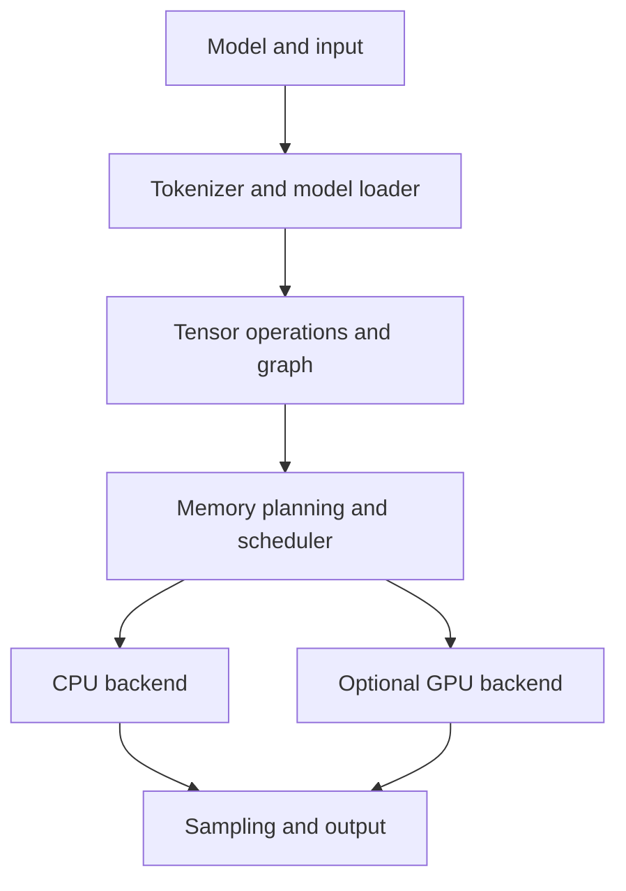

В статье рассматриваются понятия и отдельные элементы реализации ПО инференса на C++. Приведённый код — только небольшой пример арены памяти; здесь нет загрузчика модели, токенизатора, всех слоёв Transformer, сэмплирования или полноценных бэкендов CUDA/Metal. Это не LLM-движок и не сравнение производительности.

## Зачем использовать C++ и какие есть компромиссы

C++ полезен, когда требуется управлять размещением памяти, инструкциями CPU или API устройств, но смена языка сама по себе не ускоряет задачу. Фреймворки вроде PyTorch передают значительную часть вычислений оптимизированному C++ и GPU-ядрам, поэтому вызовы Python не всегда являются узким местом. Развёртывание не всегда сводится к одному бинарному файлу: могут потребоваться GPU-runtime и общие библиотеки.

## Компоненты движка инференса



## Матричные операции и оценка памяти

В Transformer часто используются матричные умножения, однако их доля времени зависит от модели, батча, длины последовательности и оборудования. 7 000 000 000 весов FP32 занимают 28 000 000 000 байт (28 десятичных ГБ, около 26,1 ГиБ) только для весов. Теоретический объём FP16/INT8/INT4 составляет половину, четверть и одну восьмую от FP32; метаданные квантования, KV-кэш и рабочие области требуют памяти, а квантование может влиять на качество.

## Пример арены на C++17

Пример повторно использует выровненную область байтов в C++17. reset только перемещает указатель назад и не вызывает деструкторы размещённых объектов. Управляйте временем жизни объектов отдельно и проверяйте размер выделений.

```cpp
// C++17: illustrative byte arena; this is not an inference engine.
#include <cstddef>
#include <cstdint>
#include <new>
#include <stdexcept>

class MemoryArena {
    static constexpr std::size_t base_alignment = 64;
    std::size_t capacity_;
    std::size_t offset_ = 0;
    std::byte* data_;

public:
    explicit MemoryArena(std::size_t capacity) : capacity_(capacity), data_(nullptr) {
        if (capacity == 0) throw std::invalid_argument("capacity must be positive");
        data_ = static_cast<std::byte*>(
            ::operator new(capacity, std::align_val_t{base_alignment}));
    }

    ~MemoryArena() {
        ::operator delete(data_, std::align_val_t{base_alignment});
    }

    MemoryArena(const MemoryArena&) = delete;
    MemoryArena& operator=(const MemoryArena&) = delete;

    void* allocate(std::size_t bytes, std::size_t alignment = base_alignment) {
        if (alignment == 0 || (alignment & (alignment - 1)) != 0 || alignment > base_alignment)
            throw std::invalid_argument("alignment must be a power of two up to 64");

        const auto address = reinterpret_cast<std::uintptr_t>(data_ + offset_);
        const auto padding = (alignment - address % alignment) % alignment;
        if (padding > capacity_ - offset_ || bytes > capacity_ - offset_ - padding)
            throw std::bad_alloc();

        offset_ += padding;
        void* result = data_ + offset_;
        offset_ += bytes;
        return result;
    }

    void reset() noexcept { offset_ = 0; }
};
```

## CPU- и GPU-бэкенды

CPU SIMD и GPU-пути нужно проектировать и измерять с учётом инструкций, драйверов, runtime, размещения данных и передач. CUDA предоставляет матричные операции через cuBLAS, Apple — API Metal Performance Shaders, но короткий фрагмент кода не является готовым бэкендом. Общая память Apple silicon не отменяет синхронизацию и управление ресурсами.

## Изучение реальных реализаций

Для изучения реальных реализаций смотрите GGML и исходный код с инструкциями сборки llama.cpp. Начните с небольших тензорных операций и тестов; укажите формат модели, поддерживаемые операции, точность, использование памяти и целевое оборудование. Результат должен включать модель, входные данные, настройки сборки, устройство и метод измерения.

- [GGML project](https://github.com/ggml-org/ggml)
- [llama.cpp source](https://github.com/ggml-org/llama.cpp)
- [llama.cpp build guide](https://github.com/ggml-org/llama.cpp/blob/master/docs/build.md)
- [NVIDIA cuBLAS documentation](https://docs.nvidia.com/cuda/cublas/index.html)
- [Apple Metal Performance Shaders: MPSMatrixMultiplication](https://developer.apple.com/documentation/metalperformanceshaders/mpsmatrixmultiplication)
- [C++ working draft: aligned allocation](https://www.open-std.org/jtc1/sc22/wg21/docs/papers/2025/n5014.pdf)
