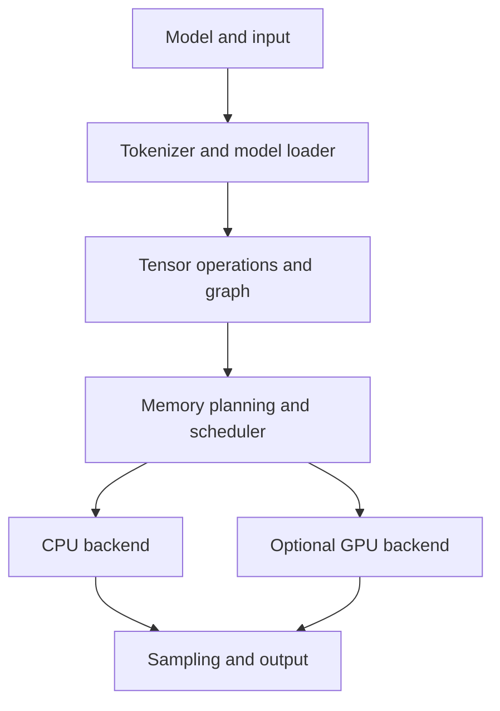

本文介绍使用 C++ 设计推理软件时的一些概念和实现要素。下方代码仅展示一个小型内存 arena；它没有实现模型加载器、分词器、全部 Transformer 层、采样或完整 CUDA/Metal 后端。因此它不是可运行的 LLM 引擎，也不能用于性能比较。

## 为何使用 C++ 及其取舍

当需要控制内存布局、CPU 指令或设备 API 时，C++ 很有用，但仅仅更换语言并不会自动加速任务。PyTorch 等框架会把大量计算交给优化后的 C++ 和 GPU 内核，因此 Python 调用不一定是瓶颈。部署也不总是只需一个独立二进制文件；GPU 运行时和共享库仍可能是依赖项。

## 推理引擎的组成部分



## 矩阵运算与内存估算

Transformer 会执行许多矩阵乘法，但耗时比例取决于模型、批次、序列长度和硬件。7,000,000,000 个 FP32 权重仅权重就占 28,000,000,000 字节（十进制 28 GB，约 26.1 GiB）。FP16/INT8/INT4 的理论原始权重数据量约为 FP32 的一半、四分之一、八分之一；量化元数据、KV 缓存和工作区会增加内存，量化也可能影响质量。

## C++17 arena 示例

此示例在 C++17 中重复使用对齐的字节区域。reset 只回退游标，不会调用区域中对象的析构函数。请单独管理对象生命周期，并确认分配大小不会超出区域。

```cpp
// C++17: illustrative byte arena; this is not an inference engine.
#include <cstddef>
#include <cstdint>
#include <new>
#include <stdexcept>

class MemoryArena {
    static constexpr std::size_t base_alignment = 64;
    std::size_t capacity_;
    std::size_t offset_ = 0;
    std::byte* data_;

public:
    explicit MemoryArena(std::size_t capacity) : capacity_(capacity), data_(nullptr) {
        if (capacity == 0) throw std::invalid_argument("capacity must be positive");
        data_ = static_cast<std::byte*>(
            ::operator new(capacity, std::align_val_t{base_alignment}));
    }

    ~MemoryArena() {
        ::operator delete(data_, std::align_val_t{base_alignment});
    }

    MemoryArena(const MemoryArena&) = delete;
    MemoryArena& operator=(const MemoryArena&) = delete;

    void* allocate(std::size_t bytes, std::size_t alignment = base_alignment) {
        if (alignment == 0 || (alignment & (alignment - 1)) != 0 || alignment > base_alignment)
            throw std::invalid_argument("alignment must be a power of two up to 64");

        const auto address = reinterpret_cast<std::uintptr_t>(data_ + offset_);
        const auto padding = (alignment - address % alignment) % alignment;
        if (padding > capacity_ - offset_ || bytes > capacity_ - offset_ - padding)
            throw std::bad_alloc();

        offset_ += padding;
        void* result = data_ + offset_;
        offset_ += bytes;
        return result;
    }

    void reset() noexcept { offset_ = 0; }
};
```

## CPU 与 GPU 后端

CPU SIMD 和 GPU 路径需要结合指令支持、驱动、运行时、数据布局和传输进行设计与测量。CUDA 可通过 cuBLAS 提供矩阵运算，Apple 可通过 Metal Performance Shaders 提供矩阵 API，但短代码并不等于完整后端。Apple silicon 的统一内存也不意味着无需同步或资源管理。

## 学习真实实现

要学习真实推理实现，可阅读 GGML，以及使用它的 llama.cpp 源码和构建说明。从小型张量运算和测试开始，记录模型格式、支持运算、数值精度、内存用量和目标硬件。性能结果应注明模型、输入、构建设置、设备和测量方法。

- [GGML project](https://github.com/ggml-org/ggml)
- [llama.cpp source](https://github.com/ggml-org/llama.cpp)
- [llama.cpp build guide](https://github.com/ggml-org/llama.cpp/blob/master/docs/build.md)
- [NVIDIA cuBLAS documentation](https://docs.nvidia.com/cuda/cublas/index.html)
- [Apple Metal Performance Shaders: MPSMatrixMultiplication](https://developer.apple.com/documentation/metalperformanceshaders/mpsmatrixmultiplication)
- [C++ working draft: aligned allocation](https://www.open-std.org/jtc1/sc22/wg21/docs/papers/2025/n5014.pdf)
