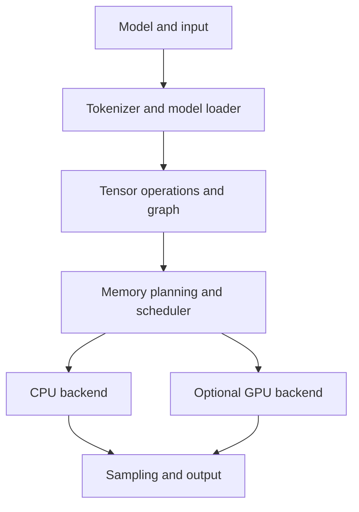

本文介紹以 C++ 設計推論軟體時的概念與部分實作要素。下方程式碼僅示範小型記憶體 arena；沒有實作模型載入器、分詞器、所有 Transformer 層、取樣或完整 CUDA/Metal 後端，因此不是可執行的 LLM 引擎，也不能作為效能比較。

## 為何使用 C++ 及其取捨

需要控制記憶體配置、CPU 指令或裝置 API 時，C++ 很有用，但只更換語言不會自動加速工作負載。PyTorch 等框架會將大量計算交給最佳化的 C++ 和 GPU 核心，因此 Python 呼叫不一定是瓶頸。部署也不一定只要單一獨立二進位檔；GPU 執行階段與共用程式庫仍可能是相依項目。

## 推論引擎的組成部分



## 矩陣運算與記憶體估算

Transformer 會執行許多矩陣乘法，但耗時比例取決於模型、批次、序列長度與硬體。7,000,000,000 個 FP32 權重僅權重就占 28,000,000,000 位元組（十進位 28 GB，約 26.1 GiB）。FP16/INT8/INT4 的理論原始權重資料量約為 FP32 的一半、四分之一、八分之一；量化中繼資料、KV 快取和工作區會增加記憶體，量化也可能影響品質。

## C++17 arena 範例

此範例在 C++17 中重複使用對齊的位元組區域。reset 只會往回移動游標，不會呼叫區域內物件的解構函式。請另外管理物件生命週期，並確認配置大小不會超出區域。

```cpp
// C++17: illustrative byte arena; this is not an inference engine.
#include <cstddef>
#include <cstdint>
#include <new>
#include <stdexcept>

class MemoryArena {
    static constexpr std::size_t base_alignment = 64;
    std::size_t capacity_;
    std::size_t offset_ = 0;
    std::byte* data_;

public:
    explicit MemoryArena(std::size_t capacity) : capacity_(capacity), data_(nullptr) {
        if (capacity == 0) throw std::invalid_argument("capacity must be positive");
        data_ = static_cast<std::byte*>(
            ::operator new(capacity, std::align_val_t{base_alignment}));
    }

    ~MemoryArena() {
        ::operator delete(data_, std::align_val_t{base_alignment});
    }

    MemoryArena(const MemoryArena&) = delete;
    MemoryArena& operator=(const MemoryArena&) = delete;

    void* allocate(std::size_t bytes, std::size_t alignment = base_alignment) {
        if (alignment == 0 || (alignment & (alignment - 1)) != 0 || alignment > base_alignment)
            throw std::invalid_argument("alignment must be a power of two up to 64");

        const auto address = reinterpret_cast<std::uintptr_t>(data_ + offset_);
        const auto padding = (alignment - address % alignment) % alignment;
        if (padding > capacity_ - offset_ || bytes > capacity_ - offset_ - padding)
            throw std::bad_alloc();

        offset_ += padding;
        void* result = data_ + offset_;
        offset_ += bytes;
        return result;
    }

    void reset() noexcept { offset_ = 0; }
};
```

## CPU 與 GPU 後端

CPU SIMD 和 GPU 路徑須配合指令支援、驅動程式、執行階段、資料配置與傳輸進行設計和測量。CUDA 可透過 cuBLAS 提供矩陣運算，Apple 可透過 Metal Performance Shaders 提供矩陣 API，但短程式碼片段不是完整後端。Apple silicon 的統一記憶體也不代表不需要同步或資源管理。

## 學習實際實作

若要學習實際推論實作，可閱讀 GGML，以及使用它的 llama.cpp 原始碼和建置說明。從小型張量運算和測試開始，記錄模型格式、支援運算、數值精度、記憶體用量與目標硬體。效能結果應標示模型、輸入、建置設定、裝置和測量方法。

- [GGML project](https://github.com/ggml-org/ggml)
- [llama.cpp source](https://github.com/ggml-org/llama.cpp)
- [llama.cpp build guide](https://github.com/ggml-org/llama.cpp/blob/master/docs/build.md)
- [NVIDIA cuBLAS documentation](https://docs.nvidia.com/cuda/cublas/index.html)
- [Apple Metal Performance Shaders: MPSMatrixMultiplication](https://developer.apple.com/documentation/metalperformanceshaders/mpsmatrixmultiplication)
- [C++ working draft: aligned allocation](https://www.open-std.org/jtc1/sc22/wg21/docs/papers/2025/n5014.pdf)
