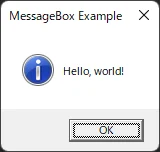

Puede mostrar un MessageBox en [Rust](https://kenji.blog/es/p/webassembly-wasm-current-future/) siguiendo los pasos a continuación.

1. Instalar [Rust](https://kenji.blog/es/p/programming-languages-history-paradigm-evolution/). Consulte [Cómo empezar con Rust](https://kenji.blog/posts/rust%E3%81%AE%E3%81%AF%E3%81%98%E3%82%81%E3%81%8B%E3%81%9F/).
2. Ejecute `cargo new --bin message_box` en el símbolo del sistema.
3. Vaya al directorio `MessageBox`.
4. Abra `Cargo.toml` y modifíquelo de la siguiente manera.

```toml
[package]
name = "message_box"
version = "0.1.0"
edition = "2021"

[dependencies]
windows-sys = { version = "0.61", features = ["Win32_UI_WindowsAndMessaging"] }
```

Este ejemplo está dirigido a Windows. `windows-sys`, mantenido por Microsoft, ofrece declaraciones FFI directas para las API de Windows. `MessageBoxW` recibe cadenas UTF-16 y la llamada FFI debe estar dentro de `unsafe`.


5. Abra `src\main.rs` y modifíquelo de la siguiente manera.
```rust
use windows_sys::Win32::UI::WindowsAndMessaging::{
    MessageBoxW, MB_ICONINFORMATION, MB_OK,
};

fn wide_null(value: &str) -> Vec<u16> {
    value.encode_utf16().chain(std::iter::once(0)).collect()
}

fn main() {
    let text = wide_null("Hello, world!");
    let caption = wide_null("MessageBox Example");

    unsafe {
        MessageBoxW(
            std::ptr::null_mut(),
            text.as_ptr(),
            caption.as_ptr(),
            MB_OK | MB_ICONINFORMATION,
        );
    }
}
```

6. Ejecute `cargo run` en el símbolo del sistema.
   

7. Para compilar una versión de lanzamiento, ejecute `cargo build --release`.


# Referencias
- [windows-sys API documentation](https://docs.rs/windows-sys/latest/windows_sys/Win32/UI/WindowsAndMessaging/)
- [windows-sys crate and feature documentation](https://docs.rs/crate/windows-sys/latest)
- [Microsoft MessageBoxW documentation](https://learn.microsoft.com/en-us/windows/win32/api/winuser/nf-winuser-messageboxw)
- [Microsoft windows-rs repository](https://github.com/microsoft/windows-rs)
