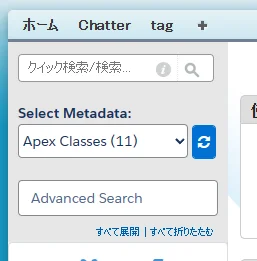

Hier werden zwei Chrome-Erweiterungen für die Salesforce-Entwicklung vorgestellt. Beide sind Drittanbieterprodukte und unabhängig von Salesforce. Die Angaben beruhen auf den am **2026-11-24** geprüften Store-Einträgen; Funktionen und Berechtigungen können sich ändern. Prüfen Sie vor einer Verbindung mit einer Arbeitsorganisation die aktuellen Berechtigungs- und Datenschutzangaben und holen Sie die Freigabe der Salesforce-Administration ein.

## Salesforce DevTools

Der Chrome-Web-Store-Eintrag beschreibt Funktionen zum Erstellen von SOQL und Apex, zum Suchen von Objekten und Feldern sowie zum Exportieren von Definitionen. Angegeben sind Version 3.12.1 und das letzte Update vom 2026-07-23; bei den verarbeiteten Daten nennt der Eintrag Location und Web history. Prüfen Sie vor der Installation die aktuellen Berechtigungen und die Datenschutzerklärung des Entwicklers.

[Salesforce DevTools — Chrome Web Store](https://chromewebstore.google.com/detail/salesforce-devtools/ehgmhinnhggigkogkbhnbodhbfjgncjf)

## Salesforce advanced Code searcher

Der Eintrag beschreibt die Suche nach Apex-Klassen, Triggern, Visualforce-Seiten/-Komponenten und anderem Salesforce-Code über Funktionen der Salesforce REST API. Angegeben sind Version 1.30 und das letzte Update vom 2024-11-06. Laut Datenschutzerklärung des Entwicklers speichert die Erweiterung die Salesforce-Instanz-URL sowie Access- und Refresh-Tokens im lokalen Browserspeicher, um Salesforce-APIs aufzurufen. Prüfen Sie vor der Verbindung den OAuth-Berechtigungsumfang und die Sicherheitsrichtlinien Ihrer Organisation.

[Salesforce advanced Code searcher — Chrome Web Store](https://chromewebstore.google.com/detail/salesforce-advanced-code/lnkgcmpjkkkeffambkllliefdpjdklmi) · [Datenschutzerklärung des Entwicklers](https://sf-advanced-code-searcher.web.app/)
