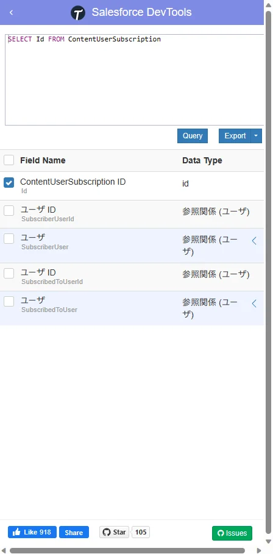

Estas são duas extensões do Chrome para desenvolvimento com Salesforce. Ambas são produtos de terceiros, independentes da Salesforce. As informações abaixo foram verificadas em **2026-11-24**; recursos e permissões podem mudar. Antes de conectar uma organização de trabalho, confira as permissões e divulgações de privacidade atuais e obtenha aprovação do administrador do Salesforce.

## Salesforce DevTools

A página na Chrome Web Store descreve recursos para montar consultas SOQL e Apex, pesquisar objetos e campos e exportar definições. Ela indica a versão 3.12.1, atualizada em 2026-07-23, e declara tratar dados de localização e histórico de navegação. Confira as permissões atuais e a política de privacidade do desenvolvedor antes de instalar.

[Salesforce DevTools — Chrome Web Store](https://chromewebstore.google.com/detail/salesforce-devtools/ehgmhinnhggigkogkbhnbodhbfjgncjf)

## Salesforce advanced Code searcher

A página descreve buscas em classes Apex, triggers, páginas/componentes Visualforce e outros códigos Salesforce por meio de recursos da Salesforce REST API. Indica a versão 1.30, atualizada em 2024-11-06. Segundo a política de privacidade do desenvolvedor, a extensão armazena a URL da instância Salesforce e tokens de acesso/atualização no armazenamento local do navegador para chamar as APIs Salesforce. Confira o escopo OAuth e a política de segurança da organização antes de conectar uma org de trabalho.

[Salesforce advanced Code searcher — Chrome Web Store](https://chromewebstore.google.com/detail/salesforce-advanced-code/lnkgcmpjkkkeffambkllliefdpjdklmi) · [Política de privacidade do desenvolvedor](https://sf-advanced-code-searcher.web.app/)
