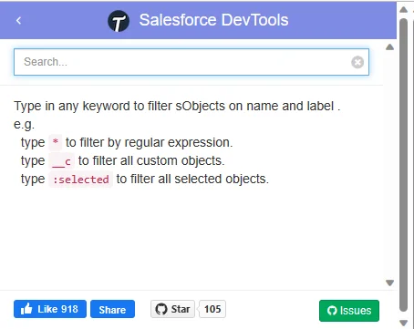

Ниже представлены два расширения Chrome для разработки Salesforce. Это сторонние продукты, не связанные с Salesforce. Информация основана на страницах магазина, проверенных **2026-11-24**; функции и разрешения могут меняться. Перед подключением к рабочей организации проверьте актуальные разрешения и сведения о конфиденциальности и получите одобрение администратора Salesforce.

## Salesforce DevTools

В описании Chrome Web Store указаны создание SOQL и Apex, поиск объектов и полей, экспорт определений и другие функции. Страница показывает версию 3.12.1 и дату последнего обновления 2026-07-23; среди обрабатываемых данных перечислены Location и Web history. Перед установкой проверьте актуальные разрешения и политику конфиденциальности разработчика.

[Salesforce DevTools — Chrome Web Store](https://chromewebstore.google.com/detail/salesforce-devtools/ehgmhinnhggigkogkbhnbodhbfjgncjf)

## Salesforce advanced Code searcher

Описание сообщает о поиске классов Apex, триггеров, страниц/компонентов Visualforce и другого кода Salesforce с помощью Salesforce REST API. Указаны версия 1.30 и последнее обновление 2024-11-06. Согласно политике конфиденциальности разработчика, расширение хранит URL экземпляра Salesforce и токены доступа/обновления в локальном хранилище браузера для вызова Salesforce API. Перед подключением проверьте область OAuth-разрешений и правила безопасности организации.

[Salesforce advanced Code searcher — Chrome Web Store](https://chromewebstore.google.com/detail/salesforce-advanced-code/lnkgcmpjkkkeffambkllliefdpjdklmi) · [Политика конфиденциальности разработчика](https://sf-advanced-code-searcher.web.app/)
