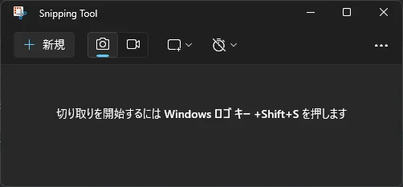

## Sobre o Snipping Tool

O Snipping Tool é o aplicativo de captura de tela incluído no Windows. Nas versões compatíveis do Windows e do app, ele captura imagens e grava vídeos. Os rótulos podem mudar com as atualizações.

## Abrir o app

Pesquise Snipping Tool no menu Iniciar e abra-o. Use `Win + Shift + S` para a captura de imagem ou `Win + Shift + R` para abrir a sobreposição de gravação.

## Capturar uma imagem

Pressione `Win + Shift + S` e escolha um recorte retangular, de forma livre, de janela ou de tela inteira. Selecione a área; a imagem aparecerá no Snipping Tool para edição e salvamento.

## Gravar a tela

Em versões do Windows com suporte à gravação, escolha Gravar > Novo no Snipping Tool ou pressione `Win + Shift + R`. Selecione a área, inicie a gravação e depois pare e salve.

## Notas de versão

A captura mostra a interface em japonês. A tela e o local de salvamento podem variar conforme a versão e as configurações.

## Referências

- [Microsoft Support: Use Snipping Tool to capture screenshots and record video](https://support.microsoft.com/en-us/windows/apps/use-snipping-tool-to-capture-screenshots)
- [Microsoft Support: Windows keyboard shortcuts](https://support.microsoft.com/en-us/accessibility/windows/keyboard-shortcuts-in-windows)
