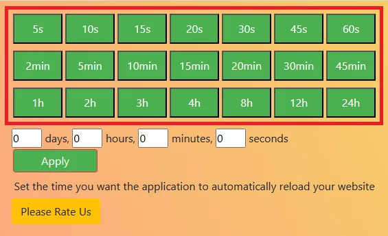

## Antes de instalar

La interfaz y los permisos pueden cambiar. Las capturas son de 2024; comprueba el editor y los permisos solicitados en la ficha y el aviso de confirmación actuales. Limita el acceso a los sitios necesarios o a “Al hacer clic”. Evita la actualización automática en páginas donde las cargas repetidas puedan tener efectos no deseados, como al enviar un formulario.

## Instalación de la actualización automática de pestañas

[Actualización automática de pestañas](https://microsoftedge.microsoft.com/addons/detail/%E3%82%BF%E3%83%96%E3%81%AE%E8%87%AA%E5%8B%95%E6%9B%B4%E6%96%B0/bicjibdndeejemialpbohjpiimehbapb)

En la ficha, haz clic en `Get` (o en el botón equivalente en tu idioma). Revisa los permisos antes de seleccionar `Add extension`.

Haga clic en `Agregar extensión`.

## Cómo usar

Una vez completada la instalación, se agregará un icono en la parte superior derecha de Edge.

Abra la página web que desea actualizar automáticamente y haga clic en el icono para comenzar la actualización automática.

La parte en el recuadro verde es el intervalo de actualización automática. Seleccione el momento para la actualización automática.

Para detener la actualización automática, haga clic en el icono y luego en `Stop reloading this tab`.

## Referencias

- [Tab Auto Refresh in Microsoft Edge Add-ons](https://microsoftedge.microsoft.com/addons/detail/%E3%82%BF%E3%83%96%E3%81%AE%E8%87%AA%E5%8B%95%E6%9B%B4%E6%96%B0/bicjibdndeejemialpbohjpiimehbapb)
- [Microsoft Support: Edge extensions FAQ](https://support.microsoft.com/en-us/edge/microsoft-edge-extensions-frequently-asked-questions)
- [Microsoft Support: Extension site access permissions](https://support.microsoft.com/en-us/edge/change-site-access-permissions-for-extensions-in-microsoft-edge)
