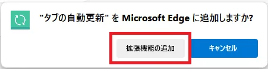
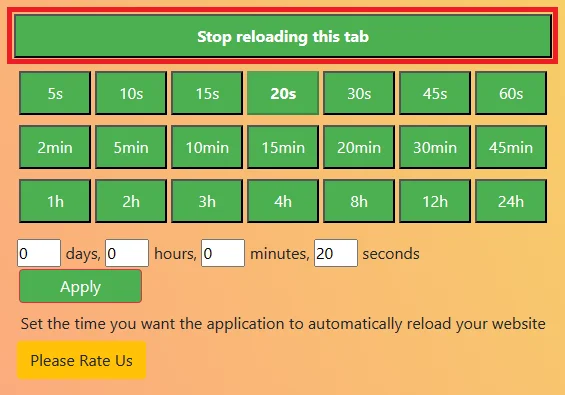

Voici "Tab Auto Refresh", une extension de navigateur Edge qui actualise automatiquement les pages Web.

## Avant l’installation

L’interface et les autorisations peuvent évoluer. Les captures datent de 2024 ; vérifiez l’éditeur et les autorisations demandées sur la fiche et dans la confirmation actuelles. Limitez l’accès aux sites nécessaires ou à « Au clic ». Évitez le rechargement automatique sur les pages où des chargements répétés pourraient avoir des effets indésirables, par exemple lors de l’envoi d’un formulaire.

## Installation de Tab Auto Refresh

[Tab Auto Refresh](https://microsoftedge.microsoft.com/addons/detail/%E3%82%BF%E3%83%96%E3%81%AE%E8%87%AA%E5%8B%95%E6%9B%B4%E6%96%B0/bicjibdndeejemialpbohjpiimehbapb)

Sur la fiche, cliquez sur `Get` (ou le bouton équivalent dans la langue de la boutique). Vérifiez les autorisations avant de sélectionner `Add extension`.

Cliquez sur `Ajouter l'extension`.

## Comment l'utiliser

Une fois l'installation terminée, une icône sera ajoutée dans le coin supérieur droit d'Edge.

Ouvrez la page Web que vous souhaitez rafraîchir automatiquement et cliquez sur l'icône pour lancer le rafraîchissement automatique.

La zone encadrée en vert indique l'intervalle de rafraîchissement automatique. Sélectionnez le moment où vous souhaitez que le rafraîchissement automatique se produise.

Pour arrêter le rafraîchissement automatique, cliquez sur l'icône et cliquez sur `Stop reloading this tab`.

## Références

- [Tab Auto Refresh in Microsoft Edge Add-ons](https://microsoftedge.microsoft.com/addons/detail/%E3%82%BF%E3%83%96%E3%81%AE%E8%87%AA%E5%8B%95%E6%9B%B4%E6%96%B0/bicjibdndeejemialpbohjpiimehbapb)
- [Microsoft Support: Edge extensions FAQ](https://support.microsoft.com/en-us/edge/microsoft-edge-extensions-frequently-asked-questions)
- [Microsoft Support: Extension site access permissions](https://support.microsoft.com/en-us/edge/change-site-access-permissions-for-extensions-in-microsoft-edge)
