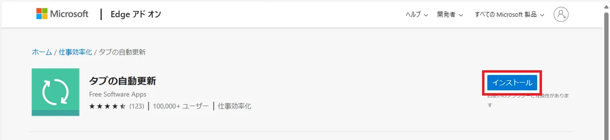

介绍一款用于自动刷新网页的 Edge 浏览器扩展程序“标签页自动刷新”。

## 安装前请注意

界面和权限可能会更新。截图拍摄于2024年，请以当前商店页面和确认提示显示的发布者及权限为准。将网站访问权限限制为必要网站或“单击时”。填写表单等不适合反复加载的页面请勿使用自动刷新。

## 安装标签页自动刷新

[标签页自动刷新](https://microsoftedge.microsoft.com/addons/detail/%E3%82%BF%E3%83%96%E3%81%AE%E8%87%AA%E5%8B%95%E6%9B%B4%E6%96%B0/bicjibdndeejemialpbohjpiimehbapb)

在上述页面点击`获取`（Get）。在确认提示中查看所需权限后，再点击`添加扩展`。

点击`添加扩展`。

## 使用方法

安装完成后，Edge 的右上角会添加一个图标。

打开您想要自动刷新的网页，点击该图标，即可开始自动刷新。

绿框部分是自动刷新的间隔时间。请选择自动刷新的时机。

如果要停止自动刷新，请点击该图标，然后点击`Stop reloading this tab`。

## 参考资料

- [Tab Auto Refresh in Microsoft Edge Add-ons](https://microsoftedge.microsoft.com/addons/detail/%E3%82%BF%E3%83%96%E3%81%AE%E8%87%AA%E5%8B%95%E6%9B%B4%E6%96%B0/bicjibdndeejemialpbohjpiimehbapb)
- [Microsoft Support: Edge extensions FAQ](https://support.microsoft.com/en-us/edge/microsoft-edge-extensions-frequently-asked-questions)
- [Microsoft Support: Extension site access permissions](https://support.microsoft.com/en-us/edge/change-site-access-permissions-for-extensions-in-microsoft-edge)
