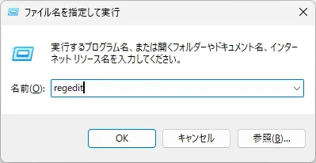

# Open the Classic Context Menu in Windows 11

In Windows 11, right-click an item and select Show more options to open the classic context menu. You can also press `Shift`+`F10` after selecting an item, or hold `Shift` while right-clicking to open Show more options. Try these built-in methods first.

> The registry change below is an unofficial workaround for making the classic menu appear by default. It is not a Microsoft-supported procedure and may not work on some Windows versions. Back up the registry before editing it.

## Registry workaround steps

1. Open the Registry Editor.

Press the `Win key` + `R key`, type `regedit`, and press the `Enter key`.
　

2. Navigate to `HKEY_CURRENT_USER\Software\Classes\CLSID\{86ca1aa0-34aa-4e8b-a509-50c905bae2a2}`. Create this key if it does not exist.

3. Navigate to `HKEY_CURRENT_USER\Software\Classes\CLSID\{86ca1aa0-34aa-4e8b-a509-50c905bae2a2}\InprocServer32`. Create this key if it does not exist.
4. Check that the `(Default)` value in `InprocServer32` is empty.

5. Restart your computer.
6. Confirm that the right-click menu has returned to the classic version.

If you want to undo this change, delete the `{86ca1aa0-34aa-4e8b-a509-50c905bae2a2}` key that you created and restart File Explorer. Back up any existing settings before changing them.

## References

- [Microsoft Support: File Explorer in Windows](https://support.microsoft.com/en-us/windows/experience/fileexplorer/file-explorer-in-windows)
- [Microsoft Support: Keyboard shortcuts in Windows](https://support.microsoft.com/en-us/accessibility/windows/keyboard-shortcuts-in-windows)
