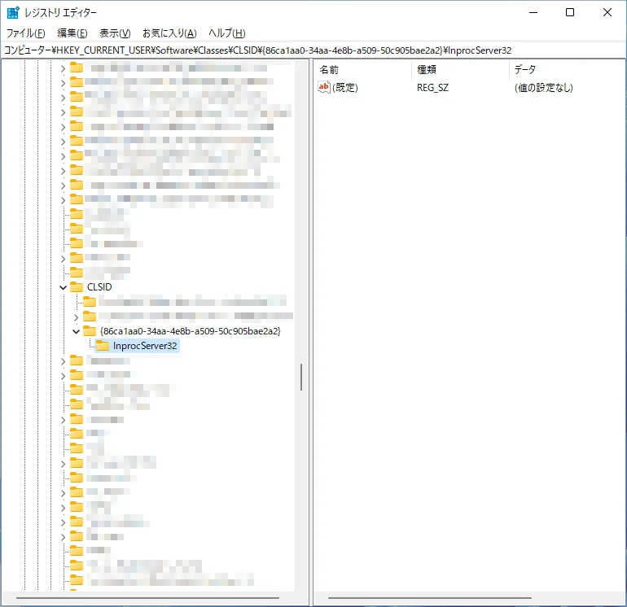

# Ouvrir le menu contextuel classique dans Windows 11

Dans Windows 11, faites un clic droit sur un élément et sélectionnez Afficher plus d’options pour ouvrir le menu contextuel classique. Vous pouvez aussi sélectionner un élément puis appuyer sur `Maj`+`F10`, ou maintenir `Maj` en faisant un clic droit pour ouvrir Afficher plus d’options. Essayez d’abord ces méthodes intégrées.

> La modification du Registre ci-dessous est une solution non officielle pour afficher le menu classique par défaut. Microsoft ne la prend pas en charge comme procédure officielle et elle peut échouer sur certaines versions de Windows. Sauvegardez le Registre avant toute modification.

## Étapes de la solution par le Registre

1. Ouvrez l'Éditeur du Registre.

Appuyez sur `Touche Win` + `R`, tapez `regedit` et appuyez sur `Entrée`.
　

2. Accédez à `HKEY_CURRENT_USER\Software\Classes\CLSID\{86ca1aa0-34aa-4e8b-a509-50c905bae2a2}`. Si cette clé n'existe pas, créez-la.

3. Accédez à `HKEY_CURRENT_USER\Software\Classes\CLSID\{86ca1aa0-34aa-4e8b-a509-50c905bae2a2}\InprocServer32`. Si cette clé n'existe pas, créez-la.
4. Vérifiez que `(Par défaut)` dans `InprocServer32` n'a pas de valeur.

5. Redémarrez l'ordinateur.
6. Confirmez que le menu contextuel est revenu à la version classique.

Pour annuler cette modification, supprimez la clé `{86ca1aa0-34aa-4e8b-a509-50c905bae2a2}` que vous avez créée, puis redémarrez l’Explorateur de fichiers. Sauvegardez les paramètres existants avant de les modifier.

## Références

- [Support Microsoft : Explorateur de fichiers dans Windows](https://support.microsoft.com/en-us/windows/experience/fileexplorer/file-explorer-in-windows)
- [Support Microsoft : Raccourcis clavier dans Windows](https://support.microsoft.com/en-us/accessibility/windows/keyboard-shortcuts-in-windows)
