Windows में रोज़ाना इस्तेमाल होने वाले कुछ छोटे टिप्स का संग्रह। अगर आप Windows का उपयोग करना शुरू कर रहे हैं, तो यह आपके लिए मददगार हो सकता है।
यहाँ Windows 11 को ध्यान में रखा गया है, लेकिन इनमें से कई चीजें Windows 10 में भी काम करेंगी।

कुछ शॉर्टकट और स्क्रीन Windows संस्करण, सेटिंग और कीबोर्ड के अनुसार अलग हो सकते हैं।

## विंडो बंद करना
- जब विंडो सक्रिय हो, तब `Alt + F4` दबाएँ।
- जब विंडो सक्रिय हो, तब `Ctrl + W` दबाएँ। टैब या विंडो बंद करें (केवल समर्थित एप्लिकेशन के लिए)।
- विंडो के टाइटल बार के बाएँ आइकन पर डबल क्लिक करें।
- विंडो के टाइटल बार के `×` पर क्लिक करें।

## डेस्कटॉप दिखाना
- `Win + D`। 2 बार दबाने पर यह पिछली विंडो स्थिति में वापस आ जाएगा। जब आप केवल एक पल के लिए डेस्कटॉप दिखाना चाहते हैं तो यह उपयोगी है।
- `Win + M`। सभी ऐप्स को छोटा (minimize) करें। 2 बार दबाने पर भी यह वापस नहीं आएगा।

## वॉयस इनपुट
- `Win + H`। वॉयस इनपुट शुरू करें। वॉयस इनपुट को समाप्त करने के लिए `Esc` या फिर से `Win + H` दबाएँ।

## फ़ाइल एक्सप्लोरर में पुराना राइट-क्लिक मेनू दिखाना
- `Shift + F10` या एप्लिकेशन कुंजी दबाएँ। एप्लिकेशन कुंजी कीबोर्ड के निचले दाएँ हिस्से में होती है।

## स्क्रीन के हिस्से को कैप्चर करना
- आप `Win + Shift + S` दबाकर एक क्षेत्र का चयन कर सकते हैं और स्क्रीन को कैप्चर कर सकते हैं।
- `Win + Print Screen` पूरी स्क्रीन कैप्चर करके Pictures\Screenshots फ़ोल्डर में सहेजता है।
- डिफ़ॉल्ट रूप से `Print Screen` स्क्रीन स्निपिंग खोलता है। यह सेटिंग बंद करने पर पूरी स्क्रीन क्लिपबोर्ड में कॉपी होती है।
- `Alt + Print Screen` सक्रिय विंडो को क्लिपबोर्ड में कॉपी करता है।

## टास्कबार पर पिन किए गए ऐप्स लॉन्च करना
- `Win + संख्या कुंजी` टास्कबार में उस स्थान पर पिन किए गए ऐप को खोलती है; ऐप पहले से चल रहा हो तो उस पर स्विच करती है।
  उदाहरण के लिए, `Win + 1` सबसे बाएँ पिन किए गए ऐप को खोलता है या चल रहे ऐप पर स्विच करता है।
- आप `Win + T` के साथ टास्कबार आइकन पर फ़ोकस ले जा सकते हैं, और फिर आप `Win + T` को कई बार दबा सकते हैं, या
  आप चयन को स्थानांतरित करने के लिए `←` या `→` का उपयोग कर सकते हैं, और चयनित ऐप को लॉन्च करने के लिए `Enter` दबा सकते हैं।

## ज़ूम इन / ज़ूम आउट
- `Win + +` दबाने पर Windows मैग्निफायर चालू हो जाता है। फिर आप `Win + + या -` से स्क्रीन को ज़ूम इन/आउट कर सकते हैं।
- नोटपैड या ब्राउज़र जैसे ऐप में आप `Ctrl + + या -` से ज़ूम इन/आउट कर सकते हैं (केवल समर्थित ऐप्स में)।

## Windows को लॉक करना
- `Win + L`
- `Ctrl + Alt + Del` → `Space` या `Enter`

## Windows को शटडाउन करना
- जब आप `Win + M` या `Win + D` के साथ डेस्कटॉप पर हों, या `Win + T` या `Win + B` के साथ टास्कबार सक्रिय हो, तो `Alt + F4` दबाने पर नीचे दिखाया गया डायलॉग दिखाई देगा। सुनिश्चित करें कि "शट डाउन" चुना गया है और `Enter` दबाएँ।
  `Win + R` → `Alt + F4` → `Alt + F4` भी काम करता है।
  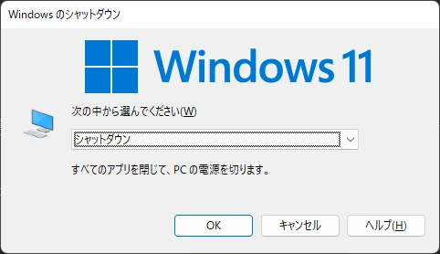
- आप `Win + X` → `U` → `U` दबाकर शटडाउन कर सकते हैं।
- आप कमांड प्रॉम्प्ट या `Win + R` से "Run" में `shutdown /s /t 0` लिखकर शटडाउन कर सकते हैं। `/f` जोड़ने से फोर्स शटडाउन हो जाएगा।. जबरन बंद करने से बिना सहेजा काम खो सकता है; इसे केवल आवश्यकता होने पर उपयोग करें।

## Windows को रीस्टार्ट करना
- जब आप `Win + M` या `Win + D` के साथ डेस्कटॉप पर हों, या `Win + T` या `Win + B` के साथ टास्कबार सक्रिय हो, तो `Alt + F4` दबाने पर नीचे दिखाया गया डायलॉग दिखाई देगा। एक बार `↓` दबाएँ, "रीस्टार्ट" चुनें और `Enter` दबाएँ।
  `Win + R` → `Alt + F4` → `Alt + F4` भी काम करता है।
  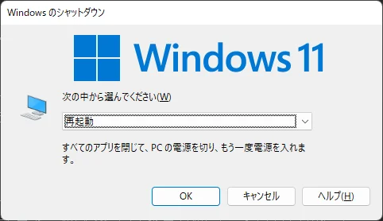
- आप `Win + X` → `U` → `R` दबाकर रीस्टार्ट कर सकते हैं।
- `shutdown /r /t 0` से आप रीस्टार्ट कर सकते हैं। `/f` जोड़ने से फोर्स रीस्टार्ट हो जाएगा।. जबरन बंद करने से बिना सहेजा काम खो सकता है; इसे केवल आवश्यकता होने पर उपयोग करें।

## Windows को स्लीप मोड में डालना
- जब आप `Win + M` या `Win + D` के साथ डेस्कटॉप पर हों, या `Win + T` या `Win + B` के साथ टास्कबार सक्रिय हो, तो `Alt + F4` दबाने पर नीचे दिखाया गया डायलॉग दिखाई देगा। एक बार `↑` दबाएँ, "स्लीप" चुनें और `Enter` दबाएँ।
  `Win + R` → `Alt + F4` → `Alt + F4` भी काम करता है।
  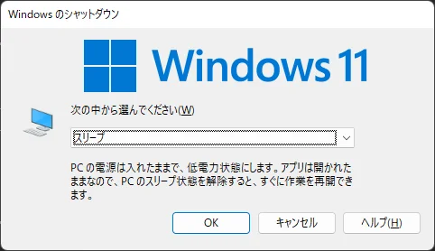
- Hibernate करने के लिए Command Prompt या Run में `shutdown /h` चलाएँ (यदि hibernation चालू है)।

## Windows से साइन आउट (लॉगऑफ़) करना
- जब आप `Win + M` या `Win + D` के साथ डेस्कटॉप पर हों, या `Win + T` या `Win + B` के साथ टास्कबार सक्रिय हो, तो `Alt + F4` दबाने पर नीचे दिखाया गया डायलॉग दिखाई देगा। दो बार `↑` दबाएँ, "साइन आउट" चुनें और `Enter` दबाएँ।
  `Win + R` → `Alt + F4` → `Alt + F4` भी काम करता है।
  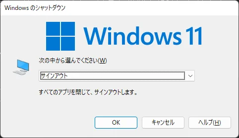
- `Win + X` → `U` → `I`
- `Ctrl + Alt + Del` → दो बार `Tab` या दो बार `↓` → `Enter` या `Space`
- आप `logoff` लिखकर साइन आउट (लॉगऑफ़) कर सकते हैं।

## कीबोर्ड से विंडो ले जाएँ
- `Win + ←`: बाईं ओर ले जाएँ
- `Win + →`: दाईं ओर ले जाएँ
- `Win + ↑`: ऊपर ले जाएँ / अधिकतम करें (maximize)
- `Win + ↓`: नीचे ले जाएँ / छोटा करें (minimize)
- `Win + Shift + ← या →`: मल्टी-मॉनिटर के बीच ले जाएँ
- `Win + Alt + ↑ या ↓`: समर्थित Windows 11 सेटअप में सक्रिय विंडो को स्क्रीन के ऊपरी या निचले आधे हिस्से में स्नैप करता है।
- विंडो मेनू खोलने के लिए `Alt + Space` दबाएँ, Move चुनें और तीर कुंजियों से विंडो ले जाएँ। Enter दबाएँ या क्लिक करके उसे रखें।
※ चूँकि विंडो माउस कर्सर का अनुसरण करेगी, इसलिए यदि विंडो स्क्रीन से बाहर चली गई है तो भी आप उसे वापस ला सकते हैं।

## टास्क मैनेजर में प्रक्रिया को समाप्त करना
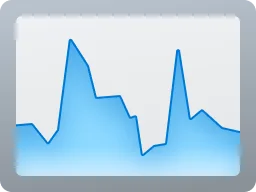
1. आप `Ctrl + Shift + Esc` दबाकर टास्क मैनेजर खोल सकते हैं।
2. आप `Ctrl + Tab` से टैब के बीच स्विच कर सकते हैं।
3. `Details` टैब पर जाने के बाद `Tab` दबाएँ, फिर कीबोर्ड से टाइप करके प्रक्रिया को नाम से खोज सकते हैं।
4. प्रक्रिया का नाम चुने जाने पर, `Delete` कुंजी दबाएँ और फिर प्रक्रिया को समाप्त करने के लिए `Enter` दबाएँ।

## कमांड से प्रक्रिया नाम निर्दिष्ट करके समाप्त करना
- आप `taskkill /f /im प्रक्रिया_का_नाम` टाइप करके किसी प्रक्रिया को समाप्त कर सकते हैं।. जबरन बंद करने से बिना सहेजा काम खो सकता है; इसे केवल आवश्यकता होने पर उपयोग करें।
उदाहरण के लिए, आप `taskkill /f /im explorer.exe` से फ़ाइल एक्सप्लोरर को समाप्त कर सकते हैं।. जबरन बंद करने से बिना सहेजा काम खो सकता है; इसे केवल आवश्यकता होने पर उपयोग करें।

## टास्कबार आइकन से एक ही प्रोग्राम की कई विंडो खोलना
- आप टास्कबार पर `Shift` कुंजी दबाए रखते हुए लेफ्ट क्लिक करके एक ही प्रोग्राम की कई विंडो खोल सकते हैं। (केवल उन ऐप्स के लिए जो मल्टीपल इंस्टेंस का समर्थन करते हैं)

## प्रोग्राम को एडमिनिस्ट्रेटर (Administrator) के रूप में चलाना
- टास्कबार में ऐप आइकन चुनते समय `Ctrl + Shift` दबाए रखें, ताकि ऐप administrator के रूप में खुले।

## फ़ाइल एक्सप्लोरर खोलना
- आप `Win + E` से फ़ाइल एक्सप्लोरर खोल सकते हैं।
- `Win + R` दबाकर "Run" खोलें, `explorer` टाइप करें और `Enter` दबाएँ।
- आप `Ctrl + Shift + N` से एक नया फोल्डर बना सकते हैं।

## फ़ाइल एक्सप्लोरर में वर्तमान स्थान पर कमांड प्रॉम्प्ट खोलना
- Windows 11 में, आप राइट-क्लिक मेनू में "Terminal" से कमांड प्रॉम्प्ट खोल सकते हैं।
- इसके अलावा, आप एड्रेस बार में `cmd` टाइप करके और `Enter` दबाकर कमांड प्रॉम्प्ट खोल सकते हैं।

## क्लिपबोर्ड इतिहास दिखाना
- आप `Win + V` से क्लिपबोर्ड इतिहास देख सकते हैं।
आप पहले कॉपी किए गए टेक्स्ट या छवि का चयन करके उसे फिर से कॉपी कर सकते हैं।

## रन (Run) खोलना
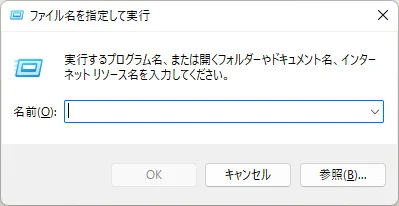
- आप `Win + R` से "Run" डायलॉग खोल सकते हैं।

नीचे कुछ कमांड दिए गए हैं जिन्हें आप "Run" या कमांड प्रॉम्प्ट से चला सकते हैं।

## Edge खोलना

- `msedge` टाइप करें और `Enter` दबाएँ।

## Edge के Internet Explorer mode में पुराने साइट खोलना

Internet Explorer 11 का समर्थन 15 जून 2022 को समाप्त हो गया। Windows 11 में अलग IE ब्राउज़र शुरू करना समर्थित नहीं है। जिन साइटों को संगतता चाहिए, उनके लिए Microsoft Edge का Internet Explorer mode उपयोग करें। सेटअप निर्देशों के लिए संदर्भ देखें।

## टर्मिनल (Terminal) खोलना

- `wt` टाइप करें और `Enter` दबाएँ।

## कंट्रोल पैनल खोलना

- `control` टाइप करें और `Enter` दबाएँ।
- आप `explorer.exe shell:::{26EE0668-A00A-44D7-9371-BEB064C98683}` का उपयोग करके भी इसे खोल सकते हैं।

## नोटपैड खोलना

- `notepad` टाइप करें और `Enter` दबाएँ।

## कैलकुलेटर खोलना

- `calc` टाइप करें और `Enter` दबाएँ।

## पेंट (Paint) खोलना

- `mspaint` टाइप करें और `Enter` दबाएँ।

## PowerShell खोलना
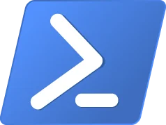
- `powershell` टाइप करें और `Enter` दबाएँ।

## Visual Studio Code खोलना

- `code` टाइप करें और `Enter` दबाएँ।

## Excel खोलना

- `excel` टाइप करें और `Enter` दबाएँ।
※ केवल तभी जब Excel स्थापित हो।

## Word खोलना

- `winword` टाइप करें और `Enter` दबाएँ।
※ केवल तभी जब Word स्थापित हो।

## PowerPoint खोलना

- `powerpnt` टाइप करें और `Enter` दबाएँ।
  ※ केवल तभी जब PowerPoint स्थापित हो।

## सिस्टम कॉन्फ़िगरेशन (System Configuration) खोलना
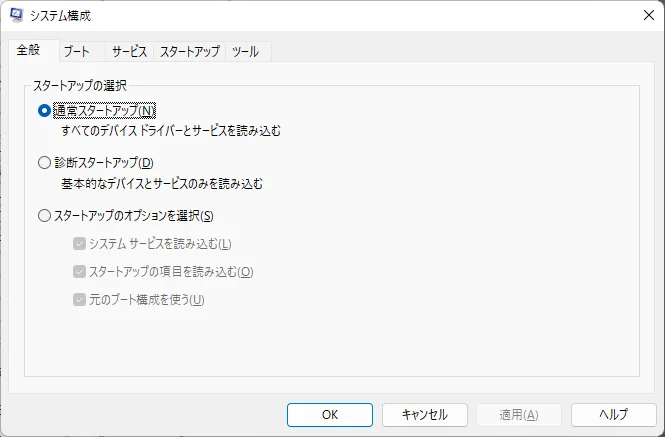
- `msconfig` टाइप करें और `Enter` दबाएँ।

## सिस्टम प्रॉपर्टीज़ (System Properties) खोलना
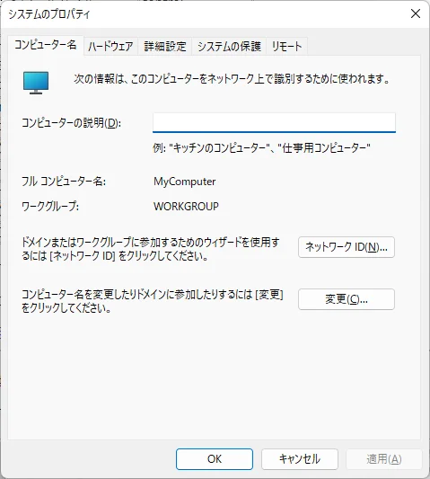
- `sysdm.cpl` टाइप करें और `Enter` दबाएँ।

## Windows का वर्ज़न जानकारी खोलना
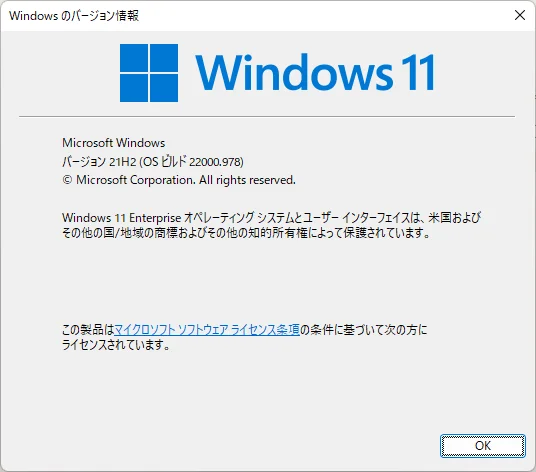
- `winver` टाइप करें और `Enter` दबाएँ।

## ऑन-स्क्रीन कीबोर्ड (On-Screen Keyboard) खोलना
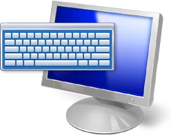
- `osk` टाइप करें और `Enter` दबाएँ।

## WordPad का उपयोग (केवल पुराने Windows संस्करण)

Windows 11 संस्करण 24H2 और बाद के संस्करणों में WordPad शामिल नहीं है। पुराने Windows में इसे खोलने के लिए `wordpad` या `write` चलाएँ। साधारण टेक्स्ट के लिए Notepad और RTF के लिए Microsoft Word या संगत editor का उपयोग करें।

## रजिस्ट्री एडिटर (Registry Editor) खोलना

- `regedit` टाइप करें और `Enter` दबाएँ।

## प्रोग्राम और फीचर्स (Programs and Features) खोलना
- `explorer.exe shell:::{7b81be6a-ce2b-4676-a29e-eb907a5126c5}` टाइप करें और `Enter` दबाएँ।

## कीबोर्ड प्रॉपर्टीज़ (Keyboard Properties) खोलना
- `explorer.exe shell:::{725BE8F7-668E-4C7B-8F90-46BDB0936430}` टाइप करें और `Enter` दबाएँ।

## माउस प्रॉपर्टीज़ (Mouse Properties) खोलना
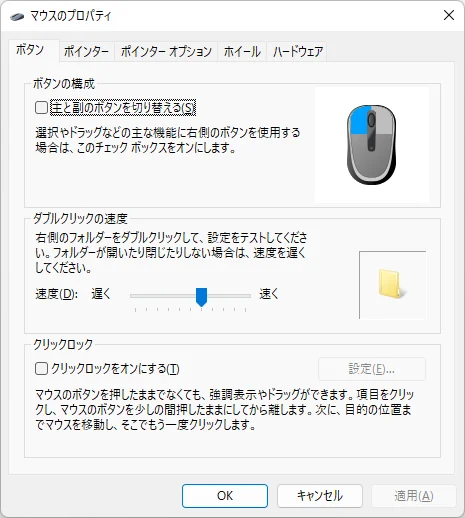
- `explorer.exe shell:::{6C8EEC18-8D75-41B2-A177-8831D59D2D50}` टाइप करें और `Enter` दबाएँ।

## साउंड (Sound) सेटिंग्स खोलना
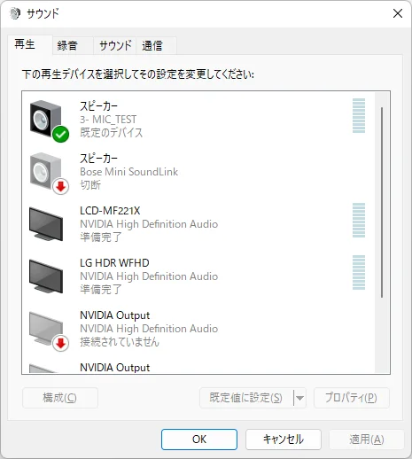
- `explorer.exe shell:::{F2DDFC82-8F12-4CDD-B7DC-D4FE1425AA4D}` टाइप करें और `Enter` दबाएँ।

## यूजर अकाउंट्स (User Accounts) खोलना
- `explorer.exe shell:::{60632754-c523-4b62-b45c-4172da012619}` टाइप करें और `Enter` दबाएँ।

## मानक संदेश बॉक्स की स्ट्रिंग कॉपी करना
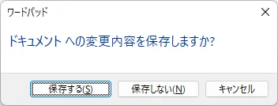

यह स्क्रीनशॉट Windows 11 संस्करण 24H2 से पहले के WordPad का है।
- आप `Ctrl + C` के साथ एक मानक संदेश बॉक्स के टेक्स्ट को कॉपी कर सकते हैं।
उपरोक्त संदेश बॉक्स को कॉपी करने पर क्लिपबोर्ड पर निम्न टेक्स्ट कॉपी हो जाएगा:
```
[Window Title]
वर्डपैड

[Main Instruction]
क्या आप दस्तावेज़ में किए गए परिवर्तनों को सहेजना चाहते हैं?

[सहेजें(S)] [सहेजें नहीं(N)] [रद्द करें]
```

## कमांड प्रॉम्प्ट के आउटपुट को क्लिपबोर्ड में कॉपी करना
कमांड के अंत में ` | clip` (पाइप+clip) जोड़ने से, जैसे कि `echo "hello" | clip`, आप मानक आउटपुट को क्लिपबोर्ड में कॉपी कर सकते हैं।

## फोल्डर पदानुक्रम (Folder Hierarchy) को टेक्स्ट के रूप में आउटपुट करना
आप कमांड प्रॉम्प्ट में `tree` कमांड का उपयोग करके फोल्डर पदानुक्रम को ट्री फॉर्मेट में आउटपुट कर सकते हैं।

आउटपुट का उदाहरण:
```
C:.
├─.idea
│  └─libraries
├─binaryeditorbz
├─blog
│  ├─archetypes
│  ├─content
│  ├─data
│  ├─layouts
│  ├─static
│  └─themes
│      └─PaperMod
│          ├─.git
│          │  ├─branches
│          │  ├─hooks
│          │  ├─info
│          │  ├─logs
│          │  │  └─refs
│          │  │      ├─heads
│          │  │      └─remotes
│          │  │          └─origin
│          │  ├─objects
│          │  │  ├─info
│          │  │  └─pack
│          │  └─refs
│          │      ├─heads
│          │      ├─remotes
│          │      │  └─origin
│          │      └─tags
│          ├─.github
│          │  ├─ISSUE_TEMPLATE
│          │  └─workflows
│          ├─assets
│          │  ├─css
│          │  │  ├─common
│          │  │  ├─core
│          │  │  ├─extended
│          │  │  ├─hljs
│          │  │  └─includes
│          │  └─js
│          ├─i18n
│          ├─images
│          └─layouts
│              ├─partials
│              │  └─templates
│              ├─shortcodes
│              └─_default
│                  └─_markup
(यहाँ से आगे हटाया गया)
```

## संदर्भ

- [Windows keyboard shortcuts](https://support.microsoft.com/en-us/accessibility/windows/keyboard-shortcuts-in-windows)
- [Use Snipping Tool to capture screenshots](https://support.microsoft.com/en-us/windows/apps/use-snipping-tool-to-capture-screenshots.)
- [Internet Explorer mode in Microsoft Edge](https://support.microsoft.com/en-us/edge/internet-explorer-mode-in-microsoft-edge)
- [Resources for deprecated features in the Windows client](https://learn.microsoft.com/en-us/windows/whats-new/deprecated-features-resources)
- [Hibernate a Windows device](https://learn.microsoft.com/en-us/windows/configuration/unified-write-filter/hibernate-once-resume-many-horm)
