Esta é uma coleção de pequenas dicas e atalhos úteis para o uso diário do Windows. Espero que seja útil para iniciantes.
Embora seja focado no Windows 11, a maioria também deve funcionar no Windows 10.

Alguns atalhos e telas variam conforme a versão do Windows, as configurações e o teclado.

## Fechar janela
- `Alt + F4` com a janela ativa
- `Ctrl + W` com a janela ativa. Fecha a aba ou janela (apenas em aplicativos suportados)
- Dê um duplo clique no ícone à esquerda da barra de título da janela
- Clique no `×` na barra de título da janela

## Mostrar a área de trabalho
- `Win + D`. Pressione duas vezes para restaurar o estado original da janela. Muito útil quando você quer mostrar a área de trabalho por um instante.
- `Win + M`. Minimiza todos os aplicativos. Pressionar duas vezes não restaura.

## Digitação por voz
- `Win + H`. Inicia a digitação por voz. Para sair, pressione `Esc` ou `Win + H` novamente.

## Mostrar o menu de contexto clássico no Explorer
- Pressione `Shift + F10` ou a tecla de aplicativo. A tecla de aplicativo é a que fica no canto inferior direito do teclado.

## Capturar uma área da tela
- Você pode capturar uma área selecionada com `Win + Shift + S`.
- `Win + Print Screen` captura a tela inteira e salva a imagem em Pictures\Screenshots.
- Por padrão, `Print Screen` abre a captura de tela. Se você desativar essa configuração, a tela inteira será copiada para a área de transferência.
- `Alt + Print Screen` copia a janela ativa para a área de transferência.

## Iniciar aplicativos fixados na barra de tarefas
- `Win + uma tecla numérica` abre o aplicativo fixado nessa posição da barra de tarefas ou alterna para ele se já estiver em execução.
  Por exemplo, `Win + 1` abre o aplicativo fixado mais à esquerda ou alterna para ele se já estiver em execução.
- `Win + T` move o foco para os ícones da barra de tarefas. Pressionar `Win + T` várias vezes, ou usar `←` ou `→`, moverá a seleção, e pressionar `Enter` iniciará o aplicativo selecionado.

## Ampliar/Reduzir
- `Win + +` inicia a Lupa do Windows. Você pode ampliar/reduzir a tela usando `Win + + ou -`.
- Você pode ampliar/reduzir no Bloco de Notas ou navegadores com `Ctrl + + ou -` (apenas em aplicativos suportados).

## Bloquear o Windows
- `Win + L`
- `Ctrl + Alt + Del` → `Espaço` ou `Enter`

## Desligar o Windows
- Com a área de trabalho visível (usando `Win + M` ou `Win + D`) ou a barra de tarefas ativa (`Win + T` ou `Win + B`), pressione `Alt + F4`. Uma caixa de diálogo como a mostrada abaixo aparecerá; certifique-se de que "Desligar" esteja selecionado e pressione `Enter`.
  Também pode ser feito com `Win + R` → `Alt + F4` → `Alt + F4`.
  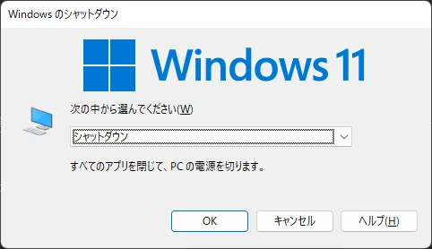
- Você pode desligar usando `Win + X` → `U` → `U`.
- No Prompt de Comando ou em "Executar" (`Win + R`), digite `shutdown /s /t 0` para desligar. Adicionar `/f` forçará o desligamento. O encerramento forçado pode descartar trabalhos não salvos; use-o somente quando necessário.

## Reiniciar o Windows
- Com a área de trabalho visível (usando `Win + M` ou `Win + D`) ou a barra de tarefas ativa (`Win + T` ou `Win + B`), pressione `Alt + F4`. Uma caixa de diálogo aparecerá; pressione `↓` uma vez para selecionar "Reiniciar" e pressione `Enter`.
　Também pode ser feito com `Win + R` → `Alt + F4` → `Alt + F4`.
  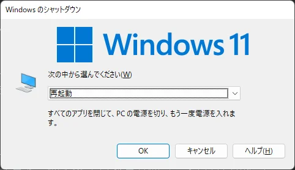
- Você pode reiniciar usando `Win + X` → `U` → `R`.
- Você pode reiniciar com `shutdown /r /t 0`. Adicionar `/f` forçará a reinicialização. O encerramento forçado pode descartar trabalhos não salvos; use-o somente quando necessário.

## Suspender (Dormir) o Windows
- Com a área de trabalho visível (usando `Win + M` ou `Win + D`) ou a barra de tarefas ativa (`Win + T` ou `Win + B`), pressione `Alt + F4`. Uma caixa de diálogo aparecerá; pressione `↑` uma vez para selecionar "Suspender" e pressione `Enter`.
  Também pode ser feito com `Win + R` → `Alt + F4` → `Alt + F4`.
  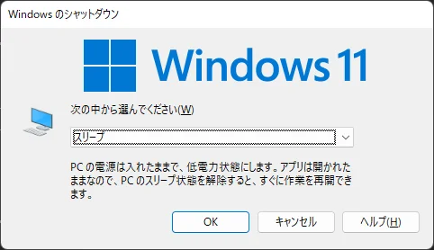
- Para hibernar, execute `shutdown /h` no Prompt de Comando ou em Executar (se a hibernação estiver habilitada).

## Sair do Windows (Logoff)
- Com a área de trabalho visível (usando `Win + M` ou `Win + D`) ou a barra de tarefas ativa (`Win + T` ou `Win + B`), pressione `Alt + F4`. Uma caixa de diálogo aparecerá; pressione `↑` duas vezes para selecionar "Sair" e pressione `Enter`.
  Também pode ser feito com `Win + R` → `Alt + F4` → `Alt + F4`.
  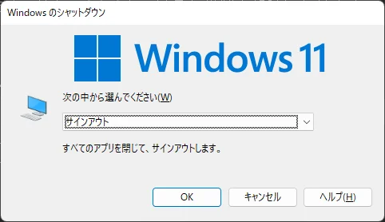
- `Win + X` → `U` → `I`
- `Ctrl + Alt + Del` → 2 vezes `Tab` ou 2 vezes `↓` → `Enter` ou `Espaço`
- Você pode sair (fazer logoff) digitando `logoff`.

## Mover janelas com o teclado
- `Win + ←`: Mover para a esquerda
- `Win + →`: Mover para a direita
- `Win + ↑`: Mover para cima/Maximizar
- `Win + ↓`: Mover para baixo/Minimizar
- `Win + Shift + ← ou →`: Mover entre múltiplos monitores
- `Win + Alt + ↑ ou ↓`: no Windows 11 e em configurações compatíveis, ajusta a janela ativa à metade superior ou inferior da tela.
- Pressione `Alt + Space`, escolha Move no menu da janela e use as setas para movê-la. Pressione Enter ou clique para posicioná-la.
※ Como a janela segue o cursor do mouse, você pode resgatá-la mesmo se ela estiver fora da tela visível.

## Encerrar processos com o Gerenciador de Tarefas
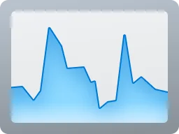
1. Você pode abrir o Gerenciador de Tarefas com `Ctrl + Shift + Esc`.
2. Alterne entre as abas usando `Ctrl + Tab`.
3. Na aba `Detalhes`, após pressionar `Tab`, você pode buscar o processo digitando letras iniciais no teclado.
4. Com o nome do processo selecionado, pressione a tecla `Delete` seguida de `Enter` para encerrá-lo.

## Encerrar processos por nome via comando
- Você pode encerrar um processo usando `taskkill /f /im NomeDoProcesso`. O encerramento forçado pode descartar trabalhos não salvos; use-o somente quando necessário.
Por exemplo, `taskkill /f /im explorer.exe` encerrará o Explorer. O encerramento forçado pode descartar trabalhos não salvos; use-o somente quando necessário.

## Iniciar várias instâncias do mesmo programa a partir da barra de tarefas
- Segure `Shift` e clique com o botão esquerdo do mouse em um ícone na barra de tarefas para abrir outra instância do mesmo programa (apenas para aplicativos que suportam múltiplas instâncias).

## Executar programas como Administrador
- Mantenha `Ctrl + Shift` pressionado ao selecionar o ícone de um aplicativo na barra de tarefas para abri-lo como administrador.

## Abrir o Explorador de Arquivos (Explorer)
- Pressione `Win + E` para abrir o Explorador de Arquivos.
- Pressione `Win + R` para abrir "Executar", digite `explorer` e pressione `Enter`.
- Pressione `Ctrl + Shift + N` para criar uma nova pasta.

## Abrir o Prompt de Comando no local atual no Explorer
- No Windows 11, você pode abrir o Prompt de Comando selecionando "Abrir no Terminal" no menu do botão direito.
- Alternativamente, digite `cmd` na barra de endereços do Explorer e pressione `Enter` para abrir o Prompt de Comando.

## Mostrar histórico da área de clipboard (área de transferência)
- `Win + V` mostra o histórico da área de transferência.
Você pode selecionar textos ou imagens copiados anteriormente para copiá-los novamente.

## Executar (Arquivo)
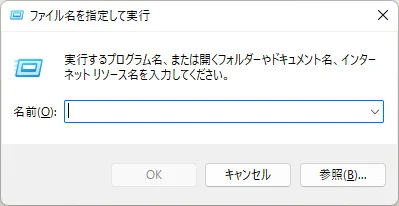
- `Win + R` abre a caixa de diálogo "Executar".

Abaixo estão alguns comandos que podem ser usados em "Executar" ou no Prompt de Comando.

## Abrir o Edge

- Digite `msedge` e pressione `Enter`

## Abrir sites antigos no modo Internet Explorer do Edge

O suporte ao Internet Explorer 11 terminou em 15 de junho de 2022. O Windows 11 não oferece suporte à inicialização do IE independente. Para sites que exigem compatibilidade, use o modo Internet Explorer no Microsoft Edge. Consulte as referências para configurá-lo.

## Abrir o Terminal

- Digite `wt` e pressione `Enter`

## Abrir o Painel de Controle

- Digite `control` e pressione `Enter`
- Também pode ser aberto com `explorer.exe shell:::{26EE0668-A00A-44D7-9371-BEB064C98683}`.

## Iniciar o Bloco de Notas

- Digite `notepad` e pressione `Enter`

## Iniciar a Calculadora

- Digite `calc` e pressione `Enter`

## Iniciar o Paint

- Digite `mspaint` e pressione `Enter`

## Iniciar o PowerShell
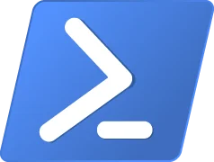
- Digite `powershell` e pressione `Enter`

## Iniciar o Visual Studio Code

- Digite `code` e pressione `Enter`

## Iniciar o Excel

- Digite `excel` e pressione `Enter`
※ Apenas se o Excel estiver instalado.

## Abrir o Word

- Digite `winword` e pressione `Enter`
※ Apenas se o Word estiver instalado.

## Abrir o PowerPoint

- Digite `powerpnt` e pressione `Enter`
  ※ Apenas se o PowerPoint estiver instalado.

## Abrir a Configuração do Sistema
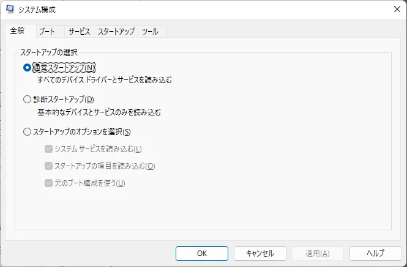
- Digite `msconfig` e pressione `Enter`

## Abrir as Propriedades do Sistema
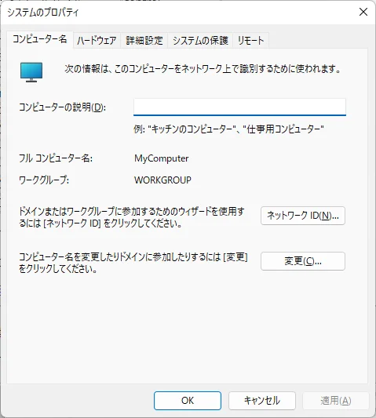
- Digite `sysdm.cpl` e pressione `Enter`

## Abrir informações sobre o Windows
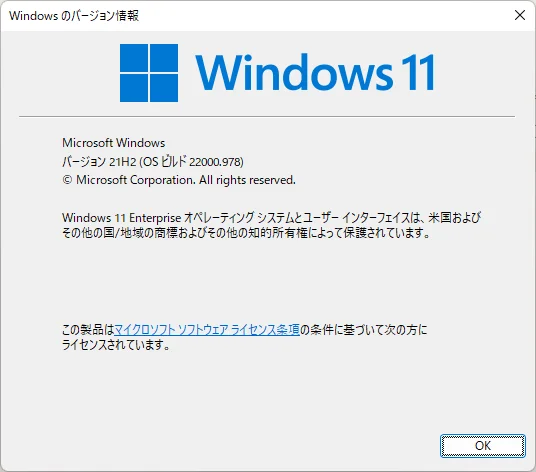
- Digite `winver` e pressione `Enter`

## Abrir o Teclado Virtual
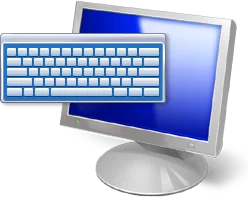
- Digite `osk` e pressione `Enter`

## Usar o WordPad (somente em versões antigas do Windows)

O WordPad não está incluído no Windows 11 versão 24H2 nem nas versões posteriores. Em versões antigas, execute `wordpad` ou `write`. Use o Bloco de Notas para texto simples e o Microsoft Word ou outro editor compatível para RTF.

## Abrir o Editor do Registro

- Digite `regedit` e pressione `Enter`

## Abrir Programas e Recursos
- Digite `explorer.exe shell:::{7b81be6a-ce2b-4676-a29e-eb907a5126c5}` e pressione `Enter`

## Abrir Propriedades do Teclado
- Digite `explorer.exe shell:::{725BE8F7-668E-4C7B-8F90-46BDB0936430}` e pressione `Enter`

## Abrir Propriedades do Mouse
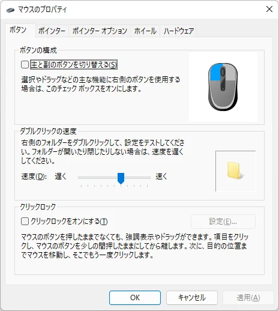
- Digite `explorer.exe shell:::{6C8EEC18-8D75-41B2-A177-8831D59D2D50}` e pressione `Enter`

## Abrir Configurações de Som
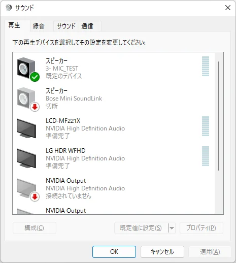
- Digite `explorer.exe shell:::{F2DDFC82-8F12-4CDD-B7DC-D4FE1425AA4D}` e pressione `Enter`

## Abrir Contas de Usuário
- Digite `explorer.exe shell:::{60632754-c523-4b62-b45c-4172da012619}` e pressione `Enter`

## Copiar o texto de caixas de mensagem padrão
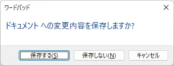

Esta captura mostra o WordPad de uma versão anterior ao Windows 11 versão 24H2.
- Você pode copiar o texto de uma caixa de mensagem padrão com `Ctrl + C`.
Se você copiar a caixa de mensagem acima, o seguinte será copiado para a área de transferência:
```
[Window Title]
WordPad

[Main Instruction]
Deseja salvar as alterações em Documento?

[Salvar (S)] [Não Salvar (N)] [Cancelar]
```

## Armazenar a saída do Prompt de Comando na área de transferência
Adicionar ` | clip` (pipe+clip) ao final de um comando, como `echo "hello" | clip`, copia a saída padrão para a área de transferência.

## Saída de texto da hierarquia de pastas
No Prompt de Comando, você pode gerar a hierarquia de pastas em formato de árvore usando o comando `tree`.

Exemplo de saída:
```
C:.
├─.idea
│  └─libraries
├─binaryeditorbz
├─blog
│  ├─archetypes
│  ├─content
│  ├─data
│  ├─layouts
│  ├─static
│  └─themes
│      └─PaperMod
│          ├─.git
│          │  ├─branches
│          │  ├─hooks
│          │  ├─info
│          │  ├─logs
│          │  │  └─refs
│          │  │      ├─heads
│          │  │      └─remotes
│          │  │          └─origin
│          │  ├─objects
│          │  │  ├─info
│          │  │  └─pack
│          │  └─refs
│          │      ├─heads
│          │      ├─remotes
│          │      │  └─origin
│          │      └─tags
│          ├─.github
│          │  ├─ISSUE_TEMPLATE
│          │  └─workflows
│          ├─assets
│          │  ├─css
│          │  │  ├─common
│          │  │  ├─core
│          │  │  ├─extended
│          │  │  ├─hljs
│          │  │  └─includes
│          │  └─js
│          ├─i18n
│          ├─images
│          └─layouts
│              ├─partials
│              │  └─templates
│              ├─shortcodes
│              └─_default
│                  └─_markup
(omitido)
```

## Referências

- [Windows keyboard shortcuts](https://support.microsoft.com/en-us/accessibility/windows/keyboard-shortcuts-in-windows)
- [Use Snipping Tool to capture screenshots](https://support.microsoft.com/en-us/windows/apps/use-snipping-tool-to-capture-screenshots.)
- [Internet Explorer mode in Microsoft Edge](https://support.microsoft.com/en-us/edge/internet-explorer-mode-in-microsoft-edge)
- [Resources for deprecated features in the Windows client](https://learn.microsoft.com/en-us/windows/whats-new/deprecated-features-resources)
- [Hibernate a Windows device](https://learn.microsoft.com/en-us/windows/configuration/unified-write-filter/hibernate-once-resume-many-horm)
