Это небольшая коллекция хитростей, которые я обычно использую в Windows. Буду рад, если это прочитают те, кто только начинает пользоваться Windows.
Предполагается использование Windows 11, но думаю, что многое из этого будет работать и в Windows 10.

Некоторые сочетания клавиш и элементы интерфейса зависят от версии Windows, настроек и клавиатуры.

## Закрытие окна
- `Alt + F4`, когда окно активно
- `Ctrl + W`, когда окно активно. Закрывает вкладку или окно (только в поддерживаемых приложениях)
- Двойной щелчок по иконке слева в строке заголовка окна
- Щелчок по `×` в строке заголовка окна

## Отображение рабочего стола
- `Win + D`. Двойное нажатие возвращает окно в исходное состояние. Удобно, когда нужно на мгновение показать рабочий стол.
- `Win + M`. Свернуть все приложения. Повторное нажатие не возвращает их обратно.

## Голосовой ввод
- `Win + H`. Начать голосовой ввод. Чтобы завершить голосовой ввод, нажмите `Esc` или снова `Win + H`.

## Отображение классического контекстного меню в проводнике
- Нажмите `Shift + F10` или клавишу Application. Клавиша Application находится в правой нижней части клавиатуры.

## Захват экрана с выбором области
- `Win + Shift + S` позволяет выбрать область и захватить экран.
- `Win + Print Screen` делает снимок всего экрана и сохраняет его в папке Pictures\Screenshots.
- По умолчанию `Print Screen` открывает инструмент фрагмента экрана. Если отключить этот параметр, весь экран будет скопирован в буфер обмена.
- `Alt + Print Screen` копирует активное окно в буфер обмена.

## Запуск приложений, закрепленных на панели задач
- `Win + цифра` открывает приложение, закреплённое в этой позиции на панели задач, или переключается на него, если оно уже запущено.
  Например, `Win + 1` открывает самое левое закреплённое приложение или переключается на него, если оно уже запущено.
- `Win + T` позволяет перевести фокус на иконки панели задач, затем можно несколько раз нажать `Win + T` или использовать `←` и `→` для перемещения выбора, а клавишей `Enter` запустить выбранное приложение.

## Увеличение / Уменьшение
- `Win + +` запускает экранную лупу Windows. Далее с помощью `Win + +` или `-` можно увеличивать и уменьшать масштаб экрана.
- В блокноте или браузере `Ctrl + +` или `-` позволяет увеличивать и уменьшать масштаб (только в поддерживаемых приложениях).

## Блокировка Windows
- `Win + L`
- `Ctrl + Alt + Del` → `Space` или `Enter`

## Завершение работы Windows
- Если нажать `Alt + F4` в состоянии отображения рабочего стола (после `Win + M` или `Win + D`) или когда панель задач активна (`Win + T` или `Win + B`), появится диалоговое окно, как показано ниже. Убедитесь, что выбрано "Завершение работы", и нажмите `Enter`.
  Также можно использовать `Win + R` → `Alt + F4` → `Alt + F4`.
  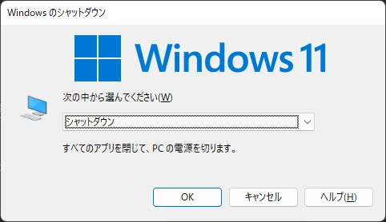
- Завершить работу можно через `Win + X` → `U` → `U`.
- Завершить работу можно, введя `shutdown /s /t 0` в командной строке или в окне "Выполнить" (`Win + R`). Добавление `/f` приведет к принудительному завершению работы. При принудительном завершении несохранённые данные могут быть потеряны; используйте его только при необходимости.

## Перезагрузка Windows
- Если нажать `Alt + F4` в состоянии отображения рабочего стола (после `Win + M` или `Win + D`) или когда панель задач активна (`Win + T` или `Win + B`), появится диалоговое окно, как показано ниже. Нажмите `↓` один раз, чтобы выбрать "Перезагрузка", и нажмите `Enter`.
  Также можно использовать `Win + R` → `Alt + F4` → `Alt + F4`.
  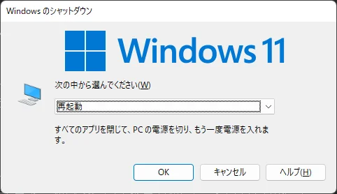
- Перезагрузить можно через `Win + X` → `U` → `R`.
- Перезагрузить можно с помощью `shutdown /r /t 0`. Добавление `/f` приведет к принудительной перезагрузке. При принудительном завершении несохранённые данные могут быть потеряны; используйте его только при необходимости.

## Спящий режим Windows
- Если нажать `Alt + F4` в состоянии отображения рабочего стола (после `Win + M` или `Win + D`) или когда панель задач активна (`Win + T` или `Win + B`), появится диалоговое окно, как показано ниже. Нажмите `↑` один раз, чтобы выбрать "Спящий режим", и нажмите `Enter`.
  Также можно использовать `Win + R` → `Alt + F4` → `Alt + F4`.
  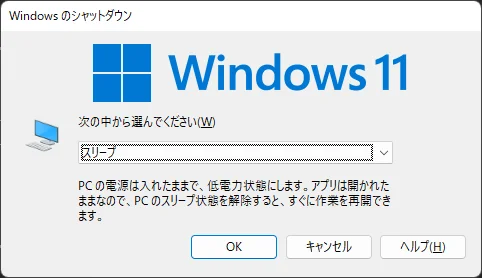
- Чтобы перейти в режим гибернации, выполните `shutdown /h` в командной строке или окне «Выполнить» (если гибернация включена).

## Выход из системы Windows
- Если нажать `Alt + F4` в состоянии отображения рабочего стола (после `Win + M` или `Win + D`) или когда панель задач активна (`Win + T` или `Win + B`), появится диалоговое окно, как показано ниже. Нажмите `↑` два раза, чтобы выбрать "Выход", и нажмите `Enter`.
  Также можно использовать `Win + R` → `Alt + F4` → `Alt + F4`.
  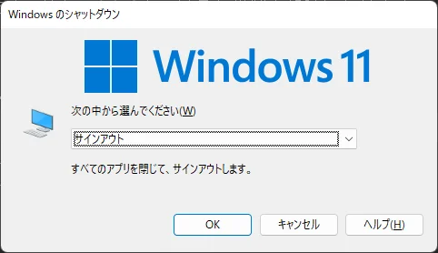
- `Win + X` → `U` → `I`
- `Ctrl + Alt + Del` → 2 раза `Tab` или 2 раза `↓` → `Enter` или `Space`
- Выйти из системы можно с помощью команды `logoff`.

## Перемещение окна с помощью клавиатуры
- `Win + ←`: Переместить влево
- `Win + →`: Переместить вправо
- `Win + ↑`: Переместить вверх / Развернуть
- `Win + ↓`: Переместить вниз / Свернуть
- `Win + Shift + ←` или `→`: Перемещение между мониторами
- `Win + Alt + ↑ или ↓`: в Windows 11 на поддерживаемых системах привязывает активное окно к верхней или нижней половине экрана.
- Нажмите `Alt + Space`, выберите «Переместить» в меню окна и перемещайте его стрелками. Нажмите Enter или щёлкните, чтобы разместить окно.
※ Поскольку окно будет следовать за курсором мыши, вы сможете "спасти" его, даже если оно находится за пределами экрана.

## Завершение процесса в диспетчере задач
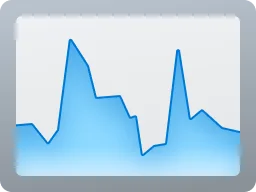
1. Диспетчер задач можно запустить с помощью `Ctrl + Shift + Esc`.
2. Вкладки можно переключать с помощью `Ctrl + Tab`.
3. На вкладке `Подробности`, нажав `Tab`, можно искать процесс по начальным буквам, вводя их на английской раскладке.
4. Выбрав имя процесса, нажмите клавишу `Delete`, а затем `Enter`, чтобы завершить процесс.

## Завершение процесса по имени с помощью команды
- Процесс можно завершить с помощью `taskkill /f /im ИмяПроцесса`. При принудительном завершении несохранённые данные могут быть потеряны; используйте его только при необходимости.
Например, `taskkill /f /im explorer.exe` завершит работу проводника. При принудительном завершении несохранённые данные могут быть потеряны; используйте его только при необходимости.

## Запуск нескольких копий одной программы с панели задач
- Удерживая клавишу `Shift`, щелкните левой кнопкой мыши по значку на панели задач, чтобы запустить еще одну копию программы. (Только для приложений, поддерживающих запуск нескольких копий)

## Запуск программы от имени администратора
- Удерживая `Ctrl + Shift`, выберите значок приложения на панели задач, чтобы открыть его от имени администратора.

## Запуск проводника
- Проводник можно запустить с помощью `Win + E`.
- Нажмите `Win + R`, чтобы открыть "Выполнить", введите `explorer` и нажмите `Enter`.
- Создать новую папку можно с помощью `Ctrl + Shift + N`.

## Открытие командной строки в текущем расположении проводника
- В Windows 11 командную строку можно запустить из контекстного меню, выбрав "Терминал".
- Также командную строку можно запустить, введя `cmd` в адресной строке и нажав `Enter`.

## Отображение истории буфера обмена
- Историю буфера обмена можно открыть с помощью `Win + V`.
Выбрав ранее скопированный текст или изображение, вы можете скопировать его снова.

## Выполнить
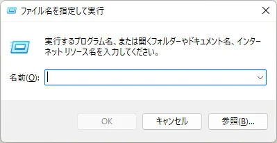
- Окно "Выполнить" можно открыть с помощью `Win + R`.

Ниже представлены некоторые команды, которые можно выполнить в окне "Выполнить" или в командной строке.

## Открыть Edge

- Введите `msedge` и нажмите `Enter`

## Открытие старых сайтов в режиме Internet Explorer в Edge

Поддержка Internet Explorer 11 завершилась 15 июня 2022 года. Windows 11 не поддерживает запуск отдельного браузера IE. Для сайтов, которым нужна совместимость, используйте режим Internet Explorer в Microsoft Edge. Инструкции по настройке см. в источниках.

## Открыть Терминал

- Введите `wt` и нажмите `Enter`

## Открыть Панель управления

- Введите `control` и нажмите `Enter`
- Также можно открыть с помощью `explorer.exe shell:::{26EE0668-A00A-44D7-9371-BEB064C98683}`.

## Запустить Блокнот

- Введите `notepad` и нажмите `Enter`

## Запустить Калькулятор

- Введите `calc` и нажмите `Enter`

## Запустить Paint

- Введите `mspaint` и нажмите `Enter`

## Запустить PowerShell
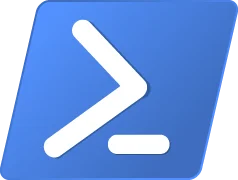
- Введите `powershell` и нажмите `Enter`

## Запустить Visual Studio Code

- Введите `code` и нажмите `Enter`

## Запустить Excel

- Введите `excel` и нажмите `Enter`
※ Только если установлен Excel.

## Открыть Word

- Введите `winword` и нажмите `Enter`
※ Только если установлен Word.

## Открыть PowerPoint

- Введите `powerpnt` и нажмите `Enter`
  ※ Только если установлен PowerPoint.

## Открыть Конфигурацию системы
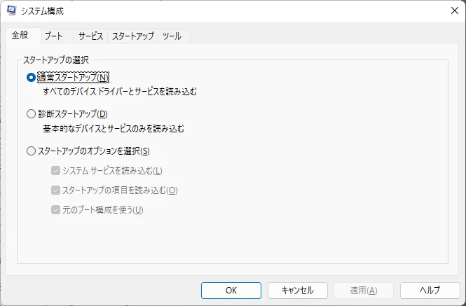
- Введите `msconfig` и нажмите `Enter`

## Открыть Свойства системы
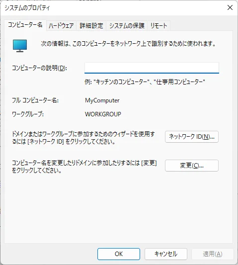
- Введите `sysdm.cpl` и нажмите `Enter`

## Открыть сведения о версии Windows
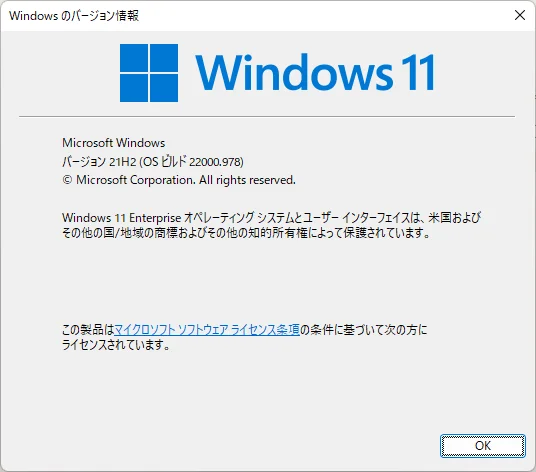
- Введите `winver` и нажмите `Enter`

## Открыть Экранную клавиатуру
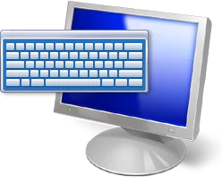
- Введите `osk` и нажмите `Enter`

## Использование WordPad (только в старых версиях Windows)

WordPad отсутствует в Windows 11 версии 24H2 и более поздних. В старых версиях запустите `wordpad` или `write`. Для обычного текста используйте «Блокнот», а для RTF — Microsoft Word или совместимый редактор.

## Открыть Редактор реестра

- Введите `regedit` и нажмите `Enter`

## Открыть Программы и компоненты
- Введите `explorer.exe shell:::{7b81be6a-ce2b-4676-a29e-eb907a5126c5}` и нажмите `Enter`

## Открыть Свойства клавиатуры
- Введите `explorer.exe shell:::{725BE8F7-668E-4C7B-8F90-46BDB0936430}` и нажмите `Enter`

## Открыть Свойства мыши
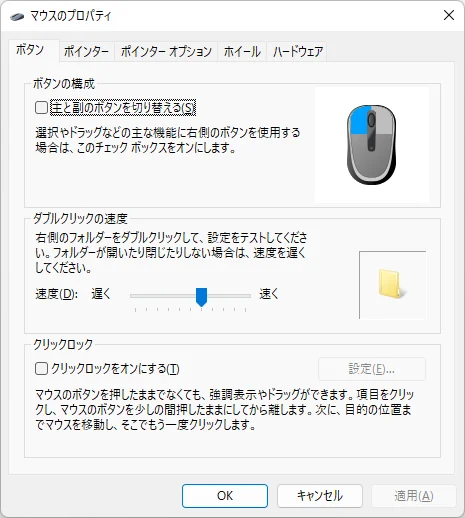
- Введите `explorer.exe shell:::{6C8EEC18-8D75-41B2-A177-8831D59D2D50}` и нажмите `Enter`

## Открыть Звук
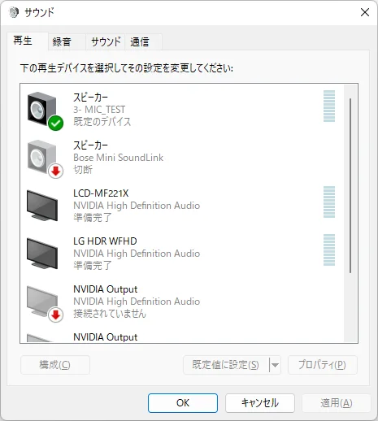
- Введите `explorer.exe shell:::{F2DDFC82-8F12-4CDD-B7DC-D4FE1425AA4D}` и нажмите `Enter`

## Открыть Учетные записи пользователей
- Введите `explorer.exe shell:::{60632754-c523-4b62-b45c-4172da012619}` и нажмите `Enter`

## Копирование текста стандартного окна сообщения
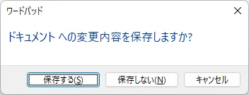

На снимке показан WordPad из версии Windows до Windows 11 версии 24H2.
- С помощью `Ctrl + C` можно скопировать текст стандартного окна сообщения.
Если скопировать приведенное выше окно сообщения, в буфер обмена будет скопировано следующее:
```
[Window Title]
ワードパッド

[Main Instruction]
ドキュメント への変更内容を保存しますか?

[保存する(S)] [保存しない(N)] [キャンセル]
```

## Сохранение вывода командной строки в буфер обмена
Добавление ` | clip` (конвейер + clip) после команды, например `echo "hello" | clip`, позволяет скопировать стандартный вывод в буфер обмена.

## Вывод иерархии папок в текстовом виде
В командной строке с помощью команды `tree` можно вывести иерархию папок в виде дерева.

Пример вывода:
```
C:.
├─.idea
│  └─libraries
├─binaryeditorbz
├─blog
│  ├─archetypes
│  ├─content
│  ├─data
│  ├─layouts
│  ├─static
│  └─themes
│      └─PaperMod
│          ├─.git
│          │  ├─branches
│          │  ├─hooks
│          │  ├─info
│          │  ├─logs
│          │  │  └─refs
│          │  │      ├─heads
│          │  │      └─remotes
│          │  │          └─origin
│          │  ├─objects
│          │  │  ├─info
│          │  │  └─pack
│          │  └─refs
│          │      ├─heads
│          │      ├─remotes
│          │      │  └─origin
│          │      └─tags
│          ├─.github
│          │  ├─ISSUE_TEMPLATE
│          │  └─workflows
│          ├─assets
│          │  ├─css
│          │  │  ├─common
│          │  │  ├─core
│          │  │  ├─extended
│          │  │  ├─hljs
│          │  │  └─includes
│          │  └─js
│          ├─i18n
│          ├─images
│          └─layouts
│              ├─partials
│              │  └─templates
│              ├─shortcodes
│              └─_default
│                  └─_markup
(далее опущено)
```

## Источники

- [Windows keyboard shortcuts](https://support.microsoft.com/en-us/accessibility/windows/keyboard-shortcuts-in-windows)
- [Use Snipping Tool to capture screenshots](https://support.microsoft.com/en-us/windows/apps/use-snipping-tool-to-capture-screenshots.)
- [Internet Explorer mode in Microsoft Edge](https://support.microsoft.com/en-us/edge/internet-explorer-mode-in-microsoft-edge)
- [Resources for deprecated features in the Windows client](https://learn.microsoft.com/en-us/windows/whats-new/deprecated-features-resources)
- [Hibernate a Windows device](https://learn.microsoft.com/en-us/windows/configuration/unified-write-filter/hibernate-once-resume-many-horm)
