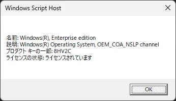

---

title: '¡Cómo verificar el estado de activación de la licencia de Windows! Comprobación fácil con un solo comando'
slug: "Windows のLicenciaの状態を確認するComando"
date: "2025-04-14T00:41:45+09:00"
lastmod: "2026-11-25"
tags: ["Windows", "Licencia", "Símbolo del sistema"]
draft: false
image: "img_1.webp"
categories: ["pc-gadgets"]
description: 'Aprende a consultar el canal de licencia y el estado de activación de Windows con los comandos integrados slmgr /dli, /dlv y /xpr, y por qué la activación no demuestra el derecho de uso de la licencia.'
---

# [Windows] Cómo verificar el estado de la licencia (con un solo comando)

¿Alguna vez te has preguntado si la licencia de tu Windows está correctamente activada?

Para esos momentos, es muy útil **el método para verificar la información de la licencia con un solo comando**. Con solo seguir los siguientes pasos, puedes comprobar fácilmente el estado actual de tu licencia.

## Comando para verificar el estado de la licencia

Puedes mostrar la información de la licencia usando la herramienta de script estándar de Windows. El comando a usar es este:

```
slmgr /dli
```

Al ejecutar este comando, se mostrará parte de la información de la licencia en una ventana.

## Método de ejecución

1. Busca “cmd” en Inicio y abre el Símbolo del sistema. No necesitas privilegios de administrador para `/dli`, `/dlv` ni `/xpr`.

2. Ingresa lo siguiente en el símbolo del sistema y presiona la tecla Enter:

   ```
   slmgr /dli
   ```

3. Espera unos segundos y se mostrará la información de la licencia de la siguiente manera.

   

## Principal información mostrada

* Clave de producto parcial
* Canal de licencia (por ejemplo, Retail u OEM)
* Estado de la licencia (los campos varían según la edición y el canal)

## ¿Quieres saber información más detallada?

También existen los siguientes comandos:

* `slmgr /dlv`: Muestra información de licencia más detallada
* `slmgr /xpr`: Muestra la fecha de expiración de la activación

`/xpr` muestra la fecha de expiración de la activación y es principalmente útil para clientes KMS; las activaciones Retail y MAK suelen ser permanentes. `slmgr` no verifica si la licencia de Windows se obtuvo legítimamente. En Windows 11 también puedes consultar la activación en Configuración > Sistema > Activación.

## Resumen

El estado de la licencia de Windows se puede verificar fácilmente con un solo comando.

* **Verificación simple**: `slmgr /dli`
* **Verificación detallada**: `slmgr /dlv`
* **Verificación de vencimiento**: `slmgr /xpr`

Si el estado no es el esperado, consulta la configuración de Activación de Windows o contacta con el vendedor o el administrador de tu organización.

## Referencias

- [Slmgr.vbs options for obtaining volume activation information](https://learn.microsoft.com/en-us/windows-server/get-started/activation-slmgr-vbs-options)
- [Activate Windows](https://support.microsoft.com/en-us/windows/activation/activate-windows)
