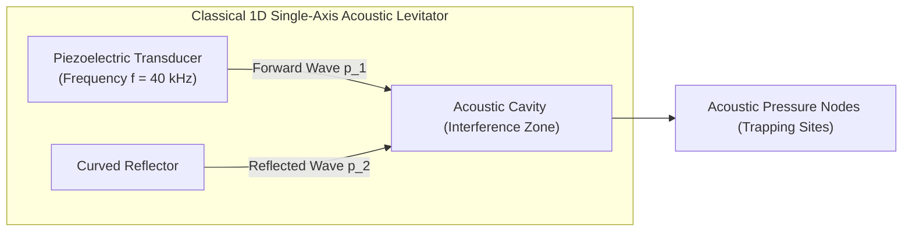
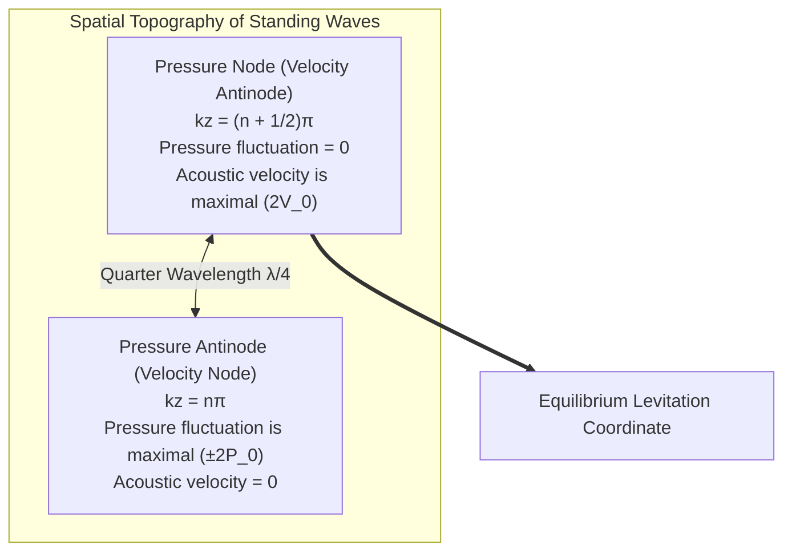
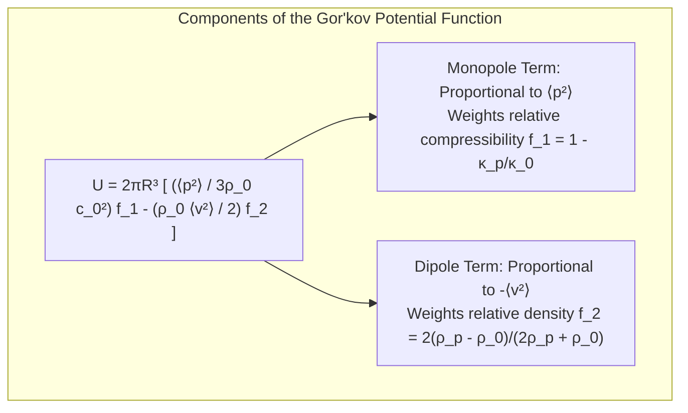
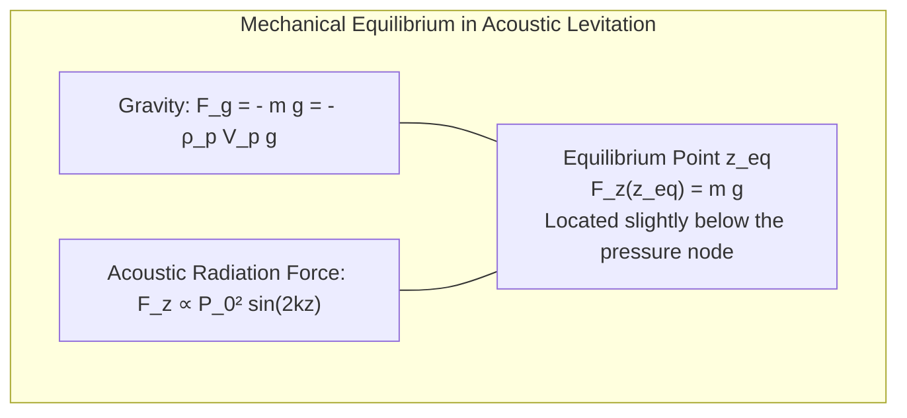
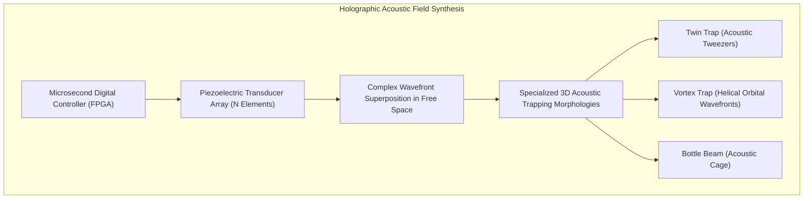
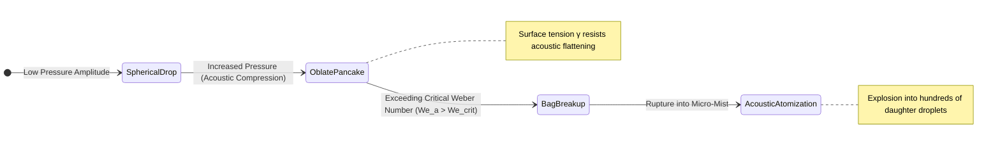

In the open air of a modern research laboratory, a single droplet of pure water floats completely motionless, suspended in mid-air with neither physical support nor tether. Beside it, tiny electronic surface-mount components, living biological cells, and delicate insects hover trapped in empty space like puppets controlled by invisible strings. At the operator's command, these airborne objects glide smoothly in three dimensions, rotate about their axes, and merge with other floating reagents to initiate container-free chemical synthesis.

Even materials that are completely non-magnetic—water, plastics, wood, and biological tissues—can be held effortlessly aloft. This real-world realization of science fiction's "tractor beam" and "anti-gravity" is known as <strong>Acoustic Levitation</strong>.

The sounds we perceive in our daily lives are mere whispers of pressure: minuscule longitudinal perturbations in air density that gently vibrate our eardrums with micropascal forces. However, when sound is driven past the limits of human hearing into the ultrasonic regime (tens to hundreds of kilohertz) and configured into resonant interference structures known as <strong>standing waves</strong>, sound ceases to be a passive sensory medium. It transforms into an active, formidable physical tool capable of exerting steady mechanical forces: the <strong>acoustic radiation force</strong>.

In this comprehensive treatise, we explore the deep physics and transformative engineering of acoustic levitation. We will trace why linear acoustic theory fails to predict levitation and how nonlinear hydrodynamics rectifies alternating sound into steady direct-current forces. We will dissect the mathematical derivation of Lev Gor'kov's celebrated acoustic radiation potential, examine how ultrasonic phased arrays synthesize dynamic 3D holographic acoustic traps, analyze the hydroelastic breakdown and atomization limits of liquid droplets, and survey cutting-edge frontiers from containerless pharmaceutical crystallization to acoustic microfluidics and spaceborne materials processing.

---

## 1. Why Does Sound Exert Force? From Linear Limits to Nonlinear Acoustics

### 1.1 The Linear Acoustic Paradox: Why the Time-Averaged Pressure is Zero

In introductory physics, sound waves in air are formulated via <strong>linear acoustic wave theory</strong>, assuming infinitesimally small perturbations in ambient density $\rho_0$, ambient pressure $p_0$, and particle velocity $\mathbf{v}$.

Consider a monochromatic harmonic acoustic wave propagating with angular frequency $\omega = 2\pi f$ and pressure amplitude $P_0$:
$$p(t) = P_0 \sin(\omega t)$$

If we evaluate the time-averaged acoustic pressure $\langle p \rangle$ over a full oscillation period $T = 2\pi / \omega$:
$$\langle p \rangle = \frac{1}{T} \int_0^T P_0 \sin(\omega t) dt = 0$$

The positive half-cycle of acoustic compression is identically and symmetrically cancelled by the negative half-cycle of acoustic rarefaction. Likewise, the time-averaged particle velocity of the oscillating air molecules is strictly zero: $\langle \mathbf{v} \rangle = \mathbf{0}$.

If linear acoustic theory were the complete physical reality, sound could <strong>never</strong> exert a net static force on any object. For every microsecond sound pushed an object forward, it would pull it backward with equal magnitude in the next half-cycle.

How, then, does high-intensity ultrasound levitate dense matter against the relentless pull of Earth's gravity?

```mermaid
flowchart TD
    subgraph AcousticParadox ["The Theoretical Transition: Linear to Nonlinear Acoustics"]
        Linear["Linear Acoustics (Infinitesimal Limit)<br>p(t) = P_0 sin(ωt)<br>Time-averaged force ⟨F⟩ = 0<br>Net mechanical levitation impossible"]
        Nonlinear["Nonlinear Acoustics (Finite Amplitude)<br>Quadratic momentum flux tensor<br>⟨Π⟩ = ⟨p + ρ v²⟩ ≠ 0<br>Non-zero net DC acoustic radiation force"]
    end
    Linear -->|High Sound Pressure Levels (>140 dB)| Nonlinear
```

### 1.2 Nonlinear Hydrodynamics and the Acoustic Radiation Pressure

The emergence of a persistent, unidirectional force is a consequence of <strong>second-order nonlinear hydrodynamic effects</strong>.

The exact, non-linear Euler equation governing an inviscid fluid is:
$$\rho \left( \frac{\partial \mathbf{v}}{\partial t} + (\mathbf{v} \cdot \nabla) \mathbf{v} \right) = -\nabla p$$

The convective acceleration term $(\mathbf{v} \cdot \nabla) \mathbf{v}$ is intrinsically <strong>quadratic (nonlinear)</strong> in the fluid velocity $\mathbf{v}$. In ordinary speech ($60\,\text{dB}$, where $P_0 \sim 0.02\,\text{Pa}$), this term is infinitesimal ($O(10^{-9})$) and safely discarded. But in ultrasonic levitators operating at sound pressure levels (SPL) exceeding $150 \sim 165\,\text{dB}$ ($P_0 > 10^3 \sim 10^4\,\text{Pa}$), this quadratic term becomes massive.

The total momentum flux density tensor $\Pi_{ij}$ passing through a fluid control surface is:
$$\Pi_{ij} = p \delta_{ij} + \rho v_i v_j$$

Expanding the thermodynamic equation of state of the gas to second order in density perturbations $\rho' = \rho - \rho_0$:
$$p - p_0 = c_0^2 \rho' + \frac{1}{2} \left( \frac{\partial^2 p}{\partial \rho^2} \right)_0 (\rho')^2 + \dots$$

When we compute the time average of the momentum flux tensor over an acoustic cycle, the linear oscillatory terms vanish, but the quadratic products $\langle \rho v_i v_j \rangle$ and $\langle (\rho')^2 \rangle$ <strong>survive as positive, non-zero direct-current (DC) quantities</strong>!

Just as an electrical diode rectifies an alternating electrical current into a steady direct current, the inherent nonlinearity of fluid mechanics rectifies high-frequency acoustic oscillations into a steady, time-averaged mechanical pressure: the <strong>Acoustic Radiation Pressure</strong>.

### 1.3 Langevin vs. Rayleigh Radiation Pressure

Historically, acoustic radiation pressure has been classified into two frameworks:
1. <strong>Rayleigh Radiation Pressure</strong>: The time-averaged pressure increment inside a closed, rigid cavity with fixed fluid mass.
2. <strong>Langevin Radiation Pressure</strong>: The net time-averaged mechanical force per unit area exerted on an absorbing or reflecting obstacle immersed in an open fluid medium connected to an undisturbed reservoir.

In acoustic levitation, the <strong>Langevin radiation pressure</strong> is the relevant operative force. For a plane wave of acoustic energy density $\langle E \rangle = \frac{1}{2} \rho_0 v_0^2 = \frac{P_0^2}{2 \rho_0 c_0^2}$ incident upon a planar boundary with reflection coefficient $R_{\text{ref}}$, the time-averaged radiation pressure is:
$$P_{\text{rad}} = (1 + R_{\text{ref}}) \langle E \rangle$$

For a perfect reflector ($R_{\text{ref}} = 1$), the radiation pressure is exactly twice the acoustic energy density ($P_{\text{rad}} = 2 \langle E \rangle$).

---

## 2. Standing Waves and the Architecture of Acoustic Traps

### 2.1 Wave Interference in a Resonant Cavity

A traveling wave exerts radiation pressure that pushes particles downstream along its path of propagation, acting as an "acoustic wind." To trap and immobilize a particle at a fixed coordinate in space, one must create a spatial potential energy well with restoring forces in all directions.

The foundational design consists of an ultrasonic transducer emitting toward an opposed, rigid planar or concave reflector separated by an integer or half-integer multiple of the acoustic wavelength $\lambda$.



Let a forward-propagating plane wave traveling in the $+z$ direction be:
$$p_1(z, t) = P_0 \cos(k z - \omega t)$$
and the counter-propagating reflected wave traveling in the $-z$ direction be:
$$p_2(z, t) = P_0 \cos(k z + \omega t)$$

By trigonometric superposition, the combined acoustic pressure field forms a pure <strong>standing wave</strong>:
$$p(z, t) = p_1 + p_2 = 2 P_0 \cos(k z) \cos(\omega t)$$

The corresponding particle velocity field $v(z, t)$, evaluated from the linearized momentum equation $\rho_0 \frac{\partial v}{\partial t} = -\frac{\partial p}{\partial z}$, is:
$$v(z, t) = \frac{2 P_0}{\rho_0 c_0} \sin(k z) \sin(\omega t) = 2 V_0 \sin(k z) \sin(\omega t)$$



### 2.2 The Spatial Decoupling of Nodes and Antinodes

A quintessential property of acoustic standing waves is that the nodes of pressure and the nodes of velocity are spatially offset by exactly <strong>one-quarter of an acoustic wavelength ($\lambda / 4$)</strong>:
1. <strong>Pressure Nodes (Velocity Antinodes)</strong>: Coordinates where $\cos(kz) = 0$, occurring at $z = \frac{\lambda}{4}, \frac{3\lambda}{4}, \frac{5\lambda}{4}, \dots$
   Here, the acoustic pressure fluctuations are strictly zero ($p = 0$). However, the gas molecules oscillate back and forth with maximum velocity ($v = 2 V_0$).
2. <strong>Pressure Antinodes (Velocity Nodes)</strong>: Coordinates where $\sin(kz) = 0$, occurring at $z = 0, \frac{\lambda}{2}, \lambda, \dots$
   Here, the pressure oscillates with maximum amplitude ($\pm 2 P_0$), while the fluid velocity is zero ($v = 0$).

This spatial gradient between alternating kinetic and potential acoustic energy zones provides the landscape from which trapping forces emerge.

---

## 3. The Gor'kov Potential: Rigorous Analytical Mechanics

Calculating the net acoustic radiation force by integrating the nonlinear stress tensor over the arbitrary moving boundary of a scattering sphere is an arduous boundary-value problem. In 1962, the renowned Soviet theoretical physicist <strong>Lev Petrovich Gor'kov</strong> published a mathematical masterpiece that reduced this complex hydrodynamic scattering problem to the gradient of a single scalar potential.

### 3.1 The Gor'kov Acoustic Radiation Potential

Consider a small spherical particle of radius $R$, density $\rho_p$, and compressibility $\kappa_p = 1 / K_p$ immersed in an arbitrary acoustic field within a fluid medium of ambient density $\rho_0$, sound speed $c_0$, and compressibility $\kappa_0 = 1 / (\rho_0 c_0^2)$. Assume the particle is small compared to the acoustic wavelength ($R \ll \lambda$, the Rayleigh scattering regime).

Gor'kov proved that the time-averaged acoustic radiation force $\mathbf{F}^{\text{rad}}$ acting on the particle is conservative and can be written as the negative gradient of a scalar potential $U$:

$$\mathbf{F}^{\text{rad}} = -\nabla U$$

where the <strong>Gor'kov Potential $U$</strong> is defined as:

$$U = 2 \pi R^3 \left[ \frac{\langle p^2 \rangle}{3 \rho_0 c_0^2} f_1 - \frac{\rho_0 \langle |\mathbf{v}|^2 \rangle}{2} f_2 \right]$$

Here, $\langle p^2 \rangle$ and $\langle |\mathbf{v}|^2 \rangle$ are the mean-square acoustic pressure and velocity at the particle's position in the *unperturbed* acoustic field.

The two dimensionless scattering contrast factors are:

1. <strong>Monopole Scattering Factor (Compressibility Contrast)</strong>:
   $$f_1 = 1 - \frac{\kappa_p}{\kappa_0}$$
   This term originates from isotropic volume pulsations of the sphere in response to pressure fluctuations (monopole acoustic radiation).

2. <strong>Dipole Scattering Factor (Density Contrast)</strong>:
   $$f_2 = \frac{2 (\rho_p - \rho_0)}{2 \rho_p + \rho_0}$$
   This term arises from the rigid-body translational oscillation of the particle relative to the surrounding fluid due to inertia (dipole acoustic radiation).



### 3.2 Evaluation for Condensed Matter in Air

Consider a liquid water droplet or a solid particle (glass, metal, polymer) suspended in air:
- The particle density is three orders of magnitude greater than air: $\rho_p \sim 10^3\,\text{kg/m}^3 \gg \rho_0 \approx 1.2\,\text{kg/m}^3$.
  $$f_2 = \frac{2(\rho_p - \rho_0)}{2\rho_p + \rho_0} \approx \frac{2\rho_p}{2\rho_p} = 1$$
- The compressibility of condensed matter is negligible compared to air: $\kappa_p \ll \kappa_0$ (air is thousands of times more compliant).
  $$f_1 = 1 - \frac{\kappa_p}{\kappa_0} \approx 1 - 0 = 1$$

Thus, for virtually any solid or liquid suspended in air:
$$f_1 \approx 1, \quad f_2 \approx 1$$

Under these conditions, Gor'kov's potential simplifies to:
$$U(z) \approx 2 \pi R^3 \left[ \frac{\langle p^2 \rangle}{3 \rho_0 c_0^2} - \frac{\rho_0 \langle v^2 \rangle}{2} \right]$$

### 3.3 Derivation of Levitation Force in a 1D Standing Wave

Substituting the 1D standing wave fields:
$$\langle p^2 \rangle = 2 P_0^2 \cos^2(k z)$$
$$\langle v^2 \rangle = \frac{2 P_0^2}{\rho_0^2 c_0^2} \sin^2(k z)$$

into Gor'kov's potential yields:
$$U(z) = \frac{2 \pi R^3 P_0^2}{\rho_0 c_0^2} \left[ \frac{2}{3} \cos^2(k z) - \sin^2(k z) \right]$$

Using trigonometric identities, we evaluate the vertical acoustic radiation force $F_z = -\frac{\partial U}{\partial z}$:
$$F_z(z) = -\frac{\partial U}{\partial z} = \left( \frac{4}{3} \pi R^3 \right) \left( \frac{5}{6} \right) \frac{k P_0^2}{\rho_0 c_0^2} \sin(2 k z) = V_p \left( \frac{5}{6} \right) \frac{k P_0^2}{\rho_0 c_0^2} \sin(2 k z)$$

where $V_p = \frac{4}{3}\pi R^3$ is the particle volume.



### 3.4 The Mechanics of Stable Equilibrium

This mathematical expression reveals the fundamental physical principles of acoustic levitation:
1. <strong>Force Periodicity</strong>: The radiation force oscillates with spatial wavenumber $2k$, meaning its spatial period is $\lambda / 2$. A multi-wavelength standing wave possesses multiple stable trapping sites spaced every half-wavelength along the vertical axis.
2. <strong>Stable Equilibrium Position</strong>:
   The potential energy $U(z)$ exhibits local minima precisely at the <strong>pressure nodes</strong> ($kz = \pi/2, 3\pi/2, \dots$).
   In the absence of gravity, particles migrate toward and rest at the exact pressure node.
3. <strong>Gravitational Balancing</strong>:
   Under downward gravitational force $F_g = \rho_p V_p g$, the particle settles at a coordinate $z_{\text{eq}}$ displaced slightly below the pressure node, where the upward acoustic radiation force exactly counterbalances the particle's weight:
   $$V_p \left( \frac{5}{6} \right) \frac{k P_0^2}{\rho_0 c_0^2} \sin(2 k z_{\text{eq}}) = \rho_p V_p g$$
   Dividing through by particle volume $V_p$, we discover that the required acoustic pressure depends only on the particle's <strong>mass density $\rho_p$</strong>, completely independent of particle radius $R$!
4. <strong>Restoring Spring Constant</strong>:
   Linearizing around $z_{\text{eq}}$, the acoustic trap behaves as an ideal Hookean spring with stiffness $k_{\text{trap}} = -\left. \frac{dF_z}{dz} \right|_{z_{\text{eq}}}$. Any accidental mechanical perturbation pushing the particle upward or downward is met with an immediate, opposing restoring force.

---

## 4. Ultrasonic Phased Arrays and 3D Holographic Tractor Beams

### 4.1 Beyond the 1D Resonator

Classical single-axis levitators—relying on a single piezo-transducer firing against an opposing glass or aluminum reflector—suffer from crippling engineering limitations:
- <strong>Spatial Immobility</strong>: Trapping locations are fixed by the cavity geometry and wavelength; objects cannot be dynamically navigated.
- <strong>Physical Obstruction</strong>: The rigid opposing reflector severely impedes optical access, robotic pipetting, and laser diagnostics.
- <strong>Weak Lateral Confinement</strong>: Restoring forces perpendicular to the propagation axis rely on weak lateral acoustic gradients, making trapped specimens vulnerable to lateral slippage and ejection.

### 4.2 The Phased Array Revolution

In 2015, researchers led by Asier Marzo and Sriram Subramanian dismantled these constraints by introducing <strong>ultrasonic phased arrays</strong> driven by multi-channel digital signal synthesis.

An ultrasonic phased array consists of dozens to hundreds of miniature piezoelectric transducers (typically operating at $40\,\text{kHz}$, $\lambda \approx 8.6\,\text{mm}$) arranged on planar, curved, or dual-sided modular panels. Instead of driving all transducers in phase, an FPGA controller modulates the emission phase $\phi_j$ of each $j$-th transducer with microsecond timing precision.



The total acoustic pressure field $p(\mathbf{r})$ at target coordinate $\mathbf{r}$ is synthesized via Huygens-Fresnel superposition:
$$p(\mathbf{r}) = \sum_{j=1}^N \frac{A_j}{|\mathbf{r} - \mathbf{r}_j|} D(\theta_j) e^{i (k |\mathbf{r} - \mathbf{r}_j| + \phi_j)}$$
where $\mathbf{r}_j$ is the position of transducer $j$, $A_j$ is its amplitude, and $D(\theta_j)$ is the circular piston directivity function.

### 4.3 Holographic Trapping Modalities

By optimizing the phase vector $\boldsymbol{\phi} = (\phi_1, \dots, \phi_N)$, modern phased arrays can sculpt custom 3D acoustic potential landscapes:

1. <strong>Twin Trap</strong>: Two cylindrical acoustic lobes with a relative phase difference of $\pi$ are synthesized side by side. A microscopic null pressure slit forms between them, pinching the particle like a pair of acoustic tweezers with exceptional lateral stiffness.
2. <strong>Acoustic Vortex Trap</strong>: The phase profile spirals azimuthally as $\phi(\theta) = m \theta$, where $m$ is the topological charge. This helical wavefront carries <strong>orbital angular momentum (OAM)</strong>, generating a silent core surrounded by an acoustic tornado that can exert controlled torsional torque to spin levitated matter.
3. <strong>Bottle Beam</strong>: A spherical shell of high acoustic pressure completely encloses a quiet, zero-pressure interior node, creating a self-contained acoustic cage capable of dynamic 3D translation without an opposing reflector.

---

## 5. Physical Limits of Acoustic Levitation

Acoustic levitation is bounded by distinct physical limits rooted in wave diffraction, fluid dynamics, and surface energy.

### 5.1 The Particle Size Limit (Rayleigh Threshold)

The Gor'kov potential framework is strictly valid in the Rayleigh regime:
$$R \ll \lambda \quad (\text{practically, } R \le \lambda / 4)$$

For standard $40\,\text{kHz}$ ultrasound in air ($\lambda \approx 8.6\,\text{mm}$), the maximum stable diameter of a levitated spherical particle is roughly <strong>$3 \sim 4\,\text{mm}$</strong>. 

When particle dimensions approach the wavelength ($R \sim \lambda$), wave diffraction and higher-order multipole scattering dominate. The acoustic wave scatters incoherently across the particle's own surface, distorting the standing wave structure and destroying the restorative trap. 

While millimeter-scale objects are easily manipulated with ultrasound, levitating centimeter-to-meter scale objects would require audible low-frequency sound (e.g., $1\,\text{kHz}$, $\lambda \approx 34\,\text{cm}$), generating sound pressure levels ($>150\,\text{dB}$) that would rupture human eardrums and cause severe physiological trauma.

### 5.2 Density Threshold and Acoustic Shock Wave Limits

The acoustic force scales quadratically with pressure amplitude: $F_{\text{rad}} \propto P_0^2$.
Levitating ultra-dense materials such as metallic tungsten ($\rho \approx 19.3\,\text{g/cm}^3$), gold, or platinum requires immense pressure amplitudes ($P_0 > 10\,\text{kPa}$, corresponding to SPL $> 165\,\text{dB}$).

However, air cannot sustain arbitrarily large acoustic pressures:
- At extreme amplitudes, the peaks of the sound wave travel faster than the troughs due to adiabatic heating, causing the sinusoidal waveform to steepen into an <strong>acoustic shock wave</strong>.
- Shock wave formation introduces extreme acoustic dissipation, generating intense thermal gradients and vigorous turbulent convective jets known as <strong>acoustic streaming</strong>.
- These turbulent streaming vortices destabilize the acoustic trap, blowing levitated particles out of the potential well.

### 5.3 Droplet Deformation and Atomization Limits

When levitating liquids (such as water or molten metals), internal cohesion is provided solely by liquid-gas <strong>surface tension $\gamma$</strong>.

The intense vertical acoustic radiation pressure acting on the droplet's poles, coupled with sub-atmospheric pressures along its equator, compresses the sphere into an <strong>oblate spheroid (pancake shape)</strong>.



The deformation stability is dictated by the dimensionless <strong>Acoustic Weber Number ($We_a$)</strong>:
$$We_a = \frac{P_0^2 R}{\rho_0 c_0^2 \gamma}$$

If the acoustic field is amplified beyond a critical threshold ($We_a \approx 3 \sim 4$):
1. The droplet flattens into a paper-thin circular membrane.
2. The center of the disk balloons upward or downward into an acoustic bubble (bag breakup).
3. The liquid film catastrophically ruptures, disintegrating in milliseconds into a fine spray of hundreds of micro-droplets. This phenomenon is termed <strong>acoustic atomization</strong>.

Hence, levitating large, low-surface-tension liquid volumes represents one of the most delicate balancing acts in applied fluid mechanics.

---

## 6. Cutting-Edge Frontiers of Acoustic Manipulation

Acoustic levitation has transitioned from a physics curiosity into a transformative multi-disciplinary engineering technology:

| Domain | Technological Application | Distinctive Advantages |
|---|---|---|
| <strong>Structural Biology & Pharma</strong> | Containerless protein crystallization & amorphous screening | $100\%$ elimination of container wall nucleation and chemical leaching |
| <strong>Microfluidics & Chemistry</strong> | Lab-on-a-drop synthesis, contactless droplet coalescence | Zero cross-contamination, zero dead-volume, automated micro-reactions |
| <strong>Biomedicine</strong> | Acoustic sorting of circulating tumor cells (CTC) in microchannels | Label-free, non-invasive, preserves cell viability under physiological shear |
| <strong>Aerospace Materials</strong> | Microgravity simulation & containerless molten metal processing | Supercooling high-temperature alloys without crucible contamination |
| <strong>Human-Computer Interaction</strong> | Volumetric displays and mid-air tactile haptics | Bare-hand physical touch sensations rendered in mid-air via focused ultrasound |

### 6.1 Containerless Pharmaceutical Processing

In pharmaceutical manufacturing, formulating poorly water-soluble active pharmaceutical ingredients (APIs) requires creating amorphous solid dispersions or specific metastable polymorphs. When solutions crystallize within standard glass vials or microplates, microscopic surface scratches on the container walls act as heterologous nucleation sites, forcing the drug into thermodynamically stable, low-bioavailability crystal forms.

By levitating droplets in an acoustic trap, contact with physical surfaces is <strong>strictly zero</strong>. The droplet evaporates in a perfectly symmetric, container-free environment. This enables researchers to achieve extreme degrees of supersaturation, reliably generating novel high-solubility amorphous drug nanoparticles that cannot be synthesized by any other means.

### 6.2 Mid-Air Haptic Feedback and Volumetric Displays

By focusing ultrasonic phased arrays onto the skin of a human hand, focused acoustic radiation pressure stimulates mechanoreceptors (Meissner's corpuscles and Pacinian corpuscles) in the dermis. This produces palpable physical tactile sensations—such as the sensation of pressing an invisible floating button, stroking a textured virtual surface, or feeling an object moving across your palm—without gloves or wearable hardware.

Furthermore, by moving a tiny, photoluminescent expanded-polystyrene bead through a 3D acoustic field at speeds exceeding several meters per second and illuminating it with synchronized RGB projection lasers, engineers have created <strong>3D volumetric displays</strong> that allow viewers to perceive floating, animated 3D graphics in true physical space.

---

## 7. Conclusion: The Invisible Hands of Wave Mechanics

Sound is fundamentally the rhythm of matter in motion.

For millennia, humans have engaged with acoustic waves as signals of hearing, music, and communication. Yet when elevated to high intensities and sculpted through the mathematics of wave interference, sound transcends sensation. It becomes an active physical force: an invisible, clean, non-contact mechanical hand that counteracts gravity, sculpts fluid geometry, and directs the assembly of matter in free space.

From the elegant mathematical symmetry of the Gor'kov potential to the dynamic choreography of phased-array tractor beams, acoustic levitation showcases the profound unity of theoretical physics, transforming the intangible vibrations of air into one of modern science's most extraordinary tools.
