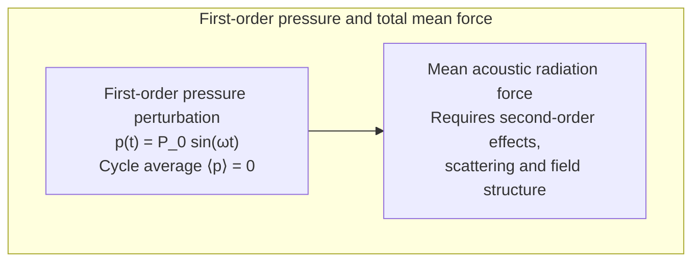
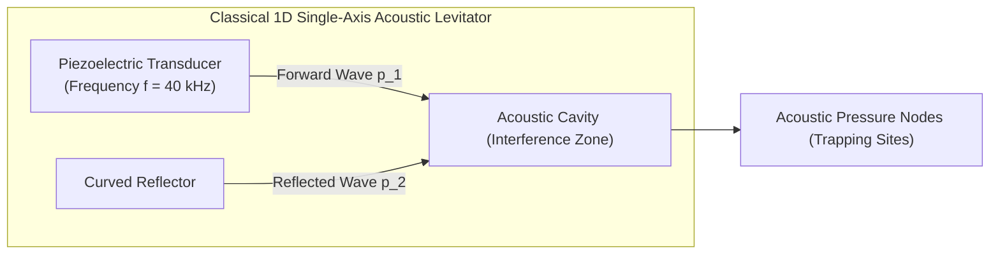
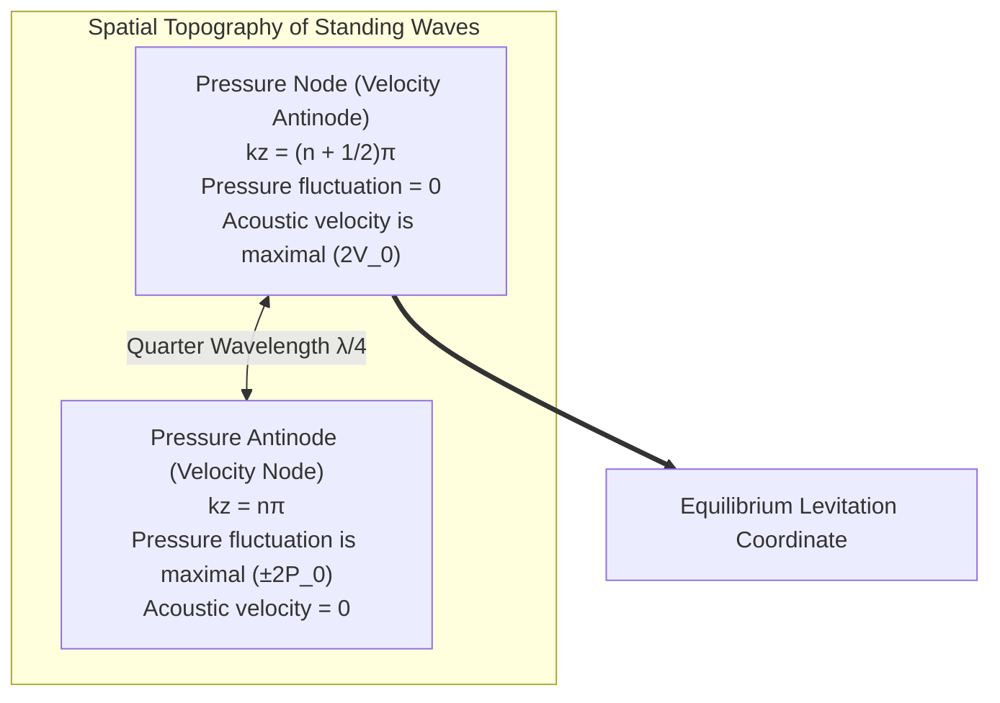
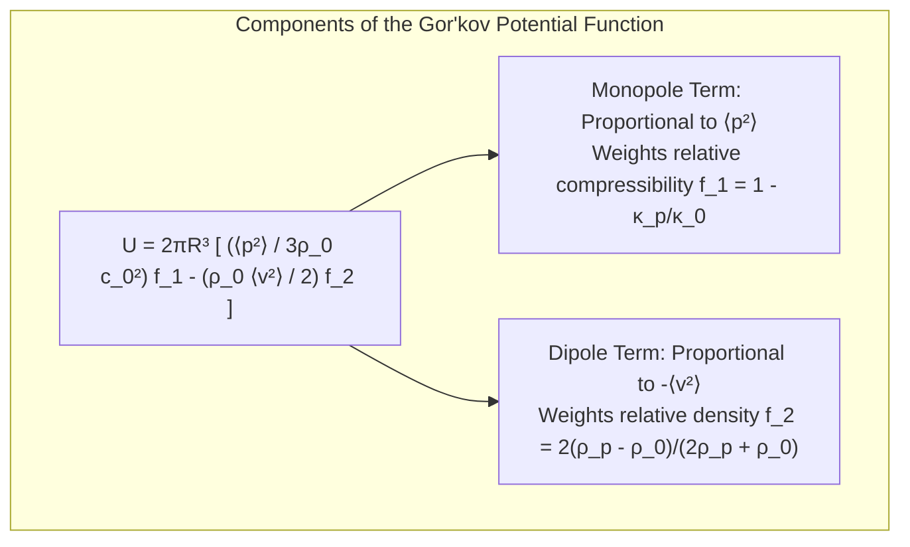
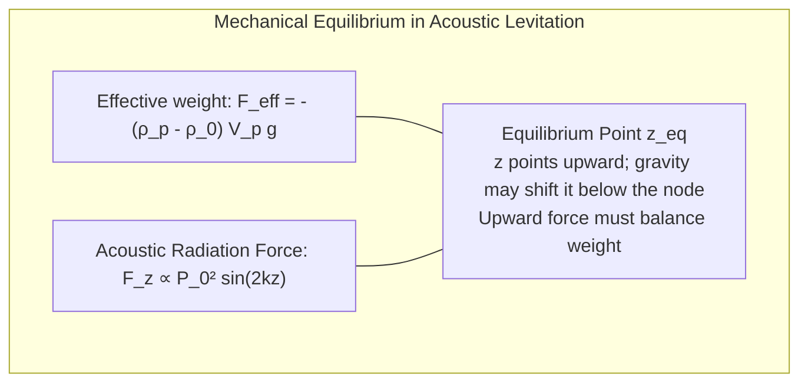

Acoustic levitation uses a strong sound field to hold droplets or small particles without contact with a solid surface. The object is not necessarily a perfect sphere or motionless; its position and shape depend on the field, material properties and apparatus. Some systems can also translate or rotate a trapped object.

Levitation does not depend on magnetism and is not “anti-gravity.” Time-averaged acoustic radiation forces can balance gravity for suitable targets and configurations, but the range of objects and controllable directions is apparatus-dependent.

Ultrasound can be used to create standing waves and other acoustic fields. A first-order pressure oscillation can have zero cycle average without implying that the total average force on an object is zero. Radiation force is a time-averaged effect that includes the field and scattering by the object. This article introduces a useful small-sphere approximation and states its limits.

We examine time-averaged acoustic force, standing-wave nodes and antinodes, Gor’kov’s potential for a small sphere, phased-array manipulation, droplet deformation and breakup, and selected research applications. Device-specific results should not be treated as universal pressure or size thresholds.

---

## 1. Why Does Sound Exert Force? From Linear Limits to Nonlinear Acoustics

### 1.1 The Linear Acoustic Paradox: Why the Time-Averaged Pressure is Zero

Linear acoustics treats pressure, density and particle velocity as small periodic perturbations about an equilibrium state. Here $p(t)$ denotes acoustic pressure, not the ambient static pressure $p_0$. For a sinusoidal pressure perturbation with amplitude $P_0$ and angular frequency $\omega$:

$$p(t) = P_0 \sin(\omega t)$$

If we evaluate the time-averaged acoustic pressure $\langle p \rangle$ over a full oscillation period $T = 2\pi / \omega$:
$$\langle p \rangle = \frac{1}{T} \int_0^T P_0 \sin(\omega t) dt = 0$$

The positive half-cycle of acoustic compression is identically and symmetrically cancelled by the negative half-cycle of acoustic rarefaction. Likewise, the time-averaged particle velocity of the oscillating air molecules is strictly zero: $\langle \mathbf{v} \rangle = \mathbf{0}$.

This calculation shows that the first-order pressure perturbation averages to zero. It does not establish that the total force on an object averages to zero: that force must include second-order effects, scattering and the spatial structure of the field. The half-cycle push-and-pull argument is therefore incomplete.

### 1.2 Nonlinear Hydrodynamics and the Acoustic Radiation Pressure

The emergence of a persistent, unidirectional force is a consequence of <strong>second-order nonlinear hydrodynamic effects</strong>.

The exact, non-linear Euler equation governing an inviscid fluid is:
$$\rho \left( \frac{\partial \mathbf{v}}{\partial t} + (\mathbf{v} \cdot \nabla) \mathbf{v} \right) = -\nabla p$$

The [convective acceleration term](/en/p/navier-stokes-equations/) $(\mathbf{v} \cdot \nabla) \mathbf{v}$ is one nonlinear term. Calculating radiation forces requires accounting for second-order stresses and momentum transport that survive time averaging. Which terms are retained depends on the field, boundary conditions and approximation; no single dB value universally marks when these effects matter.

One convention for the momentum-flux tensor in an inviscid fluid is:
$$\Pi_{ij} = p \delta_{ij} + \rho v_i v_j$$

Expanding the thermodynamic equation of state of the gas to second order in density perturbations $\rho' = \rho - \rho_0$:
$$p - p_0 = c_0^2 \rho' + \frac{1}{2} \left( \frac{\partial^2 p}{\partial \rho^2} \right)_0 (\rho')^2 + \dots$$

In a small-amplitude expansion, first-order periodic terms average to zero, while second-order terms can contribute to the time-averaged stress. Positivity of individual quadratic terms alone does not determine the direction or magnitude of the force on an object; scattering, spatial gradients, geometry and boundary conditions also matter.

The time-averaged resultant force on an object is called the <strong>acoustic radiation force</strong>. “Acoustic radiation pressure” is also used for average stress at a surface. Rectification is a useful analogy, but the actual direction and magnitude follow from the sound field and boundary conditions.

### 1.3 Radiation pressure, force and boundary conditions

Acoustic radiation force is the time-averaged force on an object in a sound field. “Radiation pressure” is sometimes used for the stress acting at a surface, but its value depends on reflection, absorption, the sound field and the boundary conditions on the mean pressure. A formula for a plane wave incident on an ideal plane cannot be generalized using a reflection coefficient alone. For levitated small spheres, the next section uses the Gor’kov approximation and makes its assumptions explicit.

---

## 2. Standing Waves and the Architecture of Acoustic Traps

### 2.1 Wave Interference in a Resonant Cavity

A traveling wave exerts radiation pressure that pushes particles downstream along its path of propagation, acting as an "acoustic wind." To trap and immobilize a particle at a fixed coordinate in space, one must create a spatial potential energy well with restoring forces in all directions.

The foundational design consists of an ultrasonic transducer emitting toward an opposed, rigid planar or concave reflector separated by an integer or half-integer multiple of the acoustic wavelength $\lambda$.

Let a forward-propagating plane wave traveling in the $+z$ direction be:
$$p_1(z, t) = P_0 \cos(k z - \omega t)$$
and the counter-propagating reflected wave traveling in the $-z$ direction be:
$$p_2(z, t) = P_0 \cos(k z + \omega t)$$

By trigonometric superposition, the combined acoustic pressure field forms a pure <strong>standing wave</strong>:
$$p(z, t) = p_1 + p_2 = 2 P_0 \cos(k z) \cos(\omega t)$$

The corresponding particle velocity field $v(z, t)$, evaluated from the linearized momentum equation $\rho_0 \frac{\partial v}{\partial t} = -\frac{\partial p}{\partial z}$, is:
$$v(z, t) = \frac{2 P_0}{\rho_0 c_0} \sin(k z) \sin(\omega t) = 2 V_0 \sin(k z) \sin(\omega t)$$

### 2.2 The Spatial Decoupling of Nodes and Antinodes

A quintessential property of acoustic standing waves is that the nodes of pressure and the nodes of velocity are spatially offset by exactly <strong>one-quarter of an acoustic wavelength ($\lambda / 4$)</strong>:
1. <strong>Pressure Nodes (Velocity Antinodes)</strong>: Coordinates where $\cos(kz) = 0$, occurring at $z = \frac{\lambda}{4}, \frac{3\lambda}{4}, \frac{5\lambda}{4}, \dots$
   Here, the acoustic pressure fluctuations are strictly zero ($p = 0$). However, the gas molecules oscillate back and forth with maximum velocity ($v = 2 V_0$).
2. <strong>Pressure Antinodes (Velocity Nodes)</strong>: Coordinates where $\sin(kz) = 0$, occurring at $z = 0, \frac{\lambda}{2}, \lambda, \dots$
   Here, the pressure oscillates with maximum amplitude ($\pm 2 P_0$), while the fluid velocity is zero ($v = 0$).

This spatial gradient between alternating kinetic and potential acoustic energy zones provides the landscape from which trapping forces emerge.

---

## 3. The Gor'kov Potential: Rigorous Analytical Mechanics

Calculating the net acoustic radiation force by integrating the nonlinear stress tensor over the arbitrary moving boundary of a scattering sphere is an arduous boundary-value problem. In 1962, the renowned Soviet theoretical physicist <strong>Lev Petrovich Gor'kov</strong> published a mathematical masterpiece that reduced this complex hydrodynamic scattering problem to the gradient of a single scalar potential.

### 3.1 The Gor'kov Acoustic Radiation Potential

Consider a small spherical particle of radius $R$, density $\rho_p$, and compressibility $\kappa_p = 1 / K_p$ immersed in an arbitrary acoustic field within a fluid medium of ambient density $\rho_0$, sound speed $c_0$, and compressibility $\kappa_0 = 1 / (\rho_0 c_0^2)$. Assume the particle is small compared to the acoustic wavelength ($R \ll \lambda$, the Rayleigh scattering regime).

Gor'kov proved that the time-averaged acoustic radiation force $\mathbf{F}^{\text{rad}}$ acting on the particle is conservative and can be written as the negative gradient of a scalar potential $U$:

$$\mathbf{F}^{\text{rad}} = -\nabla U$$

where the <strong>Gor'kov Potential $U$</strong> is defined as:

$$U = 2 \pi R^3 \left[ \frac{\langle p^2 \rangle}{3 \rho_0 c_0^2} f_1 - \frac{\rho_0 \langle |\mathbf{v}|^2 \rangle}{2} f_2 \right]$$

Here, $\langle p^2 \rangle$ and $\langle |\mathbf{v}|^2 \rangle$ are the mean-square acoustic pressure and velocity at the particle's position in the *unperturbed* acoustic field.

The two dimensionless scattering contrast factors are:

1. <strong>Monopole Scattering Factor (Compressibility Contrast)</strong>:
   $$f_1 = 1 - \frac{\kappa_p}{\kappa_0}$$
   This term originates from isotropic volume pulsations of the sphere in response to pressure fluctuations (monopole acoustic radiation).

2. <strong>Dipole Scattering Factor (Density Contrast)</strong>:
   $$f_2 = \frac{2 (\rho_p - \rho_0)}{2 \rho_p + \rho_0}$$
   This term arises from the rigid-body translational oscillation of the particle relative to the surrounding fluid due to inertia (dipole acoustic radiation).

### 3.2 Evaluation for Condensed Matter in Air

Consider a liquid water droplet or a solid particle (glass, metal, polymer) suspended in air:
- The particle density is three orders of magnitude greater than air: $\rho_p \sim 10^3\,\text{kg/m}^3 \gg \rho_0 \approx 1.2\,\text{kg/m}^3$.
  $$f_2 = \frac{2(\rho_p - \rho_0)}{2\rho_p + \rho_0} \approx \frac{2\rho_p}{2\rho_p} = 1$$
- The compressibility of condensed matter is negligible compared to air: $\kappa_p \ll \kappa_0$ (air is thousands of times more compliant).
  $$f_1 = 1 - \frac{\kappa_p}{\kappa_0} \approx 1 - 0 = 1$$

Thus, for virtually any solid or liquid suspended in air:
$$f_1 \approx 1, \quad f_2 \approx 1$$

Under these conditions, Gor'kov's potential simplifies to:
$$U(z) \approx 2 \pi R^3 \left[ \frac{\langle p^2 \rangle}{3 \rho_0 c_0^2} - \frac{\rho_0 \langle v^2 \rangle}{2} \right]$$

### 3.3 Derivation of Levitation Force in a 1D Standing Wave

Substituting the 1D standing wave fields:
$$\langle p^2 \rangle = 2 P_0^2 \cos^2(k z)$$
$$\langle v^2 \rangle = \frac{2 P_0^2}{\rho_0^2 c_0^2} \sin^2(k z)$$

into Gor'kov's potential yields:
$$U(z) = \frac{2 \pi R^3 P_0^2}{\rho_0 c_0^2} \left[ \frac{2}{3} \cos^2(k z) - \sin^2(k z) \right]$$

Using trigonometric identities, we evaluate the vertical acoustic radiation force $F_z = -\frac{\partial U}{\partial z}$:
$$F_z(z) = -\frac{\partial U}{\partial z} = \left( \frac{4}{3} \pi R^3 \right) \left( \frac{5}{2} \right) \frac{k P_0^2}{\rho_0 c_0^2} \sin(2 k z) = V_p \left( \frac{5}{2} \right) \frac{k P_0^2}{\rho_0 c_0^2} \sin(2 k z)$$

where $V_p = \frac{4}{3}\pi R^3$ is the particle volume. $P_0$ is the peak pressure amplitude of each traveling wave, and this expression uses $f_1=f_2=1$. The coefficient follows by differentiating the potential above; an RMS-amplitude convention changes how it is written.

### 3.4 The Mechanics of Stable Equilibrium

This mathematical expression reveals the fundamental physical principles of acoustic levitation:
1. <strong>Force Periodicity</strong>: The radiation force oscillates with spatial wavenumber $2k$, meaning its spatial period is $\lambda / 2$. A multi-wavelength standing wave possesses multiple stable trapping sites spaced every half-wavelength along the vertical axis.
2. <strong>Stable Equilibrium Position</strong>:
   For positive acoustic contrast, this small-sphere model places potential minima at <strong>pressure nodes</strong> in an ideal 1D standing wave ($kz = \pi/2, 3\pi/2, \dots$).
   This location can differ for other particles or fields.
3. <strong>Gravitational Balancing</strong>:
   If the $z$ axis points upward, gravity can shift the equilibrium below a pressure node. In air, the effective downward weight includes buoyancy: $(\rho_p-\rho_0)V_p g$. When $\rho_p\gg\rho_0$, this is often approximated by $\rho_pV_pg$. Levitation requires enough upward acoustic force to balance that effective weight:
   $$V_p \left( \frac{5}{2} \right) \frac{k P_0^2}{\rho_0 c_0^2} \sin(2 k z_{\text{eq}}) = (\rho_p - \rho_0) V_p g$$
   In this ideal Rayleigh model, particle volume cancels from this balance because both force terms scale with volume. This conclusion does not extend automatically to particles outside the model assumptions.
4. <strong>Restoring Spring Constant</strong>:
   Near a stable equilibrium, small displacements can be approximated by a restoring force. This one-dimensional model alone does not establish lateral stability.

---

## 4. Ultrasonic phased arrays

A study demonstrated trapping, translating and rotating particles with a one-sided ultrasonic array under specific experimental conditions [Marzo et al., 2015](https://pmc.ncbi.nlm.nih.gov/articles/PMC4627579/). Phased arrays shape acoustic fields through interference. The achievable motion depends on the apparatus geometry, sample and control method; this does not mean arbitrary objects can be moved freely or that a universal tractor beam exists.

## 5. Limits and operating conditions

### 5.1 Small-sphere approximation and object size

Gor’kov’s expression assumes a sphere much smaller than the wavelength ($kR\ll1$, with $k=2\pi/\lambda$). This is a limit of the model, not a universal maximum size for acoustic levitation. Drops comparable to a wavelength require measurements or models beyond the small-sphere approximation.

For example, at $40\,\text{kHz}$ in air at about 20 °C, taking $c_0=343\,\text{m/s}$ gives $\lambda=c_0/f\approx8.6\,\text{mm}$. The size that a particular device can levitate depends on object shape and properties, the acoustic field and the apparatus. Experiments with a specially shaped field have reported water drops with an effective diameter close to one wavelength.

### 5.2 Sound level and strong fields

The drive needed to levitate an object depends on its mass, size and acoustic properties as well as the apparatus. A single dB threshold cannot specify what is required to levitate a metal sphere. Any comparison of sound-pressure levels should state the reference pressure (usually $20\,\mu\text{Pa}$ in air), whether the value is RMS or peak, the frequency and the measurement location.

At high amplitudes, waveform distortion and acoustic streaming can matter. Shock formation or trap failure cannot be assigned one universal sound-level threshold.

### 5.3 Droplet deformation and breakup

A droplet deforms through a balance between acoustic stresses and surface tension. In a strong field it may flatten, form a thin sheet or rim, and break up. The pathway and conditions depend on the liquid, droplet size, acoustic field and apparatus.

Experiments on acoustically levitated droplets have observed several mechanisms, including Faraday waves and Kelvin–Helmholtz, Rayleigh–Taylor and Rayleigh–Plateau instabilities. These results do not establish one universal “acoustic Weber number” or critical value that predicts breakup across liquids and devices.

---

## 6. Research and applications

| Area | Example | Qualification |
|---|---|---|
| Acoustic manipulation | Phased arrays and holographic fields for trapping, translating or rotating particles | Supported sizes and directions depend on the field and apparatus. |
| Droplet and materials research | Holding, deforming, drying or crystallizing samples without a container wall | Avoiding wall contact does not eliminate evaporation, acoustic heating or interaction with the surrounding gas. |
| Acoustofluidics | Concentrating or separating particles and cells in a channel | Effects depend on size, density, compressibility and flow; cells are not guaranteed to be unharmed. |
| Mid-air haptics | Using modulated ultrasound from an array to apply pressure patterns to skin | The sensation depends on the device and stimulus and is distinct from levitating a particle. |

These are active research areas whose performance must be evaluated under specified conditions. Contactless handling alone does not prove zero contamination, nucleation or sample loss.

## 7. Conclusion: Controlling force with sound

Sound is fundamentally the rhythm of matter in motion.

Acoustic levitation uses time-averaged forces produced by interactions between sound waves and an object. Standing waves and phased arrays can create fields that hold and manipulate suitable objects, but force and stability depend on material properties, geometry, boundary conditions and device design. It is not a universal way to levitate arbitrary matter.

Gor’kov’s potential is useful for understanding the force on a small sphere, but it relies on assumptions such as a small particle and an ideal fluid. Larger droplets and real devices require models and measurements appropriate to their conditions.

## References

- L. P. Gor’kov, “On the forces acting on a small particle in an acoustical field in an ideal fluid,” *Soviet Physics Doklady* 6, 773–775 (1962). [Bibliographic record](https://cir.nii.ac.jp/crid/1570291226443959680)
- A. Marzo et al., “Holographic acoustic elements for manipulation of levitated objects,” *Nature Communications* 6, 8661 (2015). [Article](https://pmc.ncbi.nlm.nih.gov/articles/PMC4627579/)
- E. Cancino-Jaque et al., “On the dynamics of a big drop in acoustic levitation,” *Ultrasonics Sonochemistry* 101 (2023), 106705. [Article](https://pmc.ncbi.nlm.nih.gov/articles/PMC10716583/)
- S. K. Saroj and R. M. Thaokar, “Atomisation of an acoustically levitated droplet: experimental observations of myriad complex phenomena,” *Journal of Fluid Mechanics* 999, A89 (2024). [Article](https://doi.org/10.1017/jfm.2024.523)
