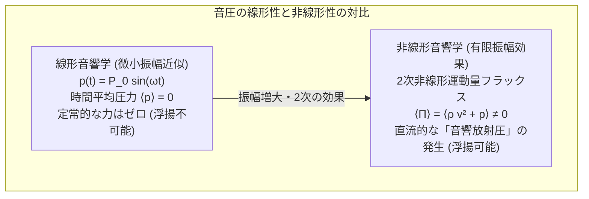
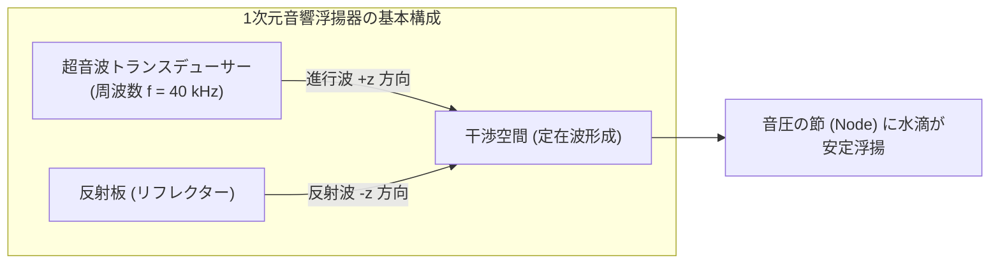
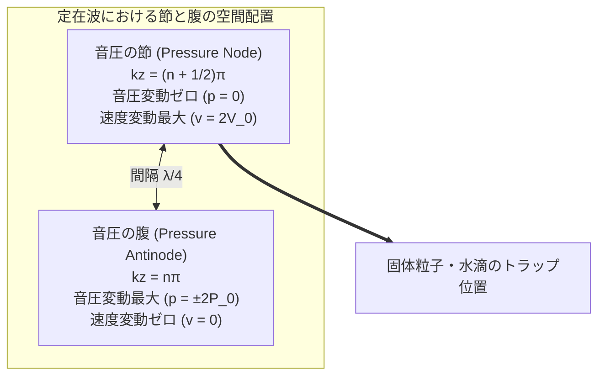
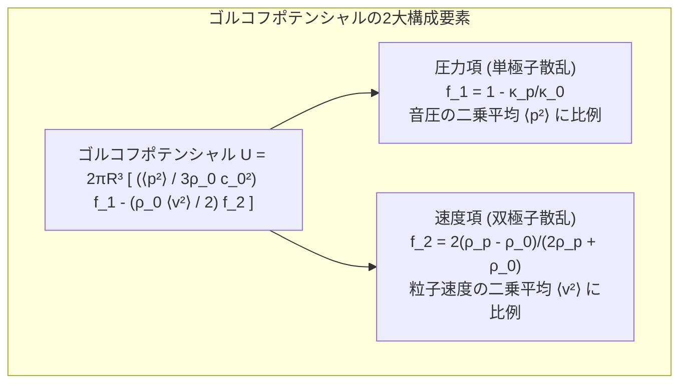
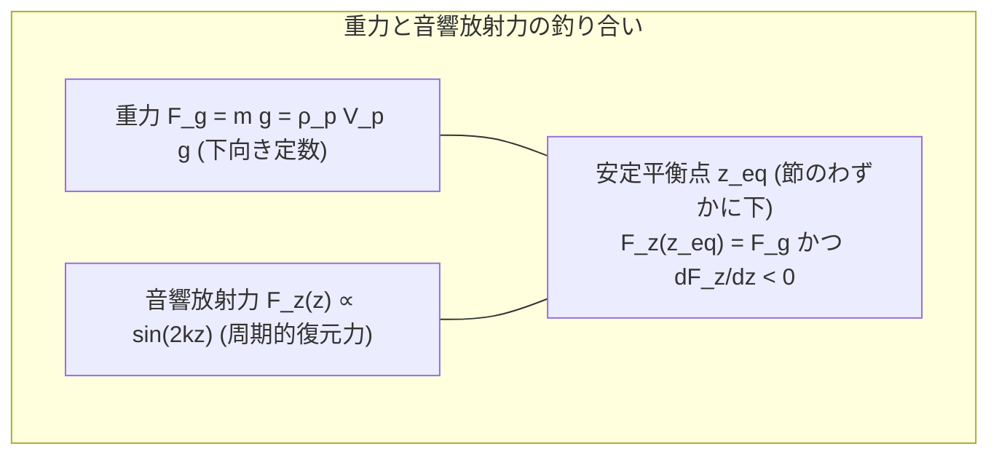
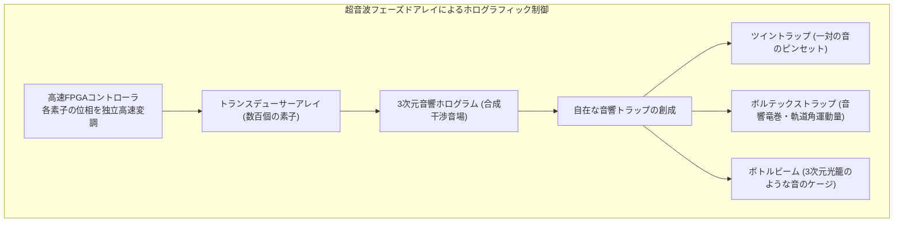
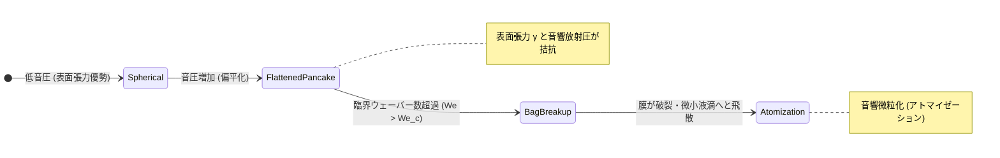

何の支えもない実験室の空気中に、一滴の水滴が完全な球体を保ったまま、まるで宇宙空間の無重力状態にあるかのように静止して浮かんでいます。その隣では、小さな昆虫や電子部品、あるいは生きた細胞が、誰の手にも触れられることなく空中に捕らえられ、見えない操り人形のように上下左右へと自由自在に移動し、さらには空中で別の液滴と融合して化学反応を開始します。

磁石に引き寄せられない水やプラスチック、木片、生体組織であっても、まったく同じように宙に浮かせることができる——このまるでSFの「反重力ビーム」や「トラクタービーム」を現実の物理法則によって具現化した先端技術こそが、<strong>「音響浮揚（Acoustic Levitation）」</strong>です。

私たちが耳で聞く日常の「音」は、空気の微小な圧力の波に過ぎず、鼓膜をわずかに震わせる程度の極めて繊細な現象です。しかし、周波数を人間の可聴域を超えた超音波領域（数十キロヘルツ以上）に引き上げ、特殊な干渉パターンである「定在波（Standing Wave）」を構築すると、音波は物質の重量を支え、空中で三次元的に拘束する強大な物理的な力——<strong>「音響放射力（Acoustic Radiation Force）」</strong>——を発揮するようになります。

本稿では、日常の音波がなぜ質量を持った物体を支える「力」へと変貌するのか、その非線形音響学の核心に迫ります。線形近似の限界から二次非線形効果によるレイリー・ランジュバン放射圧の発生機構、レフ・ゴルコフ（Lev Gor'kov）による音響放射ポテンシャルのエレガントな数学的導出、超音波フェーズドアレイとホログラフィック音響逆問題アルゴリズムが切り拓いた三次元トラクタービーム、液滴が空中で自壊・破裂する物理的限界、そして無容器結晶化やバイオチップへの最先端応用まで、音響浮揚の驚異的な物理学と工学を余すところなく解明します。

---

## 1. 音はなぜ「力」を持つのか：線形音響学の限界と非線形性

### 1.1 線形音響学のパラドックス：平均圧力は常にゼロである

物理学の入門講義で学ぶ標準的な「線形音響学（Linear Acoustics）」では、音波は流体（空気）の密度 $\rho$、圧力 $p$、粒子速度 $\mathbf{v}$ の微小な周期的揺らぎとして記述されます。

音圧 $p(t)$ が振幅 $P_0$、角振動数 $\omega$ の正弦波として伝播するとき：
$$p(t) = P_0 \sin(\omega t)$$

この音圧の1周期にわたる時間平均 $\langle p \rangle$ を計算すると、正の半周期（圧縮）と負の半周期（希薄）が完全に相殺し合います：
$$\langle p \rangle = \frac{1}{T} \int_0^T P_0 \sin(\omega t) dt = 0$$

同様に、空気分子の媒質振動速度の平均もゼロになります：$\langle \mathbf{v} \rangle = \mathbf{0}$。
もし線形音響学の法則が厳密に成り立つのであれば、音波が物体に及ぼす時間平均の力は常にゼロであり、物体を押したり浮かせたりすることは絶対に不可能なはずです。空気が押した分だけ、次の瞬間には同じ力で引き戻されてしまうからです。

では、なぜ現実の強力な超音波は物体を空中に浮かせることができるのでしょうか？

### 1.2 二次の非線形効果と音響放射圧の発生

答えは、音波の振幅が有限の大きさを持ったときに現れる<strong>「非線形流体力学効果（Nonlinear Hydrodynamics）」</strong>にあります。

流体の運動を記述する厳密なオイラー方程式（Euler Equation）を考えます：
$$\rho \left( \frac{\partial \mathbf{v}}{\partial t} + (\mathbf{v} \cdot \nabla) \mathbf{v} \right) = -\nabla p$$

左辺の第2項にある移流項 $(\mathbf{v} \cdot \nabla) \mathbf{v}$ は、流速 $\mathbf{v}$ に関する<strong>2次の非線形項</strong>です。音波の振幅が微小なときはこの項を無視できますが、音圧が $140 \sim 160\,\text{dB}$（ジェット機のエンジンの直近に匹敵する超音波）に達すると、この2次項が決して無視できない大きさに成長します。

流体中の単位面積を通過する運動量フラックス密度テンソル $\Pi_{ij}$ は以下のように与えられます：
$$\Pi_{ij} = p \delta_{ij} + \rho v_i v_j$$

気体の状態方程式を圧力と密度の関係として2次の項までテイラー展開します：
$$p - p_0 = c_0^2 (\rho - \rho_0) + \frac{1}{2} \left( \frac{\partial^2 p}{\partial \rho^2} \right)_0 (\rho - \rho_0)^2 + \dots$$

この運動量フラックスの時間平均を計算すると、振動成分は相殺されますが、2次の積の項 $\langle \rho v^2 \rangle$ や $\langle (\rho - \rho_0)^2 \rangle$ は常に正の値を持ち、ゼロにならずに生き残ります！

この時間平均された非ゼロの定常的な力学的作用を<strong>「音響放射圧（Acoustic Radiation Pressure）」</strong>と呼びます。交流の電気信号をダイオードで整流すると直流電流が取り出せるように、超音波の激しい交流振動が流体の非線形性によって整流され、一方向へと持続的に押し続ける<strong>「直流の力（DC Force）」</strong>へと変換されるのです。

### 1.3 レイリー放射圧とランジュバン放射圧の定義

音響放射圧には、歴史的に2つの異なる定義が存在します：
1. <strong>レイリー放射圧（Rayleigh Radiation Pressure）</strong>：
   流体の体積が一定に保たれた完全密閉容器内において、音波が存在することによって生じる時間平均圧力の基準値からの上昇分。
2. <strong>ランジュバン放射圧（Langevin Radiation Pressure）</strong>：
   音波の場と外部の静止した流体（大気など）との間で流体が自由に移動できる開放系において、障害物の界面に働く実質的な力。

音響浮揚において問題となるのは、この<strong>ランジュバン放射圧</strong>です。平面波が反射率 $R_{\text{ref}}$ の障害物に垂直に入射したときの時間平均放射圧 $P_{\text{rad}}$ は、音のエネルギー密度 $\langle E \rangle$ を用いて以下のように表されます：
$$P_{\text{rad}} = (1 + R_{\text{ref}}) \langle E \rangle$$
完全反射（$R_{\text{ref}} = 1$）の場合、放射圧は音響エネルギー密度のちょうど2倍（$2 \langle E \rangle$）に達します。

---

## 2. 定在波（Standing Waves）と音響トラップの幾何学

### 2.1 対向波の干渉と定在波の形成

進行波（一方向に進む音波）の放射圧は物体を進行方向へと吹き飛ばす「音の風（音響流）」として働きます。しかし、物体を空間の一点に安定して静止浮揚させるためには、あらゆる方向からの復元力を持つ「トラップ（井戸）」を形成しなければなりません。

最も古典的かつ強力な配置は、<strong>同軸上に対向させた超音波振動子（トランスデューサー）と反射板（リフレクター）</strong>、あるいは向かい合う一対の振動子を用いた系です。

トランスデューサーから放射された角振動数 $\omega = 2\pi f$、波数 $k = 2\pi / \lambda$ の進行波：
$$p_1(z, t) = P_0 \cos(k z - \omega t)$$
と、反射板から跳ね返ってきた逆向きの進行波：
$$p_2(z, t) = P_0 \cos(k z + \omega t)$$
が空間で重なり合うと、三角関数の加法定理によって波は完全に分離された<strong>定在波（Standing Wave）</strong>となります：

$$p(z, t) = p_1 + p_2 = 2 P_0 \cos(k z) \cos(\omega t)$$

対応する流体粒子の媒質振動速度 $v(z, t)$ は、オイラー方程式 $\rho_0 \frac{\partial v}{\partial t} = -\frac{\partial p}{\partial z}$ より：
$$v(z, t) = \frac{2 P_0}{\rho_0 c_0} \sin(k z) \sin(\omega t) = 2 V_0 \sin(k z) \sin(\omega t)$$

### 2.2 節（Node）と腹（Antinode）の空間的ズレ

定在波の決定的な特徴は、音圧の節と速度の節が空間的に<strong>$\lambda / 4$（4分の1波長）だけずれている</strong>ことです：
1. <strong>音圧の節（Pressure Node）</strong>：$\cos(kz) = 0 \implies z = \frac{\lambda}{4}, \frac{3\lambda}{4}, \dots$
   ここでは気圧の変動が完全にゼロであり、空気は圧縮も希薄化もされません。しかし、空気分子は左右に最大速度 $2 V_0$ で激しく往復運動しています（速度の腹）。
2. <strong>音圧の腹（Pressure Antinode）</strong>：$\sin(kz) = 0 \implies z = 0, \frac{\lambda}{2}, \lambda, \dots$
   ここでは気圧が巨大な振幅 $\pm 2 P_0$ で激しく変動しますが、空気分子の平均速度はゼロです（速度の節）。

この圧力と速度の空間的勾配こそが、後述するゴルコフポテンシャルの谷を作り出す源泉となります。

---

## 3. ゴルコフポテンシャルの数理：放射力の完全導出

音波の中に置かれた物体に働く力を、粒子の表面全体にわたって非線形な流体応力テンソルを面積分して求める計算は、極めて難解です。1962年、ソ連の理論物理学者<strong>レフ・ペトロヴィチ・ゴルコフ（Lev Petrovich Gor'kov）</strong>は、波長に比べて十分に小さな球形粒子（$R \ll \lambda$）に働く音響放射力を、息をのむほど美しい「単一のポテンシャル関数の勾配」として定式化しました。

### 3.1 ゴルコフの音響放射ポテンシャル（Gor'kov Potential）

任意の不均一な三次元音場の中に置かれた半径 $R$、密度 $\rho_p$、体積弾性率 $K_p$（圧縮率 $\kappa_p = 1/K_p$）の微小球を考えます。周囲の流体媒質（空気）の密度を $\rho_0$、音速を $c_0$、圧縮率を $\kappa_0 = 1/(\rho_0 c_0^2)$ とします。

ゴルコフは、粒子に働く時間平均音響放射力 $\mathbf{F}^{\text{rad}}$ が、スカラーポテンシャル $U$ の負の勾配として表されることを厳密に証明しました：

$$\mathbf{F}^{\text{rad}} = -\nabla U$$

ここで、<strong>ゴルコフポテンシャル $U$</strong> は以下の普遍式で与えられます：

$$U = 2 \pi R^3 \left[ \frac{\langle p^2 \rangle}{3 \rho_0 c_0^2} f_1 - \frac{\rho_0 \langle |\mathbf{v}|^2 \rangle}{2} f_2 \right]$$

この式には2つの無次元コントラスト係数 $f_1$ と $f_2$ が含まれています：

1. <strong>単極子コントラスト係数（Monopole Factor, 体積振動）</strong>：
   $$f_1 = 1 - \frac{\kappa_p}{\kappa_0}$$
   粒子の圧縮率 $\kappa_p$ と周囲流体の圧縮率 $\kappa_0$ の差に起因します。音圧の圧力変動によって粒子自身が風船のように伸縮するときに生じる散乱波の寄与を表します。

2. <strong>双極子コントラスト係数（Dipole Factor, 並進振動）</strong>：
   $$f_2 = \frac{2 (\rho_p - \rho_0)}{2 \rho_p + \rho_0}$$
   粒子の密度 $\rho_p$ と周囲流体の密度 $\rho_0$ の差に起因します。周囲の流体の往復運動に対して、粒子がその慣性質量のために遅れて揺さぶられるときに生じる双極子散乱の寄与を表します。

### 3.2 空気中における固体・液体のコントラスト係数の評価

空気中（$\rho_0 \approx 1.2\,\text{kg/m}^3, c_0 \approx 343\,\text{m/s}$）に水滴や固体粒子（$\rho_p \sim 10^3\,\text{kg/m}^3$）を置く場合を計算してみましょう：
- 粒子の密度は空気の約1000倍以上：$\rho_p \gg \rho_0$
  $$f_2 = \frac{2(\rho_p - \rho_0)}{2\rho_p + \rho_0} \approx \frac{2\rho_p}{2\rho_p} = 1$$
- 固体や液体は空気よりも圧倒的に硬く、圧縮率は無視できるほど小さい：$\kappa_p \ll \kappa_0$
  $$f_1 = 1 - \frac{\kappa_p}{\kappa_0} \approx 1 - 0 = 1$$

空気中のほぼすべての固体および液体に対して、$f_1 \approx 1$ かつ $f_2 \approx 1$ という極めてシンプルな極限が成り立ちます！

このとき、ゴルコフポテンシャルは以下のように簡単化されます：
$$U \approx 2 \pi R^3 \left[ \frac{\langle p^2 \rangle}{3 \rho_0 c_0^2} - \frac{\rho_0 \langle |\mathbf{v}|^2 \rangle}{2} \right]$$

### 3.3 1次元定在波における浮揚力の計算

前節の1次元定在波の式を代入します：
- $\langle p^2 \rangle = \frac{1}{2} (2 P_0 \cos kz)^2 = 2 P_0^2 \cos^2(kz)$
- $\langle v^2 \rangle = \frac{1}{2} \left( \frac{2 P_0}{\rho_0 c_0} \sin kz \right)^2 = \frac{2 P_0^2}{\rho_0^2 c_0^2} \sin^2(kz)$

これをゴルコフポテンシャルに代入すると：
$$U(z) = 2 \pi R^3 \left[ \frac{2 P_0^2 \cos^2(kz)}{3 \rho_0 c_0^2} - \frac{\rho_0}{2} \frac{2 P_0^2 \sin^2(kz)}{\rho_0^2 c_0^2} \right] = \frac{2 \pi R^3 P_0^2}{\rho_0 c_0^2} \left[ \frac{2}{3} \cos^2(kz) - \sin^2(kz) \right]$$

三角関数の関係式を用いて整理すると、ポテンシャルは空間的に周期 $\lambda / 2$ で振動する正弦波となります。

粒子に働く鉛直方向の放射力 $F_z = -\frac{dU}{dz}$ を計算します：
$$F_z(z) = -\frac{dU}{dz} = V_p \left( \frac{5}{6} \right) \frac{k P_0^2}{\rho_0 c_0^2} \sin(2 k z)$$
（ここで $V_p = \frac{4}{3}\pi R^3$ は粒子の体積）

この力の式は驚くべき物理的結論を示しています：
1. <strong>ポテンシャルの極小点（安定トラップ位置）</strong>：
   粒子はポテンシャル $U(z)$ が極小となる位置へと引き寄せられます。空気中の固体や液体では、$U(z)$ の極小値はまさに<strong>「音圧の節（Pressure Node: $z = \lambda/4, 3\lambda/4$）」</strong>に一致します。
2. <strong>重力との釣り合い</strong>：
   重力 $F_g = m g = \rho_p V_p g$ が下向きに働くため、粒子は音圧の節の真ん中ではなく、<strong>節からわずかに下流（重力方向）にシフトした位置 $z_{\text{eq}}$</strong> で音響放射力の上向き成分と重力が釣り合って静止します：
   $$F_z(z_{\text{eq}}) = \rho_p V_p g$$
3. <strong>バネのような復元力（フックの法則）</strong>：
   平衡点 $z_{\text{eq}}$ の近傍では、音響放射力は変位に対して線形な復元力 $F_z \approx -k_{\text{trap}} (z - z_{\text{eq}})$ を及ぼすため、粒子は外乱に対して安定に空中に保持されます。

---

## 4. 単一軸からフェーズドアレイへ：3D音響ホログラムとトラクタービーム

### 4.1 従来の1次元定在波浮揚の限界

長年用いられてきた単一軸型の浮揚装置（トランスデューサーと反射板を対向させたもの）には、工学的に極めて深刻な制約が存在しました：
- <strong>位置が固定される</strong>：波長 $\lambda$ によって決まる節の位置にしかトラップできず、物体を空中で自由に移動させることができない。
- <strong>反射板が必須</strong>：対向する位置に硬い板を設置しなければならず、作業空間が著しく制限される。
- <strong>横方向（水平面内）の拘束力が弱い</strong>：鉛直方向の放射力に比べて横方向の音圧勾配が緩やかなため、粒子が横からすっぽ抜けて落下しやすい。

### 4.2 超音波フェーズドアレイ（Phased Array）の革命

2010年代半ば、英国ブリストル大学のスリラム・スブラマニアン（Sriram Subramanian）教授やアスマール・マルゾ（Asier Marzo）博士らは、この制約を根底から覆すブレイクスルーを達成しました。それが<strong>超音波フェーズドアレイ技術を用いた「音響トラクタービーム」</strong>です。

数百個に及ぶ安価な小型超音波振動子（直径約 $10\,\text{mm}$、周波数 $40\,\text{kHz}$）を平面や半球面に敷き詰め、それぞれの素子から出力する音波の<strong>振幅と位相（Phase $\phi_j$）をマイクロ秒単位で個別に電子制御（フェーズドアレイ制御）</strong>します。

### 4.3 音響ホログラムの逆問題アルゴリズム

空中の目標点 $\mathbf{r}_t$ に所望のトラップポテンシャル（音圧ゼロで周囲の音圧勾配が最大となる場）を形成するためには、各振動子 $j$（位置 $\mathbf{r}_j$）の励振位相 $\phi_j$ を高速に逆算する必要があります。

合成音圧 $p(\mathbf{r})$ は各振動子からの球面波の線形重ね合わせとして表されます：
$$p(\mathbf{r}) = \sum_{j=1}^N \frac{A_j}{|\mathbf{r} - \mathbf{r}_j|} D(\theta_j) e^{i (k |\mathbf{r} - \mathbf{r}_j| + \phi_j)}$$
（ここで $D(\theta)$ はトランスデューサーの指向性関数）

目標点においてゴルコフポテンシャル $U$ の極小条件を満たす位相ベクトル $\boldsymbol{\phi} = (\phi_1, \dots, \phi_N)$ の決定には、光学分野の<strong>ガーチバーグ・サクストン（Gerchberg-Saxton）アルゴリズム</strong>を音響学に応用した反復法や、ゴルコフテンソルを直接最大化する凸最適化（Eigen-decomposition法）が用いられます。これにより、現代の音響浮揚システムは、毎秒数百回のフレームレートで空間内の複数のトラップ位置を動的に再計算し、空中での多粒子独立マニピュレーションを可能にしています。

---

## 5. 浮かせられる物体の物理的制約と極限

音響浮揚はあらゆる物質を浮かせられる万能の魔法のように見えますが、その根底には流体力学と弾性論に支配された厳格な物理的限界が存在します。

### 5.1 粒子サイズの限界（レイリー限界）

ゴルコフの散乱理論は、粒子半径 $R$ が音波の波長 $\lambda$ に比べて十分に小さい<strong>レイリー散乱領域（$R \ll \lambda$、通常 $R < \lambda / 4$）</strong>を前提としています。

空気中を伝播する周波数 $f = 40\,\text{kHz}$ の超音波の場合：
$$\lambda = \frac{c_0}{f} = \frac{343\,\text{m/s}}{40\,\text{kHz}} \approx 8.58\,\text{mm}$$

したがって、安定して浮揚できる粒子の最大直径 $2R$ は、波長の半分以下、すなわち<strong>およそ $3 \sim 4\,\text{mm}$ 程度が上限</strong>となります。粒子が波長と同等以上の大きさ（$R \ge \lambda$）になると、波が粒子の表面で複雑に回折・散乱し、定在波の構造そのものが破壊されてトラップ力を失ってしまいます。より大きな物体を浮かすためには、可聴域に近い低周波の音波（波長が長い波）を用いる必要がありますが、今度は人間にとって耐え難い騒音公害を引き起こすというトレードオフが生じます。

### 5.2 密度限界と音圧の非線形衝撃波限界

金（密度 $19.3\,\text{g/cm}^3$）やタングステン（$19.25\,\text{g/cm}^3$）、白金などの超高密度な重金属球を浮遊させるには、重力を打ち消すための極めて強力な音圧 $P_0$ が必要です。

ゴルコフ力は音圧の2乗 $P_0^2$ に比例するため、密度が10倍になれば必要な音圧振幅は $\sqrt{10} \approx 3.16$ 倍になります。
しかし、音圧を際限なく上げることはできません：
- 音圧が $160 \sim 170\,\text{dB}$ を超えると、空気の非線形性によって正弦波の山が谷に追いつき、波形が急峻化して<strong>音響衝撃波（Shock Waves）</strong>が発生します。
- 衝撃波に伴う激しい熱散逸と乱流（音響ストリーミング / 音響流）が周囲に吹き荒れ、安定したトラップを吹き飛ばしてしまいます。

### 5.3 液滴の変形と微粒化限界（アコースティック・アトマイゼーション）

固体粒子と異なり、液体（水滴など）を浮揚させる際には、<strong>液滴の形態安定性</strong>が重大な制約となります。

空中に浮揚した水滴の上下の極には、音圧による強い圧縮力が加わります。一方で赤道面には外向きの力が働くため、水滴は球形から<strong>偏平な「どら焼き型（パンケーキ状）」</strong>へと押しつぶされます。

この変形は、音響放射力と液体の表面張力 $\gamma$ の比を表す無次元数、<strong>音響ウェーバー数（Acoustic Weber Number, $We_a$）</strong>によって支配されます：

$$We_a = \frac{P_0^2 R}{\rho_0 c_0^2 \gamma}$$

音圧を上げすぎて $We_a$ が臨界値（通常 $We_{a,\text{crit}} \approx 3 \sim 4$）を超えると、円盤状に広がった液滴の中心部が風船のように膨らんで破裂する「バッグ破砕（Bag Breakup）」を起こし、何百もの微細な霧へと瞬時に四散します（<strong>音響アトマイゼーション</strong>）。水滴を浮かせる際には、重力を支える力と、液滴を自壊させない表面張力のバランスが極めてシビアに要求されるのです。

---

## 6. 最先端の応用フロンティア

音響浮揚は、単なる物理のデモンストレーションを超え、現代のハイテク産業と先端科学を牽引する不可欠なツールへと進化しています。

| 応用分野 | 具体的な技術・用途 | 音響浮揚がもたらす革新的メリット |
|---|---|---|
| <strong>創薬・構造生物学</strong> | タンパク質の結晶化、無容器アモルファススクリーニング | 容器壁面からの不純物混入や不均一核形成を $100\%$ 排除 |
| <strong>生化学・分析化学</strong> | 一滴の液滴内での超微量化学合成・DNA増幅 | 試薬の損失ゼロ、ピペット不要の完全非接触分注・融合 |
| <strong>バイオメディカル</strong> | 血液中の循環腫瘍細胞（CTC）の音響分離 | 細胞に物理的ストレスを与えない生体適合性の高いソーティング |
| <strong>先端材料工学</strong> | 超高融点金属（チタン・ジルコニウム等）の過冷却凝固 | るつぼ容器との化学反応を防ぎ、純度 $99.999\%$ の新合金創成 |
| <strong>ヒューマンインターフェース</strong> | 空中ハプティクス（触覚フィードバック）・空中ディスプレイ | 何もない空中に「触れる感触」を提示、浮遊粒子の残像プロジェクション |
| <strong>宇宙工学</strong> | 微小重力環境での流体実験・小惑星試料ハンドリング | 重力のない宇宙船内での飛散防止および高精度サンプリング |

### 6.1 無容器結晶成長（Containerless Processing）

新薬の開発において、化合物の結晶多形（ポリモルフ）の制御は極めて重要です。通常の試験管やシャーレの中で溶液を結晶化させると、どうしても容器の壁面の微小なキズやホコリが種結晶となり、最も安定な（しかし生体吸収率の低い）結晶形へと誘導されてしまいます。

音響浮揚を用いれば、空中に保持された液滴は<strong>容器壁との接触が物理的に厳密にゼロ</strong>です。過飽和状態を限界まで高めることが可能となり、通常の方法では得られない高活性な準安定結晶や、水に溶けにくい薬物を均一なアモルファス（非晶質）ナノ粒子として析出させることができます。

### 6.2 宇宙工学と地上シミュレーション

国際宇宙ステーション（ISS）などの微小重力環境では、液体は容器に収まらず球体となって船内を浮遊します。この宇宙環境下で液滴を望みの位置に保持し、実験操作を行うためのツールとして、音響浮揚装置（Acoustic Levitation Furnace）が長年にわたり活用されてきました。地上では重力があるため大パワーが必要ですが、宇宙空間では微小な音響放射力だけで安全に液滴をポジショニングでき、過冷却凝固や熱物性計測の精度が飛躍的に向上します。

### 6.4 マイクロ流体デバイスと音響ピンセット（音響流体力学）

微小流路（マイクロ流路）内において細胞や微粒子を非接触・非破壊で濃縮・整列・選別する技術は<strong>「音響マイクロ流体力学（Acoustofluidics）」</strong>と呼ばれ、次世代のオンチップ医療検査装置（Lab-on-a-Chip）の基盤となっています。表面弾性波（SAW: Surface Acoustic Wave）を用いて流路内に定在波を励起すると、血球細胞のサイズや密度の違いによってゴルコフ放射力の大きさが異なるため、希少ながん細胞（循環腫瘍細胞: CTC）を正常な赤血球や白血球から高精度に連続分離することが可能です。

### 6.3 空中ハプティクス：音に触れる触覚インターフェース

超音波フェーズドアレイの焦点（高音圧トラップ）を人間の手のひらの皮膚表面に合わせると、皮膚内部の触覚受容器（マイスナー小体やパチニ小体）が超音波放射圧を感知し、<strong>「何もない空間に物体があるかのようなリアルな触感」</strong>を感じることができます。

VR/ARゴーグルと組み合わせることで、空中に浮かぶ仮想のボタンを押した感触や、手の中にCGの小鳥が乗って歩いているような微細な振動を、グローブなどを一切装着することなく完全な素手で体験できる未来型インターフェースが実用化されています。

---

## 7. 結論：見えない波が切り拓く物質操作の未来

音とは、本質的に物質の震えです。

私たちは古来、その震えを耳で捉えて「音楽」や「言葉」として享受してきました。しかし非線形物理学と現代の電子工学が融合したとき、音は単なる情報の伝達媒体を超えて、<strong>物質を空間に繋ぎ止め、重力を手懐け、自在に操る「見えない手」</strong>へと昇華しました。

目に見えず、耳にも聞こえない超音波の定在波の中に、宝石のようにきらめく水滴が浮かび上がる瞬間——そこには、オイラー方程式からゴルコフポテンシャルへと至る数理物理学の精緻な論理と、自然界に潜む見えない力の調和が、これ以上ないほど美しく凝縮されているのです。
