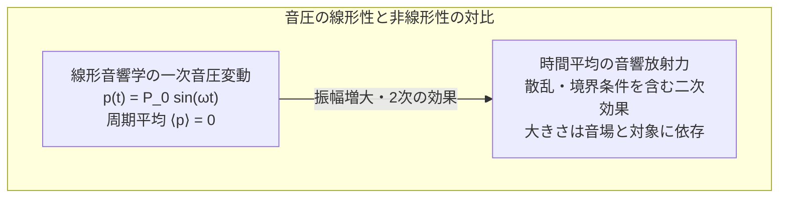
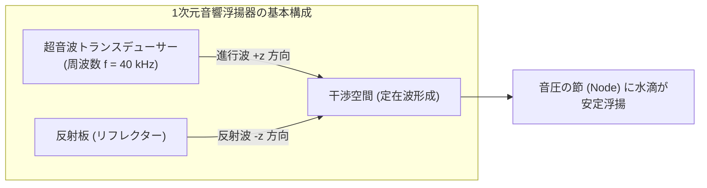
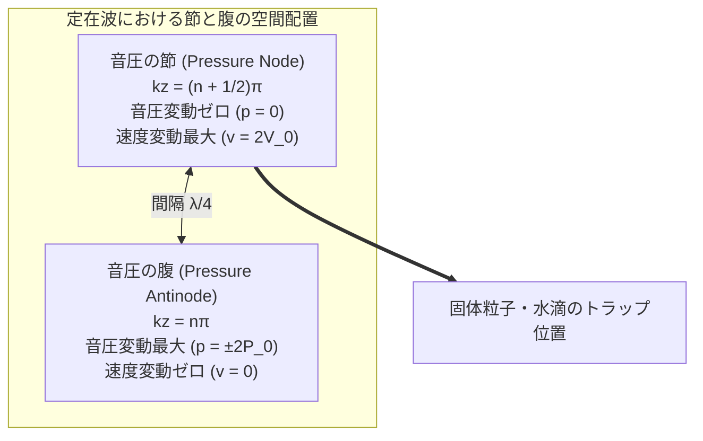
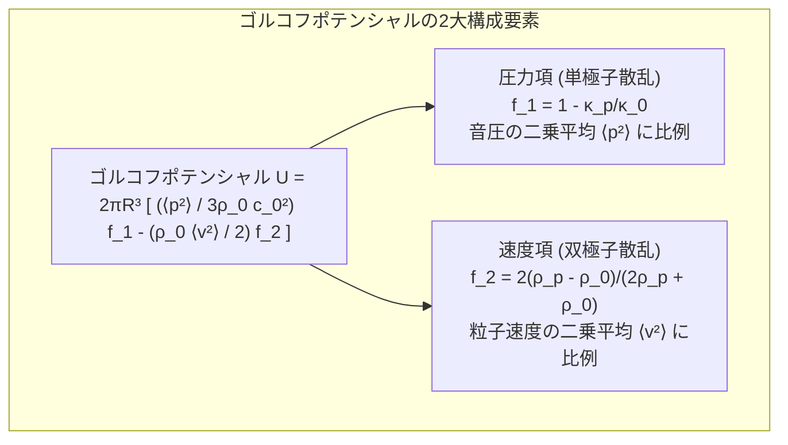
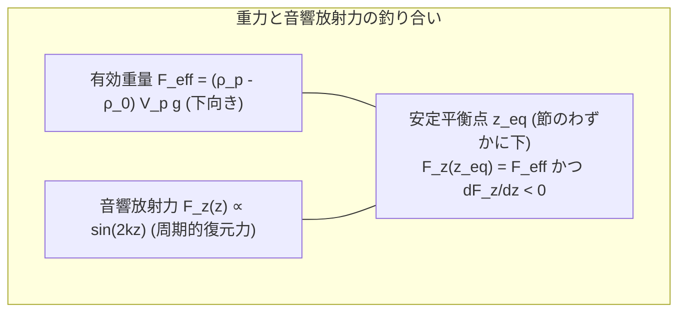

音響浮揚では、強い音場を使って液滴や小さな粒子を固体面に触れさせずに保持できます。対象が完全な球形のまま静止するとは限らず、位置や形状の安定性は音場・対象の物性・装置の構成に左右されます。装置によっては、捕捉した対象を移動・回転させることもできます。

磁性の有無ではなく、音場と対象の相互作用が浮揚を決めます。音響浮揚は重力を打ち消す「反重力」ではなく、時間平均された音響放射力などで重力と釣り合う力を作る方法です。対象の種類や操作できる方向には装置ごとの制約があります。

可聴域を超える超音波は、定在波などの音場を作るのに使われます。音の一次の圧力変動は周期平均でゼロでも、それだけで物体に働く平均力がゼロとは言えません。音響放射力は、音場と物体による散乱を含む時間平均の効果です。ここでは、小球に対する代表的な近似と、その適用範囲を説明します。

本稿では、音場の時間平均力、定在波の節と腹、小さな球に対するゴルコフポテンシャルを順に見ます。さらに、位相アレイによる操作、液滴の変形・分裂、および容器を使わない試料操作や音響マイクロ流体などの研究例を紹介します。各結果は特定の装置や条件に依存するため、単一の音圧しきい値や対象サイズを普遍的な限界として扱わないよう注意します。

---

## 1. 音はなぜ「力」を持つのか：線形音響学の限界と非線形性

### 1.1 線形音響学のパラドックス：平均圧力は常にゼロである

線形音響学では、密度・圧力・粒子速度を、平衡状態からの小さな周期変動として扱います。ここでの $p(t)$ は静圧 $p_0$ そのものではなく、音圧変動です。

音圧変動を振幅 $P_0$、角振動数 $\omega$ の正弦波として表すと：

$$p(t) = P_0 \sin(\omega t)$$

この音圧の1周期にわたる時間平均 $\langle p \rangle$ を計算すると、正の半周期（圧縮）と負の半周期（希薄）が完全に相殺し合います：
$$\langle p \rangle = \frac{1}{T} \int_0^T P_0 \sin(\omega t) dt = 0$$

同様に、空気分子の媒質振動速度の平均もゼロになります：$\langle \mathbf{v} \rangle = \mathbf{0}$。
この計算が示すのは、音圧変動の一次の周期平均がゼロということです。物体に働く平均力は、散乱や音場の空間分布に伴う二次の効果を含めて求める必要があり、「各半周期の押し引きが必ず相殺する」とは結論できません。

### 1.2 二次の非線形効果と音響放射圧の発生

答えは、音波の振幅が有限の大きさを持ったときに現れる<strong>「非線形流体力学効果（Nonlinear Hydrodynamics）」</strong>にあります。

流体の運動を記述する厳密なオイラー方程式（Euler Equation）を考えます：
$$\rho \left( \frac{\partial \mathbf{v}}{\partial t} + (\mathbf{v} \cdot \nabla) \mathbf{v} \right) = -\nabla p$$

左辺の第2項にある[移流項](/p/navier-stokes-equations/) $(\mathbf{v} \cdot \nabla) \mathbf{v}$ は非線形項の一つです。音響放射力を求めるには、一次の音場だけでなく、時間平均に寄与する二次の応力・運動量輸送を考慮します。どの項を残すかは、音場・境界条件・近似の取り方によります。特定の dB 値を境に二次効果が一律に重要になるわけではありません。

非粘性流体について、全圧力 $p$ を用いる運動量フラックスの一つの表現は次のとおりです。符号や応力の定義は採用する規約に注意が必要です：
$$\Pi_{ij} = p \delta_{ij} + \rho v_i v_j$$

気体の状態方程式を圧力と密度の関係として2次の項までテイラー展開します：
$$p - p_0 = c_0^2 (\rho - \rho_0) + \frac{1}{2} \left( \frac{\partial^2 p}{\partial \rho^2} \right)_0 (\rho - \rho_0)^2 + \dots$$

小振幅展開では一次の周期変動の平均はゼロになりますが、二次の項が時間平均に寄与します。ただし、各二次項が正であることだけから、物体に働く力の向きや大きさは決まりません。散乱、空間勾配、形状、境界条件を含めて力を求めます。

物体に働く合力の時間平均を<strong>音響放射力</strong>と呼びます。表面上の平均応力を指して「音響放射圧」と呼ぶ場合もあります。この効果を交流の整流にたとえることはできますが、実際の向きと大きさは音場と境界条件から決まります。

### 1.3 放射圧・放射力と境界条件

音響放射力は、音場にある物体へ働く時間平均力です。表面での応力を「放射圧」と呼ぶ場合もありますが、その値は物体の反射・吸収、音場、平均圧力の境界条件によって変わります。平面進行波が理想的な平面に当たる場合の式を、反射率だけで一般化することはできません。以下では、小球の力を考えるため、適用条件が明確なゴルコフ近似を使います。

---

## 2. 定在波（Standing Waves）と音響トラップの幾何学

### 2.1 対向波の干渉と定在波の形成

進行波（一方向に進む音波）の放射圧は物体を進行方向へと吹き飛ばす「音の風（音響流）」として働きます。しかし、物体を空間の一点に安定して静止浮揚させるためには、あらゆる方向からの復元力を持つ「トラップ（井戸）」を形成しなければなりません。

最も古典的かつ強力な配置は、<strong>同軸上に対向させた超音波振動子（トランスデューサー）と反射板（リフレクター）</strong>、あるいは向かい合う一対の振動子を用いた系です。

トランスデューサーから放射された角振動数 $\omega = 2\pi f$、波数 $k = 2\pi / \lambda$ の進行波：
$$p_1(z, t) = P_0 \cos(k z - \omega t)$$
と、反射板から跳ね返ってきた逆向きの進行波：
$$p_2(z, t) = P_0 \cos(k z + \omega t)$$
が空間で重なり合うと、三角関数の加法定理によって波は完全に分離された<strong>定在波（Standing Wave）</strong>となります：

$$p(z, t) = p_1 + p_2 = 2 P_0 \cos(k z) \cos(\omega t)$$

対応する流体粒子の媒質振動速度 $v(z, t)$ は、オイラー方程式 $\rho_0 \frac{\partial v}{\partial t} = -\frac{\partial p}{\partial z}$ より：
$$v(z, t) = \frac{2 P_0}{\rho_0 c_0} \sin(k z) \sin(\omega t) = 2 V_0 \sin(k z) \sin(\omega t)$$

### 2.2 節（Node）と腹（Antinode）の空間的ズレ

定在波の決定的な特徴は、音圧の節と速度の節が空間的に<strong>$\lambda / 4$（4分の1波長）だけずれている</strong>ことです：
1. <strong>音圧の節（Pressure Node）</strong>：$\cos(kz) = 0 \implies z = \frac{\lambda}{4}, \frac{3\lambda}{4}, \dots$
   ここでは気圧の変動が完全にゼロであり、空気は圧縮も希薄化もされません。しかし、空気分子は左右に最大速度 $2 V_0$ で激しく往復運動しています（速度の腹）。
2. <strong>音圧の腹（Pressure Antinode）</strong>：$\sin(kz) = 0 \implies z = 0, \frac{\lambda}{2}, \lambda, \dots$
   ここでは気圧が巨大な振幅 $\pm 2 P_0$ で激しく変動しますが、空気分子の平均速度はゼロです（速度の節）。

この圧力と速度の空間的勾配こそが、後述するゴルコフポテンシャルの谷を作り出す源泉となります。

---

## 3. ゴルコフポテンシャルの数理：放射力の完全導出

音波の中に置かれた物体に働く力を、粒子の表面全体にわたって非線形な流体応力テンソルを面積分して求める計算は、極めて難解です。1962年、ソ連の理論物理学者<strong>レフ・ペトロヴィチ・ゴルコフ（Lev Petrovich Gor'kov）</strong>は、波長に比べて十分に小さな球形粒子（$R \ll \lambda$）に働く音響放射力を、息をのむほど美しい「単一のポテンシャル関数の勾配」として定式化しました。

### 3.1 ゴルコフの音響放射ポテンシャル（Gor'kov Potential）

任意の不均一な三次元音場の中に置かれた半径 $R$、密度 $\rho_p$、体積弾性率 $K_p$（圧縮率 $\kappa_p = 1/K_p$）の微小球を考えます。周囲の流体媒質（空気）の密度を $\rho_0$、音速を $c_0$、圧縮率を $\kappa_0 = 1/(\rho_0 c_0^2)$ とします。

ゴルコフは、粒子に働く時間平均音響放射力 $\mathbf{F}^{\text{rad}}$ が、スカラーポテンシャル $U$ の負の勾配として表されることを厳密に証明しました：

$$\mathbf{F}^{\text{rad}} = -\nabla U$$

ここで、<strong>ゴルコフポテンシャル $U$</strong> は以下の普遍式で与えられます：

$$U = 2 \pi R^3 \left[ \frac{\langle p^2 \rangle}{3 \rho_0 c_0^2} f_1 - \frac{\rho_0 \langle |\mathbf{v}|^2 \rangle}{2} f_2 \right]$$

この式には2つの無次元コントラスト係数 $f_1$ と $f_2$ が含まれています：

1. <strong>単極子コントラスト係数（Monopole Factor, 体積振動）</strong>：
   $$f_1 = 1 - \frac{\kappa_p}{\kappa_0}$$
   粒子の圧縮率 $\kappa_p$ と周囲流体の圧縮率 $\kappa_0$ の差に起因します。音圧の圧力変動によって粒子自身が風船のように伸縮するときに生じる散乱波の寄与を表します。

2. <strong>双極子コントラスト係数（Dipole Factor, 並進振動）</strong>：
   $$f_2 = \frac{2 (\rho_p - \rho_0)}{2 \rho_p + \rho_0}$$
   粒子の密度 $\rho_p$ と周囲流体の密度 $\rho_0$ の差に起因します。周囲の流体の往復運動に対して、粒子がその慣性質量のために遅れて揺さぶられるときに生じる双極子散乱の寄与を表します。

### 3.2 空気中における固体・液体のコントラスト係数の評価

空気中（$\rho_0 \approx 1.2\,\text{kg/m}^3, c_0 \approx 343\,\text{m/s}$）に水滴や固体粒子（$\rho_p \sim 10^3\,\text{kg/m}^3$）を置く場合を計算してみましょう：
- 粒子の密度は空気の約1000倍以上：$\rho_p \gg \rho_0$
  $$f_2 = \frac{2(\rho_p - \rho_0)}{2\rho_p + \rho_0} \approx \frac{2\rho_p}{2\rho_p} = 1$$
- 固体や液体は空気よりも圧倒的に硬く、圧縮率は無視できるほど小さい：$\kappa_p \ll \kappa_0$
  $$f_1 = 1 - \frac{\kappa_p}{\kappa_0} \approx 1 - 0 = 1$$

空気中のほぼすべての固体および液体に対して、$f_1 \approx 1$ かつ $f_2 \approx 1$ という極めてシンプルな極限が成り立ちます！

このとき、ゴルコフポテンシャルは以下のように簡単化されます：
$$U \approx 2 \pi R^3 \left[ \frac{\langle p^2 \rangle}{3 \rho_0 c_0^2} - \frac{\rho_0 \langle |\mathbf{v}|^2 \rangle}{2} \right]$$

### 3.3 1次元定在波における浮揚力の計算

前節の1次元定在波の式を代入します：
- $\langle p^2 \rangle = \frac{1}{2} (2 P_0 \cos kz)^2 = 2 P_0^2 \cos^2(kz)$
- $\langle v^2 \rangle = \frac{1}{2} \left( \frac{2 P_0}{\rho_0 c_0} \sin kz \right)^2 = \frac{2 P_0^2}{\rho_0^2 c_0^2} \sin^2(kz)$

これをゴルコフポテンシャルに代入すると：
$$U(z) = 2 \pi R^3 \left[ \frac{2 P_0^2 \cos^2(kz)}{3 \rho_0 c_0^2} - \frac{\rho_0}{2} \frac{2 P_0^2 \sin^2(kz)}{\rho_0^2 c_0^2} \right] = \frac{2 \pi R^3 P_0^2}{\rho_0 c_0^2} \left[ \frac{2}{3} \cos^2(kz) - \sin^2(kz) \right]$$

三角関数の関係式を用いて整理すると、ポテンシャルは空間的に周期 $\lambda / 2$ で振動する正弦波となります。

粒子に働く鉛直方向の放射力 $F_z = -\frac{dU}{dz}$ を計算します：
$$F_z(z) = -\frac{dU}{dz} = V_p \left( \frac{5}{2} \right) \frac{k P_0^2}{\rho_0 c_0^2} \sin(2 k z)$$
（ここで $V_p = \frac{4}{3}\pi R^3$ は粒子の体積です。$P_0$ は各進行波のピーク音圧振幅です。この係数は上のポテンシャルを微分して得ます。実効値など別の振幅規約では表示係数も変わります。）

この力の式は驚くべき物理的結論を示しています：
1. <strong>ポテンシャルの極小点（安定トラップ位置）</strong>：
   この小球近似で音響コントラストが正なら、無重力の理想的な一次元定在波ではポテンシャル極小が音圧の節に現れます。粒子の性質や音場が異なれば、安定位置も変わり得ます。
2. <strong>重力との釣り合い</strong>：
   z 軸を上向きに取り、空気の浮力を考慮すると、有効重量は $(\rho_p-\rho_0)V_p g$ です（$\rho_p\gg\rho_0$ では $\rho_pV_pg$ と近似できます）。浮揚には、装置が作る上向きの放射力がこの有効重量を支える必要があります：
   $$F_z(z_{\text{eq}}) = (\rho_p - \rho_0) V_p g$$
3. <strong>バネのような復元力（フックの法則）</strong>：
   安定平衡点の近くでは、小さな変位への応答を復元力で近似できます。ただし、この一次元モデルだけでは横方向の安定性は保証されません。

---

## 4. 単一軸からフェーズドアレイへ：3D音響ホログラムとトラクタービーム

### 4.1 一次元定在波と位相アレイ

対向する振動子・反射板や二つの振動子で作る一次元定在波では、節や腹の位置が主に音場の波長と境界条件によって決まります。横方向の安定性は一次元モデルだけからは分かりません。

位相アレイは、複数の振動子の位相を調整して音場を形成し、対象の捕捉・移動・回転を行う方法です。実験では片側のアレイを使った三次元操作や、ツイーザー状・渦状・ボトル状の音場が示されています。ただし、対象、周波数、素子数、駆動方法によって性能は異なり、「自由自在な」操作が一般に保証されるわけではありません。

### 4.2 音場設計

2015年、Marzoらは超音波フェーズドアレイの位相を最適化し、単一側のアレイで粒子の三次元捕捉・移動・回転を実験的に示しました。これは特定の装置での実証であり、あらゆる対象を任意に引き寄せる「トラクタービーム」を意味するものではありません。アレイの各振動子の位相を調整して、目的に応じた干渉音場を作ります。素子数、周波数、更新速度はシステムごとに異なります。

目標位置でのトラップ強度を評価し、振動子ごとの位相を最適化する方法が研究されています。例としてMarzoらは、ゴルコフポテンシャルから得られるトラップ指標を用いて位相を数値最適化しました。最適化法や計算速度は装置・目的関数に依存するため、単一のアルゴリズムや毎秒数百回の再計算を音響浮揚一般の仕様として扱うことはできません。

---

## 5. 浮かせられる物体の物理的制約と極限

音響浮揚はあらゆる物質を浮かせられる万能の魔法のように見えますが、その根底には流体力学と弾性論に支配された厳格な物理的限界が存在します。

### 5.1 小球近似と対象サイズ

ゴルコフの式は、球の半径 $R$ が波長に比べて十分小さい条件（$kR \ll 1$、$k=2\pi/\lambda$）で導かれます。これは理論の適用範囲であり、音響浮揚装置が扱える物体の最大サイズを一律に定める規則ではありません。大きさが波長に近い液滴では、小球近似以外のモデルや実測が必要です。

例として、20 ℃の空気中で $f=40\,\text{kHz}$、音速を $c_0=343\,\text{m/s}$ とすると、波長は $\lambda=c_0/f\approx8.6\,\text{mm}$ です。浮揚可能な寸法は、対象の形状・物性・音場・装置の配置と出力に依存します。実際に、特殊な音場を用いた研究では、波長に近い有効直径の水滴が報告されています。

### 5.2 音圧レベルと強い音場

同じ音場でも、対象の質量・サイズ・音響特性と装置の幾何によって、浮揚に必要な駆動条件は異なります。そのため、金属球などを浮かせるのに必要な音圧を単一の dB 値で示すことはできません。音圧レベルを比較するときは、基準音圧（空気中では通常 $20\,\mu\text{Pa}$）、実効値かピーク値か、周波数、測定位置を明記する必要があります。

振幅の大きい音波では波形の非線形な歪みや音響流が重要になることがありますが、衝撃波の発生やトラップの破綻を一律の音圧しきい値で決めることはできません。

### 5.3 液滴の変形と分裂

液滴は音場からの応力と表面張力の釣り合いによって変形します。強い音場では、偏平化や液膜・縁の形成を経て分裂することがあります。ただし分裂の経路と条件は、液体の物性、液滴の大きさ、音場、装置に依存します。

音響浮揚液滴の実験では、扁平化や液膜化に加え、ファラデー波、ケルビン–ヘルムホルツ不安定性、レイリー–テイラー不安定性、レイリー–プラトー不安定性など複数の現象が観察されています。実験条件を越えて適用できる単一の「音響ウェーバー数」や臨界値があるかのようには扱えません。

---

## 6. 研究・応用例

| 分野 | 研究例 | 注意点 |
|---|---|---|
| 音響操作 | 位相アレイやホログラフィック音場による粒子の捕捉・移動・回転 | 操作可能な寸法や方向は音場と装置に依存します。|
| 液滴・材料研究 | 容器に触れさせない液滴の保持・変形・乾燥や結晶化の研究 | 容器壁との接触を避けても、蒸発・音響加熱・周囲気体との相互作用は残ります。|
| 音響マイクロ流体 | 流路内の粒子・細胞の濃縮や分離 | 効果は粒径・密度・圧縮率・流量などに依存し、細胞に常に無害とは限りません。|
| 空中触覚 | 超音波アレイで皮膚に時間変調された圧力を提示する研究 | 感覚は装置・駆動・提示パターンに依存し、空中浮揚と同じ仕組みではありません。|

これらは用途や条件を区別して評価すべき研究分野です。容器を使わないことだけから、汚染・核形成・試料損失が完全にゼロになるとは結論できません。

## 7. 結論：音場で力を制御する

音響浮揚は、音波と対象の相互作用が生む平均力を利用する技術です。

定在波や位相アレイは、対象を保持・操作する音場を作れます。その力や安定性は対象の音響特性、形状、境界条件、装置設計によって変わり、万能な浮揚法ではありません。

ゴルコフポテンシャルはその理解に有用な近似ですが、小球・理想流体などの仮定を伴います。実際の装置や大きな液滴を扱うときは、その仮定を確認し、実験条件に対応するモデルを選ぶことが重要です。

## 参考文献

- L. P. Gor’kov, “On the forces acting on a small particle in an acoustical field in an ideal fluid,” *Soviet Physics Doklady* 6, 773–775 (1962). [書誌情報](https://cir.nii.ac.jp/crid/1570291226443959680)
- A. Marzo et al., “Holographic acoustic elements for manipulation of levitated objects,” *Nature Communications* 6, 8661 (2015). [論文](https://pmc.ncbi.nlm.nih.gov/articles/PMC4627579/)
- E. Cancino-Jaque et al., “On the dynamics of a big drop in acoustic levitation,” *Ultrasonics Sonochemistry* 101 (2023), 106705. [論文](https://pmc.ncbi.nlm.nih.gov/articles/PMC10716583/)
- S. K. Saroj and R. M. Thaokar, “Atomisation of an acoustically levitated droplet: experimental observations of myriad complex phenomena,” *Journal of Fluid Mechanics* 999, A89 (2024). [論文](https://doi.org/10.1017/jfm.2024.523)
