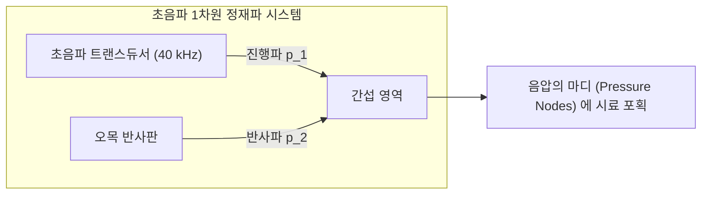

아무런 받침대도 와이어도 없는 현대식 실험실의 허공에 한 방울의 물방울이 완벽한 구형을 유지한 채 우주 공간의 무중력 상태처럼 정지해 떠 있습니다. 그 옆에서는 작은 곤충, 전자 부품, 혹은 살아있는 세포가 보이지 않는 손에 이끌리듯 3차원 공간을 자유자재로 이동하고, 공중에서 다른 시약 방울과 충돌하여 화학 반응을 일으킵니다.

자석에 전혀 반응하지 않는 물, 플라스틱, 목재, 생체 조직마저도 중력을 거슬러 공중에 안정적으로 띄울 수 있는 이 기술——SF 영화 속 '반중력 빔'이나 '트랙터 빔(Tractor Beam)'을 현실의 물리 법칙으로 구현한 것이 바로 <strong>음향 부양(Acoustic Levitation)</strong>입니다.

일상에서 귀로 듣는 소리는 공기 매질의 미세한 압력 섭동에 불과하며, 고막을 살짝 떨리게 하는 극히 미약한 현상입니다. 하지만 주파수를 인간의 가청 한계를 넘는 초음파 영역(수십 킬로헤르츠 이상)으로 높이고, 음파의 간섭을 통해 특수한 '정재파(Standing Wave)'를 형성하면, 소리는 물체의 무게를 지탱하고 공간에 가두는 강력한 물리적 힘인 <strong>음향 방사력(Acoustic Radiation Force)</strong>을 발휘하게 됩니다.

본 글에서는 비선형 음향학과 음향 유체역학의 기초부터 살펴봅니다. 선형 음향학의 역설과 2차 비선형 효과에 의한 직류 음향 방사압의 발생 기구, 소련의 이론물리학자 레프 고르코프(Lev Gor'kov)가 유도한 우아한 음향 방사 포텐셜, 초음파 위상 배열(Phased Array)이 연 3차원 홀로그래픽 트랙터 빔, 공중에서 물방울이 파열하는 물리적 한계, 그리고 무용기 결정화와 바이오칩에 이르는 최첨단 응용까지 음향 부양의 경이로운 과학을 철저하게 해명합니다.

---

## 1. 소리는 어떻게 힘을 갖는가: 비선형 음향학의 비밀

### 1.1 선형 음향학의 역설: 시간 평균 압력은 0이다

기초 물리학에서 배우는 선형 음향학(Linear Acoustics)에 따르면, 음압 $p(t) = P_0 \sin(\omega t)$의 1주기 시간 평균 $\langle p \rangle$은 정확히 0입니다. 양의 압축 구간과 음의 팽창 구간이 완벽히 대칭을 이루어 상쇄되기 때문입니다. 매질 분자의 평균 진동 속도 역시 $\langle \mathbf{v} \rangle = \mathbf{0}$입니다.

선형 음향학의 세계에서는 소리가 물체를 지속적으로 밀어내는 힘이 결코 존재할 수 없습니다.

```mermaid
flowchart TD
    subgraph AcousticParadox ["선형 음향학과 비선형 음향학의 대비"]
        Linear["선형 음향학 (미소 진폭)<br>p(t) = P_0 sin(ωt)<br>시간 평균 힘 ⟨F⟩ = 0<br>물체 부양 불가능"]
        Nonlinear["비선형 음향학 (유한 진폭 효과)<br>운동량 플럭스 2차 텐서<br>⟨Π⟩ = ⟨p + ρ v²⟩ ≠ 0<br>직류 음향 방사압 발생 (부양 가능)"]
    end
    Linear -->|강력한 초음파 음압 (>150 dB)| Nonlinear
```

### 1.2 2차 비선형 유체 효과와 음향 방사압

물체를 공중에 띄우는 힘의 비밀은 바로 <strong>유한 진폭에 의한 2차 비선형 유체역학 효과</strong>에 있습니다.
유체의 오일러 운동방정식에서 대류 가속도 항 $(\mathbf{v} \cdot \nabla) \mathbf{v}$은 속도의 제곱에 비례하는 2차 비선형 항입니다. 소리의 음압이 $150\,\text{dB}$를 넘어서면 이 2차 항이 거대하게 성장합니다.

단위 면적을 통과하는 운동량 플럭스 텐서 $\Pi_{ij} = p \delta_{ij} + \rho v_i v_j$의 시간 평균을 취하면, 1차 진동 성분은 상쇄되지만 2차 제곱 성분 $\langle \rho v^2 \rangle$과 $\langle (\rho')^2 \rangle$은 <strong>항상 양의 값을 가지며 소멸하지 않고 살아남습니다</strong>!

다이오드가 교류 전류를 직류로 정류하듯, 유체의 고유한 비선형성이 초음파의 초고주파 교번 진동을 한 방향으로 지속적으로 밀어주는 일정한 물리적 힘, 즉 <strong>음향 방사압(Acoustic Radiation Pressure)</strong>으로 변환시키는 것입니다.

---

## 2. 정재파와 1차원 음향 트랩의 구조

진행파는 물체를 밀어 날려버리는 음향풍으로 작용합니다. 물체를 허공의 한 지점에 안정적으로 가두려면 3차원 복원력을 지닌 '음향 트랩(Trap)'을 만들어야 합니다.

가장 대표적인 방식은 초음파 진동자(트랜스듀서)와 반사판을 마주 보게 배치하여 형성하는 <strong>정재파(Standing Wave)</strong>입니다.



정재파는 다음과 같은 특징적인 공간 분포를 보입니다:
1. <strong>음압의 마디(Pressure Node)</strong>: $z = (n + 1/2)\frac{\lambda}{2}$. 이곳은 압력의 진동 폭이 엄밀히 0이지만, 공기 분자의 왕복 속도는 최대($2V_0$)가 됩니다(속도의 배).
2. <strong>음압의 배(Pressure Antinode)</strong>: $z = n\frac{\lambda}{2}$. 이곳은 압력 변화가 $\pm 2P_0$로 극대화되지만, 공기 분자의 평균 속도는 0입니다(속도의 마디).

---

## 3. 고르코프 포텐셜의 수리물리학

1962년 소련의 이론물리학자 <strong>레프 고르코프(Lev Gor'kov)</strong>는 음파 파장보다 충분히 작은 미소 입자($R \ll \lambda$)에 작용하는 시간 평균 음향 방사력 $\mathbf{F}^{\text{rad}}$이 단일 스칼라 포텐셜 $U$의 음의 그래디언트로 유도됨을 증명했습니다:

$$\mathbf{F}^{\text{rad}} = -\nabla U$$

$$U = 2 \pi R^3 \left[ \frac{\langle p^2 \rangle}{3 \rho_0 c_0^2} f_1 - \frac{\rho_0 \langle |\mathbf{v}|^2 \rangle}{2} f_2 \right]$$

여기서:
- 단극자 인자: $f_1 = 1 - \frac{\kappa_p}{\kappa_0}$ (입자의 압축성 대조)
- 쌍극자 인자: $f_2 = \frac{2(\rho_p - \rho_0)}{2\rho_p + \rho_0}$ (입자의 밀도 대조)

공기 중의 고체나 액체는 공기보다 밀도가 수천 배 높고($\rho_p \gg \rho_0$) 압축률이 극히 낮으므로($\kappa_p \ll \kappa_0$), $f_1 \approx 1$ 및 $f_2 \approx 1$이 성립합니다.

1차원 정재파에서 연직 방향의 방사력은 다음과 같이 정리됩니다:
$$F_z(z) = -\frac{\partial U}{\partial z} = V_p \left( \frac{5}{6} \right) \frac{k P_0^2}{\rho_0 c_0^2} \sin(2 k z)$$

중력 $F_g = \rho_p V_p g$가 아래로 작용할 때, 입자는 <strong>음압의 마디 바로 아래</strong>의 안정 평형점 $z_{\text{eq}}$에 자리를 잡고 중력과 음향 방사력이 완벽히 비기며 공중에 정지합니다.

---

## 4. 초음파 위상 배열과 3D 홀로그래픽 트랙터 빔

반사판이 고정된 전통적 방식과 달리, 2015년 이후 등장한 <strong>초음파 위상 배열(Phased Array)</strong> 기술은 수백 개의 소형 초음파 소자의 위상($\phi_j$)을 FPGA로 마이크로초 단위로 독립 제어합니다:
- <strong>트윈 트랩(Twin Trap)</strong>: 서로 반대 위상을 가진 두 개의 음압 엽(Lobe) 사이에 미세 입자를 집게처럼 집는 '음향 핀셋';
- <strong>와류 트랩(Vortex Trap)</strong>: 나선형 음향 위상차로 궤도 각운동량(OAM)을 전달하여 입자를 공중에서 고속 자전시킴;
- <strong>보틀 빔(Bottle Beam)</strong>: 고음압으로 둘러싸인 3차원 음향 케이지를 형성하여 반사판 없이 단면 배열만으로 공중의 물체를 자유자재로 3차원 이동시킴.

---

## 5. 음향 부양의 물리적 한계

1. <strong>입자 크기 한계</strong>: 레일리 산란 조건($2R \lesssim \lambda / 2$)으로 인해 $40\,\text{kHz}$ 초음파(파장 약 $8.6\,\text{mm}$)에서 안정 부양 가능한 크기는 직경 약 $3 \sim 4\,\text{mm}$ 이하입니다.
2. <strong>밀도 및 충격파 한계</strong>: 금이나 텅스텐 등 초고밀도 금속을 띄우려면 음압을 $165\,\text{dB}$ 이상으로 올려야 하나, 공기의 극심한 비선형성으로 인해 음향 충격파와 난류 제트(음향류)가 발생하여 트랩이 붕괴합니다.
3. <strong>액적 분무 한계</strong>: 액체 방울을 띄울 때 음향 복사압이 표면장력을 압도하여 <strong>음향 웨버 수($We_a = \frac{P_0^2 R}{\rho_0 c_0^2 \gamma}$)</strong>가 임계값($\sim 3.6$)을 초과하면, 물방울이 납작한 원반 형태로 팽창하다가 일순간 수백 개의 미세 안개로 폭발 분무(Acoustic Atomization)됩니다.

---

## 6. 첨단 응용 분야와 결론

음향 부양은 벽면 접촉이 $100\%$ 배제되므로 <strong>신약 단백질의 무용기 결정화</strong>, 미세 유체 칩 내에서의 <strong>혈중 순환 종양 세포(CTC) 비침습 선별</strong>, 그리고 장갑 없이 공중의 가상 버튼을 누르는 감각을 재현하는 <strong>공중 햅틱(Mid-Air Haptics)</strong> 기술로 급속히 발전하고 있습니다.

보이지 않는 음파가 허공에 물질을 속박하고 제어하는 음향 부양은, 파동 물리학과 첨단 전자 제어가 결합하여 탄생시킨 가장 우아한 과학의 결정체입니다.
