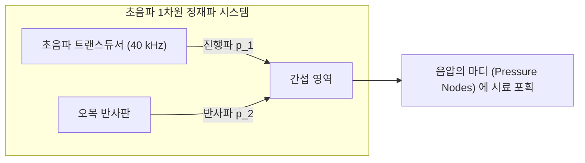

음향 부양은 강한 음장을 이용해 작은 입자나 액적을 고체 표면에 닿지 않게 붙잡습니다. 중력을 없애는 것은 아니며, 음향력은 재료와 장치 조건에 따라 무게와 균형을 이룰 수 있습니다.

이 글은 정재파, 음향 방사력, 작은 구에 대한 고르코프 퍼텐셜, 위상 배열, 액적 변형 및 일부 연구 응용을 소개합니다. 결과를 보편적인 압력·크기 한계로 일반화해서는 안 됩니다.

---

## 1. 소리는 어떻게 힘을 갖는가: 비선형 음향학의 비밀

선형 음향학에서 음압은 정압 주변의 작은 주기적 변화입니다. 진폭이 $P_0$, 각주파수가 $\omega$인 정현파 음압 변화의 한 주기 평균은 0입니다.

$$p(t)=P_0\sin(\omega t),\qquad \langle p\rangle=0$$

이는 물체에 작용하는 전체 평균 힘이 0이라는 뜻은 아닙니다. 평균 힘은 2차 효과, 산란 및 음장의 공간 분포를 고려해 계산해야 하며, 그 효과가 중요해지는 보편적인 dB 임계값은 없습니다.

## 2. 정재파와 1차원 음향 트랩의 구조

진행파는 물체를 밀어 날려버리는 음향풍으로 작용합니다. 물체를 허공의 한 지점에 안정적으로 가두려면 3차원 복원력을 지닌 '음향 트랩(Trap)'을 만들어야 합니다.

가장 대표적인 방식은 초음파 진동자(트랜스듀서)와 반사판을 마주 보게 배치하여 형성하는 <strong>정재파(Standing Wave)</strong>입니다.

정재파는 다음과 같은 특징적인 공간 분포를 보입니다:
1. <strong>음압의 마디(Pressure Node)</strong>: $z = (n + 1/2)\frac{\lambda}{2}$. 이곳은 압력의 진동 폭이 엄밀히 0이지만, 공기 분자의 왕복 속도는 최대($2V_0$)가 됩니다(속도의 배).
2. <strong>음압의 배(Pressure Antinode)</strong>: $z = n\frac{\lambda}{2}$. 이곳은 압력 변화가 $\pm 2P_0$로 극대화되지만, 공기 분자의 평균 속도는 0입니다(속도의 마디).

---

## 3. 고르코프 포텐셜의 수리물리학

1962년 소련의 이론물리학자 <strong>레프 고르코프(Lev Gor'kov)</strong>는 음파 파장보다 충분히 작은 미소 입자($R \ll \lambda$)에 작용하는 시간 평균 음향 방사력 $\mathbf{F}^{\text{rad}}$이 단일 스칼라 포텐셜 $U$의 음의 그래디언트로 유도됨을 증명했습니다:

$$\mathbf{F}^{\text{rad}} = -\nabla U$$

$$U = 2 \pi R^3 \left[ \frac{\langle p^2 \rangle}{3 \rho_0 c_0^2} f_1 - \frac{\rho_0 \langle |\mathbf{v}|^2 \rangle}{2} f_2 \right]$$

여기서:
- 단극자 인자: $f_1 = 1 - \frac{\kappa_p}{\kappa_0}$ (입자의 압축성 대조)
- 쌍극자 인자: $f_2 = \frac{2(\rho_p - \rho_0)}{2\rho_p + \rho_0}$ (입자의 밀도 대조)

공기 중의 고체나 액체는 공기보다 밀도가 수천 배 높고($\rho_p \gg \rho_0$) 압축률이 극히 낮으므로($\kappa_p \ll \kappa_0$), $f_1 \approx 1$ 및 $f_2 \approx 1$이 성립합니다.

1차원 정재파에서 연직 방향의 방사력은 다음과 같이 정리됩니다:
$$F_z(z) = -\frac{\partial U}{\partial z} = V_p \left( \frac{5}{2} \right) \frac{k P_0^2}{\rho_0 c_0^2} \sin(2 k z)$$
(여기서 $P_0$는 각 진행파의 피크 음압 진폭이며 $f_1=f_2=1$로 둡니다. 계수는 위 퍼텐셜을 미분해 얻습니다. 실효값을 쓰면 계수 표기가 달라집니다. 이 식은 작은 구형 입자와 이상 유체를 가정하며, 실제 편차는 입자와 음장에 따라 달라집니다.)

$+z$축이 위쪽이고 음향 대비가 양수라면 중력은 수직 평형점을 음압 마디보다 아래로 이동시킬 수 있습니다. 이 1차원 모델은 횡방향 안정성을 증명하지 않습니다.

---

## 4. 초음파 위상 배열

한쪽에 배치한 초음파 배열로 특정 실험 조건에서 입자를 포획하고 이동·회전시킬 수 있음이 보고되었습니다 [Marzo et al., 2015](https://pmc.ncbi.nlm.nih.gov/articles/PMC4627579/). 위상 배열은 간섭을 이용해 음장을 형성합니다. 가능한 조작은 장치의 기하 구조, 시료, 제어 방식에 따라 달라지며, 모든 물체를 자유롭게 움직이는 만능 트랙터 빔을 뜻하지 않습니다.

## 5. 음향 부양의 물리적 한계

고르코프 근사는 구의 크기가 파장보다 훨씬 작다는 조건($kR\ll1$)을 가정합니다. 이는 모델의 적용 조건이지 부양 가능한 물체의 보편적 크기 한계가 아닙니다. 액적의 변형과 분열 역시 액체와 장치 조건에 따라 달라지며, 모든 경우에 적용되는 단일 임계 웨버 수는 없습니다.

## 6. 첨단 응용 분야와 결론

입자 조작, 비접촉 액적 처리, 음향 미세유체 및 공중 촉각은 연구 중인 응용입니다. 결과는 시료·장치·작동 조건에 좌우됩니다. 용기 벽을 피하더라도 증발, 가열, 주변 기체와의 상호작용이 없어지는 것은 아니며 세포에 영향이 없다고 보장할 수도 없습니다.

## 참고문헌

- L. P. Gor’kov, “On the forces acting on a small particle in an acoustical field in an ideal fluid” (1962). [Paper](https://cir.nii.ac.jp/crid/1570291226443959680)
- A. Marzo et al., “Holographic acoustic elements for manipulation of levitated objects” (2015). [Paper](https://pmc.ncbi.nlm.nih.gov/articles/PMC4627579/)
- E. Cancino-Jaque et al., “On the dynamics of a big drop in acoustic levitation” (2023). [Paper](https://pmc.ncbi.nlm.nih.gov/articles/PMC10716583/)
- S. K. Saroj and R. M. Thaokar, “Atomisation of an acoustically levitated droplet” (2024). [Paper](https://doi.org/10.1017/jfm.2024.523)
