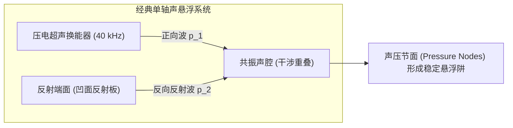

声悬浮利用强声场，使液滴或小颗粒在不接触固体表面的情况下保持悬浮。它并不消除重力；声力只能在取决于材料和装置的条件下平衡物体重量。

本文介绍驻波、声辐射力、小球的戈尔科夫势、相控阵、液滴形变和若干研究应用。具体结果不构成普遍的压力或尺寸上限。

---

## 一、 声音为何具有力量：线性声学的极限与非线性整流

在线性声学中，声压是静态压力周围的小幅周期扰动。振幅为 $P_0$、角频率为 $\omega$ 的正弦声压扰动，其周期平均值为零：

$$p(t)=P_0\sin(\omega t),\qquad \langle p\rangle=0$$

这并不意味着物体所受总平均力为零。计算时还要考虑二阶效应、散射和声场的空间结构；不存在一个普遍的 dB 阈值能单独决定这些效应何时重要。

## 二、 驻波场与一维声学陷阱的物理几何

行波（沿单一方向传播的声波）主要表现为将物体推向远方的“声风”。为了让物体在三维空间中稳定受缚，必须构建具有三维全向恢复力的“声学势阱（Trap）”。

最经典的实现方式是：由超声换能器向相隔数个波长距离的刚性凹面反射板发射声波，形成<strong>一维声学驻波（Standing Wave）</strong>。

两列相向传播的平面波叠加形成驻波：
$$p(z, t) = 2 P_0 \cos(k z) \cos(\omega t)$$
介质粒子速度为：
$$v(z, t) = \frac{2 P_0}{\rho_0 c_0} \sin(k z) \sin(\omega t) = 2 V_0 \sin(k z) \sin(\omega t)$$

驻波展现出极富对称性的空间交错分布：
1. <strong>声压节面（Pressure Node）</strong>：位于 $z = (n + 1/2) \frac{\lambda}{2}$ 处。此处的声压扰动严格为零，但空气分子在此处以最大速度 $2V_0$ 剧烈往复摆动（速度腹面）；
2. <strong>声压腹面（Pressure Antinode）</strong>：位于 $z = n \frac{\lambda}{2}$ 处。此处的瞬时声压振幅达到最大值 $\pm 2P_0$，但空气分子的平均宏观振动速度为零（速度节面）。

---

## 三、 戈尔科夫势的严谨数学解析

1962年，苏联理论物理学家<strong>列夫·戈尔科夫（Lev Gor'kov）</strong>针对波长远大于颗粒尺寸（$R \ll \lambda$，瑞利散射区）的小球，推导出了声辐射力的标量势理论。

物体所受的瞬时时间平均声辐射力 $\mathbf{F}^{\text{rad}}$ 可严格表示为<strong>戈尔科夫势（Gor'kov Potential）</strong> $U$ 的负梯度：

$$\mathbf{F}^{\text{rad}} = -\nabla U$$

$$U = 2 \pi R^3 \left[ \frac{\langle p^2 \rangle}{3 \rho_0 c_0^2} f_1 - \frac{\rho_0 \langle |\mathbf{v}|^2 \rangle}{2} f_2 \right]$$

其中包含两个核心的声学散射对比因子：
1. <strong>单极子压缩性对比因子</strong>：$f_1 = 1 - \frac{\kappa_p}{\kappa_0}$（反映颗粒受压体积脉动引起的单极辐射）；
2. <strong>双极子密度对比因子</strong>：$f_2 = \frac{2 (\rho_p - \rho_0)}{2 \rho_p + \rho_0}$（反映颗粒因惯性滞后于流体引起的双极辐射）。

在空气介质中（$\rho_0 \approx 1.2\,\text{kg/m}^3, \kappa_0 \approx 7 \times 10^{-6}\,\text{Pa}^{-1}$），由于绝大多数固体和液体的密度远大于空气（$\rho_p \gg \rho_0$）且极难压缩（$\kappa_p \ll \kappa_0$），对比因子展现出极为简明的极限：
$$f_1 \approx 1, \quad f_2 \approx 1$$

将一维驻波代入后，可得作用在微粒上的垂直恢复力：
$$F_z(z) = -\frac{\partial U}{\partial z} = V_p \left( \frac{5}{2} \right) \frac{k P_0^2}{\rho_0 c_0^2} \sin(2 k z)$$
(这里 $P_0$ 是每个行波的峰值声压振幅，并假设 $f_1=f_2=1$。该系数由上面的势函数求导得到；若使用均方根振幅，系数写法会改变。该式假设小球和理想流体；实际偏差取决于颗粒和声场。)

若 $+z$ 轴向上且声学对比因子为正，重力可使竖直平衡位置偏到声压节面下方。这个一维模型不能证明横向稳定性。

---

## 四、 超声相控阵

一项研究在特定实验条件下展示了单侧超声阵列对颗粒的捕获、平移和旋转 [Marzo 等，2015](https://pmc.ncbi.nlm.nih.gov/articles/PMC4627579/)。相控阵通过干涉塑造声场。可实现的运动取决于装置几何、样品和控制方式；这并不表示任意物体都能自由移动，也不代表存在通用牵引光束。

## 五、 声悬浮的物理限制：尺寸与液滴破裂

戈尔科夫近似假设球体远小于波长（$kR\ll1$）；这是模型条件，不是可悬浮物体的普遍尺寸上限。液滴形变和破裂也取决于液体、尺寸与装置条件，不存在适用于所有系统的统一临界声学韦伯数。

## 六、 最前沿的应用领域

颗粒操控、无接触液滴处理、声微流控和空中触觉仍是研究中的应用。结果取决于样品、设备和条件。避免接触容器壁不能消除蒸发、声致加热或与周围气体的相互作用，也不能保证细胞不受影响。

## 参考文献

- L. P. Gor’kov, “On the forces acting on a small particle in an acoustical field in an ideal fluid” (1962). [Paper](https://cir.nii.ac.jp/crid/1570291226443959680)
- A. Marzo et al., “Holographic acoustic elements for manipulation of levitated objects” (2015). [Paper](https://pmc.ncbi.nlm.nih.gov/articles/PMC4627579/)
- E. Cancino-Jaque et al., “On the dynamics of a big drop in acoustic levitation” (2023). [Paper](https://pmc.ncbi.nlm.nih.gov/articles/PMC10716583/)
- S. K. Saroj and R. M. Thaokar, “Atomisation of an acoustically levitated droplet” (2024). [Paper](https://doi.org/10.1017/jfm.2024.523)
