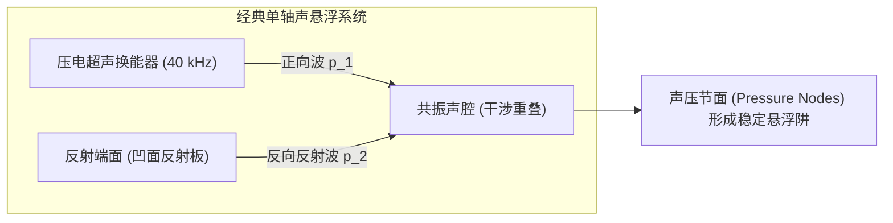
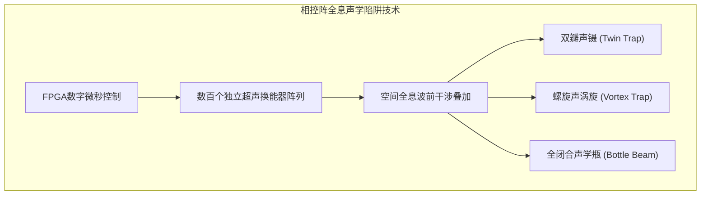

在现代化实验室空无一物的空气中，一滴纯净的水滴静静悬浮在半空中，既无物理支撑，也无细线悬挂，呈现出近乎完美的几何球体。在它身旁，微小的活体昆虫、电子元器件、甚至是单个生物细胞，如同被无形的提线木偶丝线牵引着，在三维空间中自由平移、旋转，甚至在空中与另一滴试剂碰撞融合，发生精准的微量化学反应。

即便对于水、塑料、木材等完全不具备铁磁性的抗磁性物质，这项技术同样能让它们对抗重力、稳稳浮起。这一将科幻小说中的“反重力”与“牵引光束（Tractor Beam）”变为现实前沿物理的杰出技术，正是<strong>声学悬浮（Acoustic Levitation，简称声悬浮）</strong>。

在日常生活中，人类耳朵听到的声音不过是空气介质极度微弱的纵波扰动，其压力变化仅在微帕斯卡量级，微弱到只能轻微震动耳膜。然而，当我们将声波频率提升至人类听觉极限之外的超声波波段（几十千赫兹以上），并通过声波干涉构建出特殊的“驻波（Standing Wave）”结构时，声波便展现出惊人的宏观机械力——<strong>声辐射力（Acoustic Radiation Force）</strong>。

本文将带领读者深入非线性声学与声流控学的核心：从线性声学佯谬到二次非线性效应如何将交变声波整流为直流推力；从苏联天才理论物理学家列夫·戈尔科夫（Lev Gor'kov）推导出的优雅声辐射势函数，到超声相控阵打造的3D全息声学牵引光束；从液滴在强声场中的破裂与雾化极限，到无容器药物晶体生长及太空微重力模拟的前沿应用。

---

## 一、 声音为何具有力量：线性声学的极限与非线性整流

### 1.1 线性声学佯谬：为什么时间平均声压严格为零？

经典物理学入门教程中的“线性声学（Linear Acoustics）”假设声扰动极其微小。一列角频率为 $\omega$、声压振幅为 $P_0$ 的单色简谐波：
$$p(t) = P_0 \sin(\omega t)$$

在完整的一个振动周期 $T$ 内计算时间平均声压 $\langle p \rangle$ 时，正半周期的正压压缩与负半周期的负压稀疏严格对称抵消：
$$\langle p \rangle = \frac{1}{T} \int_0^T P_0 \sin(\omega t) dt = 0$$

同样，介质分子的平均振动速度也恒等于零：$\langle \mathbf{v} \rangle = \mathbf{0}$。如果线性声学是全部真相，那么声波施加在物体上的净力在时间平均意义下永远为零：前半微秒声波将物体向前推，后半微秒就会以完全相同的力量将其拉回，物体绝无可能被稳定托起。

```mermaid
flowchart TD
    subgraph AcousticParadox ["声学理论跨越：线性到非线性"]
        Linear["线性声学 (微小振幅假设)<br>p(t) = P_0 sin(ωt)<br>时间平均推力 ⟨F⟩ = 0<br>无法实现宏观悬浮"]
        Nonlinear["非线性声学 (有限振幅效应)<br>动量通量二阶非线性张量<br>⟨Π⟩ = ⟨p + ρ v²⟩ ≠ 0<br>产生直流稳态声辐射力 (成功悬浮)"]
    end
    Linear -->|超声强声强 (>150 dB)| Nonlinear
```

### 1.2 二次非线性流体效应与声辐射压

突破这一理论困境的关键在于流体动力学的<strong>有限振幅非线性效应</strong>。
无粘性流体的严格欧拉方程为：
$$\rho \left( \frac{\partial \mathbf{v}}{\partial t} + (\mathbf{v} \cdot \nabla) \mathbf{v} \right) = -\nabla p$$

方程左侧的对流项 $(\mathbf{v} \cdot \nabla) \mathbf{v}$ 是流体速度 $\mathbf{v}$ 的<strong>二次非线性项</strong>。在普通谈话的微弱声波中，该项极小可忽略；但在声压级超过 $150 \sim 165\,\text{dB}$ 的高能超声场中，二次项便占据了显著地位。

流体中的总动量通量密度张量为：
$$\Pi_{ij} = p \delta_{ij} + \rho v_i v_j$$

对动量通量进行时间平均时，一阶线性振荡相互抵消，但速度平方项 $\langle \rho v_i v_j \rangle$ 与密度涨落平方项 $\langle (\rho')^2 \rangle$ <strong>作为正定物理量在平均后依然留存</strong>！

正如二极管将交流电整流为直流电一样，流体本身的非线性机制将高频交流声学振动“整流”为了稳定的宏观单向推力——<strong>声辐射压（Acoustic Radiation Pressure）</strong>。

---

## 二、 驻波场与一维声学陷阱的物理几何

行波（沿单一方向传播的声波）主要表现为将物体推向远方的“声风”。为了让物体在三维空间中稳定受缚，必须构建具有三维全向恢复力的“声学势阱（Trap）”。

最经典的实现方式是：由超声换能器向相隔数个波长距离的刚性凹面反射板发射声波，形成<strong>一维声学驻波（Standing Wave）</strong>。



两列相向传播的平面波叠加形成驻波：
$$p(z, t) = 2 P_0 \cos(k z) \cos(\omega t)$$
介质粒子速度为：
$$v(z, t) = \frac{2 P_0}{\rho_0 c_0} \sin(k z) \sin(\omega t) = 2 V_0 \sin(k z) \sin(\omega t)$$

驻波展现出极富对称性的空间交错分布：
1. <strong>声压节面（Pressure Node）</strong>：位于 $z = (n + 1/2) \frac{\lambda}{2}$ 处。此处的声压扰动严格为零，但空气分子在此处以最大速度 $2V_0$ 剧烈往复摆动（速度腹面）；
2. <strong>声压腹面（Pressure Antinode）</strong>：位于 $z = n \frac{\lambda}{2}$ 处。此处的瞬时声压振幅达到最大值 $\pm 2P_0$，但空气分子的平均宏观振动速度为零（速度节面）。

---

## 三、 戈尔科夫势的严谨数学解析

1962年，苏联理论物理学家<strong>列夫·戈尔科夫（Lev Gor'kov）</strong>针对波长远大于颗粒尺寸（$R \ll \lambda$，瑞利散射区）的小球，推导出了声辐射力的标量势理论。

物体所受的瞬时时间平均声辐射力 $\mathbf{F}^{\text{rad}}$ 可严格表示为<strong>戈尔科夫势（Gor'kov Potential）</strong> $U$ 的负梯度：

$$\mathbf{F}^{\text{rad}} = -\nabla U$$

$$U = 2 \pi R^3 \left[ \frac{\langle p^2 \rangle}{3 \rho_0 c_0^2} f_1 - \frac{\rho_0 \langle |\mathbf{v}|^2 \rangle}{2} f_2 \right]$$

其中包含两个核心的声学散射对比因子：
1. <strong>单极子压缩性对比因子</strong>：$f_1 = 1 - \frac{\kappa_p}{\kappa_0}$（反映颗粒受压体积脉动引起的单极辐射）；
2. <strong>双极子密度对比因子</strong>：$f_2 = \frac{2 (\rho_p - \rho_0)}{2 \rho_p + \rho_0}$（反映颗粒因惯性滞后于流体引起的双极辐射）。

在空气介质中（$\rho_0 \approx 1.2\,\text{kg/m}^3, \kappa_0 \approx 7 \times 10^{-6}\,\text{Pa}^{-1}$），由于绝大多数固体和液体的密度远大于空气（$\rho_p \gg \rho_0$）且极难压缩（$\kappa_p \ll \kappa_0$），对比因子展现出极为简明的极限：
$$f_1 \approx 1, \quad f_2 \approx 1$$

将一维驻波代入后，可得作用在微粒上的垂直恢复力：
$$F_z(z) = -\frac{\partial U}{\partial z} = V_p \left( \frac{5}{6} \right) \frac{k P_0^2}{\rho_0 c_0^2} \sin(2 k z)$$

当重力 $F_g = \rho_p V_p g$ 向下拉扯物体时，微粒会稳定在<strong>声压节面稍下方</strong>的平衡点 $z_{\text{eq}}$ 处，使向上的声辐射力恰好与重力平衡。在微扰下，声势阱如同胡克弹簧一样提供强大的线性恢复力，将物体死死锁在空中。

---

## 四、 超声相控阵与3D全息声学牵引光束

传统的单轴声悬浮器依赖反射板，陷阱位置固定无法移动。2015年，英国布里斯托大学团队开创了<strong>超声相控阵（Ultrasonic Phased Array）</strong>技术。

通过将数百个微型超声换能器（常用 $40\,\text{kHz}$）排布为阵列，利用FPGA高速芯片以微秒级精度独立调制每个换能器的发射相位 $\phi_j$。通过惠更斯原理在空中干涉合成任意形态的三维声场：
1. <strong>孪生陷阱（Twin Trap）</strong>：合成一对反相位的声压瓣，在中心形成一处夹紧颗粒的“声镊”；
2. <strong>涡旋陷阱（Vortex Trap）</strong>：波前呈螺旋状旋转，携带轨道角动量（OAM），不仅能捕获颗粒，还能在空中施加扭矩使其高速自转；
3. <strong>瓶状光束（Bottle Beam）</strong>：形成一个由高声压包围的空心无声球壳笼，实现真正的单侧发射、全向三维立体操控。



---

## 五、 声悬浮的物理限制：尺寸与液滴破裂

声悬浮具有由波动与流体力学决定的刚性物理边界：
1. <strong>尺寸上限（瑞利判据）</strong>：微粒直径必须满足 $2R \lesssim \lambda / 2$。对于 $40\,\text{kHz}$ 超声波（波长约 $8.6\,\text{mm}$），可稳定悬浮的物体最大直径约为 $3 \sim 4\,\text{mm}$。超过此尺寸，散射波严重破坏原驻波结构；
2. <strong>声学激波极限</strong>：浮起高密度重金属（如金或钨）需要极高声压（$>165\,\text{dB}$），但空气剧烈非线性会导致声波波形畸变为<strong>声激波（Acoustic Shock Waves）</strong>，伴随产生的强烈湍流声流会将物体吹出陷阱；
3. <strong>液滴形变与雾化破坏</strong>：悬浮液体受上下压力压缩而变扁呈扁球形（薄饼状）。当<strong>声学韦伯数 $We_a = \frac{P_0^2 R}{\rho_0 c_0^2 \gamma}$</strong> 超过临界值（$\approx 3.6$）时，表面张力无法抗衡声压，液滴将发生剧烈的“气囊破裂（Bag Breakup）”，瞬间炸裂为数百颗微米级雾滴（<strong>声雾化</strong>）。

---

## 六、 最前沿的应用领域

| 领域 | 核心技术 | 声学悬浮带来的颠覆性优势 |
|---|---|---|
| <strong>结构生物与制药</strong> | 无容器蛋白质结晶、非晶态药物筛选 | $100\%$ 消除器皿壁面的异相成核与化学杂质浸出 |
| <strong>微流控与生化合成</strong> | 空中微液滴反应器 (Lab-on-a-Drop) | 零挂壁损失，无需移液管的毫微升液体非接触融合 |
| <strong>生物医学工程</strong> | 微通道内声泳分选稀有循环肿瘤细胞 (CTC) | 无标记、物理剪切极低、保持细胞原生活性 |
| <strong>先进冶金材料</strong> | 超高熔点合金深过冷凝固 (Ti, Zr) | 杜绝熔融金属与坩埚反应，制造极高纯度非晶金属 |
| <strong>交互与显示</strong> | 空中触觉反馈 (Mid-Air Haptics)、三维容积显示 | 无需穿戴设备即可在虚空中触摸到真实按钮力反馈 |

---

## 七、 结论：无形之波重塑物质世界

声波，本质上是物质微观振动的时空传播。

当非线性声学与现代数字全息算法相遇，微弱的声音升华为了能够抓取微粒、托举水滴、重组物质的“无形巨手”。从戈尔科夫势的严谨数学，到太空舱内的微重力模拟，声悬浮向人类展现了经典物理学在现代工程中绽放出的无与伦比的深邃与优美。
