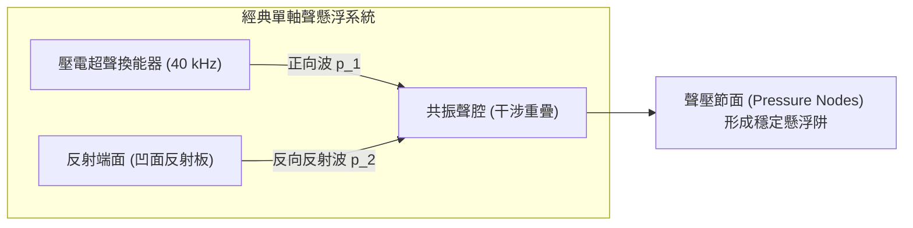
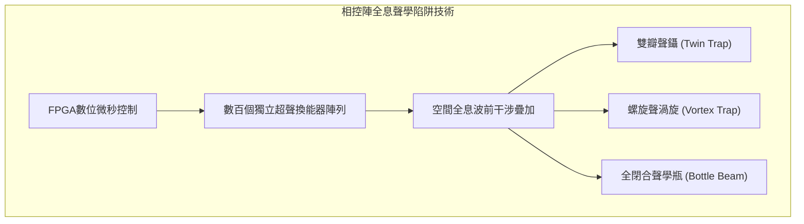

在現代化實驗室空無一物的空氣中，一滴純淨的水滴靜靜懸浮在半空中，既無物理支撐，也無細線懸掛，呈現出近乎完美的幾何球體。在它身旁，微小的活體昆蟲、電子元器件、甚至是單個生物細胞，如同被無形的提線木偶絲線牽引著，在三維空間中自由平移、旋轉，甚至在空中與另一滴試劑碰撞融合，發生精準的微量化學反應。

即便對於水、塑料、木材等完全不具備鐵磁性的抗磁性物質，這項技術同樣能讓它們對抗重力、穩穩浮起。這一將科幻小說中的「反重力」與「牽引光束（Tractor Beam）」變為現實前沿物理的傑出技術，正是<strong>聲學懸浮（Acoustic Levitation，簡稱聲懸浮）</strong>。

在日常生活中，人類耳朵聽到的聲音不過是空氣介質極度微弱的縱波擾動，其壓力變化僅在微帕斯卡量級，微弱到只能輕微震動耳膜。然而，當我們將聲波頻率提升至人類聽覺極限之外的超聲波波段（幾十千赫茲以上），並通過聲波干涉構建出特殊的「駐波（Standing Wave）」結構時，聲波便展現出驚人的宏觀機械力——<strong>聲輻射力（Acoustic Radiation Force）</strong>。

本文將帶領讀者深入非線性聲學與聲流控學的核心：從線性聲學佯謬到二次非線性效應如何將交變聲波整流為直流推力；從蘇聯天才理論物理學家列夫·戈爾科夫（Lev Gor'kov）推導出的優雅聲輻射勢函數，到超聲相控陣打造的3D全息聲學牽引光束；從液滴在強聲場中的破裂與霧化極限，到無容器藥物晶體生長及太空微重力模擬的前沿應用。

---

## 一、 聲音為何具有力量：線性聲學的極限與非線性整流

### 1.1 線性聲學佯謬：為什麼時間平均聲壓嚴格為零？

經典物理學入門教程中的「線性聲學（Linear Acoustics）」假設聲擾動極其微小。一列角頻率為 $\omega$、聲壓振幅為 $P_0$ 的單色簡諧波：
$$p(t) = P_0 \sin(\omega t)$$

在完整的一個振動週期 $T$ 內計算時間平均聲壓 $\langle p \rangle$ 時，正半週期的正壓壓縮與負半週期的負壓稀疏嚴格對稱抵消：
$$\langle p \rangle = \frac{1}{T} \int_0^T P_0 \sin(\omega t) dt = 0$$

同樣，介質分子的平均振動速度也恆等於零：$\langle \mathbf{v} \rangle = \mathbf{0}$。如果線性聲學是全部真相，那麼聲波施加在物體上的淨力在時間平均意義下永遠為零：前半微秒聲波將物體向前推，後半微秒就會以完全相同的力量將其拉回，物體絕無可能被穩定托起。

```mermaid
flowchart TD
    subgraph AcousticParadox ["聲學理論跨越：線性到非線性"]
        Linear["線性聲學 (微小振幅假設)<br>p(t) = P_0 sin(ωt)<br>時間平均推力 ⟨F⟩ = 0<br>無法實現宏觀懸浮"]
        Nonlinear["非線性聲學 (有限振幅效應)<br>動量通量二階非線性張量<br>⟨Π⟩ = ⟨p + ρ v²⟩ ≠ 0<br>產生直流穩態聲輻射力 (成功懸浮)"]
    end
    Linear -->|超聲強聲強 (>150 dB)| Nonlinear
```

### 1.2 二次非線性流體效應與聲輻射壓

突破這一理論困境的關鍵在於流體動力學的<strong>有限振幅非線性效應</strong>。
無粘性流體的嚴格歐拉方程為：
$$\rho \left( \frac{\partial \mathbf{v}}{\partial t} + (\mathbf{v} \cdot \nabla) \mathbf{v} \right) = -\nabla p$$

方程左側的對流項 $(\mathbf{v} \cdot \nabla) \mathbf{v}$ 是流體速度 $\mathbf{v}$ 的<strong>二次非線性項</strong>。在普通談話的微弱聲波中，該項極小可忽略；但在聲壓級超過 $150 \sim 165\,\text{dB}$ 的高能超聲場中，二次項便佔據了顯著地位。

流體中的總動量通量密度張量為：
$$\Pi_{ij} = p \delta_{ij} + \rho v_i v_j$$

對動量通量進行時間平均時，一階線性振盪相互抵消，但速度平方項 $\langle \rho v_i v_j \rangle$ 與密度漲落平方項 $\langle (\rho')^2 \rangle$ <strong>作為正定物理量在平均後依然留存</strong>！

正如二極管將交流電整流為直流電一樣，流體本身的非線性機制將高頻交流聲學振動「整流」為了穩定的宏觀單向推力——<strong>聲輻射壓（Acoustic Radiation Pressure）</strong>。

---

## 二、 駐波場與一維聲學陷阱的物理幾何

行波（沿單一方向傳播的聲波）主要表現為將物體推向遠方的「聲風」。為了讓物體在三維空間中穩定受縛，必須構建具有三維全向恢復力的「聲學勢阱（Trap）」。

最經典的實現方式是：由超聲換能器向相隔數個波長距離的剛性凹面反射板發射聲波，形成<strong>一維聲學駐波（Standing Wave）</strong>。



兩列相向傳播的平面波疊加形成駐波：
$$p(z, t) = 2 P_0 \cos(k z) \cos(\omega t)$$
介質粒子速度為：
$$v(z, t) = \frac{2 P_0}{\rho_0 c_0} \sin(k z) \sin(\omega t) = 2 V_0 \sin(k z) \sin(\omega t)$$

駐波展現出極富對稱性的空間交錯分布：
1. <strong>聲壓節面（Pressure Node）</strong>：位於 $z = (n + 1/2) \frac{\lambda}{2}$ 處。此處的聲壓擾動嚴格為零，但空氣分子在此處以最大速度 $2V_0$ 劇烈往復擺動（速度腹面）；
2. <strong>聲壓腹面（Pressure Antinode）</strong>：位於 $z = n \frac{\lambda}{2}$ 處。此處的瞬時聲壓振幅達到最大值 $\pm 2P_0$，但空氣分子的平均宏觀振動速度為零（速度節面）。

---

## 三、 戈爾科夫勢的嚴謹數學解析

1962年，蘇聯理論物理學家<strong>列夫·戈爾科夫（Lev Gor'kov）</strong>針對波長遠大於顆粒尺寸（$R \ll \lambda$，瑞利散射區）的小球，推導出了聲輻射力的標量勢理論。

物體所受的瞬時時間平均聲輻射力 $\mathbf{F}^{\text{rad}}$ 可嚴格表示為<strong>戈爾科夫勢（Gor'kov Potential）</strong> $U$ 的負梯度：

$$\mathbf{F}^{\text{rad}} = -\nabla U$$

$$U = 2 \pi R^3 \left[ \frac{\langle p^2 \rangle}{3 \rho_0 c_0^2} f_1 - \frac{\rho_0 \langle |\mathbf{v}|^2 \rangle}{2} f_2 \right]$$

其中包含兩個核心的聲學散射對比因子：
1. <strong>單極子壓縮性對比因子</strong>：$f_1 = 1 - \frac{\kappa_p}{\kappa_0}$（反映顆粒受壓體積脈動引起的單極輻射）；
2. <strong>雙極子密度對比因子</strong>：$f_2 = \frac{2 (\rho_p - \rho_0)}{2 \rho_p + \rho_0}$（反映顆粒因慣性滯後於流體引起的雙極輻射）。

在空氣介質中（$\rho_0 \approx 1.2\,\text{kg/m}^3, \kappa_0 \approx 7 \times 10^{-6}\,\text{Pa}^{-1}$），由於絕大多數固體和液體的密度遠大於空氣（$\rho_p \gg \rho_0$）且極難壓縮（$\kappa_p \ll \kappa_0$），對比因子展現出極為簡明的極限：
$$f_1 \approx 1, \quad f_2 \approx 1$$

將一維駐波代入後，可得作用在微粒上的垂直恢復力：
$$F_z(z) = -\frac{\partial U}{\partial z} = V_p \left( \frac{5}{6} \right) \frac{k P_0^2}{\rho_0 c_0^2} \sin(2 k z)$$

當重力 $F_g = \rho_p V_p g$ 向下拉扯物體時，微粒會穩定在<strong>聲壓節面稍下方</strong>的平衡點 $z_{\text{eq}}$ 處，使向上的聲輻射力恰好與重力平衡。在微擾下，聲勢阱如同胡克彈簧一樣提供強大的線性恢復力，將物體死死鎖在空中。

---

## 四、 超聲相控陣與3D全息聲學牽引光束

傳統的單軸聲懸浮器依賴反射板，陷阱位置固定無法移動。2015年，英國布里斯托大學團隊開創了<strong>超聲相控陣（Ultrasonic Phased Array）</strong>技術。

通過將數百個微型超聲換能器（常用 $40\,\text{kHz}$）排布為陣列，利用FPGA高速芯片以微秒級精度獨立調制每個換能器的發射相位 $\phi_j$。通過惠更斯原理在空中干涉合成任意形態的三維聲場：
1. <strong>攣生陷阱（Twin Trap）</strong>：合成一對反相位的聲壓瓣，在中心形成一處夾緊顆粒的「聲鑷」；
2. <strong>渦旋陷阱（Vortex Trap）</strong>：波前呈螺旋狀旋轉，攜帶軌道角動量（OAM），不僅能捕獲顆粒，還能在空中施加扭矩使其高速自轉；
3. <strong>瓶狀光束（Bottle Beam）</strong>：形成一個由高聲壓包圍的空心無聲球殼籠，實現真正的單側發射、全向三維立體操控。



---

## 五、 聲懸浮的物理限制：尺寸與液滴破裂

聲懸浮具有由波動與流體力學決定的剛性物理邊界：
1. <strong>尺寸上限（瑞利判據）</strong>：微粒直徑必須滿足 $2R \lesssim \lambda / 2$。對於 $40\,\text{kHz}$ 超聲波（波長約 $8.6\,\text{mm}$），可穩定懸浮的物體最大直徑約為 $3 \sim 4\,\text{mm}$。超過此尺寸，散射波嚴重破壞原駐波結構；
2. <strong>聲學激波極限</strong>：浮起高密度重金屬（如金或鎢）需要極高聲壓（$>165\,\text{dB}$），但空氣劇烈非線性會導致聲波波形畸變為<strong>聲激波（Acoustic Shock Waves）</strong>，伴隨產生的強烈湍流聲流會將物體吹出陷阱；
3. <strong>液滴形變與霧化破壞</strong>：懸浮液體受上下壓力壓縮而變扁呈扁球形（薄餅狀）。當<strong>聲學韋伯數 $We_a = \frac{P_0^2 R}{\rho_0 c_0^2 \gamma}$</strong> 超過臨界值（$\approx 3.6$）時，表面張力無法抗衡聲壓，液滴將發生劇烈的「氣囊破裂（Bag Breakup）」，瞬間炸裂為數百顆微米級霧滴（<strong>聲霧化</strong>）。

---

## 六、 最前沿的應用領域

| 領域 | 核心技術 | 聲學懸浮帶來的顛覆性優勢 |
|---|---|---|
| <strong>結構生物與製藥</strong> | 無容器蛋白質結晶、非晶態藥物篩選 | $100\%$ 消除器皿壁面的異相成核與化學雜質浸出 |
| <strong>微流控與生化合成</strong> | 空中微液滴反應器 (Lab-on-a-Drop) | 零掛壁損失，無需移液管的毫微升液體非接觸融合 |
| <strong>生物醫學工程</strong> | 微通道內聲泳分選稀有循環腫瘤細胞 (CTC) | 無標記、物理剪切極低、保持細胞原生活性 |
| <strong>先進冶金材料</strong> | 超高熔點合金深過冷凝固 (Ti, Zr) | 杜絕熔融金屬與坩堝反應，製造極高純度非晶金屬 |
| <strong>交互與顯示</strong> | 空中觸覺反饋 (Mid-Air Haptics)、三維容積顯示 | 無需穿戴設備即可在虛空中觸摸到真實按鈕力反饋 |

---

## 七、 結論：無形之波重塑物質世界

聲波，本質上是物質微觀振動的時空傳播。

當非線性聲學與現代數位全息算法相遇，微弱的聲音昇華為了能夠抓取微粒、托舉水滴、重組物質的「無形巨手」。從戈爾科夫勢的嚴謹數學，到太空艙內的微重力模擬，聲懸浮向人類展現了經典物理學在現代工程中綻放出的無與倫比的深邃與優美。
