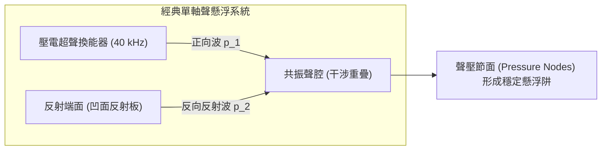

聲懸浮利用強聲場，使液滴或小顆粒在不接觸固體表面的情況下保持懸浮。它並不消除重力；聲力只能在取決於材料與裝置的條件下平衡物體重量。

本文介紹駐波、聲輻射力、小球的戈爾科夫勢、相控陣、液滴形變和若干研究應用。具體結果不構成普遍的壓力或尺寸上限。

---

## 一、 聲音為何具有力量：線性聲學的極限與非線性整流

在線性聲學中，聲壓是靜態壓力周圍的小幅週期擾動。振幅為 $P_0$、角頻率為 $\omega$ 的正弦聲壓擾動，其週期平均值為零：

$$p(t)=P_0\sin(\omega t),\qquad \langle p\rangle=0$$

這不代表物體所受總平均力為零。計算時仍須考慮二階效應、散射及聲場的空間結構；不存在單一普遍的 dB 閾值可決定這些效應何時重要。

## 二、 駐波場與一維聲學陷阱的物理幾何

行波（沿單一方向傳播的聲波）主要表現為將物體推向遠方的「聲風」。為了讓物體在三維空間中穩定受縛，必須構建具有三維全向恢復力的「聲學勢阱（Trap）」。

最經典的實現方式是：由超聲換能器向相隔數個波長距離的剛性凹面反射板發射聲波，形成<strong>一維聲學駐波（Standing Wave）</strong>。

兩列相向傳播的平面波疊加形成駐波：
$$p(z, t) = 2 P_0 \cos(k z) \cos(\omega t)$$
介質粒子速度為：
$$v(z, t) = \frac{2 P_0}{\rho_0 c_0} \sin(k z) \sin(\omega t) = 2 V_0 \sin(k z) \sin(\omega t)$$

駐波展現出極富對稱性的空間交錯分布：
1. <strong>聲壓節面（Pressure Node）</strong>：位於 $z = (n + 1/2) \frac{\lambda}{2}$ 處。此處的聲壓擾動嚴格為零，但空氣分子在此處以最大速度 $2V_0$ 劇烈往復擺動（速度腹面）；
2. <strong>聲壓腹面（Pressure Antinode）</strong>：位於 $z = n \frac{\lambda}{2}$ 處。此處的瞬時聲壓振幅達到最大值 $\pm 2P_0$，但空氣分子的平均宏觀振動速度為零（速度節面）。

---

## 三、 戈爾科夫勢的嚴謹數學解析

1962年，蘇聯理論物理學家<strong>列夫·戈爾科夫（Lev Gor'kov）</strong>針對波長遠大於顆粒尺寸（$R \ll \lambda$，瑞利散射區）的小球，推導出了聲輻射力的標量勢理論。

物體所受的瞬時時間平均聲輻射力 $\mathbf{F}^{\text{rad}}$ 可嚴格表示為<strong>戈爾科夫勢（Gor'kov Potential）</strong> $U$ 的負梯度：

$$\mathbf{F}^{\text{rad}} = -\nabla U$$

$$U = 2 \pi R^3 \left[ \frac{\langle p^2 \rangle}{3 \rho_0 c_0^2} f_1 - \frac{\rho_0 \langle |\mathbf{v}|^2 \rangle}{2} f_2 \right]$$

其中包含兩個核心的聲學散射對比因子：
1. <strong>單極子壓縮性對比因子</strong>：$f_1 = 1 - \frac{\kappa_p}{\kappa_0}$（反映顆粒受壓體積脈動引起的單極輻射）；
2. <strong>雙極子密度對比因子</strong>：$f_2 = \frac{2 (\rho_p - \rho_0)}{2 \rho_p + \rho_0}$（反映顆粒因慣性滯後於流體引起的雙極輻射）。

在空氣介質中（$\rho_0 \approx 1.2\,\text{kg/m}^3, \kappa_0 \approx 7 \times 10^{-6}\,\text{Pa}^{-1}$），由於絕大多數固體和液體的密度遠大於空氣（$\rho_p \gg \rho_0$）且極難壓縮（$\kappa_p \ll \kappa_0$），對比因子展現出極為簡明的極限：
$$f_1 \approx 1, \quad f_2 \approx 1$$

將一維駐波代入後，可得作用在微粒上的垂直恢復力：
$$F_z(z) = -\frac{\partial U}{\partial z} = V_p \left( \frac{5}{2} \right) \frac{k P_0^2}{\rho_0 c_0^2} \sin(2 k z)$$
(此處 $P_0$ 是每個行波的峰值聲壓振幅，並假設 $f_1=f_2=1$。此係數由上方的勢函數微分而得；若採用均方根振幅，係數寫法會改變。此式假設小球與理想流體；實際偏差取決於粒子與聲場。)

若 $+z$ 軸朝上且聲學對比因子為正，重力可使垂直平衡位置偏到聲壓節面下方。這個一維模型不能證明橫向穩定性。

---

## 四、 超聲相控陣

一項研究在特定實驗條件下展示了單側超音波陣列對粒子的捕捉、平移與旋轉 [Marzo 等，2015](https://pmc.ncbi.nlm.nih.gov/articles/PMC4627579/)。相控陣透過干涉塑造聲場。可實現的運動取決於裝置幾何、樣品與控制方式；這不表示任意物體都能自由移動，也不代表存在通用牽引光束。

## 五、 聲懸浮的物理限制：尺寸與液滴破裂

戈爾科夫近似假設球體遠小於波長（$kR\ll1$）；這是模型條件，不是可懸浮物體的普遍尺寸上限。液滴形變與破裂也取決於液體、尺寸及裝置條件，沒有適用於所有系統的統一臨界聲學韋伯數。

## 六、 最前沿的應用領域

顆粒操控、無接觸液滴處理、聲微流體與空中觸覺仍是研究中的應用。結果取決於樣品、設備及條件。避免接觸容器壁無法消除蒸發、聲致加熱或與周圍氣體的交互作用，也不能保證細胞不受影響。

## 參考文獻

- L. P. Gor’kov, “On the forces acting on a small particle in an acoustical field in an ideal fluid” (1962). [Paper](https://cir.nii.ac.jp/crid/1570291226443959680)
- A. Marzo et al., “Holographic acoustic elements for manipulation of levitated objects” (2015). [Paper](https://pmc.ncbi.nlm.nih.gov/articles/PMC4627579/)
- E. Cancino-Jaque et al., “On the dynamics of a big drop in acoustic levitation” (2023). [Paper](https://pmc.ncbi.nlm.nih.gov/articles/PMC10716583/)
- S. K. Saroj and R. M. Thaokar, “Atomisation of an acoustically levitated droplet” (2024). [Paper](https://doi.org/10.1017/jfm.2024.523)
