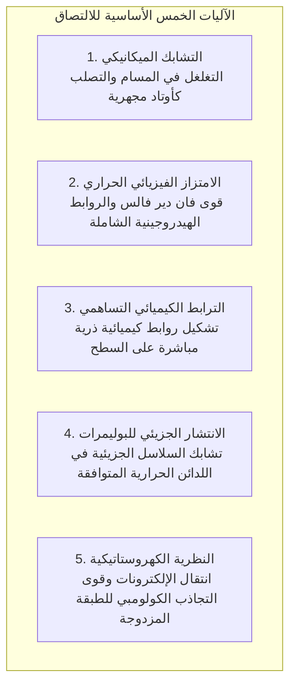
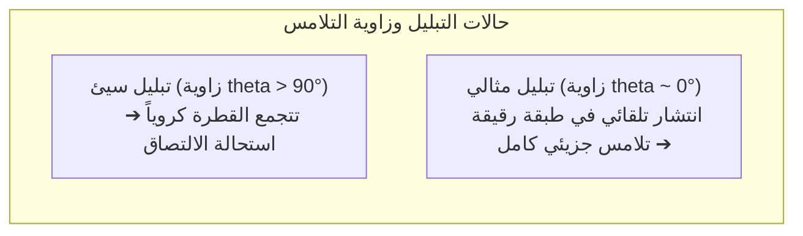

قطرة واحدة من سائل شفاف تعيد ترميم فنجان خزفي مكسور في ثوانٍ معدودة ليتحمل حرارة الماء المغلي بثبات. وفي قمة هندسة الطيران المعاصرة، لم تعد أجنحة طائرات بوينغ 787 وإيرباص A350 المصنوعة من ألياف الكربون تُثبت بمئات الآلاف من المسامير المعدنية، بل تُدمج صفائحها بأغشية لاصقة إيبوكسية هيكلية فائقة المتانة.

ومع ذلك، من منظور الفيزياء الأساسية:
"كيف يمكن لطبقة سائلة رقيقة أن تجمع بين كتلتين صلبين من المعدن بقوة تجعل المعدن ينكسر أحياناً قبل أن ينفصل المفصل اللاصق؟"
"لماذا يلتصق الشريط اللاصق بمجرد لمسة إصبع خفيفة وينتزع بنظافة دون ترك أثر؟"
"ولماذا ترفض مادة التيفلون والبولي إيثيلين الالتصاق بأي غراء تقليدي؟"

إن الالتصاق ليس مجرد مادة صمغية تجف في الشقوق، بل هو <strong>«تضافر فيزيائي كيميائي متكامل يجمع بين القوى الجزيئية (فان دير فالس والروابط الهيدروجينية)، والديناميكا الحرارية للتبليل (طاقة السطح)، وشبكات البلمرة ثلاثية الأبعاد، وميكانيكا كسر المواد.»</strong>

---

## 1. النظريات الخمس الأساسية للالتصاق

على المستوى الذري، حتى أكثر الأسطح المعدنية صقلاً تبدو كجبال شاهقة من النتوءات المجهرية. وتكون مساحة التلامس الحقيقية بين المواد الصلبة الجافة أقل من 0.01 %. وتتمثل وظيفة المادة اللاصقة في <strong>التدفق كسائل لملء التجاويف الدقيقة، وطرد فقاعات الهواء، وبناء تلامس ذري وثيق</strong>.

### 1.1 الامتزاز الفيزيائي وقوى فان دير فالس
عند مسافات تقل عن نانومتر واحد، تنشط قوى فان دير فالس الجزيئية. ورغم ضعف الرابطة الواحدة، فإن مجموع تريليونات الروابط عبر المساحة السطحية يولد قوى شد هائلة قادرة على رفع أطنان.

### 1.2 الروابط الكيميائية ومركبات السيلان
في التطبيقات الفضائية الحساسة، تُستخدم مركبات السيلان لإنشاء روابط تساهمية قوية مع أكاسيد المعادن والزجاج، مما يمنح المفصل مقاومة فائقة للرطوبة والحرارة.

---

## 2. التبليل وطاقة السطح الحرة

إذا لم يتبلل السطح بالسائل، تفشل عملية الالتصاق كلياً.

### 2.1 معادلة يونغ
$$\gamma_{\text{SV}} = \gamma_{\text{SL}} + \gamma_{\text{LV}} \cos \theta$$
لحدوث الانتشار التلقائي، <strong>يجب أن تكون طاقة سطح المادة الصلبة ($\gamma_{\text{SV}}$) أعلى بكثير من التوتر السطحي للمادة اللاصقة السائلة ($\gamma_{\text{LV}}$)</strong>.
المعادن تمتلك طاقة عالية ($> 500\text{ mN/m}$) فتتبلل بسهولة، بينما يمتلك التيفلون (PTFE) طاقة سطح منخفضة جداً تصل إلى <strong>$18\text{ mN/m}$</strong> بسبب ذرات الفلور غير القابلة للاستقطاب، مما يجعله طارداً للغراء. ويُستخدم تفريغ البلازما لتوليد مجموعات قطبية لتنشيط هذه الأسطح.

---

## 3. آليات التصلب الكيميائي للمواد اللاصقة

- <strong>السيانوأكريلات (الغراء الفوري)</strong>: جزيئات الرطوبة الجوية الدقيقة ($\text{OH}^-$) تطلق بلمرة أنيونية متسلسلة فائقة السرعة تحول المونومر السائل إلى بلاستيك صلب في ثوانٍ.
- <strong>راتنجات الإيبوكسي</strong>: تفاعل فتح حلقة الأكسيران بواسطة الأمينات يشكل شبكة ثلاثية الأبعاد متصلبة بالحرارة دون انكماش حجمي يذكر ودون مذيبات.
- <strong>المواد اللاهوائية</strong>: تبقى سائلة بوجود الأكسجين، لكنها تتبلمر فوراً عند حبسها داخل مسننات البراغي المعدنية بمعزل عن الهواء.

---

## 4. الأشرطة الحساسة للضغط ومعيار دالكويست

تعمل الأشرطة اللاصقة وفق <strong>معيار دالكويست للريولوجيا</strong>:
$$G' (1\text{ Hz}) < 3 \times 10^5\text{ Pa}$$
فعند الضغط الخفيف تتدفق مثل سائل في التجاويف المجهرية، وعند الشد السريع تتصرف كمادة صلبة مرنة تنفصل بنظافة دون ترك بقايا صمغية.

---

## 5. الربط الهيكلي في صناعة الطائرات

في طائرات بوينغ 787، حلت الأغشية اللاصقة الإيبوكسية محل ثقوب المسامير المعدنية (التي تسبب تركز الإجهاد بثلاثة أضعاف وفق كيرش)، مما خفض أطنان من الوزن ومنع التآكل الجلفاني بين ألياف الكربون والمعادن.

---

## 6. خاتمة

من شعيرات أرجل أوزة البرص النانوية إلى مقاتلات الجيل الخامس، تمثل المواد اللاصقة إحدى أروع إنجازات علم المواد التي تبني جسوراً متينة عبر العالم الذري غير المرئي.
