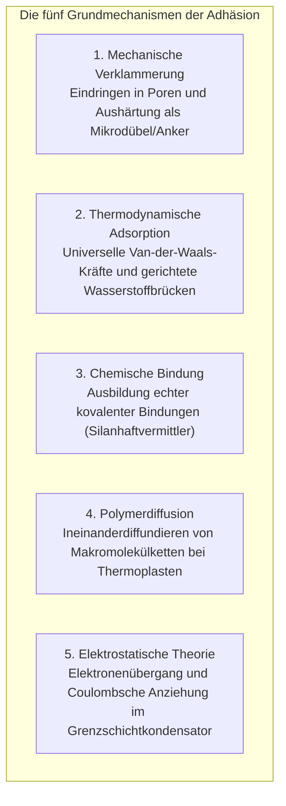

Ein Tropfen Flüssigkeit fügt zerbrochene Keramik innerhalb von Sekunden so fest zusammen, dass die Bruchstelle kochendem Wasser standhält. Im Flugzeugbau werden bei der Boeing 787 und dem Airbus A350 tragende Kohlenstofffaser-Tragflächen (CFK) nicht mehr durch Hunderttausende Niete geschwächt, sondern mit strukturellen Hochleistungs-Epoxidklebstoffen stoffschlüssig verbunden.

Doch physikalisch stellt sich eine grundlegende Frage:
"Warum verbindet ein dünner Flüssigkeitsfilm starre Metalle oder Gesteine so unlösbar fest?"
"Warum klebt Klebeband bei leichtem Fingerdruck sofort, lässt sich aber rückstandsfrei abziehen?"
"Und warum versagt jeder gewöhnliche Klebstoff an Teflon oder Polyethylen?"

Kleben ist kein bloßes Verkeilen in Fugen. Es ist <strong>„das Zusammenwirken von zwischenmolekularen Van-der-Waals-Kräften, thermodynamischer Benetzung (Oberflächenenergie), dreidimensionaler Polymerisationsnetzwerke und Kontinuumsbruchmechanik.“</strong>

---

## 1. Die 5 Theorien der Adhäsion: Wie Materie bindet

Auf atomarer Skala gleicht jede scheinbar glatte Festkörperoberfläche einem schroffen Gebirge aus mikroskopischen Rauheitsspitzen (Asperities). Die reale Kontaktfläche trockener Festkörper beträgt oft weniger als 0,01 %.
Ein Klebstoff muss <strong>als Flüssigkeit in jede mikroskopische Vertiefung fließen, Luftblasen verdrängen und atomaren Kontakt herstellen</strong>.

### 1.1 Physikalische Adsorption: Die Kraft der Van-der-Waals-Bindungen
Bei Abständen unter 1 Nanometer wirken Dispersions-, Orientierungs- und Induktionskräfte. Obwohl die Bindungsenergie pro Einzelbindung gering ist ($1 \sim 10\text{ kJ/mol}$), summieren sich Billionen paralleler Bindungen über die Fläche zu makroskopischen Tragkräften von Dutzenden Megapascal.

### 1.2 Chemische Bindung und Silankopplung
In anspruchsvollen Anwendungen sorgen Silan-Kopplungsreagenzien für echte kovalente Siloxanbrücken ($\text{Si-O-Si}$) zwischen Glas/Metall und Polymermatrix, die hydrolytisch extrem stabil sind.

---

## 2. Benetzung und Oberflächenenergie

Kann ein Klebstoff eine Oberfläche nicht benetzen, sinkt die Festigkeit auf null.

### 2.1 Die Young-Gleichung
$$\gamma_{\text{SV}} = \gamma_{\text{SL}} + \gamma_{\text{LV}} \cos \theta$$
Damit eine Flüssigkeit spontan spreitet ($S \ge 0$), muss die <strong>Oberflächenenergie des Festkörpers ($\gamma_{\text{SV}}$) deutlich größer sein als die Oberflächenspannung des flüssigen Klebstoffs ($\gamma_{\text{LV}}$)</strong>.
Metalle besitzen hohe Energien ($> 500\text{ mN/m}$) und lassen sich hervorragend benetzen. Teflon besitzt extrem unpolarisierbare Fluoratome und eine Oberflächenenergie von nur <strong>$18\text{ mN/m}$</strong>, weshalb Standardklebstoffe abperlen. Plasma- und Koronaentladungen brechen inerte Polymerketten auf und erhöhen die Energie künstlich.

---

## 3. Aushärtungskinetik moderner Klebstoffe

- <strong>Cyanacrylat (Sekundenkleber)</strong>: Spuren adsorbierter Luftfeuchtigkeit ($\text{OH}^-$) an Oberflächen lösen eine schlagartige anionische Kettenpolymerisation aus, die das Monomer in Sekunden in festes Acrylglas verwandelt.
- <strong>Epoxidharze</strong>: Bisphenol-A-Diglycidylether reagiert mit Aminen unter Ringöffnung der Oxiranringe zu einem unlöslichen, extrem formstabilen 3D-Kovalenznetzwerk ohne nennenswerten Volumenschrumpf ($< 1\,\%$) und ohne Hohlraumbildung.
- <strong>Anaerobe Klebstoffe</strong>: Unter Sauerstoffausschluss und Metallionenkatalyse im Schraubengewinde startet eine rapide radikalische Polymerisation.

---

## 4. Haftklebebänder und das Dahlquist-Kriterium

Dass Klebebänder bei leichtem Druck kleben und sauber abziehbar sind, regelt das <strong>Dahlquist-Kriterium</strong>:
$$G' (1\text{ Hz}) < 3 \times 10^5\text{ Pa}$$
Bei niedrigen Deformationsgeschwindigkeiten (Aufkleben) fließt das Polymer viskos in mikroskopische Vertiefungen; beim raschen Abziehen versteift sich das viskoelastische Polymer massiv und widersteht dem Bruch kohäsionsfrei.

---

## 5. Faserverbund-Strukturklebung in der Luftfahrt

Die Boeing 787 ersetzt Millionen von Nieten durch Epoxidharz-Strukturklebefilme. Dies eliminiert Spannungsspitzen an Bohrlöchern (3-fache Spannungskonzentration nach Kirsch), spart Tonnen an Strukturgewicht und schützt vor galvanischer Korrosion zwischen Kohlenstofffasern und Metallen.

---

## 6. Fazit

Ob Geckofüße mit Millionen Nanohärchen oder interkontinentale Kohlenstofffaserflugzeuge: Klebstoffe sind die molekularen Brücken, die die moderne Festkörperwelt zusammenhalten.
