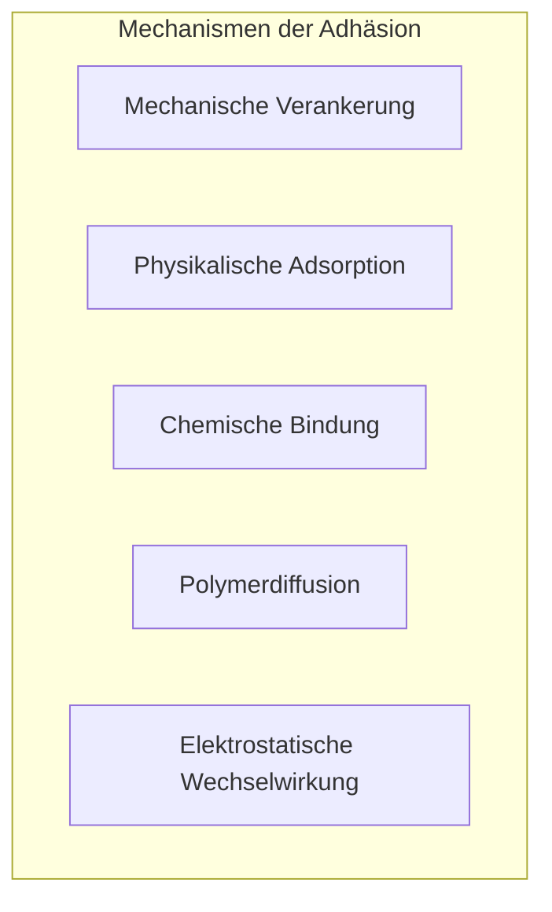
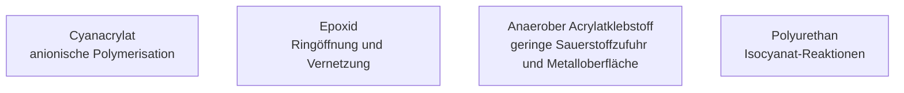
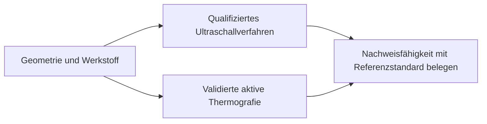

Ein Tropfen Sekundenkleber kann zerbrochene Keramik zusammenfügen. In Flugzeugen wie der Boeing 787 werden Faserverbundwerkstoffe eingesetzt; je nach Konstruktion kommen Kleben, gemeinsame Aushärtung und mechanische Verbindungselemente zum Einsatz. Klebstoffe ersetzen Niete und Schrauben nicht in jeder Verbindung.

Doch physikalisch stellt sich eine grundlegende Frage:
"Warum verbindet ein dünner Flüssigkeitsfilm starre Metalle oder Gesteine so unlösbar fest?"
"Warum klebt Klebeband bei leichtem Fingerdruck sofort, lässt sich aber rückstandsfrei abziehen?"
"Und warum versagt jeder gewöhnliche Klebstoff an Teflon oder Polyethylen?"

Kleben ist kein bloßes Verkeilen in Fugen. Es ist <strong>„das Zusammenwirken von zwischenmolekularen Van-der-Waals-Kräften, thermodynamischer Benetzung (Oberflächenenergie), dreidimensionaler Polymerisationsnetzwerke und Kontinuumsbruchmechanik.“</strong>

---

## 1. Fünf Mechanismen der Adhäsion: Wie Stoffe verbunden werden

Selbst polierte Festkörper besitzen mikroskopische Rauheiten. Trockene Oberflächen berühren sich deshalb nur an einem Teil ihrer scheinbaren Fläche. Ein flüssiger Klebstoff kann in Vertiefungen eindringen, Luft verdrängen und engen Kontakt zwischen den Oberflächen herstellen. Die Haftung kann durch mehrere Mechanismen entstehen:



### 1.1 Mechanische Verankerung
Auf porösen oder rauen Oberflächen kann flüssiger Klebstoff in Poren und Risse eindringen und dort aushärten. Diese Verankerung kann zur Festigkeit beitragen, erklärt aber nicht jede Klebung: Auch sehr glatte Glas- und Siliziumoberflächen lassen sich kleben.

### 1.2 Physikalische Adsorption
Bei engem Abstand wirken Dispersions-, Orientierungs- und Induktionskräfte (Van-der-Waals-Wechselwirkungen). Wasserstoffbrücken können bei passenden funktionellen Gruppen ebenfalls beitragen. Die resultierende Verbindung hängt auch von der tatsächlich erreichten Kontaktfläche und der Grenzflächenchemie ab.

### 1.3 Chemische Bindung und Silankopplung
Bei geeigneten Materialpaarungen können kovalente, ionische oder koordinative Wechselwirkungen an der Grenzfläche entstehen. Silan-Kopplungsmittel können beispielsweise an Glasoberflächen Siloxanbindungen ($\text{Si-O-Si}$) bilden und mit einer Polymermatrix wechselwirken. Die Beständigkeit hängt von Vorbehandlung und Einsatzbedingungen ab.

### 1.4 Polymerdiffusion
Bei bestimmten Polymerpaarungen können bewegliche Ketten über die Grenzfläche diffundieren und sich verschlaufen. Lösungsmittel- und Wärmeverschweißen sind Beispiele; dieser Mechanismus gilt nicht für alle Kunststoffe oder Klebstoffe.

## 2. Benetzung und Oberflächenenergie

Eine unzureichende Benetzung verringert häufig die erreichbare Haftfestigkeit. Sie ist jedoch nicht allein ausschlaggebend: Aushärtung, Grenzflächenchemie, Geometrie und Belastung spielen ebenfalls eine Rolle.


### 2.1 Young-Gleichung und Spreitungskoeffizient
Für einen idealen, glatten Festkörper im Gleichgewicht beschreibt die Young-Gleichung den Kontaktwinkel $\theta$:

$$\gamma_{\text{SV}} = \gamma_{\text{SL}} + \gamma_{\text{LV}} \cos \theta$$

Dabei stehen SV, SL und LV für Festkörper-Gas-, Festkörper-Flüssigkeits- und Flüssigkeits-Gas-Grenzflächen. Der Spreitungskoeffizient lautet:

$$S = \gamma_{\text{SV}} - (\gamma_{\text{SL}} + \gamma_{\text{LV}})$$

Vollständige thermodynamische Benetzung setzt $S \ge 0$ voraus. Ein Vergleich der Festkörperoberflächenenergie mit der Flüssigkeitsoberflächenspannung allein genügt nicht.

### 2.2 Niedrigenergetische Oberflächen
PTFE (Teflon) und Polypropylen lassen sich mit vielen handelsüblichen Klebstoffen schwer benetzen. Oberflächenenergie und Kontaktwinkel hängen jedoch von Materialzustand, Verunreinigung und Messverfahren ab; einzelne Zahlenwerte sind keine universellen Konstanten. Hohe, mittlere und niedrige Oberflächenenergien lassen sich qualitativ unterscheiden, aber Materialwerte müssen mit passender Methode und Oberflächenvorbereitung angegeben werden.

### 2.3 Oberflächenvorbereitung
Plasma- oder Koronabehandlung, chemisches Ätzen und geeignete Primer können die Oberflächenchemie und Benetzung verändern. Das Verfahren muss zum Werkstoff passen; Wirksamkeit und Haltbarkeit sind für den konkreten Prozess zu prüfen.

## 3. Aushärtungschemie ausgewählter Klebstoffe

Nach der Benetzung muss der Klebstoff je nach System durch Polymerisation, Vernetzung, Abkühlung oder Lösungsmittelverlust seine Gebrauchseigenschaften erreichen.



### 3.1 Cyanacrylatklebstoffe
Oberflächenfeuchte und schwach basische Stoffe können die anionische Polymerisation von Cyanacrylaten auslösen. Dabei entsteht Poly(cyanacrylat), nicht Acrylglas. Spaltbreite, Temperatur, Feuchtigkeit und Formulierung beeinflussen die Aushärtung.

### 3.2 Epoxidharze
Epoxidgruppen reagieren mit geeigneten Härtern, etwa Aminen, unter Ringöffnung und bilden je nach Funktionalität ein vernetztes Duroplast. Volumenschrumpfung und thermisch bedingte Eigenspannungen können auftreten. Festigkeit, Glasübergangstemperatur, Kriechen und Chemikalienbeständigkeit sind formulierung- und anwendungsabhängig.

```
Vereinfachte Ringöffnung:
      O
     / \
R-CH-CH2  +  R'-NH2  →  R-CH(OH)-CH2-NH-R'
```

### 3.3 Anaerobe Klebstoffe
Bestimmte Acrylat-Klebstoffe härten in engen Metallspalten bei geringer Sauerstoffzufuhr aus. Die Metalloberfläche kann die Initiierung unterstützen. Zusammensetzung und Aushärtungszeit unterscheiden sich je nach Produkt; nicht jeder anaerobe Klebstoff reagiert gleich.

## 4. Druckempfindliche Klebebänder und das Dahlquist-Kriterium

Druckempfindliche Klebstoffe (PSA) haften durch Kontakt unter Druck, ohne dass dabei zwingend eine chemische Reaktion wie bei einem Strukturklebstoff abläuft. Ihre Leistung beruht auf viskoelastischem Verhalten.


### 4.1 Das Dahlquist-Kriterium als Faustregel
Das Dahlquist-Kriterium ist eine empirische Orientierung für Tack. Häufig wird ein Speichermodul $G'$ unter etwa $3 \times 10^5\text{ Pa}$ bei Raumtemperatur und ungefähr 1 Hz genannt. Es ist kein universelles Gesetz und sagt nicht allein Haftung, Schälkraft, Scherfestigkeit oder Haltbarkeit voraus.

$$G' (1\text{ Hz bei } 25^\circ\text{C}) < 3 \times 10^5\text{ Pa}$$

### 4.2 Abziehen und Klebstoffrückstände
Kontaktzeit, Temperatur, Abziehgeschwindigkeit, Oberfläche und Rezeptur beeinflussen die Verformung und Energiedissipation. Je nach Bedingungen kann Klebstoff sauber abgehen, sich dehnen oder kohäsiv versagen und Rückstände hinterlassen.

## 5. Bruchmechanik geklebter Verbindungen

Eine Verbindung kann an der Grenzfläche, im Klebstoff, im Fügeteil oder entlang mehrerer Bruchpfade versagen. Der beobachtete Bruchpfad hängt von Werkstoffen, Geometrie, Belastung, Umgebung und Herstellungsprozess ab. Er ist ein Hinweis für die Bewertung, entscheidet aber allein nicht über das Bestehen der Abnahmekriterien.

### 5.1 Spannungsverteilung in Überlappverbindungen


Bei einer einschnittigen Überlappverbindung ist die Schubspannung in der Klebschicht im Allgemeinen nicht gleichmäßig verteilt. Das Schubverzugsmodell von Volkersen beschreibt, wie die elastische Dehnung der Fügeteile und die Schubverformung des Klebstoffs zu Spannungsspitzen an den Überlappungsenden führen können. Zusätzlich erzeugt die exzentrische Belastung Biege- und Schälspannungen. Geometrie, Klebschicht und Werkstoffe müssen daher gemeinsam ausgelegt und geprüft werden.

---

## 6. Kleben und mechanisches Fügen in Flugzeugstrukturen


### 6.1 Fertigung und Qualifizierung
Boeing gibt an, dass Verbundwerkstoffe etwa 50 % des Strukturgewichts der 787 ausmachen. Das bedeutet nicht, dass alle strukturellen Verbindungen ausschließlich geklebt sind. Je nach Konstruktion kommen gemeinsames Aushärten, Co-Bonding, sekundäres Kleben und mechanische Verbindungselemente zum Einsatz.

Bohrungen und Befestigungen in CFK werden für Laminataufbau, Lasten und Schadenstoleranz ausgelegt und nachgewiesen. Kleben ist kein universeller Ersatz für Niete oder Schrauben: Oberflächenvorbereitung, Prozesskontrolle, Prüfung und struktureller Nachweis sind wesentlich.

Klebverbindungen können Lasten über eine Fläche übertragen und in bestimmten Konstruktionen Befestigungselemente oder Verstärkungen reduzieren. An den Klebfugenenden können sich jedoch Schub- und Schälspannungen konzentrieren. Gewichts- und Treibstoffvorteile hängen von der konkreten Konstruktion und deren Zulassungsanforderungen ab.

Bei Übergängen zwischen CFK und Metall sind elektrische Isolation und Feuchtigkeitsschutz wichtig. Klebstoffschichten oder Oberflächenbehandlungen können zum Schutz beitragen, garantieren aber keine vollständige oder dauerhafte Verhinderung von Korrosion.

---

## 7. Biologische Vorbilder: Geckofüße und Miesmuscheln

### 7.1 Trockene Haftung des Geckos
Die Haftlamellen an den Zehen eines Geckos besitzen eine hierarchische Struktur aus feinen Setae und nanoskaligen Spatulae. Sie passen sich an Oberflächen an; Van-der-Waals-Kräfte tragen zur Haftung bei. Die tatsächliche Leistung hängt von Kontakt, Geometrie und Bewegungsrichtung ab. Synthetische Gecko-inspirierte Oberflächen werden erforscht und für spezielle Anwendungen entwickelt; eine allgemeine Verwendung in Satellitendocks oder Reinraumrobotern sollte nicht ohne anwendungsspezifische Belege behauptet werden.

### 7.2 Unterwasserhaftung der Miesmuschel
Miesmuscheln befestigen sich mit Byssusfäden an nassen Oberflächen. DOPA-haltige Proteine können an Mineral- und Metalloxidoberflächen binden; weitere Vernetzungsreaktionen tragen zur Festigkeit der Fäden bei. Die Mechanismen hängen von Protein, Oxidationszustand und Umgebung ab. DOPA-inspirierte Klebstoffe und Hydrogele werden untersucht, doch daraus folgt nicht, dass sie bereits routinemäßige chirurgische Klebstoffe sind.

---

## 8. Prüfung und Selbstheilung geklebter Strukturen



### 8.1 Zerstörungsfreie Prüfung
Ultraschallverfahren, darunter Impuls-Echo, Durchschallung und Array-Bildgebung, können je nach Werkstoff und Geometrie zur Suche nach festgelegten Fehlertypen eingesetzt werden. Die Nachweisfähigkeit muss mit repräsentativen Referenzstandards und für die konkrete Struktur qualifizierten Verfahren belegt werden; eine universelle Fehlergröße gibt es nicht.

Bei der aktiven Infrarotthermografie wird die Oberfläche erwärmt und die Temperaturantwort mit einer Wärmebildkamera erfasst. Das Verfahren wurde an Klebverbindungen von Verbundwerkstoffen untersucht. Ergebnisse hängen unter anderem von Werkstoff, Geometrie, Fehlertiefe, Anregung und Auswertung ab; für reale Strukturen ist ein validiertes Prüfverfahren nötig.

### 8.2 Selbstheilende Klebstoffe
In der Forschung werden Klebstoffsysteme mit Mikrokapseln untersucht, die bei Rissbildung ein Heilmittel freisetzen. Die Heilwirkung und Wiederholbarkeit hängen vom jeweiligen System und den Prüfbedingungen ab; veröffentlichte Untersuchungen zeigen eine teilweise, nicht universelle Wiederherstellung. Selbstheilung ersetzt weder Inspektion noch Auslegung oder Wartung.

---

## 9. Fazit

Von der Reparatur zerbrochener Keramik bis zu qualifizierten Klebverbindungen in Flugzeugen zeigt die Adhäsion, wie Grenzflächenchemie, Polymerverhalten und Bruchmechanik zusammenwirken. Die konkrete Leistungsfähigkeit muss stets für Material, Konstruktion und Einsatzbedingungen nachgewiesen werden.

## Quellen
- [FAA AC 20-107B: Composite Aircraft Structure (einschließlich Änderung 1)](https://www.faa.gov/documentLibrary/media/Advisory_Circular/AC_20-107B_with_change_1.pdf)
- [Boeing: 787 Dreamliner By Design](https://www.boeing.com/commercial/787/by-design)
- [FAA AC 43-214A: Repairs and Alterations to Composite and Bonded Aircraft Structure](https://www.faa.gov/documentLibrary/media/Advisory_Circular/AC_43-214A.pdf)
- [Pulse infrared thermography for composite aircraft adhesive joints](https://doi.org/10.3390/ma14030533)
- [Ultrasonic analysis and lock-in thermography for composite adhesive joints](https://doi.org/10.1016/j.ndteint.2015.09.001)
- [Fracture behavior of a self-healing, toughened epoxy adhesive](https://doi.org/10.1016/j.ijadhadh.2013.02.015)
