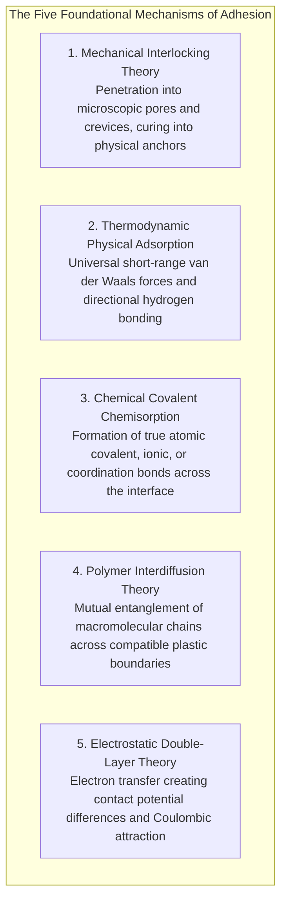
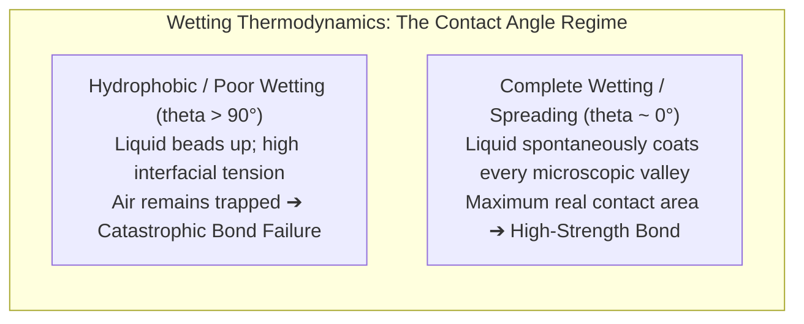
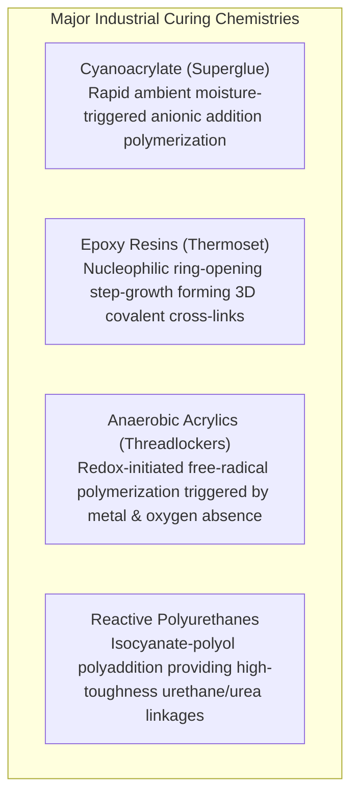
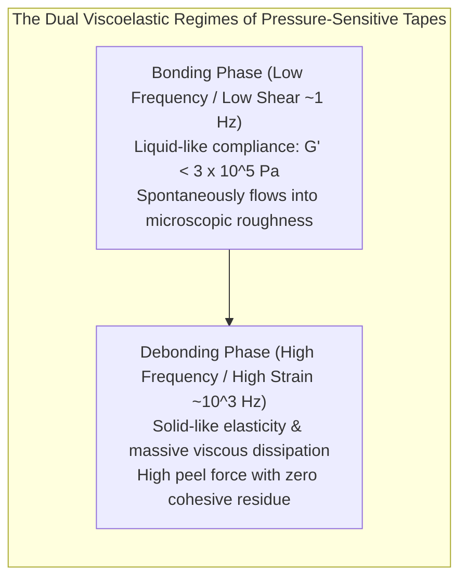
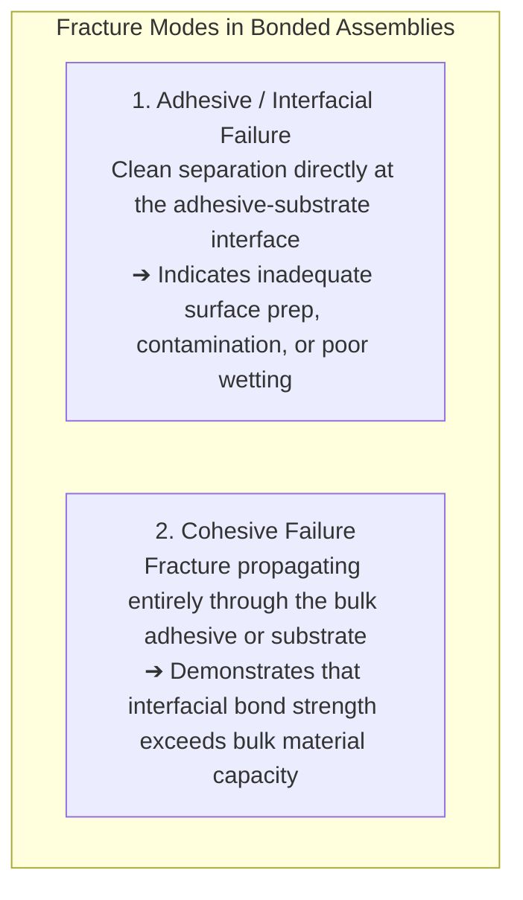
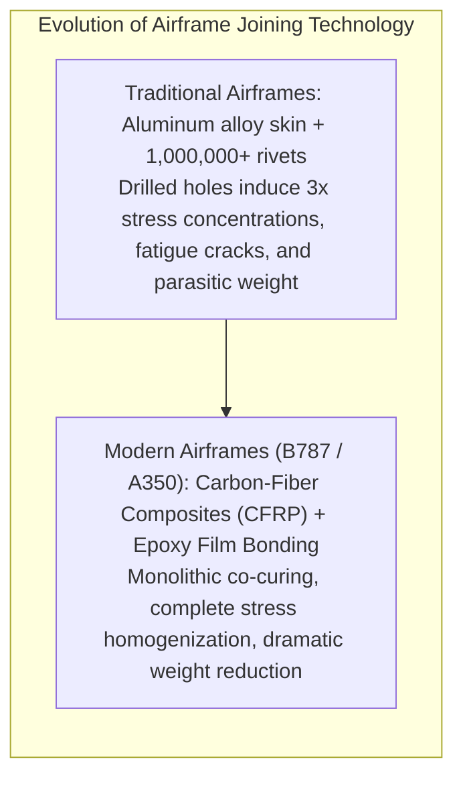

A ceramic coffee mug shatters onto a hardwood floor, its handle snapping cleanly into two fragments. A single drop of clear, pungent liquid is applied along the hairline fracture; the pieces are pressed together for fifteen seconds, and the mug is restored, capable of bearing the full weight of boiling liquid without yielding. 

At the other extreme of engineering scale, consider the Boeing 787 Dreamliner or the Airbus A350 XWB cruising at 900 kilometers per hour through the sub-zero stratosphere. The gargantuan composite wings carrying hundreds of tons of dynamic aerodynamic lift are not held together by thousands of heavy steel rivets and bolts. Instead, their load-bearing titanium spars and carbon-fiber reinforced polymer (CFRP) skins are integrally bonded by microscopic layers of aerospace-grade structural polymeric adhesives.

Yet, viewed through the lens of fundamental physics, this ubiquity conceals a profound paradox:
"Why should applying a thin film of viscous liquid between two solid blocks of metal or stone cause them to fuse with such violent tenacity that the mother material often ruptures before the joint itself fails?"
"Why does cellophane adhesive tape stick instantly upon the lightest fingertip touch, yet peel away cleanly without leaving a trace of residue?"
"And why, conversely, do non-stick polytetrafluoroethylene (Teflon) and polyethylene bags stubbornly refuse to bond to virtually every known glue on Earth?"

Adhesion is emphatically not the mere mechanical trapping of sticky gum in cracks. It is <strong>"an exquisite interdisciplinary masterpiece combining nanoscale intermolecular forces (van der Waals and hydrogen bonding), thermodynamic wetting and surface free energy, high-density 3D macromolecular cross-linking polymerizations, and continuum fracture mechanics."</strong>

This comprehensive guide dissects the science of adhesion: from the five foundational theories of bonding and Young-Dupré wetting dynamics to the rapid anionic kinetics of superglue, the tough network topology of aerospace epoxies, Dahlquist rheological criteria in pressure-sensitive tapes, Volkersen shear-lag stress concentration models, biomimetic gecko dry adhesives, and non-destructive structural health monitoring.

---

## 1. The Five Fundamental Theories of Adhesion: How Matter Binds

At a theoretical level, if two absolutely flat, atomically clean solid surfaces could be brought into contact within sub-nanometer proximity, they would instantly weld together into a continuous monolithic solid via spontaneous interatomic attraction (a phenomenon known as cold welding or optical contacting).

In reality, however, even the most exquisitely polished optical glass or metallurgical mirror is, at the atomic scale, a jagged alpine mountain range of microscopic roughness—asperities measuring anywhere from tens of nanometers to hundreds of micrometers in height. When two dry solids are placed together, they touch only at the rarest, sharpest peaks of these microscopic asperities. The true microscopic contact area ($A_{\text{real}}$) is typically less than <strong>0.01% of the apparent geometric area</strong>. The remaining 99.99% is an insulating expanse of ambient air, separating the opposing atomic lattices far beyond the reach of intermolecular forces.

The primary function of an adhesive is thermodynamic: <strong>to act as a conformal liquid that spontaneously flows into the deepest microscopic valleys of surface asperities, expelling trapped air pockets, and establishing continuous, atomic-scale contact across the entire macroscopic interface.</strong>

In modern interfacial science, the mechanisms responsible for translating this intimate contact into mechanical joint strength are codified into five foundational theories:



### 1.1 Mechanical Interlocking Theory (The Anchor Effect)
Mechanical interlocking represents the oldest and most intuitive concept of adhesion. When an adhesive is applied to porous substrates—such as unglazed ceramics, wood, paper, textiles, or sandblasted metals—the liquid penetrates deep into microscopic fissures and re-entrant cavities via capillary pressure.
Upon curing, the solidified resin forms millions of microscopic <strong>interlocking hooks, anchors, and wedges</strong> that physically resist pullout.

While mechanical interlocking provides significant shear and peel resistance in porous media, it cannot explain why adhesives bond with ferocious tenacity to atomically smooth, non-porous substrates such as fire-polished quartz, silicon wafers, or cleavage faces of mica. Hence, mechanical interlocking is a secondary, surface-specific contributor rather than the universal root of adhesion.

### 1.2 Thermodynamic Physical Adsorption: The Universal Titan
The undisputed cornerstone of virtually all adhesive phenomena is <strong>Thermodynamic Adsorption</strong>.
Whenever two distinct phases are brought into intimate proximity within distances of less than a single nanometer ($0.2 \sim 0.5\text{ nm}$), spontaneous electromagnetic interactions occur between their constituent electron clouds: <strong>van der Waals forces</strong>.

1. <strong>Keesom Dipole-Dipole Forces</strong>: Orientation interactions between permanent molecular dipoles.
2. <strong>Debye Induced Dipole Forces</strong>: Polarization of a non-polar molecule by an adjacent polar molecule.
3. <strong>London Dispersion Forces</strong>: Quantum electrodynamic fluctuations in instantaneous electron density, generating synchronized transient dipoles present between all atoms without exception.

Individually, a van der Waals bond is weak, possessing an interaction energy of only $1 \sim 10\text{ kJ/mol}$ (compared to $200 \sim 800\text{ kJ/mol}$ for a primary covalent bond). However, because these forces operate ubiquitously across every square nanometer of the true contact area, the cumulative summation across trillions of atoms generates colossal macroscopic strength—frequently exceeding <strong>20 to 40 megapascals of tensile strength</strong>, enough to suspend a multi-ton locomotive from a bonded steel disc the size of a tea saucer.

Furthermore, when the adhesive or substrate possesses highly electronegative atoms (such as oxygen, nitrogen, or fluorine) paired with hydrogen, <strong>Hydrogen Bonding</strong> ($10 \sim 40\text{ kJ/mol}$) engages. This directional pseudo-chemical bond dramatically amplifies interfacial toughness and thermal resistance.

### 1.3 Chemical Bonding Theory (Chemisorption)
In critical structural engineering applications where adhesive joints must endure decades of hostile environmental exposure—such as moisture immersion, cyclic thermal shocks, and corrosive saline environments—van der Waals forces alone may succumb to water hydrolysis. Under such conditions, <strong>true Chemical Bonding (Chemisorption)</strong> is actively engineered.

Chemical bonding occurs when functional groups on the adhesive molecule react directly with active chemical sites on the substrate surface, forming primary covalent, ionic, or coordinate bonds.
The preeminent industrial example is the deployment of <strong>Organofunctional Silane Coupling Agents</strong> (e.g., $\gamma$-glycidoxypropyltrimethoxysilane) in glass-reinforced composites and automotive windshield bonding. The silane molecule possesses two distinct ends:
- A hydrolyzable alkoxy group that condenses with silanol groups ($\text{Si-OH}$) on the glass or oxidized metal surface to form permanent, hydrolytically stable <strong>siloxane bonds ($\text{Si-O-Si}$)</strong>.
- An organic functional group (epoxy, vinyl, or amine) that copolymerizes directly into the adhesive polymer matrix during vulcanization.

The resulting joint is not merely two materials touching; it is an unbroken continuum of covalent atomic bonds spanning from the bulk metal, through the interface, into the core adhesive resin.

### 1.4 Polymer Interdiffusion Theory
First articulated by Soviet scientist S.S. Voyutskii, this theory applies to the bonding of chemically compatible thermoplastic polymers. When two compatible plastics are brought into contact in the presence of heat or mild solvents, long-chain polymer macromolecules are liberated into micro-Brownian thermal motion.
Polymer chains from Substrate A diffuse across the phase boundary into Substrate B, weaving through neighboring coils to establish an interpenetrating, entangled interfacial network. The sharp geometrical interface literally dissolves, transforming into a gradual concentration gradient. This mechanism governs solvent welding in acrylic sheets and ultrasonic plastic sealing.

---

## 2. The Thermodynamic Prerequisite: Wetting and Surface Free Energy

An adhesive may possess the most formidable molecular bond chemistry conceivable, but if it fails to spread across the substrate and instead beads up into spherical droplets, the bond strength will be precisely zero.

<strong>Wetting</strong> is the indispensable mechanical precursor to all adhesive bonding. The liquid adhesive must wet the substrate completely, driving its contact angle toward zero to eliminate interfacial micro-voids.



### 2.1 The Young-Dupré Thermodynamic Formulation
When a liquid droplet rests in thermodynamic equilibrium on a flat, ideal solid substrate in an ambient vapor phase, the mechanical balance of the three intersecting interfacial surface tensions is dictated by <strong>Thomas Young's Equation (1805)</strong>:

$$\gamma_{\text{SV}} = \gamma_{\text{SL}} + \gamma_{\text{LV}} \cos \theta$$

where:
- $\gamma_{\text{SV}}$ = Solid-Vapor surface free energy (often termed solid surface tension)
- $\gamma_{\text{SL}}$ = Solid-Liquid interfacial free energy
- $\gamma_{\text{LV}}$ = Liquid-Vapor surface tension of the liquid adhesive
- $\theta$ = Contact angle formed at the three-phase boundary line

For an adhesive to spread spontaneously across a solid without requiring mechanical work ($\theta \rightarrow 0^\circ$, $\cos \theta = 1$), the <strong>Spreading Coefficient ($S$)</strong> must be greater than or equal to zero:

$$S = \gamma_{\text{SV}} - (\gamma_{\text{SL}} + \gamma_{\text{LV}}) \ge 0$$

Rearranging this reveals the golden axiom of adhesion engineering: 
<strong>To achieve spontaneous, perfect wetting, the solid substrate must possess a surface free energy ($\gamma_{\text{SV}}$) substantially higher than the liquid adhesive's surface tension ($\gamma_{\text{LV}}$).</strong>

```
Surface Free Energies of Engineering Materials (mN/m or dyn/cm at 20°C):
High-Energy Surfaces (Spontaneously wetted by all commercial adhesives):
  - Ferrous Alloys, Titanium, Aluminum: 500 to 2,000+
  - Silica, Soda-Lime Glass, Metal Oxides: 250 to 500

Medium-Energy Surfaces (Wetted by standard epoxies and polyurethanes):
  - Nylon-6,6, PET, Polycarbonate: 40 to 46
  - Epoxy Resin, Polyurethane Liquid: 35 to 45

Low-Energy Surfaces (Adhesives bead up; virtually impossible to bond without treatment):
  - Polyethylene (PE): ~31
  - Polypropylene (PP): ~29
  - Silicone Rubber (PDMS): ~20
  - Polytetrafluoroethylene (PTFE / Teflon): ~18
```

### 2.2 Why Teflon and Polypropylene Defy Bonding
The non-stick behavior of Polytetrafluoroethylene (Teflon) and Polypropylene (PP) is a direct consequence of surface thermodynamics.
In PTFE, the carbon backbone is completely enveloped in a sheath of fluorine atoms. Because fluorine is the most electronegative element in the periodic table, it holds its electrons with fierce tenacity; its electron cloud exhibits exceptionally low polarizability.
Consequently, PTFE possesses an extraordinarily low surface energy of just <strong>$18\text{ mN/m}$</strong>.

Because standard liquid adhesives possess surface tensions between $35$ and $45\text{ mN/m}$, placing an adhesive on Teflon yields a strongly negative spreading coefficient ($S \ll 0$). The liquid adhesive minimizes its free energy by shrinking into a spherical bead with a contact angle $\theta > 110^\circ$, physically refusing to enter the surface valleys. Trapped air pockets remain, and true molecular contact is thwarted.

### 2.3 Surface Activation Technologies
To bond low-surface-energy polymers in automotive and aerospace production, engineers deploy energetic surface modification techniques to forcibly raise $\gamma_{\text{SV}}$:
1. <strong>Atmospheric Plasma & Corona Discharge</strong>: High-energy ionized gas streams strike the polymer surface, cleaving non-polar $\text{C-H}$ and $\text{C-C}$ bonds. The resulting free radicals immediately react with atmospheric oxygen and moisture, grafting polar oxygen-bearing functional groups—such as <strong>hydroxyl ($\text{-OH}$), carbonyl ($\text{-C=O}$), and carboxyl ($\text{-COOH}$)</strong> moieties—onto the outer atomic layers. This abruptly elevates the surface energy from $30\text{ mN/m}$ to well over $60\text{ mN/m}$, allowing adhesives to wet out completely.
2. <strong>Chemical Etching</strong>: For fluoropolymers, exposure to sodium naphthalene complexes strips fluorine atoms from the surface, leaving behind an unsaturated, reactive carbonaceous surface that bonds aggressively to epoxies.

---

## 3. The Chemistry of Cohesion: Macromolecular Curing Kinetics

Achieving intimate interfacial contact is only half the battle. Once an adhesive has wetted the substrate, it must undergo a profound phase transition: <strong>transforming from a compliant liquid into a rigid, highly cohesive solid capable of bearing enormous mechanical stress without cohesive rupture</strong>.

If an adhesive remained a viscous liquid, applying an external tensile load would simply cause the liquid layer to split down the middle (cohesive fluid failure). Modern adhesives employ diverse, highly sophisticated chemical polymerization mechanisms to construct dense macromolecular architectures.



### 3.1 Cyanoacrylates: The Instant Moisture-Triggered Anionic Cascade
Invented serendipitously by Dr. Harry Coover at Eastman Kodak in 1942, household "Super Glue" is composed of liquid <strong>ethyl-2-cyanoacrylate</strong> monomers.

The cyanoacrylate molecule features a central vinyl carbon-carbon double bond ($\text{C=C}$) flanked by two ferocious electron-withdrawing groups: an <strong>ester group ($\text{-COOCH}_2\text{CH}_3$)</strong> and a <strong>cyano group ($\text{-C}\equiv\text{N}$)</strong>. This configuration drains electron density away from the terminal methylene carbon, leaving it in an intensely electrophilic, highly vulnerable state.

Inside its sealed plastic container, the monomer is stabilized by minute quantities of volatile weak acids (such as sulfur dioxide, $\text{SO}_2$) that quench stray nucleophiles. However, when squeezed out into a thin film between two surfaces exposed to atmospheric air:
1. <strong>Initiation via Ambient Trace Water</strong>: Every surface under ambient conditions is coated with an invisible, microscopic monolayer of adsorbed moisture. The traces of water molecules dissociate slightly to generate nucleophilic hydroxide ions ($\text{OH}^-$) or act as weak bases.
2. <strong>Explosive Anionic Polymerization</strong>: The electron-rich lone pair of the hydroxyl nucleophile attacks the electron-starved terminal carbon of the cyanoacrylate monomer, converting it into a reactive carbanion.
3. <strong>Chain Propagation</strong>: This carbanion attacks the double bond of a second monomer, regenerating the carbanion at the new chain terminus. This chain-growth cascade proceeds at blistering velocities—thousands of monomer units assemble into long linear polyacrylate chains in <strong>less than 15 seconds</strong>, transforming the liquid into a rock-solid, glass-like acrylic polymer.

This explains why superglue bonds human fingers with terrifying speed: skin moisture and alkaline cellular proteins act as ultra-potent polymerization catalysts.

### 3.2 Epoxy Resins: The Three-Dimensional Network of Aerospace Strength
Where maximum mechanical strength, high glass transition temperature ($T_g$), and zero creep under sustained load are mandatory, <strong>Epoxy Resins</strong> represent the gold standard of structural adhesives.

Typically formulated as a two-component reactive system, epoxies comprise:
- <strong>Resin Prepolymer</strong>: Diglycidyl ether of bisphenol-A (DGEBA), characterized by strained three-membered <strong>oxirane (epoxy) rings</strong> at both chain termini.
- <strong>Hardener (Curing Agent)</strong>: Multifunctional aliphatic or aromatic polyamines (such as diethylenetriamine, DETA, or 4,4'-diaminodiphenylsulfone, DDS).

```
Epoxy Ring Opening Reaction with Primary Amine:
        O
       / \
    R-CH-CH2  +  R'-NH2  ──>  R-CH(OH)-CH2-NH-R'
```

When mixed, the nucleophilic nitrogen of the amine attacks the electrophilic methylene carbon of the strained oxirane ring. The ring snaps open, forming a stable secondary amine and a pendant hydroxyl ($\text{-OH}$) group. Because primary amines possess two active hydrogen atoms and each amine molecule typically contains multiple amino groups, each hardener molecule reacts with four or more separate epoxy prepolymers.

This generates a tightly knit, infinite <strong>3D Covalent Cross-Linked Macromolecular Network</strong>.
The engineering consequences of this network topology are profound:
- <strong>Negligible Curing Shrinkage</strong>: Unlike vinyl polymerization, which contracts heavily as double bonds collapse into single bonds, ring-opening polyaddition involves minimal volumetric shrinkage (typically $< 1 \sim 2\%$). Consequently, negligible residual internal shear stresses are frozen into the bondline.
- <strong>Immense Creep Resistance</strong>: Once fully cured, the 3D covalent thermoset network cannot melt or undergo plastic flow below its thermal decomposition point, allowing it to sustain continuous aerospace loads across decades.
- <strong>High Hydroxyl Adhesion</strong>: The opening of oxirane rings generates vast concentrations of polar secondary hydroxyl groups ($\text{-OH}$), which form dense hydrogen bonding networks with metal oxide layers.

### 3.3 Anaerobic Adhesives: Polymerization in the Absence of Air
Widely deployed in mechanical engineering under brand names such as Loctite, anaerobic threadlockers remain stable liquids indefinitely when exposed to atmospheric oxygen inside permeable polyethylene bottles. Yet, when applied to a steel bolt and threaded tightly into an engine casing, the fluid cures into an indestructible solid polymer within minutes.

This behavior relies on a dual-inhibition mechanism:
- <strong>Oxygen Inhibition</strong>: Atmospheric oxygen is a diradical molecule ($\cdot\text{O-O}\cdot$) that reacts with growing polymer radicals orders of magnitude faster than monomer addition, forming unreactive peroxy radicals that instantly terminate free-radical polymerization.
- <strong>Redox Transition-Metal Catalysis</strong>: When the adhesive is confined between threaded metal surfaces, oxygen is physically excluded. Concurrently, catalytic active metal ions ($\text{Fe}^{2+}, \text{Cu}^+$) leaching from the fresh metal surface react with organic hydroperoxides present in the resin, initiating an explosive cascade of free radicals that rapidly polymerizes the dimethacrylate monomers into a cross-linked thermoset plastic.

---

## 4. The Physics of Pressure-Sensitive Adhesives and the Dahlquist Criterion

Unlike structural epoxies or superglues, <strong>Pressure-Sensitive Adhesives (PSAs)</strong>—the technology underpinning Scotch tape, Post-it notes, masking tapes, and medical bandages—undergo <strong>zero chemical reaction, zero solvent evaporation, and zero phase change</strong>.

They exist perpetually in a metastable state between liquid and solid: possessing enough liquid-like compliance to wet out a surface under light pressure in fractions of a second, while retaining enough solid-like elastic cohesion to resist peeling without leaving adhesive residue.



### 4.1 The Dahlquist Criterion for Instantaneous Tack
In the 1960s, 3M physicist Carl A. Dahlquist discovered the universal rheological law governing whether a material exhibits instantaneous pressure-sensitive "tack":

$$G' (1\text{ Hz at } 25^\circ\text{C}) < 3 \times 10^5\text{ Pa} \quad (0.3\text{ MPa})$$

where $G'$ is the dynamic shear storage modulus.
If a polymer possesses a modulus greater than this critical threshold ($G' > 0.3\text{ MPa}$), it is too rigid. Human fingertip pressure (typically $10 \sim 100\text{ kPa}$) is mechanically insufficient to deform the elastomer into the microscopic valleys of the paper or wall within a practical human timeframe (fractions of a second); true molecular contact fails to form.

Conversely, if $G' < 3 \times 10^5\text{ Pa}$, the material's elastic resistance is low enough that light pressure forces the polymer to <strong>flow dynamically like a high-viscosity liquid into surface asperities</strong>, achieving instant, intimate van der Waals contact.

### 4.2 Why Tapes Peel Without Leaving Gunk
How does a tape exhibit instant liquid-like tack, yet peel away cleanly without splitting into a sticky mess?
The answer lies in <strong>frequency-dependent viscoelastic energy dissipation</strong>:
- During <strong>application (slow, low strain rate $\sim 1\text{ Hz}$)</strong>, the polymer operates in its low-modulus rubbery plateau, behaving like a liquid to establish wetting.
- During <strong>rapid peeling (high strain rate $\sim 10^2 - 10^4\text{ Hz}$)</strong>, polymer chains are stretched violently. The material shifts dynamically toward its glass transition regime; its effective modulus spikes by multiple orders of magnitude. The polymer stiffens into an elastic solid, maintaining internal cohesive integrity and peeling cleanly at the interface rather than rupturing cohesively.

---

## 5. Continuum Fracture Mechanics of Adhesive Joints

When an adhesive joint is subjected to catastrophic external mechanical loads, failure proceeds via one of two distinct modes:



In structural engineering certification, <strong>pure cohesive failure of the adhesive or substrate is the mandatory design objective</strong>. If an adhesive joint fails along the interface (adhesive failure), it signifies an unoptimized, brittle process susceptible to environmental degradation.

### 5.1 Stress Concentrations in Lap Joints: The Volkersen Shear-Lag Model
When two overlapping plates are joined in a standard single-lap shear configuration and pulled under axial tensile force $P$, intuition suggests that shear stress $\tau$ is distributed uniformly across the overlap area: $\tau_{\text{avg}} = P / (w \cdot L)$.

In 1938, Otto Volkersen demonstrated that this elementary assumption is dangerously flawed. Because the adherends (plates) stretch elastically under tensile load while the adhesive deforms in shear, a phenomenon termed <strong>shear lag</strong> develops. Shear stress is drastically localized at the extreme edges of the overlap ($x = 0$ and $x = L$), while the central region of the bondline carries virtually zero shear load:

$$\tau(x) = \tau_{\text{avg}} \left[ \frac{\omega}{2 \sinh(\omega/2)} \cosh\left(\omega \left(\frac{x}{L} - \frac{1}{2}\right)\right) \right]$$

where $\omega$ is a dimensionless parameter characterizing the stiffness ratio between the adhesive layer and the adherends.

```
Shear Stress Profile Across a Single Lap Joint:
  Shear Stress tau
   ^
   |   |\                                 /|
   |   | \  Peak Stress at Edges         / |  Peak Stress at Edges
   |   |  \                             /  |
   |   |   \                           /   |
   |   |    \_________________________/    |  Central Dead Zone
   +---+-----------------------------------+-----> Overlap Position x
      x=0                                 x=L
```

Furthermore, because the opposing tensile forces $P$ act along offset planes separated by the plate thickness, an eccentric bending moment is induced. This moment curls the joint edges, generating intense out-of-plane tensile normal stresses: <strong>Peel Stresses ($\sigma_{\text{peel}}$)</strong>.
Adhesives are exceptionally strong in pure shear, but notoriously susceptible to brittle cleavage under peel stresses. Modern joint designers alleviate this by introducing chamfered tapers, scarf joints, and molded adhesive fillets at overlap edges to diffuse peak stresses.

---

## 6. The Modern Apex: Aerospace CFRP Structural Bonding

Nowhere has the science of adhesive bonding wrought a more profound industrial revolution than in commercial and military aviation.



### 6.1 Transcending the Rivet: The Boeing 787 and Airbus A350
For nearly a century, airframes were constructed by drilling millions of holes through aluminum sheets and hammering in metal rivets.
However, drilling a circular hole into a structural plate induces a theoretical <strong>three-fold stress concentration ($\sigma_{\text{peak}} = 3\sigma_0$)</strong> around the hole perimeter according to Kirsch's classical elasticity solution. Under cyclic cabin pressurization cycles, these rivet holes inevitably nucleate metal fatigue micro-cracks, requiring continuous structural maintenance.

In fifth-generation stealth fighters (F-22, F-35) and commercial widebodies (Boeing 787, Airbus A350), carbon-fiber reinforced polymers (CFRP) constitute over 50% of the structural airframe.
Drilling holes through carbon fiber cuts the continuous graphite filaments, destroying their unidirectional tensile reinforcement. Consequently, aerospace manufacturers deploy <strong>structural epoxy film adhesives</strong>:
1. <strong>Continuous Stress Transfer</strong>: Instead of transferring multi-ton aerodynamic loads through discrete puncture points (rivets), adhesive bonds distribute stresses continuously across hundreds of square meters of aerodynamic surface area, completely eradicating point stress concentrations.
2. <strong>Weight Elimination</strong>: Eliminating millions of metal fasteners and reinforcement doublers slashes structural weight by several metric tons, directly enabling double-digit percentage gains in commercial fuel efficiency.
3. <strong>Galvanic Corrosion Isolation</strong>: Direct physical contact between conductive carbon fibers and metallic aluminum induces violent electrochemical galvanic corrosion. An intervening structural epoxy adhesive film functions as a 100% dielectric insulator, permanently sealing the structural interface against environmental degradation.

---

## 7. Biomimetic Adhesion: Gecko Setae and Mussel DOPA Chemistry

Long before human chemists synthesized synthetic polymers, biological evolution engineered adhesive mechanisms capable of feats that continue to humble modern materials science.

### 7.1 The Gecko's Dry Nanotech Adhesion
A 100-gram Tokay gecko can sprint up a polished vertical glass pane at one meter per second, hang from a ceiling by a single toe, and detach in milliseconds with zero perceptible effort. Crucially, the gecko's foot possesses no glands, secretes no sticky liquid, and leaves no residue.

Electron microscopy revealed that the gecko's footpad is covered by an intricate, hierarchical micro-forest. Hundreds of thousands of microscopic keratinous hairs called <strong>setae</strong> (length $\approx 100\,\mu\text{m}$) carpet the toes, each splitting at its tip into hundreds of nanoscale flattened spatulae (width $\approx 200\text{ nm}$).
When the gecko places its foot, these billions of spatulae conform intimately to the atomic valleys of the substrate, mobilizing pure, unadulterated <strong>van der Waals intermolecular attraction</strong>.
To detach, the gecko dynamically changes the peeling angle of its setae beyond a critical angle ($\approx 30^\circ$), causing the spatulae to pop off sequentially with near-zero energy consumption.
Synthetic gecko tapes engineered from vertically aligned carbon nanotube arrays are now deployed in vacuum satellite docking systems and semiconductor pick-and-place robots where chemical adhesives would vaporize and contaminate sensitive optics.

### 7.2 Mussel Byssus: Covalent Underwater Gluing
The most challenging environment for any synthetic glue is submerged marine water: polar water molecules instantly hydrate substrate surfaces, out-competing adhesive polymers and preventing van der Waals contact.
Yet the marine mussel (*Mytilus edulis*) anchors itself permanently to storm-battered, algae-coated rocks beneath crashing waves.

Mussels achieve this by extruding proteinaceous filaments (byssal threads) packed with a unique amino acid: <strong>L-3,4-dihydroxyphenylalanine (DOPA)</strong>.
The catechol ring of DOPA features two adjacent hydroxyl groups that displace water molecules from mineral oxide surfaces via high-affinity coordination bonding (chelation). Once bound, the catechols oxidize to form cross-linked covalent poly-catecholamine networks that cure into an indestructible underwater cement. Synthetic DOPA-functionalized hydrogels are currently pioneering sutureless surgical glues capable of sealing wet arterial lacerations and punctured internal organs in emergency trauma medicine.

---

## 8. Conclusion: The Masterwork of the Invisible Interface

From a solitary drop of cyanoacrylate repairing broken porcelain to structural epoxy films sustaining the immense aerodynamic forces of an intercontinental airliner, the science of adhesion represents one of humanity's most triumphant engineering achievements.

An adhesive is not a passive gap filler. It is <strong>"a dynamic molecular bridge that banishes the microscopic void between two disparate materials, orchestrating trillions of atomic forces into a unified macroscopic whole."</strong>

Inside the microscopic boundary layer separating two bonded surfaces—a zone often measuring mere fractions of a hair's width—lies the culmination of centuries of physical inquiry: the quantum fluctuations of electron clouds, the precise thermodynamics of surface free energy, the complex network kinetics of polymer cross-linking, and the continuum mechanics of fracture resistance. It is within this invisible nanoscale expanse that modern engineering quietly, yet resolutely, holds the physical world together.
