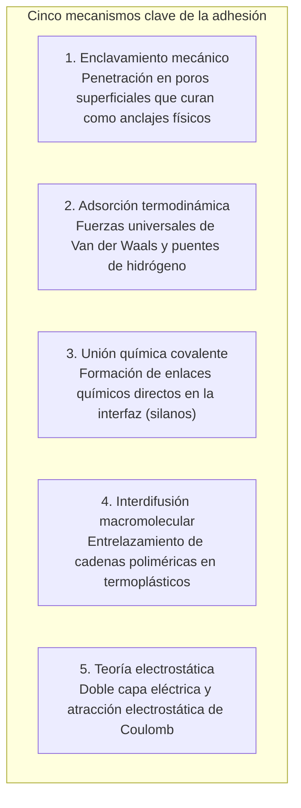
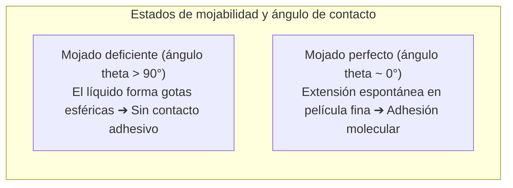

Unas gotas de líquido unen fragmentos de cerámica rota con tal firmeza que soportan agua hirviendo sin despegarse. En el extremo de la ingeniería aeronáutica, las alas de fibra de carbono del Boeing 787 y Airbus A350 no dependen de remaches metálicos, sino de adhesivos epoxi estructurales que fusionan los componentes a escala atómica.

Desde la física fundamental, surge una pregunta obligada:
"¿Por qué una película líquida puede unir metales con tanta fuerza que el material base suele romperse antes que la unión adhesiva?"
"¿Cómo logra una cinta adhesiva adherirse con una suave presión y despegarse sin dejar residuos?"
"¿Y por qué el teflón o el polietileno rechazan prácticamente cualquier pegamento convencional?"

La adhesión no es una mera traba mecánica. Es <strong>«la convergencia de fuerzas intermoleculares (Van der Waals y puentes de hidrógeno), termodinámica de mojabilidad (energía superficial), redes poliméricas tridimensionales y mecánica de fractura continua.»</strong>

---

## 1. Los 5 mecanismos fundamentales de la adhesión

A escala microscópica, las superficies sólidas presentan rugosidades pronunciadas. El contacto real entre sólidos secos es inferior al 0,01 %. El adhesivo debe <strong>mojar la superficie en estado líquido, desplazar el aire ocluido y establecer un contacto atómico íntimo</strong>.

### 1.1 Adsorción física (Van der Waals)
A distancias inferiores a un nanómetro, las fuerzas de Van der Waals actúan de forma universal. Aunque débiles individualmente ($1 \sim 10\text{ kJ/mol}$), su suma a lo largo de billones de átomos en la interfaz genera resistencias de decenas de megapascales.

### 1.2 Enlace químico y silanos
En aplicaciones estructurales exigentes, los agentes de acoplamiento silano forman enlaces covalentes de siloxano ($\text{Si-O-Si}$) extremadamente resistentes a la hidrólisis con sustratos inorgánicos y resinas.

---

## 2. Mojabilidad y energía superficial

Si el adhesivo no moja el sustrato, la adhesión es imposible.

### 2.1 Ecuación de Young
$$\gamma_{\text{SV}} = \gamma_{\text{SL}} + \gamma_{\text{LV}} \cos \theta$$
Para que el adhesivo se extienda espontáneamente, la energía superficial del sólido ($\gamma_{\text{SV}}$) debe superar la tensión superficial del líquido ($\gamma_{\text{LV}}$).
Los metales ($\gamma_{\text{SV}} > 500\text{ mN/m}$) se mojan con facilidad. El teflón (PTFE), blindado por átomos de flúor poco polarizables, tiene una energía de solo <strong>$18\text{ mN/m}$</strong>, por lo que repele los pegamentos. El tratamiento con plasma o corona genera radicales polares para activar estas superficies.

---

## 3. Cinética de curado de adhesivos clave

- <strong>Cianoacrilato (Superglue)</strong>: Trazas de humedad atmosférica ($\text{OH}^-$) en la superficie disparan una polimerización aniónica en cadena ultrarrápida en cuestión de segundos.
- <strong>Resinas epoxi</strong>: Reacción de poliadición por apertura de anillo oxirano con aminas, formando una red tridimensional termoestable sin contracción apreciable ($< 1\,\%$) ni solventes.
- <strong>Adhesivos anaeróbicos</strong>: Curan al excluir el oxígeno en presencia de iones metálicos catalizadores dentro de roscas y tornillos.

---

## 4. Cintas adhesivas y el Criterio de Dahlquist

Las cintas sensibles a la presión (PSA) cumplen el <strong>criterio reológico de Dahlquist</strong>:
$$G' (1\text{ Hz}) < 3 \times 10^5\text{ Pa}$$
A baja deformación (colocación) fluyen como líquido sobre las asperezas; al retirarse bruscamente, el polímero se endurece elásticamente disipando energía sin romperse ni dejar residuo.

---

## 5. Unión estructural en la industria aeroespacial

En aviones como el Boeing 787 y Airbus A350, los adhesivos estructurales epoxi reemplazan a los remaches convencionales, eliminando la concentración de tensiones por orificios (factor 3 según Kirsch), reduciendo toneladas de peso y evitando la corrosión galvánica entre metales y carbono.

---

## 6. Conclusión

Desde los nanohilos secos de los gecos hasta las alas compuestas de los aviones comerciales modernos, los adhesivos son los puentes moleculares invisibles que sostienen la ingeniería del mundo físico.
