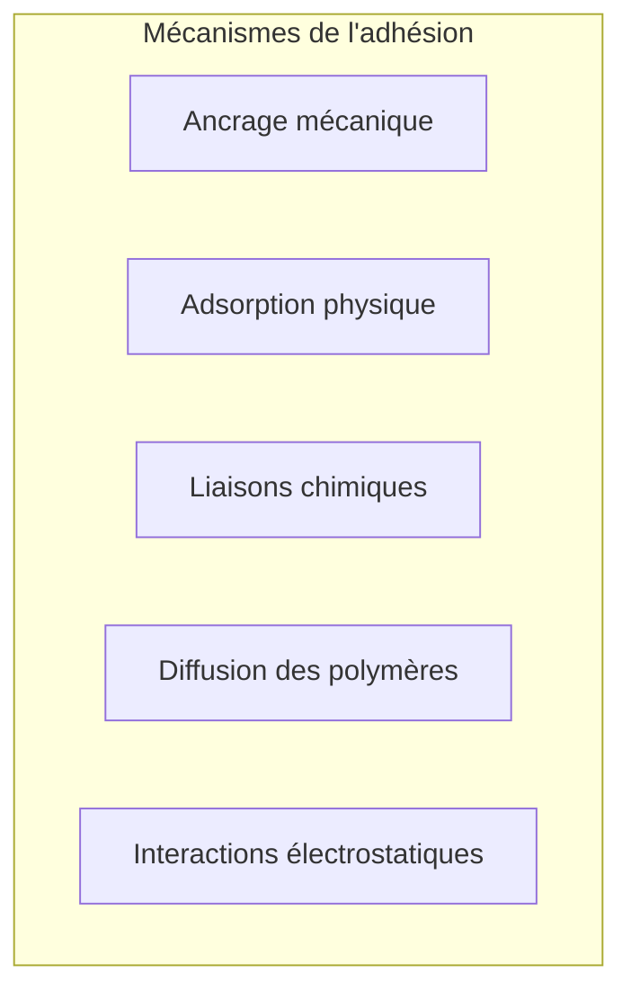
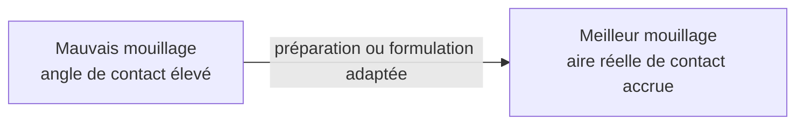
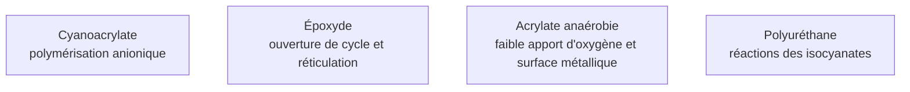
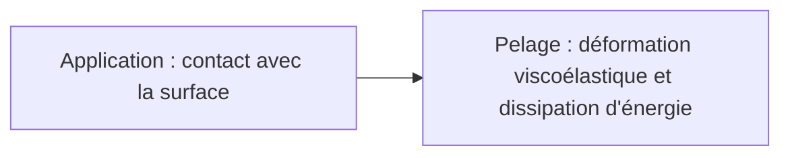
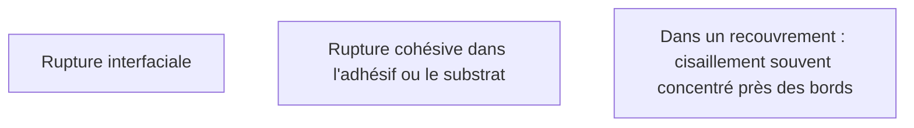
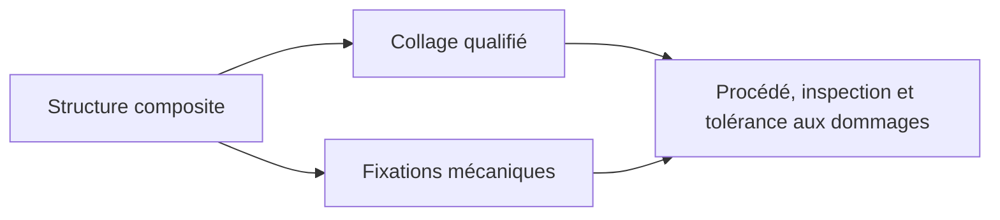
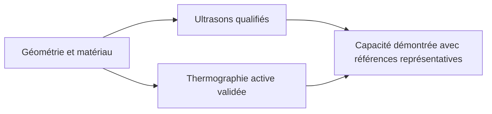

Une goutte de cyanoacrylate peut réunir des fragments de céramique. Dans un avion comme le Boeing 787, les structures composites peuvent combiner co-cuisson, collage et fixations mécaniques selon la conception. Le collage ne remplace pas systématiquement les rivets ni les boulons.

Pourtant, du point de vue de la physique fondamentale :
« Pourquoi un simple film liquide permet-il de joindre des métaux au point que la matière d'origine cède avant le joint ? »
« Pourquoi le ruban adhésif colle-t-il instantanément et se retire-t-il sans laisser de résidu ? »
« Et pourquoi le Téflon ou le polyéthylène résistent-ils obstinément à tout collage ? »

Le collage n'est pas une simple prise mécanique dans des fentes. C'est <strong>« la synthèse remarquable des forces intermoléculaires (Van der Waals et liaisons hydrogène), de la thermodynamique du mouillage (énergie de surface), de la réticulation macromoléculaire tridimensionnelle et de la mécanique de la rupture. »</strong>

---

## 1. Cinq mécanismes de l'adhésion

Même polies, les surfaces solides possèdent des aspérités microscopiques. Un adhésif liquide peut pénétrer dans certaines irrégularités, chasser l'air et créer un contact étroit. Plusieurs mécanismes contribuent à l'adhésion :



### 1.1 Ancrage mécanique
Sur un matériau poreux ou rugueux, l'adhésif peut pénétrer dans les pores et les fissures puis durcir. Cet ancrage peut contribuer à la résistance, mais il n'explique pas à lui seul le collage de surfaces très lisses.

### 1.2 Adsorption physique
À courte distance, les interactions de dispersion, d'orientation et d'induction (forces de Van der Waals) contribuent à l'adhésion. Des liaisons hydrogène sont également possibles si les groupes chimiques s'y prêtent. L'aire de contact réelle et la chimie de l'interface comptent aussi.

### 1.3 Liaisons chimiques et silanes
Selon les matériaux, des interactions covalentes, ioniques ou coordinatives peuvent se former à l'interface. Les agents de couplage silane peuvent, par exemple, former des liaisons siloxane ($\text{Si-O-Si}$) sur le verre et interagir avec une matrice polymère. La durabilité dépend de la préparation et de l'environnement.

### 1.4 Diffusion des polymères
Pour certains couples de polymères, des chaînes mobiles diffusent à travers l'interface et s'entrelacent. Le soudage par solvant ou par chaleur en sont des exemples; ce mécanisme ne s'applique pas à tous les plastiques ni à tous les adhésifs.

## 2. Mouillage et énergie de surface

Un mauvais mouillage réduit souvent l'adhérence atteignable, mais ne suffit pas à prédire la résistance du joint. La chimie de l'interface, le durcissement, la géométrie et le chargement interviennent également.



### 2.1 Équation de Young et coefficient d'étalement
Pour une surface idéale et lisse à l'équilibre, l'équation de Young relie l'angle de contact $\theta$ aux énergies interfaciales :

$$\gamma_{\text{SV}} = \gamma_{\text{SL}} + \gamma_{\text{LV}} \cos \theta$$

SV, SL et LV désignent les interfaces solide-vapeur, solide-liquide et liquide-vapeur. Le coefficient d'étalement est :

$$S = \gamma_{\text{SV}} - (\gamma_{\text{SL}} + \gamma_{\text{LV}})$$

Un étalement thermodynamique complet exige $S \ge 0$. Comparer seulement l'énergie de surface du solide et la tension superficielle du liquide ne suffit pas.

### 2.2 Surfaces difficiles à coller
Le PTFE (Téflon) et le polypropylène (PP) sont difficiles à mouiller avec de nombreux adhésifs courants. Le résultat dépend aussi de la chimie de surface, de la contamination, de la rugosité, de la formulation et de la méthode de mesure. Le nom du matériau ne détermine pas à lui seul un angle de contact ni une résistance de collage fixes.

### 2.3 Préparation de surface
Le plasma ou la corona peuvent améliorer le mouillage dans certains systèmes; leur effet et leur durée dépendent du matériau et du procédé. Une attaque chimique peut modifier certains fluoropolymères comme le PTFE, avec une chimie et des précautions adaptées. Un primaire peut aider à former l'interface. Une meilleure mouillabilité ne garantit pas la tenue du joint : des essais de collage et de durabilité adaptés sont nécessaires.

## 3. Chimie de durcissement de quelques adhésifs

Après le mouillage, l'adhésif acquiert ses propriétés par polymérisation, réticulation, refroidissement ou évaporation d'un solvant, selon le système.



### 3.1 Cyanoacrylates
L'humidité de surface et certaines bases faibles peuvent amorcer la polymérisation anionique des cyanoacrylates. Le produit est un poly(cyanoacrylate), et non du plexiglas. Le jeu, la température, l'humidité et la formulation influencent le durcissement.

### 3.2 Résines époxy
Les groupes époxy peuvent réagir avec des durcisseurs adaptés, comme certaines amines, et former un réseau thermodurci. Le retrait de polymérisation et les contraintes résiduelles thermiques ne sont pas nuls. Résistance, température de transition vitreuse, fluage et résistance chimique dépendent de la formulation et de l'usage.

```
Ouverture simplifiée d'un cycle époxy :
      O
     / \
R-CH-CH2  +  R'-NH2  →  R-CH(OH)-CH2-NH-R'
```

### 3.3 Adhésifs anaérobies
Certains adhésifs acryliques durcissent dans des interstices métalliques où l'apport d'oxygène est limité; la surface métallique peut favoriser l'initiation. La formulation et le temps de durcissement varient selon le produit.

## 4. Rubans adhésifs sensibles à la pression et critère de Dahlquist

Les adhésifs sensibles à la pression (PSA) adhèrent au contact sous pression, sans nécessairement subir une réaction chimique. Leur comportement dépend de leur viscoélasticité.



### 4.1 Le critère de Dahlquist : une règle empirique
Le critère de Dahlquist est une règle empirique souvent utilisée pour discuter du tack. Une valeur fréquemment citée est un module de stockage $G'$ inférieur à environ $3 \times 10^5\text{ Pa}$ à température ambiante et autour de 1 Hz. Ce n'est pas une loi universelle et cette valeur ne garantit pas à elle seule l'adhérence, la force de pelage, la tenue au cisaillement ou la durabilité.

$$G' (1\text{ Hz à } 25^\circ\text{C}) < 3 \times 10^5\text{ Pa}$$

### 4.2 Pelage et résidus
Le temps de contact, la température, la vitesse de pelage, le substrat et la formulation influencent la déformation et la dissipation d'énergie. Selon les conditions, l'adhésif peut se détacher proprement, s'étirer ou rompre en laissant un résidu.

## 5. Mécanique de la rupture des assemblages collés



Une rupture peut suivre l'interface, traverser l'adhésif, traverser le substrat ou combiner plusieurs chemins. Le mode observé dépend des matériaux, de la géométrie, de la charge, de l'environnement et du procédé. C'est un indice utile, mais il ne suffit pas à décider si le joint satisfait ses critères d'acceptation.

### 5.1 Contraintes dans les assemblages à recouvrement
Dans un assemblage simple à recouvrement, la contrainte de cisaillement n'est généralement pas uniforme. Le modèle de cisaillement différé de Volkersen décrit comment la déformation des pièces et celle de l'adhésif peuvent concentrer les contraintes près des extrémités du recouvrement. L'excentricité peut aussi créer flexion et pelage; la géométrie, l'adhésif et les substrats doivent être évalués ensemble.

---

## 6. Collage et fixations mécaniques dans les structures aéronautiques



### 6.1 Fabrication et qualification
Boeing indique que les matériaux composites représentent environ 50 % du poids structurel du 787. Cela ne signifie pas que tous ses joints sont uniquement collés. Selon la conception, on utilise co-cuisson, co-collage, collage secondaire et fixations mécaniques.

Le perçage et la fixation du CFRP sont conçus et justifiés selon le stratifié, les charges et la tolérance aux dommages. Le collage n'est pas un remplacement universel des rivets ou boulons : préparation de surface, maîtrise du procédé, inspection et démonstration structurale sont essentielles.

Un joint collé peut répartir la charge sur une surface et réduire les fixations dans certaines conceptions. Des contraintes de cisaillement et de pelage peuvent toutefois se concentrer aux bords. Les gains de poids et de consommation dépendent de la structure et de sa certification.

À l'interface entre CFRP et métal, l'isolation électrique et le contrôle de l'humidité sont importants. La couche adhésive ou le traitement de surface peut contribuer à la protection sans garantir une prévention complète ou permanente de la corrosion.

---

## 7. Adhésion bio-inspirée : geckos et moules

### 7.1 Adhésion sèche du gecko
Les lamelles des pattes du gecko possèdent une structure hiérarchique de setae et de spatules nanométriques. Elles épousent la surface; les forces de Van der Waals contribuent à l'adhésion. La performance dépend du contact, de la géométrie et du mouvement. Des surfaces synthétiques inspirées du gecko sont étudiées pour des usages particuliers; leur déploiement doit être étayé pour chaque application.

### 7.2 Adhésion sous-marine des moules
Les moules s'attachent aux surfaces humides par leurs filaments de byssus. Des protéines contenant de la DOPA peuvent se lier aux surfaces minérales et aux oxydes métalliques; d'autres réactions de réticulation renforcent les filaments. Les mécanismes dépendent de la protéine, de son état d'oxydation et de l'environnement. Les adhésifs inspirés de la DOPA sont étudiés, mais ne sont pas pour autant des colles chirurgicales d'usage courant.

---

## 8. Inspection et auto-réparation des joints



### 8.1 Contrôle non destructif
Les méthodes ultrasonores (écho, transmission, imagerie par réseau) peuvent rechercher certains défauts selon le matériau et la géométrie. Leur capacité doit être démontrée avec des références représentatives et des procédures qualifiées pour la structure; il n'existe pas de taille de défaut universellement détectable.

En thermographie infrarouge active, on chauffe la surface puis on enregistre sa réponse avec une caméra thermique. La méthode a été étudiée sur des joints collés composites. Les résultats dépendent du matériau, de la géométrie, de la profondeur du défaut, du chauffage et du traitement des images; une procédure validée est nécessaire pour la structure réelle.

### 8.2 Adhésifs auto-réparateurs
Des systèmes en recherche utilisent des microcapsules qui libèrent un agent réparateur lorsqu'une fissure les rompt. L'efficacité et la répétabilité dépendent du système et des conditions d'essai; les travaux publiés rapportent une récupération partielle, non universelle. L'auto-réparation ne remplace ni l'inspection, ni le dimensionnement, ni la maintenance.

---

## 9. Conclusion

De la réparation d'une céramique aux assemblages composites qualifiés, l'adhésion met en jeu la chimie des interfaces, le comportement des polymères et la mécanique de la rupture. Les performances doivent être établies pour chaque matériau, conception et environnement.

## Références
- [FAA AC 20-107B : Composite Aircraft Structure (avec Change 1)](https://www.faa.gov/documentLibrary/media/Advisory_Circular/AC_20-107B_with_change_1.pdf)
- [Boeing : 787 Dreamliner By Design](https://www.boeing.com/commercial/787/by-design)
- [FAA AC 43-214A : Repairs and Alterations to Composite and Bonded Aircraft Structure](https://www.faa.gov/documentLibrary/media/Advisory_Circular/AC_43-214A.pdf)
- [Pulse infrared thermography for composite aircraft adhesive joints](https://doi.org/10.3390/ma14030533)
- [Ultrasonic analysis and lock-in thermography for composite adhesive joints](https://doi.org/10.1016/j.ndteint.2015.09.001)
- [Fracture behavior of a self-healing, toughened epoxy adhesive](https://doi.org/10.1016/j.ijadhadh.2013.02.015)
