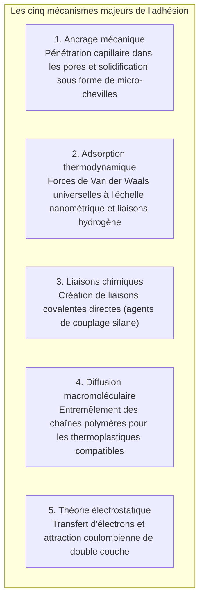
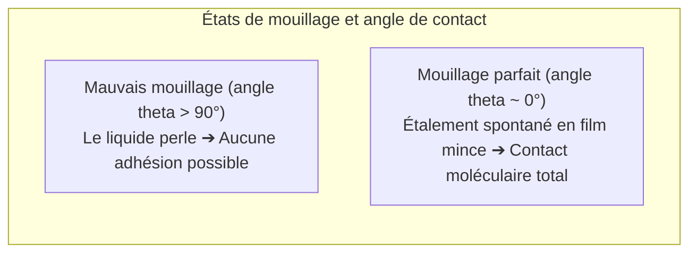

Une goutte de liquide répare une tasse brisée en quelques secondes, capable de résister à l'eau bouillante. À l'autre extrémité de l'échelle industrielle, les ailes en composite carbone du Boeing 787 et de l'Airbus A350 ne sont plus assemblées par des centaines de milliers de rivets métalliques, mais fusionnées par des films adhésifs structuraux époxy haute performance.

Pourtant, du point de vue de la physique fondamentale :
« Pourquoi un simple film liquide permet-il de joindre des métaux au point que la matière d'origine cède avant le joint ? »
« Pourquoi le ruban adhésif colle-t-il instantanément et se retire-t-il sans laisser de résidu ? »
« Et pourquoi le Téflon ou le polyéthylène résistent-ils obstinément à tout collage ? »

Le collage n'est pas une simple prise mécanique dans des fentes. C'est <strong>« la synthèse remarquable des forces intermoléculaires (Van der Waals et liaisons hydrogène), de la thermodynamique du mouillage (énergie de surface), de la réticulation macromoléculaire tridimensionnelle et de la mécanique de la rupture. »</strong>

---

## 1. Les 5 mécanismes fondamentaux de l'adhésion

Même polie comme un miroir, une surface solide est un relief d'aspérités microscopiques. Deux solides mis en contact ne se touchent que sur moins de 0,01 % de leur surface apparente. Le rôle de l'adhésif est de <strong>mouiller le solide sous forme liquide, d'expulser les bulles d'air et de créer un contact moléculaire intime</strong>.

### 1.1 L'adsorption physique : Van der Waals universel
À des distances inférieures au nanomètre, les forces de Van der Waals lient intimement les atomes. Bien que faibles individuellement ($1 \sim 10\text{ kJ/mol}$), ces forces cumulées sur des trillions d'atomes engendrent une résistance macroscopique capable de soulever des dizaines de tonnes.

### 1.2 La chimisorption et les silanes
Dans les applications aérospatiales, les silanes forment de véritables liaisons covalentes siloxanes ($\text{Si-O-Si}$) avec le verre ou les métaux oxydés, conférant au joint une résistance exceptionnelle à l'humidité.

---

## 2. Mouillage et énergie de surface

Sans étalement du liquide, l'adhésion est impossible.

### 2.1 Équation de Young
$$\gamma_{\text{SV}} = \gamma_{\text{SL}} + \gamma_{\text{LV}} \cos \theta$$
Pour un étalement spontané, l'énergie de surface du solide $\gamma_{\text{SV}}$ doit être nettement supérieure à la tension superficielle du liquide $\gamma_{\text{LV}}$.
Les métaux ($\gamma_{\text{SV}} > 500\text{ mN/m}$) se mouillent parfaitement, alors que le Téflon (PTFE), saturé de fluor peu polarisable, plafonne à <strong>$18\text{ mN/m}$</strong>, provoquant le perlage des adhésifs. Les traitements au plasma ou corona créent des radicaux polaires pour activer ces surfaces.

---

## 3. Chimie de réticulation des colles modernes

- <strong>Cyanoacrylates (Super Glue)</strong> : Les traces d'eau atmosphérique ($\text{OH}^-$) déclenchent une polymérisation anionique ultra-rapide transformant le monomère liquide en plastique rigide en quelques secondes.
- <strong>Résines époxy</strong> : Réaction polyaddition entre éthers diglycidiques et durcisseurs amines créant un réseau tridimensionnel thermodurcissable sans retrait volumique notable ($< 1\,\%$) ni émission de solvant.
- <strong>Adhésifs anaérobies</strong> : Polymérisation radicalaire déclenchée par l'absence d'oxygène et le contact catalytique des ions métalliques dans les filetages.

---

## 4. Adhésifs sensibles à la pression et critère de Dahlquist

Pour coller par simple contact digital, le polymère d'un ruban adhésif doit vérifier le <strong>critère de Dahlquist</strong> :
$$G' (1\text{ Hz}) < 3 \times 10^5\text{ Pa}$$
À faible fréquence, il s'écoule comme un liquide dans les rugosités ; lors d'un pelage rapide, il réagit comme un solide élastique tenace, se détachant sans laisser de résidu.

---

## 5. Révolution structurale dans l'aviation

Le collage époxy structural du Boeing 787 et de l'A350 supprime les trous de rivets (qui génèrent une concentration de contrainte de facteur 3), allège les structures de plusieurs tonnes et prévient la corrosion galvanique entre le carbone et l'aluminium.

---

## 6. Conclusion

Des micropoils nanométriques du gecko aux avions composites supersoniques, les adhésifs matérialisent le triomphe de la physico-chimie des interfaces reliant le monde macroscopique à l'échelle moléculaire.
