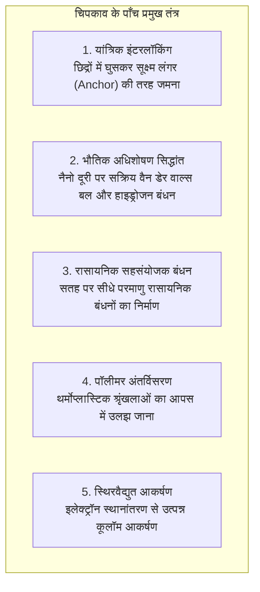
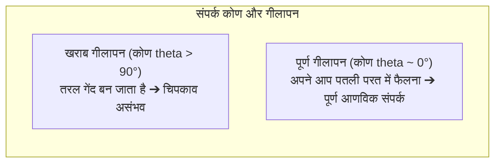

टूटे हुए सिरेमिक कप पर एक बूंद पारदर्शी गोंद लगाने पर वह कुछ ही सेकंड में खौलते पानी को संभालने लायक मजबूत हो जाता है। वहीं दूसरी ओर, सैकड़ों यात्रियों को लेकर उड़ने वाले आधुनिक बोइंग 787 विमानों के विशाल कार्बन-फाइबर पंखों को लाखों धातु के रिवेट्स (कील) के बजाय विशेष संरचनात्मक एपॉक्सी गोंद से जोड़ा जाता है।

परंतु भौतिकी के नजरिए से देखें तो आश्चर्य होता है:
"एक पतली तरल गोंद की परत कठोर धातुओं को इतनी मजबूती से कैसे जोड़ देती है कि अक्सर मूल धातु टूट जाती है पर जोड़ नहीं खुलता?"
"सेलोटेप उंगली के हल्के दबाव से कैसे चिपक जाता है और बिना कोई निशान छोड़े कैसे छूट जाता है?"
"और टेफ्लॉन या प्लास्टिक की थैलियों पर कोई भी साधारण गोंद क्यों नहीं चिपकता?"

चिपकना केवल दरारों में चिपचिपा पदार्थ सूखना नहीं है। यह <strong>«आणविक बलों (वैन डेर वाल्स और हाइड्रोजन बॉन्डिंग), गीलापन (सतह ऊर्जा), 3D पॉलीमर क्रॉस-लिंकिंग और फ्रैक्चर मैकेनिक्स का एक अद्भुत वैज्ञानिक समन्वय है»</strong>।

---

## 1. चिपकाव के 5 प्रमुख वैज्ञानिक सिद्धांत

परमाणु पैमाने पर दर्पण जैसी चिकनी सतहें भी नुकीली पहाड़ियों जैसी खुरदरी होती हैं। दो सूखी ठोस सतहों का वास्तविक संपर्क क्षेत्रफल 0.01 % से भी कम होता है। गोंद का पहला काम <strong>तरल बनकर इन सूक्ष्म घाटियों में गहराई तक जाना, हवा को बाहर निकालना और आणविक संपर्क स्थापित करना</strong> है।

### 1.1 भौतिक अधिशोषण और वैन डेर वाल्स बल
1 नैनोमीटर से कम दूरी पर वैन डेर वाल्स बल सक्रिय हो जाते हैं। हालांकि एक बंधन कमजोर होता है, लेकिन खरबों अणुओं का संयुक्त बल कई टन का भार उठाने में सक्षम होता है।

### 1.2 रासायनिक बंधन और साइलेन कपलिंग
विमानों और कांच में साइलेन कपलिंग एजेंट धातु के ऑक्साइड के साथ सीधे सिलोक्सेन बंध ($\text{Si-O-Si}$) बनाते हैं, जो जल-प्रतिरोधी और अत्यधिक मजबूत होते हैं।

---

## 2. गीलापन (Wetting) और सतह मुक्त ऊर्जा

यदि गोंद सतह पर बूंद बनकर सिकुड़ जाए, तो चिपकाव शून्य हो जाता है।

### 2.1 यंग का समीकरण
$$\gamma_{\text{SV}} = \gamma_{\text{SL}} + \gamma_{\text{LV}} \cos \theta$$
तरल के अपने आप फैलने के लिए <strong>ठोस की सतह ऊर्जा ($\gamma_{\text{SV}}$) तरल गोंद के पृष्ठ तनाव ($\gamma_{\text{LV}}$) से बहुत अधिक होनी चाहिए</strong>।
धातुओं की ऊर्जा बहुत अधिक ($> 500\text{ mN/m}$) होती है, इसलिए वे आसानी से गीली हो जाती हैं। इसके विपरीत, टेफ्लॉन (PTFE) की ऊर्जा केवल <strong>$18\text{ mN/m}$</strong> होती है, इसलिए उस पर गोंद नहीं फैलता। प्लाज्मा उपचार द्वारा सतह पर ध्रुवीय समूह जोड़कर ऊर्जा बढ़ाई जाती है।

---

## 3. प्रमुख गोंद प्रणालियों का जमना (Curing)

- <strong>सुपरग्लू (साइनोएक्रिलेट)</strong>: सतह पर मौजूद हवा की सूक्ष्म नमी ($\text{OH}^-$) एक तीव्र एनियोनिक चेन रिएक्शन शुरू करती है, जो कुछ ही सेकंड में तरल को ठोस ऐक्रेलिक प्लास्टिक में बदल देती है।
- <strong>एपॉक्सी रेजिन</strong>: एमीन हार्डनर के साथ क्रिया करके बिना किसी संकुचन ($< 1\,\%$) और बिना विलायक के एक मजबूत 3D नेटवर्क बनाती है।
- <strong>एनारोबिक एडहेसिव</strong>: हवा (ऑक्सीजन) के संपर्क में तरल रहता है, लेकिन बोल्ट की चूड़ियों में हवा बंद होते ही धातु आयनों के प्रभाव से तुरंत जम जाता है।

---

## 4. प्रेशर-सेंसिटिव टेप और डाहलक्विस्ट कसौटी

सेलोटेप <strong>डाहलक्विस्ट कसौटी</strong> पर काम करता है:
$$G' (1\text{ Hz}) < 3 \times 10^5\text{ Pa}$$
हल्के दबाव पर यह तरल की तरह सूक्ष्म खांचों में बहता है, और तेजी से खींचने पर यह लोचदार ठोस की तरह बिना कोई गोंद छोड़े साफ छूट जाता है।

---

## 5. विमान निर्माण में संरचनात्मक चिपकाव

बोइंग 787 विमानों में लाखों रिवेट्स की जगह एपॉक्सी एडहेसिव का उपयोग किया गया है, जिसने छेदों से होने वाले तनाव संकेंद्रण को खत्म कर दिया है, कई टन वजन घटाया है और कार्बन-धातु के बीच गैल्वेनिक जंग को रोका है।

---

## 6. निष्कर्ष

छिपकली के पंजों के नैनो-रोम से लेकर सुपरसोनिक विमानों तक, गोंद वह अदृश्य आणविक पुल है जो हमारे भौतिक संसार को मजबूती से थामे रखता है।
