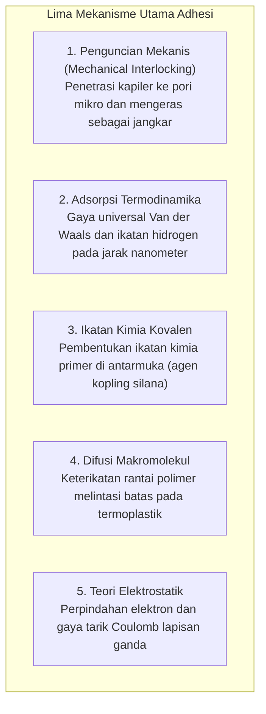
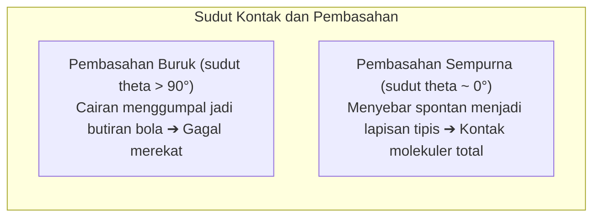

Tetesan cairan bening mampu menyatukan kembali pecahan cangkir keramik sehingga sanggup menampung air mendidih tanpa bocor. Di puncak rekayasa kedirgantaraan, sayap komposit serat karbon pada Boeing 787 dan Airbus A350 tidak lagi disatukan oleh ratusan ribu paku keling (rivet) logam, melainkan direkatkan secara permanen menggunakan film perekat struktural epoksi berperforma tinggi.

Namun, dari sudut pandang fisika dasar:
"Bagaimana lapisan cairan tipis mampu menyatukan logam padat begitu kuat hingga bahan aslinya sering kali patah sebelum sambungan lemnya lepas?"
"Mengapa selotip berperekat dapat menempel seketika dengan tekanan ringan dan terkelupas bersih tanpa meninggalkan residu?"
"Dan mengapa bahan seperti Teflon (PTFE) atau kantong plastik polietilena menolak hampir semua jenis lem?"

Merekatkan bukanlah sekadar getah yang mengering dan tersangkut di celah. Ini adalah <strong>«harmoni gaya tarik antarmolekul (Van der Waals dan ikatan hidrogen), termodinamika pembasahan (energi permukaan), polimerisasi jaringan tiga dimensi, dan mekanika fraktur kontinum.»</strong>

---

## 1. Lima Teori Dasar Adhesi

Bahkan permukaan kaca atau logam yang paling halus sekalipun memiliki kekasaran mikro (asperities). Area kontak nyata antara dua benda padat kering sering kali kurang dari 0,01 %. Fungsi perekat adalah <strong>mengalir sebagai cairan ke lembah mikro, mengusir udara, dan menciptakan kontak molekuler langsung</strong>.

### 1.1 Adsorpsi Fisik dan Gaya Van der Waals
Pada jarak di bawah 1 nanometer, gaya Van der Waals bekerja secara universal. Meskipun ikatan individualnya lemah ($1 \sim 10\text{ kJ/mol}$), akumulasi miliaran molekul di seluruh bidang kontak menghasilkan kekuatan makroskopis yang mampu menahan beban berton-ton.

### 1.2 Ikatan Kimia Kovalen
Pada aplikasi kedirgantaraan yang kritis, molekul silana membentuk ikatan kovalen siloksan ($\text{Si-O-Si}$) langsung dengan permukaan oksida logam dan resin polimer, menciptakan ketahanan hidrolitik yang luar biasa.

---

## 2. Pembasahan (Wetting) dan Energi Permukaan

Jika perekat tidak membasahi permukaan, adhesi tidak akan pernah terjadi.

### 2.1 Persamaan Young
$$\gamma_{\text{SV}} = \gamma_{\text{SL}} + \gamma_{\text{LV}} \cos \theta$$
Agar cairan menyebar spontan, <strong>energi permukaan padatan ($\gamma_{\text{SV}}$) harus jauh lebih besar daripada tegangan permukaan cairan perekat ($\gamma_{\text{LV}}$)</strong>.
Logam memiliki energi tinggi ($> 500\text{ mN/m}$) sehingga mudah dibasahi. Sebaliknya, Teflon (PTFE) memiliki energi sangat rendah (<strong>$18\text{ mN/m}$</strong>) karena atom fluorin yang tidak terpolarisasi, sehingga cairan lem ditolak. Perlakuan plasma digunakan untuk menembakkan gugus polar guna mengaktifkan permukaannya.

---

## 3. Mekanisme Pengerasan Kimia Perekat

- <strong>Sianoakrilat (Lem Super)</strong>: Kelembapan udara ($\text{OH}^-$) pada permukaan memicu polimerisasi rantai anionik berkecepatan tinggi yang mengubah monomer cair menjadi plastik akrilik padat dalam hitungan detik.
- <strong>Resin Epoksi</strong>: Reaksi pembukaan cincin oksirana oleh poliamina membentuk jaringan termoset tiga dimensi tanpa penyusutan volume signifikan ($< 1\,\%$) dan tanpa pelarut.
- <strong>Perekat Anaerobik</strong>: Cairan tetap stabil dengan adanya oksigen, namun berpolimerisasi radikal seketika saat terkurung di dalam ulir baut logam tanpa udara.

---

## 4. Pita Perekat Sensitif Tekanan dan Kriteria Dahlquist

Selotip bekerja tanpa reaksi kimia, diatur oleh <strong>kriteria reologi Dahlquist</strong>:
$$G' (1\text{ Hz}) < 3 \times 10^5\text{ Pa}$$
Pada tekanan rendah (pemasangan), polimer mengalir seperti cairan ke celah mikro; saat ditarik cepat, polimer mengeras secara elastis dan terlepas bersih tanpa meninggalkan residu.

---

## 5. Revolusi Perekat Struktural pada Pesawat Terbang

Boeing 787 dan Airbus A350 menggantikan paku keling dengan film perekat struktural epoksi, menghilangkan konsentrasi tegangan di lubang paku (faktor 3 menurut Kirsch), memangkas bobot berton-ton, dan mencegah korosi galvanik antara karbon dan logam.

---

## 6. Kesimpulan

Dari rambut mikroskopis pada telapak kaki tokek hingga pesawat komposit penjelajah benua, perekat adalah jembatan molekuler tak terlihat yang menyatukan dunia material kita.
