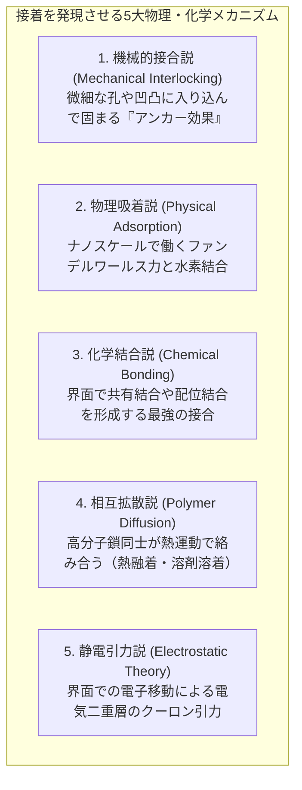
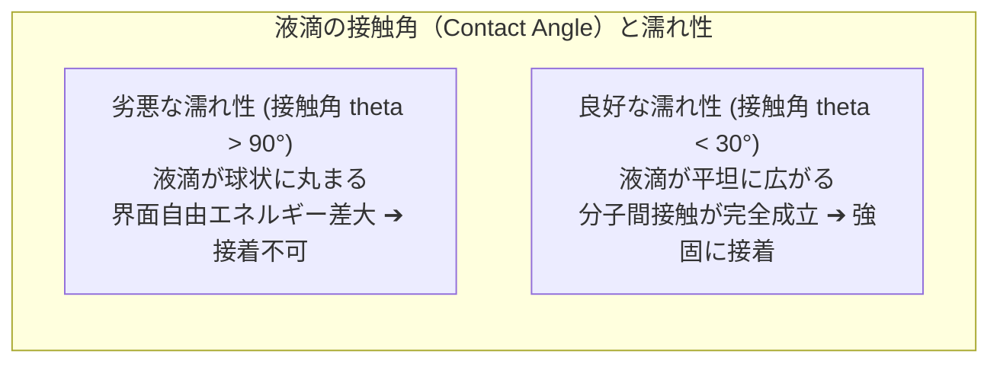
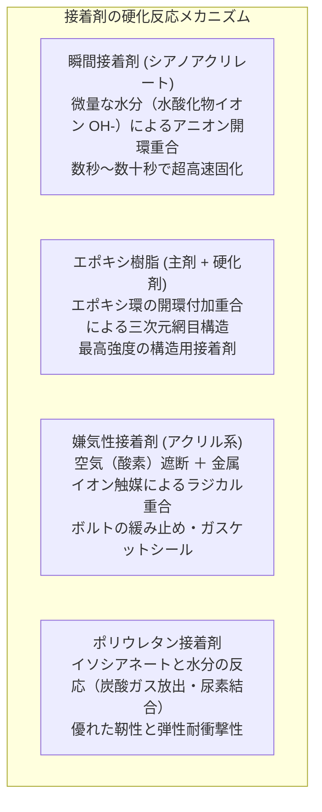
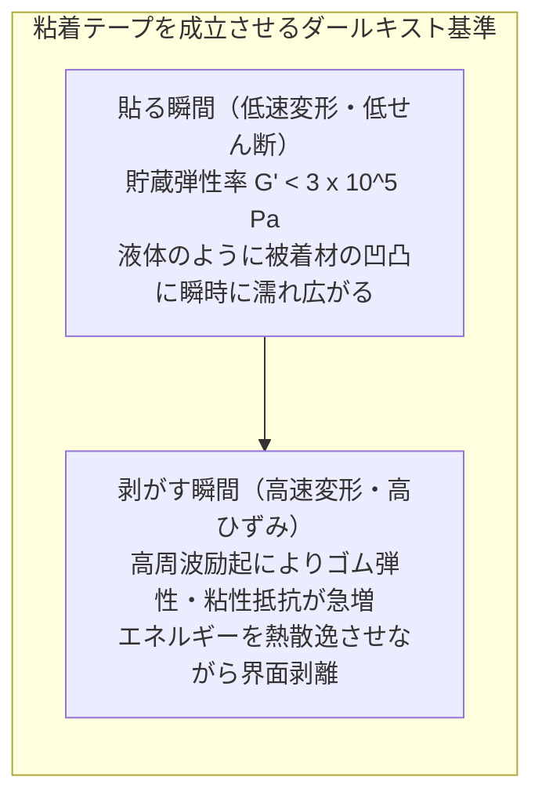
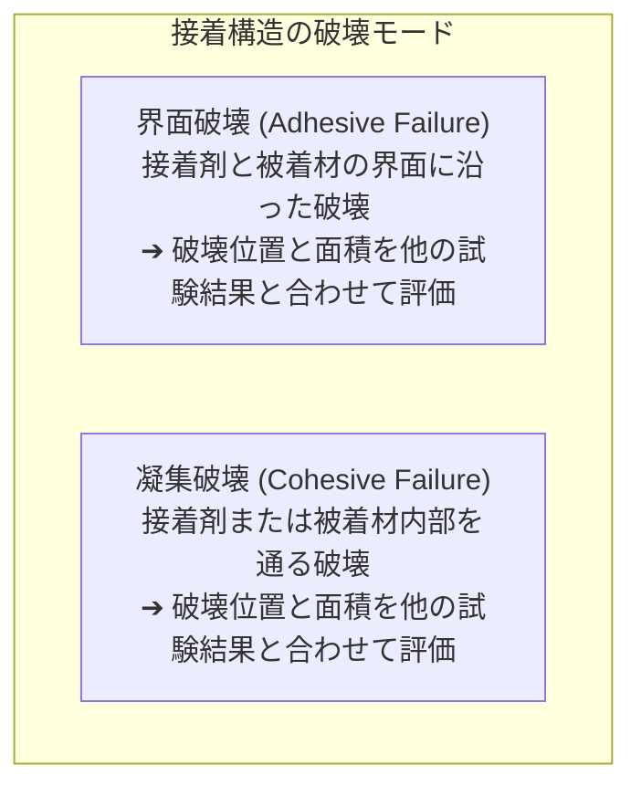
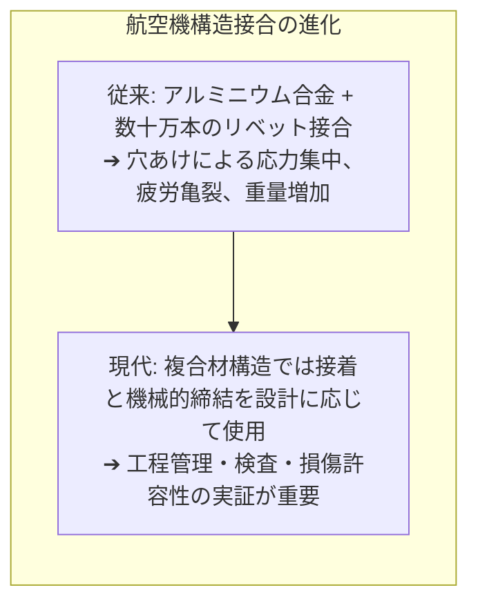

壊れた陶器のマグカップの破片を瞬間接着剤で継ぎ合わせる。スマートフォンの超薄型ガラス画面を防水フレームに固定する。あるいは、数百人の乗客を乗せて成田からニューヨークへ飛ぶボーイング787ドリームライナーの巨大な主翼――。

私たちの身の回りにある日常的な日用品から、人類の最先端工学の結晶である宇宙航空機に至るまで、ありとあらゆる物体が<strong>「接着剤（Adhesives）」</strong>の力によって接合されています。航空機や高性能車では、用途に応じて接着、共硬化、溶接、ボルトやリベットなどの接合方法を組み合わせ、CFRPや金属部品を構造化しています。接着が機械締結を一律に置き換えるわけではありません。

しかし、冷静に物理の視点から考えてみてください。
「なぜ、液体のネバネバした薬品を塗りつけて挟むだけで、固い金属や岩石同士がビクともしないほど強固にくっつくのか？」
「なぜ、ツルツルのセロハンテープは軽く押し付けるだけで貼り付くのに、跡を残さず剥がすことができるのか？」
「逆に、なぜフライパンのテフロン加工やポリエチレンの袋には、どんな強力接着剤もまったく歯が立たないのか？」

「接着」とは、単に隙間に糊が挟まって固まっているだけの現象ではありません。それは、<strong>「分子間引力（ファンデルワールス力）と化学結合、材料のナノスケール濡れ性（表面エネルギー）、そして高分子ポリマーの三次元架橋重合反応が織り成す、界面物理化学と破壊力学の総合芸術」</strong>です。

本稿では、物質同士がくっつく微視的メカニズムから、ヤング・デュプレの濡れ性理論、瞬間接着剤やエポキシの超高速・三次元硬化反応、ポストイットや粘着テープを支配するレオロジー特性（ダールキストの基準）、そして航空機を空中分解から守る接着界面の破壊力学までを徹底的に解き明かします。

---

## 1. 接着の5大メカニズム：なぜ物はくっつくのか

物理学的に、完全に平坦な2つの固体の表面を原子レベル（数オングストローム以下）まで近づけることができれば、あらゆる物質は接着剤なしでも自然に融合・結合します（これを「冷間圧接」や「オプティカル・コンタクト」と呼びます）。

しかし、肉眼では鏡のように滑らかに見える金属やガラスの表面であっても、原子スケールで拡大すれば<strong>エベレスト山脈のような険しい凹凸（表面粗さ：アスペリティ）</strong>に覆われています。固い物体同士を重ね合わせても、実際に接触しているのは山の頂点同士のごく一部（真実接触面積は全体の0.01%以下）にすぎず、空気の隙間が広がるため、分子間引力はまったく届きません。

接着剤の第一の役割は、<strong>「液体として凹凸の谷底まで入り込み、空気の隙間を完全に排除して、両方の固体表面と分子レベルで密着すること」</strong>にあります。

現在、界面科学において接着の発現機構は主に以下の5つの説によって体系化されています。



### 1.1 機械的接合説（アンカー効果：Mechanical Interlocking）
木材、紙、布、コンクリート、多孔質セラミックスのように、表面に無数の微細な孔（ポーラス）や亀裂が存在する材料で強く作用する古典的メカニズムです。
液状の接着剤が毛細管現象によって多孔質の奥深くまで浸透し、その場で固化（重合または溶媒蒸発）します。硬化した接着剤が<strong>「無数の微小な錨（アンカー）やクサビ」</strong>となって物理的に抜けなくなることで、強固な結合力を発揮します。

しかし、半導体のシリコンウエハや光学ガラスのように、表面粗さがナノメートル以下に研磨された極限の超平滑面同士であっても、接着剤は極めて強固にくっつきます。したがって、機械的アンカー効果だけでは接着の本質を説明することはできません。

### 1.2 物理吸着説（熱力学的吸着：Adsorption Theory）
あらゆる接着現象において<strong>最も普遍的かつ支配的な主役</strong>が、この物理吸着です。
接着剤分子と被着材（くっつけられる側の固体）表面の原子が数ナノメートル（$0.1 \sim 1\text{ nm}$）以下に接近したとき、電気的な分極によって生じる万有引力的な相互作用――<strong>「ファンデルワールス力（Van der Waals force）」</strong>が作動します。

- <strong>配向力（キーソム力）</strong>：永久双極子同士の引力。
- <strong>誘起力（デバイ力）</strong>：極性分子が無極性分子に電荷の偏りを引き起こす引力。
- <strong>分散力（ロンドン力）</strong>：電子雲の瞬間的な揺らぎによって全原子・分子間に例外なく生じる普遍的引力。

1本1本のファンデルワールス力は、後述する共有結合の $1/10 \sim 1/100$ 程度の微弱なエネルギー（数 $\text{kJ/mol}$）にすぎません。しかし、接着面積全体に広がる数兆個の分子が一斉に手を取り合えば、<strong>数トンの車体を吊り上げるほどの巨大な巨視的結合力</strong>を生み出します。

さらに、接着剤分子と被着材表面に酸素（O）、窒素（N）、フッ素（F）などの電気陰性度の高い原子と水素原子が存在する場合、<strong>「水素結合（Hydrogen Bond）」</strong>（結合エネルギー：$10 \sim 40\text{ kJ/mol}$）が形成され、結合力は劇的に跳ね上がります。

### 1.3 化学結合説（Chemical Bonding Theory）
接着剤と被着材の界面で、原子同士が電子を共有する<strong>「共有結合（Covalent Bond）」</strong>（結合エネルギー：$200 \sim 800\text{ kJ/mol}$）や「イオン結合」、「キレート配位結合」を直接形成するメカニズムです。
結合エネルギーがファンデルワールス力より一桁から二桁高いため、耐水性、耐熱性、長期耐久性が要求される航空機や電子材料の接着において極めて重視されます。

代表的な例が、ガラス繊維強化プラスチック（GFRP）や歯科用接着剤で使われる<strong>「シランカップリング剤」</strong>です。シラン分子の一端がガラス表面のシラノール基（$\text{Si-OH}$）と強固なシロキサン結合（$\text{Si-O-Si}$）を作り、もう一端が高分子樹脂と化学結合することで、界面が化学的に完全融合します。

### 1.4 相互拡散説（Diffusion Theory）
プラスチック（高分子材料）同士を接着する際、両方のポリマー鎖が熱運動（ミクロブラウン運動）によって界面を越えて相手の内部へと潜り込み、お互いに絡み合う（インタータングルメント）現象です。
アクリル樹脂の溶剤接着（クロロホルムで表面を溶かして圧着する）や、ビニールシートの熱融着（ヒートシール）は、この相互拡散によって界面そのものを消滅させることで結合しています。

---

## 2. 接着の絶対条件：「濡れ性」と表面自由エネルギー

接着剤をどんなに強力な分子構造に設計しても、被着材の表面に塗ったときに<strong>「水滴のように丸まって弾かれてしまう（濡れない）」</strong>状態であれば、接着力は絶対に発揮されません。

接着を成立させるための必要不可欠な第一歩は、<strong>接着剤の液体が固体の微細な凹凸の隅々まで自発的に広がり、空気の泡（ボイド）を残さずに馴染む「濡れ（Wetting）」</strong>の力学です。



### 2.1 ヤング・デュプレの式（Young-Dupré Equation）
固体の表面に置かれた液滴の界面張力の釣り合いは、1805年にトマス・ヤングによって導かれた<strong>「ヤングの式（Young's Equation）」</strong>によって厳密に記述されます。

$$\gamma_{\text{SV}} = \gamma_{\text{SL}} + \gamma_{\text{LV}} \cos \theta$$

- $\gamma_{\text{SV}}$：固体の表面自由エネルギー（固体-気体界面張力）
- $\gamma_{\text{SL}}$：固体と液体の界面張力
- $\gamma_{\text{LV}}$：液体の表面張力（液体-気体界面張力）
- $\theta$：接触角（Contact Angle）

液体が固体表面を完全に濡らす（自発的に薄膜状に広がる、$\theta \rightarrow 0^\circ$、$\cos \theta \rightarrow 1$）ための熱力学的条件は、以下の<strong>「広がり係数（Spreading Coefficient: $S$）」</strong>が正であることです。

$$S = \gamma_{\text{SV}} - (\gamma_{\text{SL}} + \gamma_{\text{LV}}) \ge 0$$

この式から、$\gamma_{\text{SV}}$ と $\gamma_{\text{LV}}$ の大小だけで濡れを決められないことが分かります。固体・液体間の界面自由エネルギー $\gamma_{\text{SL}}$ も必要で、実際の表面状態や試験条件を考慮して評価します。

### 2.2 PTFEやポリプロピレンが接着しにくい理由
PTFE（テフロン）やポリプロピレン（PP）は、多くの一般的な接着剤では濡れにくく、接着しにくい材料です。表面エネルギーだけでなく、表面の化学的性質、汚染、粗さ、接着剤の組成や測定条件が結果に影響します。材質名だけから一定の接触角や接着強度を断定することはできません。

### 2.3 難接着材料の表面処理

1. <strong>プラズマ処理・コロナ処理</strong>：表面に極性基を導入したり汚染層を除去したりして、濡れやすさを改善することがあります。効果と持続時間は材料、処理条件、保管環境に依存します。
2. <strong>化学エッチング</strong>：PTFEなどでは専用の化学処理によって表面状態を変え、接着性を改善する方法があります。処理剤、条件、安全手順は材料と工程に適合させる必要があります。
3. <strong>プライマー</strong>：被着材と接着剤の双方に適合する下塗り剤が、界面形成を助ける場合があります。

処理後の濡れ性だけで接合性能を保証することはできません。接触角などの工程管理に加え、用途に合った接着試験や耐久試験で確認します。

---

## 3. 代表的な接着剤の硬化化学メカニズム

接着剤が液体として被着材の表面を濡らし尽くしたあと、次に起きるべき現象は<strong>「液体から強靭な固体への状態変化（相転移・固化）」</strong>です。
どれほど分子間引力が働いても、接着剤層自体が液体やグニャグニャのゲルのままでは、引っ張られた瞬間に接着剤の内部でちぎれてしまいます。

現代の接着剤は、驚くほど洗練された有機化学反応によって、液体の低分子モノマーを巨大な三次元網目ポリマーへと組み替えています。



### 3.1 瞬間接着剤（シアノアクリレート系）：空気中の水蒸気で瞬時に重合
一般に「アロンアルファ」などの商品名で親しまれている瞬間接着剤の主成分は、<strong>シアノアクリレート（主に2-シアノアクリル酸エチル）</strong>という低粘度の液体モノマーです。

シアノアクリレート分子の炭素-炭素二重結合（$\text{C=C}$）の両隣には、電子を強烈に引き寄せる「シアノ基（$\text{-CN}$）」と「エステル基（$\text{-COOR}$）」が配置されています。このため、二重結合部分の電子密度が極端に希薄になっており、<strong>求核剤（電子をくれる相手）がいれば今すぐにでも重合を始めたくてたまらない極限の反応状態</strong>にあります。

容器の中では微量の酸性安定剤（亜硫酸ガスなど）によって重合が抑え込まれていますが、接着剤がチューブから押し出されて大気中の物質の表面に薄く塗り広げられた瞬間、ドラマが始まります。

1. <strong>水酸イオンによる開始反応</strong>：
   あらゆる物質の表面には、大気中の湿気によって数分子層の目に見えない微量な「水膜（吸着水）」が存在しています。水分子（$\text{H}_2\text{O}$）がわずかに電離して生じた水酸化物イオン（$\text{OH}^-$）が、シアノアクリレートの二重結合炭素を求核攻撃します。
2. <strong>超高速アニオン連鎖重合</strong>：
   攻撃を受けた分子は炭素陰イオン（カルバニオン）となり、隣のシアノアクリレート分子の二重結合を猛烈な勢いで攻撃。次々と数千〜数万個の分子が鎖状に繋がり（アニオン重合）、わずか数秒から十数秒の間に<strong>超高分子量のアクリルポリマー（プラスチックの固体）</strong>へと硬化変貌します。

瞬間接着剤を使う際、「塗布量をできるだけ少なくし、薄く押し広げる」のが鉄則である理由はここにあります。液層が厚すぎると、内部まで水分子が拡散できず、硬化が極端に遅くなってしまうのです。

### 3.2 エポキシ樹脂接着剤：航空宇宙を支える三次元網目構造
構造用接着剤の絶対王者として、ビル建築、新幹線、F1マシン、航空機に多用されているのが<strong>「エポキシ樹脂（Epoxy Resin）」</strong>です。エポキシは通常、2つのチューブに分かれた「主剤（エポキシプレポリマー）」と「硬化剤（アミン類など）」を用事混合する2液混合型として使用されます。

```
エポキシ基（オキシラン環）の三員環構造：
       O
      / \
   H2C ── CH ── R
```

- <strong>主剤</strong>：最も代表的なものはビスフェノールAとエピクロロヒドリンを反応させた「ビスフェノールAジグリシジルエーテル（DGEBA）」。分子の両端に、酸素と炭素が三角形の環を作った歪みの大きな<strong>「エポキシ基（オキシラン環）」</strong>を持っています。
- <strong>硬化剤</strong>：脂肪族ポリアミンや芳香族ポリアミンなど、複数のアミノ基（$\text{-NH}_2$）を持つ化合物。

混合すると、アミンの非共有電子対がエポキシ環の炭素を求核攻撃して環を開裂させ（開環付加反応）、新たな結合を形成します。硬化剤分子は1分子で3つ〜4つのエポキシ基と結合できるため、反応が進むにつれて線状の鎖だけでなく、前後左右上下に無限に枝分かれした<strong>「完全な三次元ジャングルジム状の架橋ネットワーク（巨大分子）」</strong>が形成されます。

エポキシ樹脂の性質は配合と使用条件によって異なります：
1. <strong>硬化収縮と残留応力はゼロではない</strong>：揮発性溶媒を使わない配合は多い一方、硬化反応による収縮や温度変化による残留応力が生じ得ます。樹脂、硬化剤、充填材、接着層形状、硬化温度・時間によって変わります。
2. <strong>強度・耐熱性・クリープ特性は材料系と条件に依存する</strong>：架橋密度や配合でガラス転移温度 $T_g$ や弾性率が変わります。荷重、温度、湿度、時間によって変形や劣化が起こり得るため、「エポキシならクリープしない」とは言えません。
3. <strong>耐薬品性・電気絶縁性も用途ごとに確認する</strong>：硬化状態、温度、薬品濃度、暴露時間に応じて特性が異なります。用途に合うデータと接合部の評価が必要です。

### 3.3 嫌気性接着剤（ネジの緩み止め）：空気（酸素）を嫌う化学
機械のボルトやベアリングの固定に使われる「ロックタイト」に代表される嫌気性接着剤は、一見パラドキシカルな性質を持っています。容器（ポリエチレン製ボトル）の中では何年間も液体のままなのに、<strong>ボルトを締め込んで金属の隙間に閉じ込められた瞬間にカチカチに固まる</strong>のです。

主成分はメタクリル酸エステルと有機過酸化物（ラジカル重合開始剤）です。
容器の中では、空気中の「酸素分子（$\text{O}_2$）」が液体内に溶け込んでいます。酸素分子はラジカルを捕獲して重合を停止させる強力な重合禁止剤として働くため、液体状態が保たれます。
しかし、金属ボルトを締め込むと：
1. 隙間から空気が締め出され、<strong>酸素の供給が完全に遮断</strong>される。
2. ボルトの活性な金属表面（鉄や銅イオン $\text{Fe}^{2+}, \text{Cu}^+$）が過酸化物を還元分解し、<strong>爆発的にフリーラジカルを発生</strong>させる（レドックス触媒反応）。
3. 遮る酸素がなくなったアクリルモノマーが一気にラジカル重合を開始し、強固なプラスチックへと硬化します。

---

## 4. 貼って剥がせる物理：粘着テープとダールキスト基準

ポストイット、セロハンテープ、養生テープ、スマートフォンのバッテリー固定テープなどの「粘着テープ（Pressure Sensitive Adhesive: PSA）」は、化学反応や溶媒の乾燥を一切伴いません。
<strong>「軽く指で押すだけで瞬時に接着し、強い力で引っ張れば綺麗に剥がすことができる」</strong>。この常識外れの挙動は、粘着剤が持つ独特の<strong>粘弾性レオロジー（流動と変形）</strong>によって物理的に成立しています。



### 4.1 ダールキストの基準（Dahlquist Criterion）
ダールキスト基準は、感圧接着剤（PSA）のタックを考えるときによく使われる経験則です。代表的な目安は、室温・約 1 Hz での貯蔵弾性率 $G' が $3 \times 10^5\text{ Pa}$ より小さいことですが、組成、温度、接触時間、被着材、剥離速度などを含む性能全体を決める普遍法則ではありません。

$$G'（室温・1\text{ Hzでの貯蔵弾性率}） < 3 \times 10^5\text{ Pa} \quad (0.3\text{ MPa})$$

この目安を満たすことは、短時間で表面の凹凸に追従し、実接触面積を得る助けになります。ただし、それだけでタック、剥離力、せん断保持力や耐久性が保証されるわけではありません。PSAの性能は粘弾性スペクトルと試験条件を合わせて評価します。

### 4.2 なぜ糊残りせずに剥がせるのか？
粘着剤（天然ゴム系やアクリル系ポリマー）は、完全な液体ではなく、適度に架橋されたエラストマー（ゲル）です。
- <strong>貼るとき（低速の接触）</strong>：変形速度が遅いため、粘性流体のように振る舞い、凹凸に密着する。
- <strong>剥がすとき（高速の引張破断）</strong>：剥離速度によって粘弾性応答が変わり、接着剤内部の変形やエネルギー散逸が剥離力に影響します。ただし、剥離速度や温度、配合によっては凝集破壊や糊残りも起こり得ます。
- <strong>接着エネルギーの散逸</strong>：剥がす際、粘着層が目に見えない微小なフィラメント（糸引き）状に伸び、その変形過程で膨大なエネルギーを熱として消費（内部粘性散逸）するため、剥がす手には強い抵抗感（ピール力）が伝わります。

---

## 5. 接着の破壊力学：界面剥離と凝集破壊

接着された継手が破壊されるとき、力学的には以下の2つの破壊モードのいずれかが生じます。



破壊面の観察は、接着工程と継手性能を評価する手掛かりの一つです。凝集破壊が常に合格を意味するわけでも、界面破壊が必ず汚染や設計不備を意味するわけでもありません。破壊位置・面積、荷重、環境耐久性、許容基準を、用途に適した認定試験と合わせて判断します。

### 5.1 ラップジョイントのせん断応力集中：フォルカーセン理論
2枚の板を重ねて接着した「単重ね継手（Single Lap Joint）」に引張荷重 $P$ をかけたとき、接着剤層のせん断応力 $\tau$ は一様に分布するわけではありません。
1938年にフォルカーセン（O. Volkersen）が導いた<strong>「シアラグ理論（Shear-lag Model）」</strong>によれば、せん断応力は中央部で極めて小さく、<strong>両端のエッジ部分に強烈な応力集中</strong>が発生します。

```
単重ね継手 (Single Lap Joint) の応力分布
    引張力 P <─── 上板 ───────┐
                              │ 接着層 (厚さ eta)
               └────── 下板 ──┴───> 引張力 P

  接着層のせん断応力 tau
    ^
    |  |\                                 /|
    |  | \                               / |  (両端エッジに応力集中)
    |  |  \                             /  |
    |  |   \                           /   |
    |  |    \_________________________/    |  (中央部はほとんど力を伝達しない)
    +--+-----------------------------------+--> 接着長さ x
      x=0                                 x=L
```

さらに、引張力が一直線上にないことから曲げモーメント（偏心荷重）が発生し、接着剤の両端を引き剥がそうとする<strong>「ピール応力（Peel Stress：垂直引張応力）」</strong>が重畳します。接着剤はせん断力（ズレる力）には無類の強さを誇りますが、一端からめくるように引き剥がす「ピール力」には極めて脆弱です。

現代の構造設計者は、接着端部の角を斜めに削る（テーパー加工）や、フィレット（丸み）をつけることで応力集中係数を劇的に緩和させ、破壊リスクを最小化しています。

---

## 6. 現代の極致：航空宇宙産業と構造用接着技術

接着技術が最も劇的な革命をもたらした分野こそが、<strong>航空機工学</strong>です。



### 6.1 リベットと接着を使い分ける航空機構造
ボーイングは787の機体重量の約50%が複合材料であると説明しています。この数値は複合材の重量割合を示し、機体構造の接合部すべてが接着だけで作られているという意味ではありません。航空機では設計に応じて共硬化、共接着、二次接着、機械的締結などを使い分けます。

CFRPの穴あけや締結も、積層構成、荷重、損傷許容性を踏まえて設計・認定されます。接着は万能な代替ではなく、表面処理、工程管理、検査、損傷許容性を含めた構造実証が必要です。

接着継手は荷重を接合面に沿って伝え、一部の構造でファスナーや補強材を減らせる可能性があります。一方で、接着端部にはせん断応力や剥離応力が集中し得ます。重量低減や燃費への効果は構造と認定要件に依存します。

CFRPと金属の接触では電気的絶縁や水分侵入の管理が重要です。接着層や表面処理が保護に寄与する場合はありますが、腐食を完全・永久に防ぐ保証ではなく、設計と環境試験が必要です。

---

## 7. 自然界に学ぶ極限接着：ヤモリとムール貝のバイオミメティクス

人類が化学合成接着剤を開発する遥か以前から、生物たちは進化の過程で驚異的な接着システムを獲得してきました。現代の先端材料工学は、これらの生体接着を模倣する<strong>「バイオミメティクス（Biomimetics：生体模倣技術）」</strong>によって、新たなブレークスルーを生み出しています。

### 7.1 ヤモリ（Gecko）の足裏：糊を使わない「ドライ接着」
ヤモリは垂直なガラス壁を駆け上がり、天井に逆さまに張り付いて静止することができます。しかし、ヤモリの足裏には粘着剤や分泌液のような「ネバネバした糊」は一切ついていません。足を離すときも瞬時に軽々と剥がすことができます。

この謎を解明したのがナノテクノロジーです。ヤモリの足指の裏には、長さ数十マイクロメートルの<strong>「セタ（剛毛）」</strong>が数十万本密生しており、さらにその先端は数千本の極小のヘラ状構造（スパチュラ：幅約200ナノメートル）に枝分かれしています。
この無数の微細突起が、壁面の原子スケールの凹凸に完璧に追従して隙間なく密着することで、純粋な<strong>「ファンデルワールス力（分子間引力）」</strong>だけを総動員して自重を支えています。

現代では、この構造を模倣したカーボンナノチューブやシリコーン微細ピラーによる<strong>「ヤモリテープ（ドライアドヒージョン）」</strong>が開発され、真空の宇宙空間や半導体クリーンルームなど、有機ガスの揮発や糊残りが許されない極限環境での搬送ツールとして実用化されています。

### 7.2 ムール貝（イガイ）の足糸：水中で固まる奇跡のタンパク質
通常の接着剤が最も苦手とする環境が「水中」です。水分子は極性が強いため、被着材の表面を覆って接着剤分子を弾き飛ばしてしまいます。
しかし、荒波が打ち寄せる岩場に自らを固着させるムール貝は、海水の中でもビクともしない強靭な接着糸（足糸：そくし）を分泌します。

ムール貝の接着タンパク質には、<strong>「DOPA（L-3,4-ジヒドロキシフェニルアラニン）」</strong>というカテコール骨格を持つ特殊なアミノ酸が高濃度で含まれています。カテコールの隣接するヒドロキシル基（-OH）が、岩石や金属表面に吸着している水分子を強制的に排除し、金属酸化物表面と強力な配位結合（キレート錯体）を形成します。さらに、海水中の酸素や金属イオンによって自らを架橋重合させ、瞬時に耐水性の弾性ゲルへと硬化します。
このメカニズムを応用した「水中接着剤」や「生体適合性手術用止血シール」は、医療分野において縫合糸を使わずに臓器や血管を接着する未来の外科手術ツールとして急速に臨床応用が進んでいます。

---

## 8. 接合部の超高信頼性保証：非破壊検査と自己修復スマート接着剤

航空機や自動車の構造接着では、接着工程と接着部の品質保証が重要です。硬化した接着部の内部欠陥（ボイドや剥離）は、外観検査だけでは確認できません。検査方法や合否基準は、接合部の形状、材料、想定する欠陥、承認済みの手順に合わせて選定します。

### 8.1 先端非破壊検査（NDI）
1. <strong>超音波検査</strong>：
   パルスエコー法や透過法、アレイ探触子を使った画像化など、接合形状に応じた方法があります。接着部の構成や参照標準で性能を確認した手順を用い、剥離や空隙など、検出対象として定めた欠陥を評価します。検出可能な欠陥寸法は材料、厚さ、形状、装置、手順に左右されるため、一律の分解能を示すことはできません。
2. <strong>赤外線アクティブサーモグラフィ</strong>：
   フラッシュランプなどで表面を加熱し、赤外線カメラで温度変化を記録して、内部欠陥による熱伝導の違いを調べます。複合材の接着部への適用が実験されていますが、結果は材料、形状、欠陥の深さ、加熱条件、画像処理に依存します。実構造に使う場合は、対象に適した検証済み手順が必要です。

### 8.2 自己修復（Self-Healing）スマート接着剤
マイクロカプセルに修復剤を封入し、接着剤の母材に触媒などとともに分散させる自己修復材料が研究されています。亀裂がカプセルを破ると修復剤が流出し、特定の系では触媒との反応によって亀裂面が修復されます。ただし、回復率や再修復性は材料系や試験条件に依存し、報告された実験でも回復は部分的です。この技術を通常の検査、設計余裕、整備の代わりとして扱うことはできません。

## 9. 結論：目に見えぬナノの架け橋

陶器のかけらを繋ぐ一滴の透明な液体から、超音速で成層圏を切り裂くステルス戦闘機の主翼を支える炭素繊維の接合層まで。

接着剤の正体とは、<strong>「物質の表面というエベレスト山脈を液体として埋め尽くし、空気の隙間を消し去り、原子と原子の間にナノスケールの強固な橋を架ける物理化学の奇跡」</strong>です。

一見すると静止して動かない接着剤の硬化層の内部では、数兆個の分子鎖が熱力学の法則に従って熱運動し、ファンデルワールス力の網を張り巡らせ、共有結合の三次元ネットワークを張り巡らせて外力に耐え続けています。

普段は決して目に触れることのない、物と物とのわずか数マイクロメートルの「隙間」の中に、人類が数世紀をかけて解き明かしてきた分子間力、量子力学的電子雲、高分子化学、そして破壊力学の深遠な美学が息づいているのです。

## 参考資料
- [FAA AC 20-107B: Composite Aircraft Structure（Change 1を含む）](https://www.faa.gov/documentLibrary/media/Advisory_Circular/AC_20-107B_with_change_1.pdf)
- [Boeing: 787 Dreamliner By Design](https://www.boeing.com/commercial/787/by-design)
- [FAA AC 43-214A: Repairs and Alterations to Composite and Bonded Aircraft Structure](https://www.faa.gov/documentLibrary/media/Advisory_Circular/AC_43-214A.pdf)
- [Pulse infrared thermography for composite aircraft adhesive joints](https://doi.org/10.3390/ma14030533)
- [Ultrasonic analysis and lock-in thermography for composite adhesive joints](https://doi.org/10.1016/j.ndteint.2015.09.001)
- [Fracture behavior of a self-healing, toughened epoxy adhesive](https://doi.org/10.1016/j.ijadhadh.2013.02.015)
