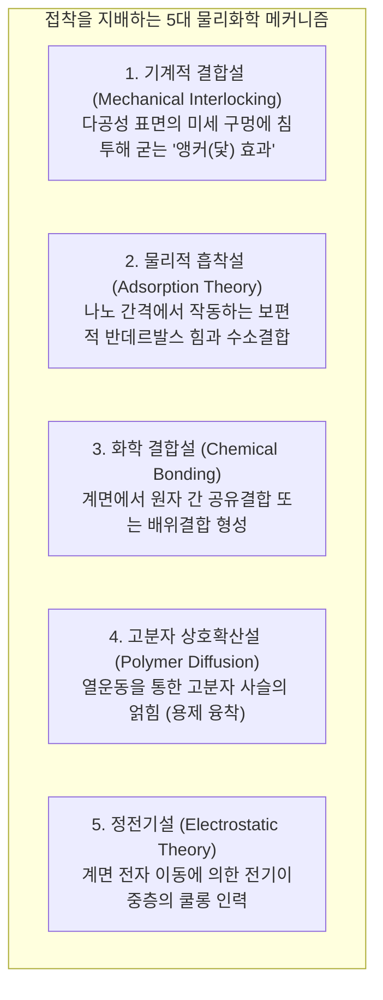
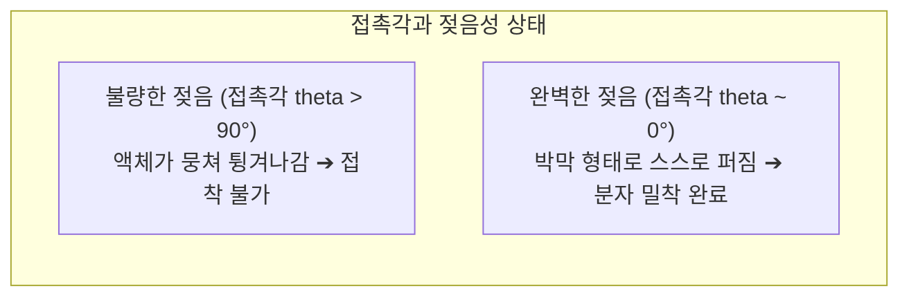

깨진 머그잔 파편에 액체 한 방울을 발라 몇 초간 누르면 끓는 물을 담아도 끄떡없이 복원됩니다. 한편 수백 명의 승객을 태우고 성층권을 시속 900km로 비행하는 보잉 787이나 에어버스 A350의 거대한 탄소섬유 날개는 수십만 개의 리벳 볼트 대신 고성능 구조용 접착제로 완벽히 결합되어 있습니다.

그러나 기초 물리학의 관점에서 보면 놀라운 의문이 생깁니다:
"어째서 끈적거리는 액체를 얇게 발라 누르는 것만으로 단단한 금속과 바위가 하나로 융합되는가?"
"어째서 셀로판테이프는 살짝 눌러도 즉시 붙고 떼어낼 때는 흔적도 없이 떨어지는가?"
"반대로 프라이팬의 테플론 코팅이나 비닐봉지에는 왜 어떤 접착제도 붙지 않는가?"

접착은 단순히 굳은 풀이 틈새에 끼어있는 현상이 아닙니다. 그것은 <strong>「나노스케일의 분자간력(반데르발스 힘과 수소결합), 젖음성(Wetting)과 표면에너지, 고분자 폴리머의 3차원 가교 중합 화학, 그리고 연속체 파괴역학이 융합된 극한의 계면과학」</strong>입니다.

---

## 1. 접착의 5대 메커니즘: 물질은 왜 서로 붙는가

원자 스케일에서 관찰하면 아무리 매끄러운 금속이나 유리 표면도 수 나노미터에서 수십 마이크로미터 높이의 거친 산맥(아스페리티)으로 가득 차 있습니다. 두 고체를 그냥 맞대면 실제 접촉 면적은 0.01% 미만에 불과하며, 나머지 공간은 공기층으로 가로막혀 분자간력이 도달하지 못합니다.

접착제의 첫 번째 물리적 역할은 <strong>「액체 상태로 미세한 골짜기 구석구석까지 스며들어 공기를 몰아내고 분자 수준의 진실 접촉을 달성하는 것」</strong>입니다.

### 1.1 물리적 흡착설 (반데르발스 힘)
접착제 분자와 피착재 원자가 1나노미터 이내로 접근하면 전자 구름의 미세한 분극에 의해 <strong>반데르발스 힘</strong>이 작동합니다. 개별 결합력은 수 kJ/mol로 미약하지만, 거시적 접촉면에 걸쳐 수조 개의 분자가 동시에 결합하면 수 톤의 차량을 매달 수 있는 막강한 인장강도를 발휘합니다.

### 1.2 화학 결합설과 실란 커플링제
가장 가혹한 내구성이 요구되는 항공우주 분야에서는 계면에서 직접 공유결합을 유도합니다. <strong>실란 커플링제</strong>는 한쪽 끝은 무기물 유리/금속 산화물과 실록산 결합($\text{Si-O-Si}$)을 형성하고, 다른 쪽 끝은 고분자 수지와 직접 결합하여 완벽한 화학적 일체를 만듭니다.

---

## 2. 젖음성(Wetting)과 표면에너지의 열역학

접착제가 표면에서 물방울처럼 동그랗게 맺히면(젖지 않으면) 접착력은 제로가 됩니다.

### 2.1 영의 방정식 (Young's Equation)
$$\gamma_{\text{SV}} = \gamma_{\text{SL}} + \gamma_{\text{LV}} \cos \theta$$
액체가 고체 표면에 자발적으로 퍼지기 위한 절대 법칙은 <strong>「고체의 표면 자유에너지($\gamma_{\text{SV}}$)가 액체 접착제의 표면장력($\gamma_{\text{LV}}$)보다 훨씬 높아야 한다」</strong>는 것입니다.

금속($\gamma_{\text{SV}} > 500$)은 표면에너지가 높아 접착제가 완벽히 젖어 퍼집니다. 반면 <strong>테플론(PTFE)</strong>은 불소 원자의 낮은 분극률로 인해 표면에너지가 <strong>$18\text{ mN/m}$</strong>에 불과하여 액체 접착제를 강력히 밀어내므로 접착이 불가능합니다. 이를 극복하기 위해 플라스마나 코로나 방전으로 표면에 극성 관능기를 강제 도입하는 표면 개질 기술이 사용됩니다.

---

## 3. 대표적 접착제의 경화 메커니즘

- <strong>순간접착제 (시아노아크릴레이트)</strong>: 공기 중 물 분자에서 해리된 미량의 수산화 이온($\text{OH}^-$)이 탄소를 구핵 공격하여 수초 만에 폭발적인 음이온 연쇄 중합을 일으켜 고체 아크릴 플라스틱으로 변합니다.
- <strong>에폭시 수지 (Epoxy)</strong>: 비스페놀 A 유도체(에폭시기)와 아민 경화제가 반응하여 3각 에폭시 링을 개환시키며 전후좌우로 무한히 연결된 <strong>3차원 그물망(Cross-linked Network)</strong>을 형성합니다. 경화 수축률이 1~2%로 극히 낮아 내부 잔류 응력이 없습니다.
- <strong>혐기성 접착제 (볼트 풀림 방지제)</strong>: 금속 나사 틈새에 갇혀 산소가 차단되고 금속 이온 촉매가 작용하는 순간에만 급속 라디칼 중합을 시작하여 굳어집니다.

---

## 4. 점착 테이프와 달퀴스트 기준 (Dahlquist Criterion)

포스트잇이나 스카치테이프는 화학 반응 없이 작동합니다. 3M의 물리학자 달퀴스트는 손가락 압력으로 즉시 점착력을 발휘하기 위한 유변학적 기준을 발견했습니다:
$$G' (1\text{ Hz}) < 3 \times 10^5\text{ Pa} \quad (0.3\text{ MPa})$$
저주파 접촉 시에는 액체처럼 유동하여 표면 요철에 스며들고, 고속 박리 시에는 고분자가 탄성 고체로 변해 찌꺼기(응집 파괴) 없이 깔끔하게 떨어집니다.

---

## 5. 항공기 CFRP 구조 접착 혁신

보잉 787과 에어버스 A350은 100만 개의 리벳 구멍을 뚫는 대신 탄소섬유 복합재를 에폭시 구조용 접착 필름으로 일체 성형 접합합니다. 이를 통해 응력 집중을 100% 해소하고 기체 무게를 수 톤 줄여 극적인 연비 향상을 달성했습니다.

---

## 6. 결론

나노미터 스케일의 분자간력에서 성층권을 나는 복합재 항공기 날개에 이르기까지, 접착제는 물질과 물질 사이의 미세한 간극을 없애고 원자들을 하나로 묶어내는 현대 재료역학의 위대한 결정체입니다.
