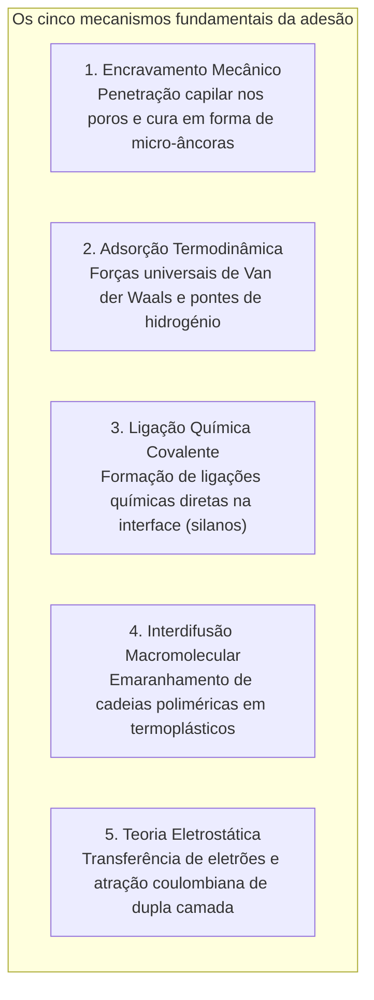
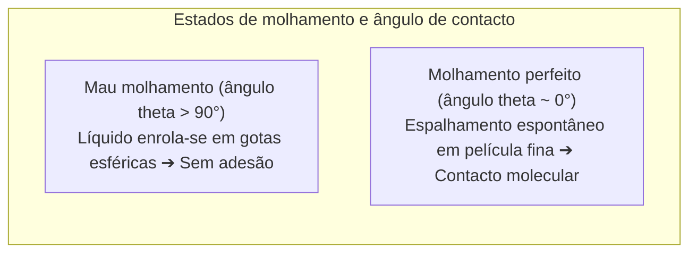

Umas gotas de líquido unem os fragmentos de uma chávena de cerâmica com tal firmeza que suportam café a ferver sem ceder. No extremo da tecnologia aeroespacial, as gigantescas asas em compósito de carbono do Boeing 787 e do Airbus A350 não são fixadas por centenas de milhares de rebites metálicos perfurantes, mas sim fundidas por películas de adesivos epóxi estruturais de alta resistência.

No entanto, à luz da física fundamental, coloca-se uma questão fascinante:
"Como pode uma fina camada líquida unir blocos rígidos de aço ou rocha com tanta força que o próprio material de base se parte antes da junta adesiva?"
"Porque é que a fita-cola adere instantaneamente com uma ligeira pressão e se solta sem deixar qualquer resíduo?"
"E porque é que o Teflon (PTFE) e os sacos de polietileno resistem tenazmente a quase todas as colas do mundo?"

Colar não é um mero encravamento mecânico de goma em fendas. É <strong>«a síntese extraordinária de forças intermoleculares (Van der Waals e pontes de hidrogénio), termodinâmica de molhamento (energia de superfície), reticulação macromolecular tridimensional e mecânica da fratura contínua.»</strong>

---

## 1. As 5 Teorias Fundamentais da Adesão

Mesmo as superfícies metálicas ou de vidro polidas a laser são, à escala atómica, cordilheiras de rugosidades microscópicas (asperezas). O contacto real entre sólidos secos raramente excede 0,01 % da área aparente. O papel do adesivo é <strong>molhar a superfície sob a forma de líquido, expelir as bolhas de ar e estabelecer um contacto atómico contínuo</strong>.

### 1.1 Adsorção física e forças de Van der Waals
A distâncias inferiores a 1 nanómetro, as forças eletromagnéticas de Van der Waals atuam universalmente. Embora débeis isoladamente ($1 \sim 10\text{ kJ/mol}$), o somatório através de triliões de átomos numa interface macroscopicamente ampla gera resistências capazes de suportar dezenas de toneladas.

### 1.2 Ligação química e promotores de aderência silano
Em juntas aeroespaciais críticas, agentes de acoplamento silano criam verdadeiras pontes covalentes siloxano ($\text{Si-O-Si}$) entre vidros ou metais oxidados e a matriz polimérica, conferindo uma durabilidade hidrolítica extrema.

---

## 2. Molhamento e energia de superfície

Sem um espalhamento espontâneo do líquido, a adesão é impossível.

### 2.1 A Equação de Young
$$\gamma_{\text{SV}} = \gamma_{\text{SL}} + \gamma_{\text{LV}} \cos \theta$$
Para haver espalhamento espontâneo, a <strong>energia de superfície do sólido ($\gamma_{\text{SV}}$) tem de ser substancialmente superior à tensão superficial do líquido ($\gamma_{\text{LV}}$)</strong>.
Os metais ($\gamma_{\text{SV}} > 500\text{ mN/m}$) molham-se facilmente. Pelo contrário, o Teflon (PTFE), revestido por átomos de flúor de baixíssima polarizabilidade, possui uma energia superficial de apenas <strong>$18\text{ mN/m}$</strong>, repelindo as colas líquidas. Tratamentos por plasma atmosférico ou efeito corona quebram cadeias inertes e enxertam grupos polares para viabilizar a colagem.

---

## 3. Cinética de cura dos adesivos modernos

- <strong>Cianoacrilato (Supercola)</strong>: Vestígios de humidade atmosférica ($\text{OH}^-$) à superfície das peças desencadeiam uma reação em cadeia aniónica ultrarrápida que polimeriza os monómeros num plástico acrílico rígido em poucos segundos.
- <strong>Resinas epoxídicas</strong>: Reação de poliadição com abertura do anel oxirano por aminas, formando uma densa rede macromolecular tridimensional termofixa, sem libertação de solventes e com contração volumétrica insignificante ($< 1\,\%$).
- <strong>Adesivos anaeróbicos</strong>: Mantêm-se líquidos na presença de oxigénio, mas polimerizam rapidamente por via radicalar quando confinados no interior de roscas metálicas sob catálise de iões de ferro e cobre.

---

## 4. Fitas adesivas sensíveis à pressão e o Critério de Dahlquist

As fitas adesivas não passam por nenhuma reação química. O seu comportamento único rege-se pelo <strong>critério reológico de Dahlquist</strong>:
$$G' (1\text{ Hz}) < 3 \times 10^5\text{ Pa}$$
A baixas frequências (aplicação), fluem como um líquido para dentro das micro-asperezas; durante a remoção rápida, o polímero endurece elasticamente, dissipando energia sem sofrer rutura coesiva nem deixar resíduos.

---

## 5. Revolução na colagem estrutural da aviação

No Boeing 787 e Airbus A350, a colagem com películas epóxi elimina furos de rebites (que concentram tensões por um fator de 3 segundo Kirsch), poupa toneladas de peso estrutural e elimina a corrosão galvânica entre compósitos de carbono e metais.

---

## 6. Conclusão

Dos pelos nanométricos das patas das osgas aos jatos supersónicos, os adesivos representam uma das maiores vitórias da ciência dos materiais, unindo o mundo macroscópico através da elegância das forças atómicas.
