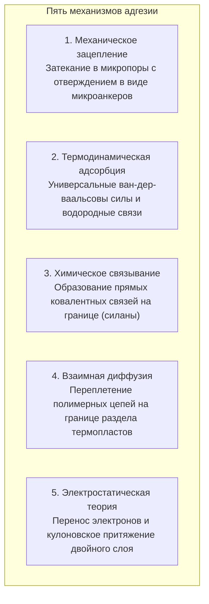
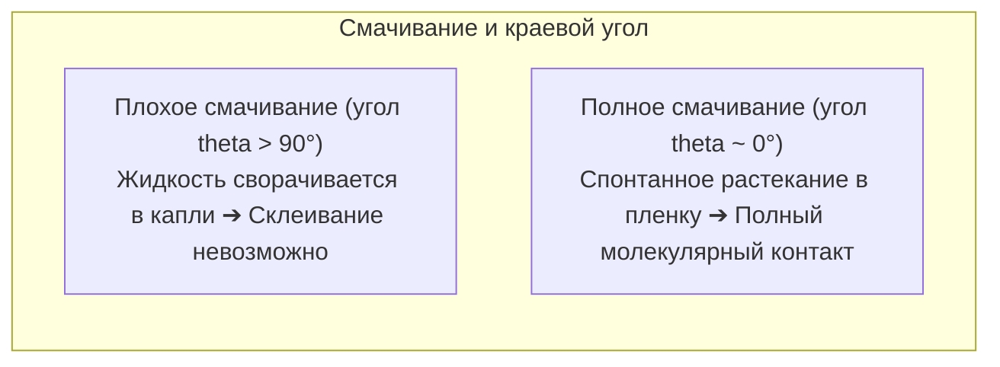

Капля прозрачной жидкости за секунды соединяет разбитую керамическую кружку так, что она выдерживает кипяток. В то же время на высоте десяти тысяч метров крылья лайнеров Boeing 787 и Airbus A350 выдерживают колоссальные аэродинамические нагрузки без единой заклепки: детали из углепластика (CFRP) и титана соединены конструкционными эпоксидными клеевыми пленками.

Но с точки зрения фундаментальной физики возникает вопрос:
«Почему тонкая пленка жидкости соединяет твердые металлы с такой прочностью, что при перегрузках чаще разрушается сам металл, чем клеевой шов?»
«Почему липкая лента прилипает от легкого нажатия и удаляется без следа?»
«И почему тефлон и полиэтилен не поддаются склеиванию большинством клеев?»

Склеивание — это не просто механическое застревание затвердевшей массы в порах. Это <strong>«синтез межмолекулярных сил Ван-дер-Ваальса, термодинамического смачивания (поверхностной энергии), трехмерной сетчатой полимеризации полимеров и механики разрушения сплошных сред.»</strong>

---

## 1. Пять фундаментальных теорий адгезии

На атомном уровне любая отполированная поверхность представляет собой хаос микроскопических выступов (шероховатостей). Истинная площадь контакта сухих тел не превышает 0,01 %. Задача клея — <strong>заполнить микронеровности в жидком состоянии, вытеснить воздух и обеспечить атомный контакт</strong>.

### 1.1 Физическая адсорбция и силы Ван-дер-Ваальса
При сближении менее чем на 1 нм включаются ван-дер-ваальсовы взаимодействия. Каждая отдельная связь слаба ($1 \sim 10\text{ кДж/моль}$), но сложение триллионов связей по всей площади шва создает прочность в десятки мегапаскалей.

### 1.2 Химическая связь и силановые аппреты
В авиастроении силановые связующие агенты создают химические силоксановые связи ($\text{Si-O-Si}$) между металлом/стеклом и полимерной матрицей, предотвращая деградацию от влаги.

---

## 2. Смачивание и поверхностная энергия

Если клей не смачивает твердое тело, адгезия невозможна.

### 2.1 Уравнение Юнга
$$\gamma_{\text{SV}} = \gamma_{\text{SL}} + \gamma_{\text{LV}} \cos \theta$$
Для самопроизвольного растекания <strong>поверхностная энергия твердого тела ($\gamma_{\text{SV}}$) должна существенно превышать поверхностное натяжение жидкого клея ($\gamma_{\text{LV}}$)</strong>.
Металлы ($\gamma_{\text{SV}} > 500\text{ мН/м}$) смачиваются отлично. У тефлона (PTFE) поверхностная энергия составляет всего <strong>$18\text{ мН/м}$</strong>, поэтому клей с него скатывается. Обработка плазмой или коронным разрядом внедряет полярные кислородные группы, активируя поверхность.

---

## 3. Химические механизмы отверждения клеев

- <strong>Цианакрилат (Суперклей)</strong>: Следы влаги воздуха ($\text{OH}^-$) на поверхности запускают быструю анионную полимеризацию, превращая жидкий мономер в твердый акриловый полимер за несколько секунд.
- <strong>Эпоксидные смолы</strong>: Реакция полиприсоединения эпоксидных колец с полиаминами создает густую трехмерную термореактивную сетку без усадки ($< 1\,\%$) и без растворителей.
- <strong>Анаэробные составы</strong>: Полимеризуются при исключении кислорода в резьбовых зазорах металлов под действием ионов железа и меди.

---

## 4. Липкие ленты и критерий Далквиста

Скотч и стикеры подчиняются <strong>реологическому критерию Далквиста</strong>:
$$G' (1\text{ Гц}) < 3 \times 10^5\text{ Па}$$
При медленном прижатии полимер течет как жидкость, затекая в микронеровности; при быстром отрыве он ведет себя как упругое тело, рассеивая энергию без расслоения и следов.

---

## 5. Конструкционное склеивание в авиации

В лайнерах Boeing 787 и Airbus A350 эпоксидные клеевые пленки соединяют углепластиковые панели, исключая концентраторы напряжений от отверстий под заклепки (трехкратный пик напряжений по Киршу), облегчая конструкцию на тонны и предотвращая гальваническую коррозию.

---

## 6. Заключение

От нановорсинок геккона до сверхзвуковых истребителей: клей — это триумф материаловедения, создающий неразрывные молекулярные мосты между телами.
