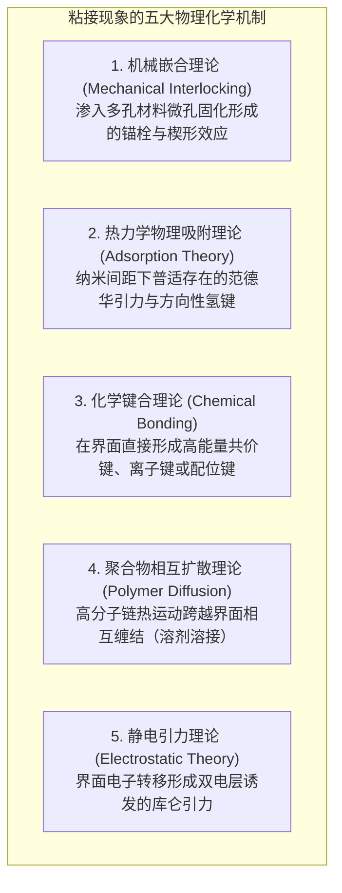
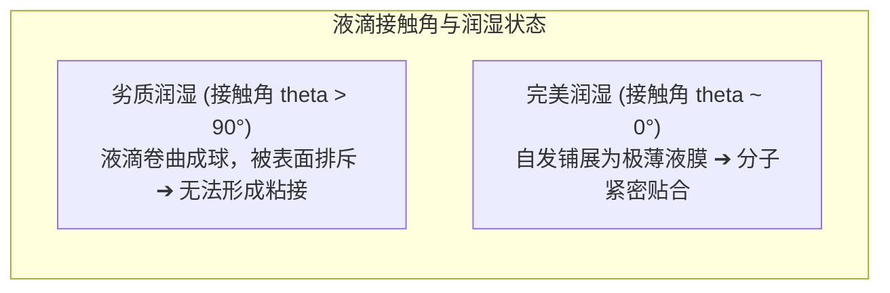
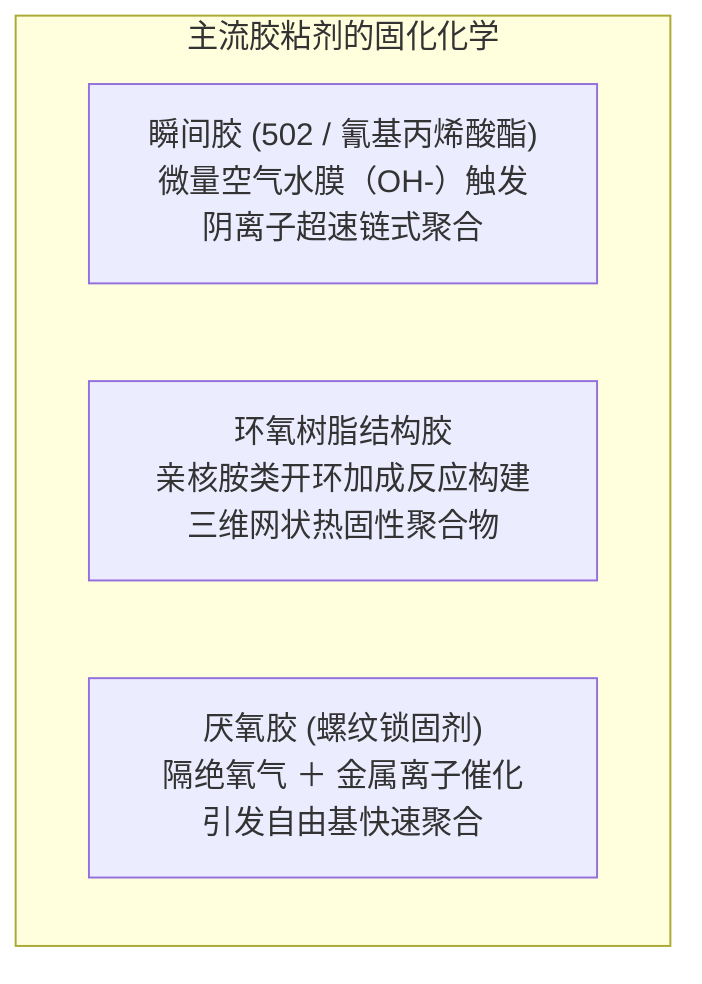

打碎的瓷杯涂上一滴透明液体，数秒后便能完好复原并承受滚水重负；而在数万米高空以近千公里时速巡航的现代客机波音 787 和空客 A350，其承受数十吨升力载荷的巨大碳纤维复合材料主翼，不再依靠密密麻麻的钢铆钉连接，而是通过几毫米厚的航天级结构胶膜融为一体。

然而，从基础物理学的角度冷静审视，我们不禁产生深深的好奇：
「为什么仅仅在两个物体之间涂上一层粘稠液体，就能让坚硬的钢铁或岩石牢固融合？」
「为什么普通的透明胶带轻轻一压就能黏住，剥离时却能干干净净不留残胶？」
「又为什么特氟龙（PTFE）和聚乙烯塑料袋对几乎所有的强力胶水都完全免疫？」

“粘接”绝非简单的“浆糊干涸卡在缝隙里”。它是<strong>「分子间引力（范德华力与氢键）、热力学润湿平衡（表面能）、高分子三维网络交联化学聚合与连续介质断裂力学的多学科工程杰作」</strong>。

---

## 1. 粘接的五大理论基石：物体为何能结合

在原子尺度上，即使抛光至镜面级别的金属或玻璃，其微观表面也是布满纳米至微米级尖锐凹凸（粗糙峰）的崇山峻岭。当两块刚体直接叠合时，真实微观接触面积往往不足表观面积的 0.01%，其余绝大部分都被空气缝隙阻隔，分子间力无法逾越。

胶粘剂的首要使命，是<strong>以液体形态流淌并渗透至粗糙峰谷的每一个纳米级角落，排净空气，建立起跨越界面的原子级连续接触</strong>。现代界面科学建立了五大核心粘接理论：

### 1.1 物理吸附理论：无所不在的范德华力
当胶粘剂分子与被粘物原子接近至 1 纳米以内时，由电子云瞬时涨落激发的<strong>范德华力（Van der Waals force）</strong>全面启动。尽管单根范德华键的结合能仅有几千焦每摩尔，但当数以万亿计的分子在整个宏观接触面上同时牵手时，汇聚成的剪切强度足以吊起重达数吨的卡车。若界面存在电负性极强的氧、氮原子，更可形成强韧的氢键网络。

### 1.2 化学键合理论与硅烷偶联剂
在耐湿热、抗疲劳要求严苛的航空航天接头中，工程师通过引入<strong>硅烷偶联剂（Silane Coupling Agents）</strong>在界面构建真正的共价键网络。偶联剂一端与无机玻璃或金属氧化物水解形成坚固的硅氧键（$\text{Si-O-Si}$），另一端直接参与高分子基体的交联共聚，将界面转化为化学原子连续体。

---

## 2. 润湿热力学与表面自由能

若胶水滴在材料表面缩成圆球（无法铺展），粘接强度将直接归零。<strong>良好润湿（Wetting）</strong>是实现分子结合的绝对前提。

### 2.1 杨氏方程（Young's Equation）与自发铺展条件
固-液-气三相平衡由杨氏方程严格描述：
$$\gamma_{\text{SV}} = \gamma_{\text{SL}} + \gamma_{\text{LV}} \cos \theta$$
铺展系数 $S = \gamma_{\text{SV}} - (\gamma_{\text{SL}} + \gamma_{\text{LV}}) \ge 0$ 表明：<strong>固体的表面自由能 $\gamma_{\text{SV}}$ 必须显著高于液态胶水的表面张力 $\gamma_{\text{LV}}$，液体才能自发铺展</strong>。

### 2.2 特氟龙为何粘不住？
特氟龙（PTFE）表面由于密布电负性极高、极化率极低的氟原子，表面能低至 <strong>$18\text{ mN/m}$</strong>。普通胶水表面张力通常在 $35 \sim 45\text{ mN/m}$，导致接触角 $\theta > 100^\circ$，胶水被强力排斥。现代工业必须使用等离子体轰击或化学钠化处理，强行引入极性基团提高表面能后方能施胶。

---

## 3. 经典胶粘剂的硬化反应机制

- <strong>瞬间胶（氰基丙烯酸酯）</strong>：双键两端强吸电子基团使碳原子极度亲电。物体表面几层纳米级吸附水分子电离出的微量 $\text{OH}^-$ 即可瞬间引发阴离子聚合，十几秒内聚合为高分子坚硬塑料。
- <strong>环氧树脂（Epoxy）</strong>：双酚A二缩水甘油醚与多胺类固化剂反应，环氧三元环开环形成三维立体互穿网络。固化过程无溶剂挥发，体积收缩率低于 1～2%，具备极高剪切强度与抗蠕变性。

---

## 4. 压敏胶与达尔奎斯特准则（Dahlquist Criterion）

胶带不发生化学反应，其“轻压即粘、揭下无残留”源于高分子的特殊流变学：
$$G' (1\text{ Hz}) < 3 \times 10^5\text{ Pa} \quad (0.3\text{ MPa})$$
低频轻压时，弹性储能模量低于临界值，聚合物如液体般流淌渗透凹凸；高速剥离时，高频应变使模量骤增数千倍，聚合物转变为坚韧弹性固体，保证胶层完整脱落不留残胶。

---

## 5. 航空航天结构胶接革命

现代客机（如波音 787）摒弃上百万颗穿孔打孔会诱发三倍应力集中的传统铝合金铆钉，全面改用航天级环氧结构胶膜对碳纤维复合材料（CFRP）进行共固化整体粘接：
1. <strong>应力全平面均匀分散</strong>：彻底消除打孔疲劳裂纹萌生隐患。
2. <strong>结构极致轻量化</strong>：减重数吨，燃油经济性提升两位数。
3. <strong>电化学绝缘</strong>：隔绝碳纤维与金属的电位差，杜绝电化学腐蚀。

---

---

## 6. 自然界的终极粘附：壁虎干式吸附与贻贝水下强力胶

在人类合成高分子胶水之前，自然界生物早已演化出了令材料学家叹为观止的粘附系统。
- <strong>壁虎（Gecko）的干式纳米刚毛</strong>：壁虎能在光滑玻璃上倒立行走，其脚掌既无粘性分泌物也不留残痕。纳米显微镜揭示其脚趾密布数十万根刚毛（Setae），末端分支为数亿个宽度仅 200 纳米的扁平肉铲（Spatulae）。通过与基底凹凸在原子尺度完美贴合，纯粹依靠<strong>范德华分子间引力</strong>即可承载自身体重。
- <strong>海洋贻贝（Mussel）的水下固着蛋白</strong>：水分子具有强极性，通常会排斥胶水阻断粘接。而贻贝分泌的足丝蛋白中富含高浓度<strong>多巴（DOPA：L-3,4-二羟基苯丙氨酸）</strong>。其邻二酚羟基能强行排开矿物表面的水分子，与金属氧化物形成极强的配位螯合键，并迅速自交联固化为耐水弹性凝胶。该机制正在被广泛应用于无须缝合线的手术止血医用胶水。

## 7. 结语

从壁虎脚掌数以百万计的纳米刚毛干式吸附，到巡航高空的万吨复合材料巨鸟，胶粘剂是连接微观分子引力与宏观极端承载的科学之桥。
