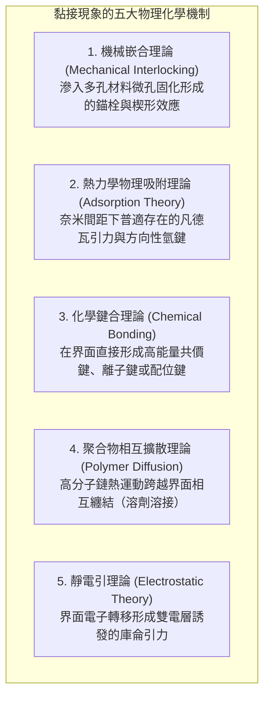
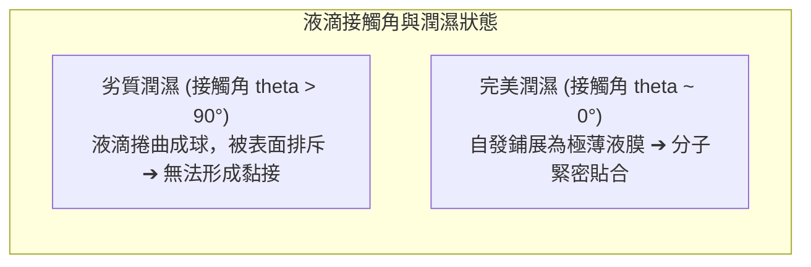
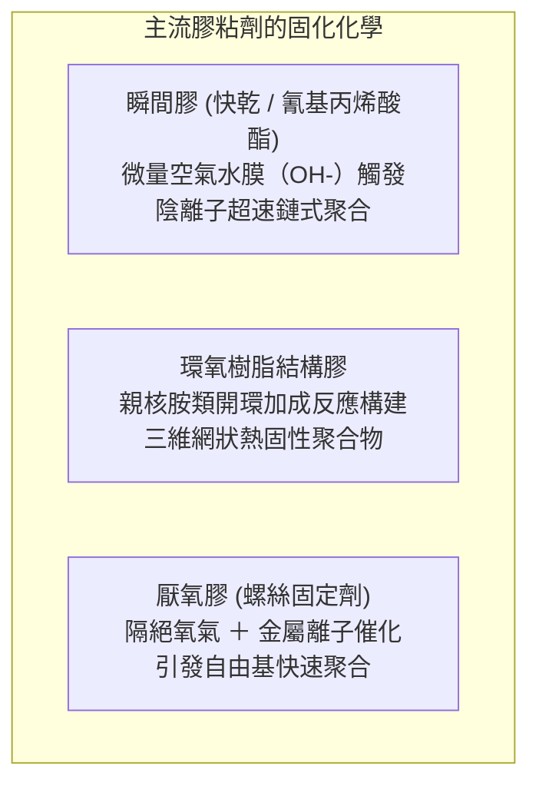

打碎的瓷杯塗上一滴透明液體，數秒後便能完好復原並承受滾水重負；而在數萬公尺高空以近千公里時速巡航的現代客機波音 787 和空中巴士 A350，其承受數十噸升力載重的巨大碳纖維複合材料主翼，不再依靠密密麻麻的鋼鉚釘連接，而是透過幾毫米厚的航太級結構膠膜融為一體。

然而，從基礎物理學的角度冷靜審視，我們不禁產生深深的好奇：
「為什麼僅僅在兩個物體之間塗上一層黏稠液體，就能讓堅硬的鋼鐵或岩石牢固融合？」
「為什麼普通的透明膠帶輕輕一壓就能黏住，撕下時卻能乾乾淨淨不留殘膠？」
「又為什麼鐵氟龍（PTFE）和聚乙烯塑膠袋對幾乎所有的強力膠水都完全免疫？」

“黏接”絕非簡單的“漿糊乾涸卡在縫隙裡”。它是<strong>「分子間引力（凡德瓦力與氫鍵）、熱力學潤濕平衡（表面能）、高分子三維網絡交聯化學聚合與連續介質斷裂力學的多學科工程傑作」</strong>。

---

## 1. 黏接的五大理論基石：物體為何能結合

在原子尺度上，即使拋光至鏡面等級的金屬或玻璃，其微觀表面也是布滿奈米至微米級尖銳凹凸（粗糙峰）的崇山峻嶺。當兩塊剛體直接疊合時，真實微觀接觸面積往往不足表觀面積的 0.01%，其餘絕大部分都被空氣縫隙阻隔，分子間力無法發揮。

膠粘劑的首要使命，是<strong>以液體形態流淌並滲透至粗糙峰谷的每一個奈米級角落，排淨空氣，建立起跨越界面的原子級連續接觸</strong>。現代界面科學建立了五大核心黏接理論：

### 1.1 物理吸附理論：無所不在的凡德瓦力
當膠粘劑分子與被粘物原子接近至 1 奈米以內時，由電子雲瞬時漲落激發的<strong>凡德瓦力（Van der Waals force）</strong>全面啟動。儘管單根凡德瓦鍵的結合能僅有幾千焦每莫耳，但當數以萬億計的分子在整個宏觀接觸面上同時牽手時，匯聚成的剪切強度足以吊起重達數噸的卡車。若界面存在電負度極強的氧、氮原子，更可形成強韌的氫鍵網絡。

### 1.2 化學鍵合理論與矽烷偶聯劑
在耐濕熱、抗疲勞要求嚴苛的航空太空接頭中，工程師透過引入<strong>矽烷偶聯劑（Silane Coupling Agents）</strong>在界面構建真正的共價鍵網絡。偶聯劑一端與無機玻璃或金屬氧化物水解形成堅固的矽氧鍵（$\text{Si-O-Si}$），另一端直接參與高分子基體的交聯共聚，將界面轉化為化學原子連續體。

---

## 2. 潤濕熱力學與表面自由能

若膠水滴在材料表面縮成圓球（無法鋪展），黏接強度將直接歸零。<strong>良好潤濕（Wetting）</strong>是實現分子結合的絕對前提。

### 2.1 楊氏方程式（Young's Equation）與自發鋪展條件
固-液-氣三相平衡由楊氏方程式嚴格描述：
$$\gamma_{\text{SV}} = \gamma_{\text{SL}} + \gamma_{\text{LV}} \cos \theta$$
鋪展係數 $S = \gamma_{\text{SV}} - (\gamma_{\text{SL}} + \gamma_{\text{LV}}) \ge 0$ 表明：<strong>固體的表面自由能 $\gamma_{\text{SV}}$ 必須顯著高於液態膠水的表面張力 $\gamma_{\text{LV}}$，液體才能自發鋪展</strong>。

### 2.2 鐵氟龍為何黏不住？
鐵氟龍（PTFE）表面由於密布電負度極高、極化率極低的氟原子，表面能低至 <strong>$18\text{ mN/m}$</strong>。普通膠水表面張力通常在 $35 \sim 45\text{ mN/m}$，導致接觸角 $\theta > 100^\circ$，膠水被強力排斥。現代工業必須使用電漿轟擊或化學鈉化處理，強行引入極性基團提高表面能後方能施膠。

---

## 3. 經典膠粘劑的硬化反應機制

- <strong>瞬間膠（氰基丙烯酸酯）</strong>：雙鍵兩端強吸電子基團使碳原子極度親電。物體表面幾層奈米級吸附水分子電離出的微量 $\text{OH}^-$ 即可瞬間引發陰離子聚合，十幾秒內聚合為高分子堅硬塑膠。
- <strong>環氧樹脂（Epoxy）</strong>：雙酚A二縮水甘油醚與多胺類固化劑反應，環氧三元環開環形成三維立體互穿網絡。固化過程無溶劑揮發，體積收縮率低於 1～2%，具備極高剪切強度與抗潛變性。

---

## 4. 感壓膠與達爾奎斯特準則（Dahlquist Criterion）

膠帶不發生化學反應，其“輕壓即黏、撕下無殘留”源於高分子的特殊流變學：
$$G' (1\text{ Hz}) < 3 \times 10^5\text{ Pa} \quad (0.3\text{ MPa})$$
低頻輕壓時，彈性儲能模數低於臨界值，聚合物如液體般流淌滲透凹凸；高速剝離時，高頻應變使模數驟增數千倍，聚合物轉變為堅韌彈性固體，保證膠層完整脫落不留殘膠。

---

## 5. 航空太空結構膠接革命

現代客機（如波音 787）摒棄上百萬顆穿孔打孔會誘發三倍應力集中的傳統鋁合金鉚釘，全面改用航太級環氧結構膠膜對碳纖維複合材料（CFRP）進行共固化整體黏接：
1. <strong>應力全平面均勻分散</strong>：徹底消除打孔疲勞裂紋萌生隱患。
2. <strong>結構極致輕量化</strong>：減重數噸，燃油經濟性提升兩位數。
3. <strong>電化學絕緣</strong>：隔絕碳纖維與金屬的電位差，杜絕電化學腐蝕。

---

---

## 6. 自然界的終極黏附：壁虎乾式吸附與貽貝水下強力膠

在人類合成高分子膠水之前，自然界生物早已演化出了令材料學家嘆為觀止的黏附系統。
- <strong>壁虎（Gecko）的乾式奈米剛毛</strong>：壁虎能在光滑玻璃上倒立行走，其腳掌既無黏性分泌物也不留殘痕。奈米顯微鏡揭示其腳趾密布數十萬根剛毛（Setae），末端分支為數億個寬度僅 200 奈米的扁平肉鏟（Spatulae）。透過與基底凹凸在原子尺度完美貼合，純粹依靠<strong>凡德瓦分子間引力</strong>即可承載自身體重。
- <strong>海洋貽貝（Mussel）的水下固著蛋白</strong>：水分子具有強極性，通常會排斥膠水阻斷黏接。而貽貝分泌的足絲蛋白中富含高濃度<strong>多巴（DOPA：L-3,4-二羥基苯丙氨酸）</strong>。其鄰二酚羥基能強行排開礦物表面的水分子，與金屬氧化物形成極強的配位螯合鍵，並迅速自交聯固化為耐水彈性凝膠。該機制正在被廣泛應用於無須縫合線的手術止血醫用膠水。

## 7. 結語

從壁虎腳掌數以百萬計的奈米剛毛乾式吸附，到巡航高空的萬噸複合材料巨鳥，膠粘劑是連接微觀分子引力與宏觀極端承載的科學之橋。
