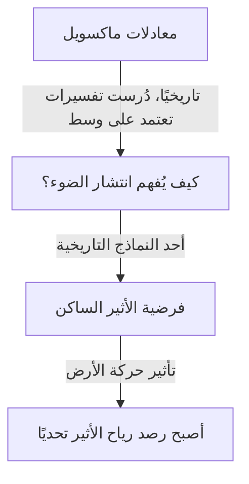

## 1. مقدمة: "الشيء" الذي كان يُعتقد أنه يملأ الكون

طوال تاريخ سعي البشرية لكشف ألغاز العالم الطبيعي، كان سؤال "كيف ينتقل الضوء عبر الفضاء؟" يسحر ويحير العديد من العباقرة، من فلاسفة اليونان القديمة إلى علماء الفيزياء في العصر الحديث.

بمراقبة الظواهر الفيزيائية اليومية، نجد أن انتقال الصوت يتطلب مادة مثل "الهواء" أو "الماء"، وانتقال أمواج البحر يتطلب وسطا هو "مياه البحر". من هذا القياس البديهي والمنطقي للغاية، ظهرت فكرة أنه إذا كان للضوء خصائص موجية، فلا بد من وجود "وسط مجهول" لنقل الضوء يملأ كل ركن من أركان الفضاء الكوني. هذا الوسط الوهمي هو ما سُمي بـ "الأثير المضيء" (Luminiferous aether).

كان الأثير إطارًا مؤثرًا لدى كثير من فيزيائيي القرن التاسع عشر، لكن النظريات والتفسيرات لم تكن موحّدة، وظلت حركة الأثير وتفاعله مع المادة موضع نقاش. وقد دفعت التجارب الباحثة عن «ريح الأثير»، إلى جانب التطورات النظرية اللاحقة، إلى إعادة تقييم فكرة الوسط الكلاسيكي للضوء، وأصبحت جزءًا من المسار التاريخي الذي أدى إلى النسبية. يتتبع هذا المقال نشأة المفهوم واختباره واختلافه عن أفكار الفيزياء الحديثة.

## 2. الجدل حول طبيعة الضوء وولادة الأثير

احتدم النقاش حول ما إذا كان جوهر الضوء "جسيمًا" أم "موجة" خلال عصر الثورة العلمية في القرن السابع عشر.

اقترح إسحاق نيوتن "النظرية الجسيمية للضوء"، والتي تنص على أن الضوء عبارة عن تيار من الجسيمات الدقيقة، مستندًا إلى انتقال الضوء في خطوط مستقيمة وقوانين الانعكاس. وبفضل سلطته الساحقة، هيمنت النظرية الجسيمية على مجتمع الفيزياء طوال القرن الثامن عشر. ولكن في نفس العصر، جادل كريستيان هيغنز بأنه لتفسير ظواهر مثل حيود وانكسار الضوء، يجب اعتبار الضوء موجة، وطرح "النظرية الموجية للضوء".

في القرن التاسع عشر، قدمت تجارب التداخل التي أجراها يونغ ونظرية فرينل أدلة قوية على تفسير التداخل والحيود بوصفهما سلوكًا موجيًا للضوء. لكن السلوك الموجي وحده لا يثبت منطقيًا وجود وسط ميكانيكي في الفراغ. واستنادًا إلى القياس مع الموجات المعروفة آنذاك، افترضت نظريات كثيرة وجود الأثير بوصفه وسطًا ناقلًا للضوء.

### الخصائص الغريبة المطلوبة في الأثير

ومع ذلك، بافتراض وجود وسط الأثير، واجه الفيزيائيون تناقضًا خطيرًا. فقد تبين من خلال اكتشاف ظاهرة الاستقطاب أن الضوء عبارة عن موجة مستعرضة (موجة تتذبذب عموديًا على اتجاه انتشارها). وفي إطار الفيزياء في ذلك الوقت، كانت "المواد الصلبة" فقط هي القادرة على نقل الموجات المستعرضة. بينما تنقل الغازات والسوائل الموجات الطولية فقط (مثل الموجات الصوتية).

بمعنى آخر، كان يجب أن يكون الأثير "مادة صلبة شفافة عملاقة" تمتد عبر الكون بأسره. ومن أجل نقل الموجات بالسرعة الهائلة التي هي سرعة الضوء (حوالي 300 ألف كيلومتر في الثانية)، يجب أن يكون الأثير أصلب بكثير من الفولاذ ويتمتع بمرونة قوية للغاية. وفي الوقت نفسه، ونظرًا لأن الأرض والكواكب لا يبدو أنها تتعرض لأي مقاومة احتكاك من الأثير أثناء دورانها حول الشمس، فيجب أن يكون الأثير خاليًا تمامًا من الاحتكاك، وأن يمتلك خاصية رقيقة للغاية تسمح بمرور المواد عبره دون أي مقاومة.

وهكذا أُثقل الأثير بخصائص غريبة متناقضة تمامًا من الناحية الفيزيائية: "مادة صلبة أصلب من الفولاذ، ولكنها لا تبدي أي مقاومة تمامًا مثل المائع المثالي".

## 3. كهرومغناطيسية ماكسويل ونظام الراحة المطلقة للأثير

في أواخر القرن التاسع عشر، أكمل جيمس كليرك ماكسويل "معادلات ماكسويل" التي تشكل أساس الكهرومغناطيسية. لم تصف هذه المعادلات الظواهر الكهربائية والمغناطيسية بشكل مثالي فحسب، بل تضمنت أيضًا تنبؤًا مذهلاً. فعند حساب سرعة انتشار الموجات الكهرومغناطيسية، وجد أنها تتطابق تمامًا مع "سرعة الضوء" التي تم قياسها في التجارب آنذاك. وبذلك تم إثبات نظريًا أن "الضوء هو نوع من الموجات الكهرومغناطيسية".

في معادلات ماكسويل، تُستنتج سرعة الضوء $c$ كثابت يتحدد من خلال السماحية الكهربائية والنفاذية المغناطيسية للفراغ. وهنا نشأت مشكلة كبيرة. عندما نقول أن "سرعة الضوء ثابتة"، فـ "بالنسبة إلى ماذا" هي ثابتة؟

وفقًا لمبدأ النسبية في ميكانيكا نيوتن، يجب أن تتغير السرعة دائمًا اعتمادًا على حالة حركة الراصد. فسرعة الكرة المرمية من قطار متحرك ستكون "سرعة القطار + سرعة الكرة" من منظور شخص يقف على الأرض. ومع ذلك، فإن سرعة الضوء في معادلات ماكسويل لم تأخذ في الاعتبار سرعة الراصد هذه.

درس كثير من منظّري ذلك العصر تفسيرات تربط المجال الكهرومغناطيسي بوسط أو بإطار مرجعي مفضّل، ومنها نماذج تفترض أثيرًا ساكنًا. لكن معادلات ماكسويل بحد ذاتها لا تثبت وجود وسط ميكانيكي أو إطار سكون مطلق. وفي الصيغ النسبية اللاحقة، تكون سرعة الضوء في الفراغ ثابتة بين الأطر القصورية، فلا حاجة إلى افتراض إطار سكون مفضّل.

## 4. تجربة ميكلسون ومورلي: نتيجة عدم كشف شهيرة

إذا كان الفضاء الكوني ممتلئًا بالأثير الساكن سكونًا مطلقًا، فإن الأرض التي تدور حول الشمس تندفع دائمًا عبر بحر الأثير. ومن منظور الأرض، يجب أن تهب "رياح الأثير" من الفضاء.

في عام 1887، أجرى ألبرت ميكلسون وإدوارد مورلي تجربة رائدة لالتقاط "رياح الأثير" هذه. قاموا ببناء جهاز بصري عالي الدقة يُعرف باسم "مقياس التداخل لميكلسون".

مبدأ التجربة هو كما يلي: يتم تقسيم حزمة ضوئية من مصدر ضوئي إلى اتجاهين متعامدين باستخدام مرآة نصف عاكسة (مرآة نصف شفافة). يتجه أحدهما موازيًا لاتجاه رياح الأثير، والآخر عموديًا عليه، وينعكس كلاهما من مرايا في نهايتي مساريهما ويعودان. إذا كانت رياح الأثير موجودة، تمامًا كما يتأثر الشخص الذي يسبح ذهابًا وإيابًا في نهر بتيار النهر، فيجب أن يكون هناك فرق ضئيل جدًا في وقت انتقال الضوء ذهابًا وإيابًا. وعندما يتم تراكب شعاعي الضوء العائدين، كان من المتوقع أن يُلاحظ فرق الوقت هذا كإزاحة في "أهداب التداخل".

لم تكشف القياسات عن إزاحة في أهداب التداخل بالحجم الذي تنبأ به نموذج بسيط للأثير الساكن. وتذكر الورقة أن الإزاحة المتوقعة كانت نحو 0.4 هدب، بينما كان الأثر المتبقي المبلّغ عنه أصغر بكثير؛ لذلك خلص المؤلفان إلى أن أي حركة نسبية بين الأرض والأثير كانت دون مستوى الكشف المتوقع بكثير. لا يعني ذلك أن الإزاحة كانت صفرًا حرفيًا؛ والأدق فهم النتيجة بوصفها نتيجة عدم كشف لنموذج محدد لريح الأثير الكلاسيكية.

كانت نتيجة التجربة سلبية بمعنى أنها لم تكشف إشارة لرياح الأثير بالحجم المتوقع. ولا يعني ذلك أن الجهاز أو القياسات «فشلت». تكمن أهمية التجربة في أنها وضعت قيدًا على الإشارة التي يتنبأ بها نموذج كلاسيكي محدد للأثير، وشجعت على مزيد من البحث النظري والتجريبي.

## 5. انكماش لورنتز والحلول المخصصة (Ad hoc)

حاول الفيزيائيون الذين أخذوا نتائج التجربة على محمل الجد إنقاذ نظرية الأثير بأي طريقة. طرح جورج فيتزجيرالد وهيندريك لورنتز فرضية مذهلة.

"هل يمكن أن يكون الجسم نفسه ينكمش قليلاً على طول اتجاه الحركة، بسبب ضغط رياح الأثير عندما يتحرك الجسم عبر الأثير؟"

وفقًا لـ "فرضية انكماش لورنتز-فيتزجيرالد"، فإن أذرع مقياس التداخل لميكلسون ومورلي تنكمش أيضًا بدقة على طول اتجاه الحركة، مما يلغي فرق الوقت في انتقال الضوء ذهابًا وإيابًا، وبالتالي يفسر سبب عدم إمكانية رصد رياح الأثير. بالإضافة إلى ذلك، قدم لورنتز مفهوم تباطؤ الزمن (الزمن المحلي) في الأنظمة المتحركة، وأكمل إطارًا رياضيًا يُعرف باسم "تحويلات لورنتز".

كانت فرضية الانكماش ونظرية لورنتز محاولتين للتوفيق بين الكهرومغناطيسية ونتائج التجارب في عصرهما. ووصفهما لاحقًا بأنهما مجرد حلول ترقيعية يبسّط السياق النظري والتجريبي الذي ظهرتا فيه. احتفظ لورنتز بفكرة أثير ساكن مطلقًا، لكن الإطار الرياضي نفسه أصبح لاحقًا أساسيًا في النسبية الخاصة التي لا تفترض إطار سكون للأثير.

## 6. أينشتاين وتغيير النموذج الفكري: النظرية النسبية الخاصة

في عام 1905، نشر ألبرت أينشتاين، وهو موظف شاب في مكتب براءات الاختراع، ورقة بحثية تحل هذه المشكلة المعقدة جذريًا من خلال مبدأين بسيطين فقط. هذه هي "النظرية النسبية الخاصة".

توقف أينشتاين عن القلق بشأن خصائص الأثير وانطلق من فرضيات جديدة كليًا:
1. **مبدأ النسبية**: تأخذ القوانين الفيزيائية نفس الشكل تمامًا في جميع الأطر القصرية (لأي راصد يتحرك في خط مستقيم وبسرعة منتظمة). لا يوجد شيء اسمه إطار سكون مطلق.
2. **مبدأ ثبات سرعة الضوء**: سرعة الضوء في الفراغ ثابتة دائمًا (الثابت $c$) لجميع الراصدين، بغض النظر عن حالة حركة مصدر الضوء أو حالة حركة الراصد.

بقبول هذين المبدأين، نصل إلى استنتاج مذهل. فلكي تكون سرعة الضوء ثابتة دائمًا، يجب أن ينكمش "المكان" ويتباطأ "الزمان" وفقًا لحالة حركة الراصد. أصبح من الواضح أن الظاهرة التي اعتبرها لورنتز وآخرون "انكماشًا ماديًا بسبب الأثير" كانت في الواقع خاصية نسبية للزمان والمكان نفسيهما.

ألغت النسبية الخاصة كما عرضها أينشتاين عام 1905 الحاجة إلى افتراض وسط ميكانيكي للضوء أو فضاء ساكن مطلق لوصف الكهرومغناطيسية. ولا يعني ذلك منع كل استخدام لكلمة «أثير» منطقيًا. ففي عام 1920 استخدم أينشتاين المصطلح بمعنى مختلف عند مناقشة الخصائص الفيزيائية للزمكان في النسبية العامة؛ ولم يكن يقصد وسطًا ميكانيكيًا للضوء له حالة حركة.

## 7. "الفراغ" في الفيزياء الحديثة: شبح الأثير

تم التخلي عن الأثير كمفهوم غير ضروري، ولكن فكرة أن "المكان الفارغ (الفراغ)" هو "فارغ" حقًا قد تم دحضها أيضًا بواسطة الفيزياء الحديثة.

في نظرية المجال الكمومي، يوصف الفراغ بأنه الحالة الأقل طاقة للحقول، وتوجد في هذه الحقول تقلبات كمومية. أما القول إن أزواج الجسيمات والجسيمات المضادة تتكون وتفنى باستمرار فقد يصوّر الفراغ على نحو مضلل كأنه بحر حرفي من الجسيمات التي تظهر وتختفي. وتختلف الحقول، مثل المجال الكهرومغناطيسي ومجال هيغز، وفكرة وصف الجسيمات بأنها إثارات للحقول، عن الأثير الميكانيكي الكلاسيكي.

بالإضافة إلى ذلك، في النظرية النسبية العامة، وصف أينشتاين الزمكان نفسه بأنه كيان ديناميكي ينحني بفعل الجاذبية. وقد قال أينشتاين نفسه في سنوات لاحقة أنه بالمعنى الذي يمتلك فيه الزمكان نفسه خصائص فيزيائية، "يمكن تسميته أثيرًا بمعنًى جديد" (على الرغم من أنه يختلف تمامًا عن الأثير كوسط ساكن مطلق في القرن التاسع عشر).

ليس دقيقًا وصف المادة المظلمة أو الطاقة المظلمة بأنهما نسختان حديثتان من الأثير الناقل للضوء. تُستدل على المادة المظلمة أساسًا من آثارها الجاذبية، وتوصف بأنها لا تصدر الضوء ولا تمتصه ولا تعكسه. أما الطاقة المظلمة فهو الاسم المعطى لما يفسر التمدد المتسارع للكون. لم يُقترح أي منهما بوصفه وسطًا لانتقال الضوء، كما أن معناهما الفيزيائي مختلف.

## 8. الخاتمة: ما يعلمنا إياه تاريخ العلوم

تعتبر قصة الأثير المضيء مثالًا جميلًا للغاية يوضح كيف يتقدم العلم.

لا يحتاج الضوء في النسبية الخاصة الحديثة إلى أثير ضوئي كلاسيكي بوصفه وسطًا ناقلًا. وقد حفّز البحث في هذه الفرضية تجارب دقيقة وعملًا نظريًا، وأصبح جزءًا من التاريخ الذي أدى إلى النسبية. لكن تجربة ميكلسون ومورلي وحدها لم تدحض كل معنى ممكن لكلمة «أثير»، ولم تُنتج النظرية النسبية بمفردها.

إن الفشل والافتراضات الخاطئة في العلم ليست بلا فائدة أبدًا. فهي بمثابة سقالات لا غنى عنها لإضاءة المناطق المجهولة. اختفى الوسط الوهمي للأثير المضيء من الفيزياء، لكن المعرفة بـ "الطبيعة الحقيقية للزمكان" التي اكتسبتها البشرية أثناء عملية استكشافه لا تزال تدعم فهمنا للكون حتى اليوم.
