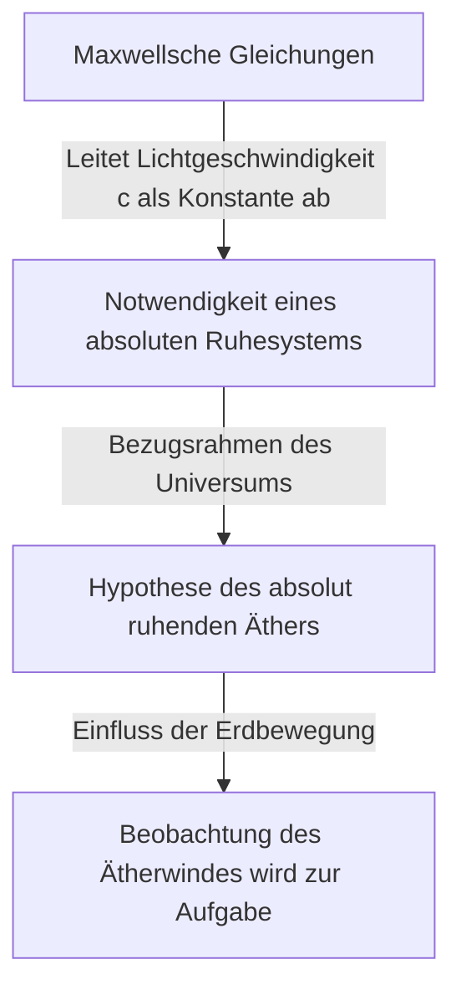

## 1. Einleitung: Das 'Etwas', das das Universum füllen sollte

In der Geschichte des menschlichen Bestrebens, die Geheimnisse der Natur zu entschlüsseln, hat die Frage "Wie breitet sich Licht im Raum aus?" unzählige Genies von den antiken griechischen Philosophen bis zu modernen Physikern fasziniert und auch sehr verwirrt.

Beobachtet man alltägliche physikalische Phänomene, ist es offensichtlich, dass die Ausbreitung von Schall ein Material wie 'Luft' oder 'Wasser' erfordert, und für Meereswellen ist das Medium 'Meerwasser' unerlässlich. Aus dieser sehr intuitiven und logischen Analogie entstand die Idee: Wenn Licht wellenartige Eigenschaften besitzt, muss es ein 'unbekanntes Medium' zur Übertragung des Lichts geben, das jeden Winkel des Weltraums ausfüllt. Dieses Phantom-Medium wurde 'Lichtäther' (Luminiferous aether) genannt.

Für viele Physiker des 19. Jahrhunderts war der Äther ein einflussreiches Erklärungsmodell. Die Theorien und Deutungen waren jedoch nicht einheitlich; auch über Bewegung und Wechselwirkung des Äthers mit Materie wurde gestritten. Experimente zur Suche nach einem Ätherwind und spätere theoretische Entwicklungen gaben Anlass, das klassische Lichtmedium neu zu bewerten, und gehören zur Vorgeschichte der Relativitätstheorie. Dieser Artikel zeichnet Entstehung, Prüfung und Abgrenzung des Konzepts von Ideen der modernen Physik nach.

## 2. Die Debatte über die Natur des Lichts und die Geburt des Äthers

Die Debatte darüber, ob das Wesen des Lichts 'Teilchen' oder 'Welle' ist, wurde während der wissenschaftlichen Revolution im 17. Jahrhundert heftig geführt.

Isaac Newton schlug basierend auf der geradlinigen Ausbreitung des Lichts und den Gesetzen der Reflexion die 'Korpuskulartheorie des Lichts' vor, die besagte, dass Licht ein Strom winziger Teilchen ist. Aufgrund seiner überwältigenden Autorität dominierte die Teilchentheorie die physikalische Gemeinschaft das gesamte 18. Jahrhundert hindurch. Zur gleichen Zeit jedoch argumentierte Christiaan Huygens, dass Licht als Welle (Wellenbewegung) betrachtet werden sollte, um Phänomene wie Beugung und Brechung des Lichts zu erklären, und trat für die 'Wellentheorie des Lichts' ein.

Im 19. Jahrhundert lieferten Youngs Interferenzversuche und Fresnels Theorie starke Belege dafür, Interferenz und Beugung als Wellenverhalten des Lichts zu erklären. Aus wellenartigem Verhalten allein folgt jedoch logisch nicht, dass im Vakuum ein mechanisches Medium existiert. In Analogie zu bekannten Wellen nahmen viele Theorien jener Zeit einen Äther als Trägermedium des Lichts an.

### Die seltsamen Eigenschaften, die vom Äther gefordert wurden

Mit der Annahme des Äthers als Medium sahen sich die Physiker jedoch mit einem gravierenden Widerspruch konfrontiert. Durch die Entdeckung des Polarisationsphänomens wurde bekannt, dass Licht eine Transversalwelle (eine Welle, die senkrecht zur Ausbreitungsrichtung schwingt) ist. Im Rahmen der damaligen Physik waren nur 'Festkörper' in der Lage, Transversalwellen zu übertragen. Gase und Flüssigkeiten konnten nur Longitudinalwellen (wie Schallwellen) übertragen.

Das bedeutet, der Äther musste ein 'riesiger, transparenter Festkörper' sein, der sich über das gesamte Universum erstreckt. Um Wellen mit der enormen Geschwindigkeit des Lichts (etwa 300.000 Kilometer pro Sekunde) zu übertragen, musste der Äther viel härter als Stahl sein und eine extrem hohe Elastizität aufweisen. Da andererseits die Erde und andere Planeten scheinbar keinen Reibungswiderstand durch den Äther erfahren, wenn sie die Sonne umkreisen, musste der Äther völlig reibungslos sein und eine extrem verdünnte Eigenschaft besitzen, die es Materie ermöglicht, ihn ohne Widerstand zu durchqueren.

Dem Äther wurden seltsame Eigenschaften aufgebürdet, die physikalisch völlig widersprüchlich erschienen: "Ein Festkörper härter als Stahl, aber ohne Widerstand wie ein perfektes Fluid."

## 3. Die Maxwellsche Elektrodynamik und das absolute Ruhesystem des Äthers

In der zweiten Hälfte des 19. Jahrhunderts vollendete James Clerk Maxwell die 'Maxwellschen Gleichungen', die zur Grundlage der Elektrodynamik wurden. Diese Gleichungen beschrieben nicht nur elektrische und magnetische Phänomene perfekt, sondern enthielten auch eine erstaunliche Vorhersage. Als er die Ausbreitungsgeschwindigkeit elektromagnetischer Wellen berechnete, stimmte diese wunderbar mit der 'Lichtgeschwindigkeit' überein, die in damaligen Experimenten gemessen worden war. Dies lieferte den theoretischen Beweis, dass 'Licht eine Art elektromagnetischer Welle ist'.

In den Maxwellschen Gleichungen wird die Lichtgeschwindigkeit $c$ als eine Konstante abgeleitet, die durch die Permittivität und Permeabilität des Vakuums bestimmt wird. Hier entstand ein großes Problem. Wenn wir sagen: "Die Lichtgeschwindigkeit ist konstant", stellt sich die Frage: "In Bezug worauf" ist sie konstant?

Gemäß dem Relativitätsprinzip der Newtonschen Mechanik sollte sich die Geschwindigkeit immer abhängig vom Bewegungszustand des Beobachters ändern. Die Geschwindigkeit eines aus einem fahrenden Zug geworfenen Balls ist für einen Beobachter auf dem Boden "Geschwindigkeit des Zuges + Geschwindigkeit des Balls". Die Lichtgeschwindigkeit in den Maxwellschen Gleichungen berücksichtigte jedoch die Geschwindigkeit eines solchen Beobachters nicht.

Viele Theoretiker jener Zeit untersuchten Deutungen, die elektromagnetische Felder mit einem Medium oder einem bevorzugten Bezugssystem verknüpften; dazu gehörten Modelle mit einem ruhenden Äther. Die Maxwell-Gleichungen selbst beweisen jedoch weder ein mechanisches Medium noch ein absolutes Ruhesystem. In späteren relativistischen Formulierungen ist die Lichtgeschwindigkeit im Vakuum zwischen Inertialsystemen invariant, sodass kein bevorzugtes Ruhesystem vorausgesetzt werden muss.

## 4. Das Michelson-Morley-Experiment: Ein bekanntes Nullresultat

Wenn der Weltraum mit einem absolut ruhenden Äther gefüllt ist, bewegt sich die Erde, die die Sonne umkreist, ständig durch das Äthermeer. Von der Erde aus gesehen sollte ein "Ätherwind" aus dem Weltraum wehen.

Im Jahr 1887 führten Albert Michelson und Edward Morley ein bahnbrechendes Experiment durch, um diesen "Ätherwind" einzufangen. Sie bauten ein extrem präzises optisches Gerät, das "Michelson-Interferometer" genannt wird.

Das Prinzip des Experiments ist wie folgt: Ein von einer Lichtquelle ausgesandtes Lichtbündel wird durch einen halbdurchlässigen Spiegel in zwei senkrecht zueinander stehende Richtungen aufgeteilt. Ein Strahl bewegt sich parallel zum Ätherwind, der andere senkrecht dazu. Beide werden von Spiegeln an den Enden ihrer Wege reflektiert und kehren zurück. Wenn ein Ätherwind existiert, sollte es, ähnlich wie bei jemandem, der in einem Fluss stromauf- und stromabwärts schwimmt und von der Strömung beeinflusst wird, einen sehr geringen Unterschied in der Zeit geben, die das Licht für die Hin- und Rückreise benötigt. Es wurde erwartet, dass bei der Überlagerung der beiden zurückkehrenden Lichtstrahlen diese Zeitdifferenz als Verschiebung von "Interferenzstreifen" beobachtet werden könnte.

Die Messungen wiesen keine Verschiebung der Interferenzstreifen in der Größenordnung nach, die ein einfaches Modell eines ruhenden Äthers vorhergesagt hatte. Im Aufsatz wird eine erwartete Verschiebung von etwa 0,4 Streifen genannt; der berichtete Rest war wesentlich kleiner. Die Autoren schlossen, eine mögliche Relativbewegung zwischen Erde und Äther liege weit unter dem erwarteten Nachweisniveau. Das bedeutet nicht, dass die Verschiebung buchstäblich null war: Das Ergebnis ist als Nullresultat für ein bestimmtes klassisches Ätherwindmodell zu verstehen.

Das Experiment ergab insofern ein Nullresultat, als es kein Ätherwindsignal in der vorhergesagten Größenordnung nachwies. Das bedeutet nicht, dass der Aufbau oder die Messungen "fehlgeschlagen" wären. Seine Bedeutung liegt darin, das von einem bestimmten klassischen Äthermodell vorhergesagte Signal einzugrenzen und weitere theoretische wie experimentelle Arbeit anzuregen.

## 5. Die Lorentz-Kontraktion und Ad-hoc-Lösungen

Physiker, die die experimentellen Ergebnisse ernst nahmen, kämpften darum, die Äthertheorie irgendwie zu retten. George FitzGerald und Hendrik Lorentz stellten eine verblüffende Hypothese auf.

"Wenn sich ein Objekt durch den Äther bewegt, schrumpft dann vielleicht das Objekt selbst durch den Druck des Ätherwindes entlang der Bewegungsrichtung leicht?"

Gemäß dieser "Lorentz-FitzGerald-Kontraktionshypothese" wurde erklärt, dass der Arm des Michelson-Morley-Interferometers genau entlang der Bewegungsrichtung schrumpfte und so den Unterschied in der Umlaufzeit des Lichts ausglich, was dazu führte, dass der Ätherwind nicht nachgewiesen werden konnte. Weiterhin führte Lorentz auch das Konzept der Zeitdilatation (Ortszeit) in einem bewegten System ein und vollendete einen mathematischen Rahmen namens "Lorentz-Transformation".

Die Kontraktionshypothese und Lorentz' Theorie waren Versuche, die Elektrodynamik und die Experimente ihrer Zeit miteinander in Einklang zu bringen. Sie rückblickend lediglich als Ad-hoc-Lösungen abzutun, vereinfacht diesen theoretischen und experimentellen Kontext. Lorentz hielt an einem Äther im absoluten Ruhezustand fest; derselbe mathematische Rahmen wurde später jedoch auch für die spezielle Relativitätstheorie zentral, die kein Äther-Ruhesystem voraussetzt.

## 6. Einstein und der Paradigmenwechsel: Die Spezielle Relativitätstheorie

Im Jahr 1905 veröffentlichte Albert Einstein, ein junger Beamter im Patentamt, eine Arbeit, die dieses komplexe Problem ausgehend von nur zwei einfachen Prinzipien grundlegend löste. Dies ist die "Spezielle Relativitätstheorie".

Einstein hörte auf, sich über die Eigenschaften des Äthers den Kopf zu zerbrechen, und ging von völlig neuen Prämissen aus.
1. **Relativitätsprinzip**: Die physikalischen Gesetze gelten in allen Inertialsystemen (Beobachter in gleichförmig geradliniger Bewegung) in genau derselben Form. Es gibt kein absolutes Ruhesystem.
2. **Prinzip der Konstanz der Lichtgeschwindigkeit**: Die Lichtgeschwindigkeit im Vakuum ist für alle Beobachter immer konstant (Konstante $c$), unabhängig vom Bewegungszustand der Lichtquelle oder des Beobachters.

Wenn man diese beiden Prinzipien akzeptiert, wird eine überraschende Schlussfolgerung gezogen. Damit die Lichtgeschwindigkeit immer konstant ist, muss sich der "Raum" zusammenziehen und das Verstreichen der "Zeit" muss sich abhängig vom Bewegungszustand des Beobachters verlangsamen. Die Phänomene, die Lorentz und andere als "materielle Kontraktion aufgrund des Äthers" betrachteten, stellten sich tatsächlich als relative Eigenschaften von Raum und Zeit selbst heraus.

Die 1905 von Einstein formulierte spezielle Relativitätstheorie machte es unnötig, für die Beschreibung der Elektrodynamik ein mechanisches Lichtmedium oder einen absolut ruhenden Raum anzunehmen. Damit wird nicht jede Verwendung des Wortes "Äther" logisch ausgeschlossen. 1920 verwendete Einstein den Begriff in einem anderen Sinn, als er die physikalischen Eigenschaften der Raumzeit in der allgemeinen Relativitätstheorie erörterte; gemeint war kein mechanisches Lichtmedium mit einem Bewegungszustand.

## 7. Das "Vakuum" in der modernen Physik: Der Geist des Äthers

Obwohl der Äther als unnötiges Konzept verworfen wurde, wurde auch die Vorstellung, dass der "leere Raum (Vakuum)" wirklich "leer" sei, durch die moderne Physik widerlegt.

In der Quantenfeldtheorie wird das Vakuum als energieärmster Zustand der Felder beschrieben, die quantenmechanische Fluktuationen aufweisen. Die Aussage, Teilchen und Antiteilchen würden ständig erzeugt und vernichtet, kann das Vakuum irreführend als ein wörtliches Meer fortwährend auftauchender und verschwindender Teilchen darstellen. Felder wie das elektromagnetische Feld und das Higgs-Feld sowie die Beschreibung von Teilchen als Anregungen solcher Felder unterscheiden sich von einem klassischen mechanischen Äther.

Auch in der Allgemeinen Relativitätstheorie beschrieb Einstein die Raumzeit selbst als eine dynamische Entität, die durch die Schwerkraft gekrümmt wird. Einstein selbst sagte später einmal, in dem Sinne, dass die Raumzeit selbst physikalische Eigenschaften habe, könne man sie "einen Äther in einem neuen Sinne nennen" (obwohl er sich völlig von dem Äther als absolut ruhendem Medium des 19. Jahrhunderts unterscheidet).

Dunkle Materie oder dunkle Energie als moderne Versionen eines lichttragenden Äthers zu bezeichnen, ist nicht zutreffend. Dunkle Materie wird vor allem aus ihren gravitativen Wirkungen erschlossen und als Materie beschrieben, die kein Licht aussendet, absorbiert oder reflektiert. Dunkle Energie ist die Bezeichnung für das, was die beschleunigte Expansion des Universums erklärt. Keines von beiden wurde als Lichtmedium vorgeschlagen; ihre physikalische Bedeutung ist eine andere.

## 8. Fazit: Was uns die Wissenschaftsgeschichte lehrt

Die Geschichte des Lichtäthers ist ein extrem schönes Beispiel dafür, wie Wissenschaft voranschreitet.

Die klassische Lichtäthertheorie ist in der modernen speziellen Relativitätstheorie nicht als Medium für Licht erforderlich. Die von ihr motivierte Forschung regte präzise Experimente und theoretische Arbeit an und wurde Teil der Vorgeschichte der Relativitätstheorie. Das Michelson-Morley-Experiment allein widerlegte weder jede mögliche Bedeutung des Wortes "Äther" noch brachte es für sich genommen die Relativitätstheorie hervor.

Fehlschläge und falsche Prämissen in der Wissenschaft sind niemals umsonst. Sie dienen als unverzichtbare Trittsteine zur Erleuchtung unbekannter Gebiete. Obwohl das Phantom-Medium, der Lichtäther, aus der Physik verschwunden ist, unterstützt die Erkenntnis der "wahren Natur der Raumzeit", die die Menschheit im Verlauf ihrer Erforschung gewonnen hat, weiterhin unser Verständnis des Universums.
