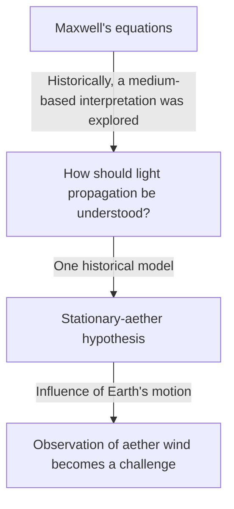

## 1. Introduction: The "Something" Believed to Fill the Universe

Throughout the history of humanity's attempts to unravel the mysteries of the natural world, the question of "how light travels through space" has fascinated and deeply troubled many geniuses, from ancient Greek philosophers to modern physicists.

Observing everyday physical phenomena, we see that media like "air" or "water" are necessary for sound to travel, and "seawater" is essential for ocean waves to propagate. From this highly intuitive and logical analogy, the idea was born that if light has wave-like properties, there must be an "unknown medium" for propagating light filling every corner of outer space. This phantom medium is what was called the "luminiferous aether".

For many 19th-century physicists, aether was an influential framework, but theories and interpretations were not uniform; its motion and interaction with matter remained debated. Experiments seeking an aether wind, together with later theoretical developments, prompted a reassessment of the classical medium for light and formed part of the history leading to relativity. This article traces the concept's origins, testing, and differences from ideas in modern physics.

## 2. The Debate Over the Nature of Light and the Birth of Aether

The debate over whether the true nature of light was a "particle" or a "wave" was fiercely fought during the scientific revolution of the 17th century.

Isaac Newton, based on the rectilinear propagation of light and the laws of reflection, proposed the "corpuscular theory of light," which stated that light is a flow of minute particles. Due to his overwhelming authority, the corpuscular theory dominated the physics community throughout the 18th century. However, around the same time, Christiaan Huygens argued that light should be considered a wave to explain phenomena such as diffraction and refraction, advocating the "wave theory of light."

In the 19th century, Young's interference experiments and Fresnel's theory provided strong evidence for explaining interference and diffraction as wave behavior. Wave-like behavior alone, however, does not logically require a mechanical medium in a vacuum. By analogy with known waves, many theories of the period proposed aether as a medium carrying light.

### The Bizarre Properties Required for Aether

However, assuming the medium of aether, physicists faced a serious contradiction. It had been discovered through polarization phenomena that light is a transverse wave (a wave oscillating perpendicular to the direction of propagation). In the framework of physics at the time, only "solids" could propagate transverse waves. Gases and liquids can only propagate longitudinal waves (such as sound waves).

In other words, the aether must be a "gigantic transparent solid" spreading throughout the universe. To propagate waves at the tremendous speed of light (about 300,000 kilometers per second), the aether must be far harder than steel and possess extremely strong elasticity. On the other hand, since the Earth and planets appear to experience no frictional resistance from the aether as they revolve around the Sun, the aether must also be completely frictionless, possessing an extremely rarefied nature that allows matter to pass through without resistance.

The aether was thus burdened with physically contradictory and bizarre properties: "being a solid harder than steel, yet having no resistance like a perfect fluid."

## 3. Maxwell's Electromagnetism and the Absolute Rest Frame of Aether

In the late 19th century, James Clerk Maxwell completed "Maxwell's equations," which form the foundation of electromagnetism. These equations not only perfectly described electrical and magnetic phenomena but also contained a surprising prediction. When the propagation speed of electromagnetic waves was calculated, it perfectly matched the "speed of light" measured in experiments at the time. This theoretically proved that "light is a type of electromagnetic wave."

In Maxwell's equations, the speed of light $c$ is derived as a constant determined by the permittivity and permeability of a vacuum. Here, a major problem arose. When we say "the speed of light is a constant," "relative to what" is it constant?

According to the principle of relativity in Newtonian mechanics, velocity should always change depending on the observer's state of motion. The speed of a ball thrown from a moving train is "the speed of the train + the speed of the ball" to a person on the ground. However, the speed of light in Maxwell's equations did not take into account the velocity of such observers.

Many theorists of the period explored interpretations that connected electromagnetic fields with a medium or preferred frame, including models with a stationary aether. Maxwell's equations themselves do not prove the existence of a mechanical medium or an absolute rest frame. In later relativistic formulations, the vacuum speed of light is invariant between inertial frames, so no privileged rest frame is required.

## 4. The Michelson-Morley Experiment: A Famous Null Result

If outer space is filled with aether at absolute rest, the Earth, revolving around the Sun, is constantly plowing through the sea of aether. From the Earth's perspective, an "aether wind" should be blowing from space.

In 1887, Albert Michelson and Edward Morley conducted a groundbreaking experiment to capture this "aether wind." They constructed an extremely precise optical device called the "Michelson interferometer."

The principle of the experiment is as follows. A single beam of light emitted from a light source is split into two orthogonal directions by a half-mirror (a semi-transparent mirror). One travels parallel to the aether wind, while the other travels perpendicularly, and they reflect back from mirrors at their respective ends. If the aether wind exists, just as a person swimming back and forth across a river is affected by the river's current, there should be a very slight difference in the time it takes for the light to travel back and forth. When the two returning light beams were recombined, this time difference was expected to be observed as a shift in "interference fringes."

The measurements did not detect the fringe displacement of the size predicted by a simple stationary-aether model. The paper gives an expected shift of about 0.4 fringe; the reported residual was far smaller, leading the authors to conclude that any relative motion of Earth and aether was well below the expected level of detection. This was not literally a zero shift: it is best understood as a null result for a particular classical aether-wind model.

The experiment produced a null result in the sense that it did not detect an aether-wind signal of the predicted size. This does not mean that the apparatus or measurements "failed." Its importance lies in constraining the signal predicted by a particular classical aether model and prompting further theoretical and experimental work.

## 5. Length Contraction and Ad-hoc Solutions

Physicists who took the experimental results seriously struggled to somehow salvage the aether theory. George FitzGerald and Hendrik Lorentz formed an astonishing hypothesis.

"When an object moves through the aether, doesn't the object itself contract slightly along the direction of motion due to the pressure of the aether wind?"

According to this "Lorentz-FitzGerald contraction hypothesis," the arm of the Michelson-Morley interferometer also contracts exactly along the direction of motion, canceling out the difference in the round-trip time of light, and as a result explaining why the aether wind could not be detected. Furthermore, Lorentz introduced the concept of time dilation in moving frames (local time) and completed a mathematical framework known as the "Lorentz transformations."

The contraction hypothesis and Lorentz's theory were attempts to reconcile the electrodynamics and experiments of their time. Calling them merely "ad hoc" in hindsight oversimplifies that theoretical and experimental context. Lorentz retained the idea of an absolute-rest aether, but the same mathematical framework later became central to special relativity, which does not require an aether rest frame.

## 6. Einstein and the Paradigm Shift: Special Relativity

In 1905, a young patent office clerk named Albert Einstein published a paper that fundamentally solved this complexly entangled problem from just two simple principles. This is the "Special Theory of Relativity."

Einstein stopped worrying about the properties of the aether and started from entirely new premises.
1. **Principle of Relativity**: The laws of physics take exactly the same form in all inertial frames (observers in uniform rectilinear motion). There is no such thing as an absolute rest frame.
2. **Principle of Invariant Speed of Light**: The speed of light in a vacuum is always constant (the constant $c$) for all observers, regardless of the state of motion of the light source or the observer.

Accepting these two principles leads to an astonishing conclusion. In order for the speed of light to always be constant, "space" must contract and the flow of "time" must slow down depending on the observer's state of motion. It became clear that the phenomenon Lorentz and others considered to be a "material contraction due to the aether" was actually a relative property of time and space themselves.

Special relativity, as presented in 1905, removed the need to assume a mechanical medium for light or an absolutely stationary space to describe electrodynamics. This does not logically forbid every use of the word "aether." In 1920 Einstein used the term in a different sense when discussing the physical properties of spacetime in general relativity; this was not a mechanical medium for light with a state of motion.

## 7. The "Vacuum" in Modern Physics: The Ghost of Aether

The aether was discarded as an unnecessary concept, but the idea that "empty space (vacuum)" is truly "empty" has also been denied by modern physics.

In quantum field theory, the vacuum is described as the lowest-energy state of fields, which have quantum fluctuations. Saying that particles and antiparticles are constantly being created and annihilated can misleadingly picture the vacuum as a literal sea of particles appearing and disappearing. Fields such as the electromagnetic and Higgs fields, and the description of particles as excitations of fields, are distinct from a classical mechanical aether.

Furthermore, in general relativity, Einstein described spacetime itself as a dynamic entity that is bent by gravity. Einstein himself later stated that in the sense that spacetime itself has physical properties, it "could be called an aether in a new sense" (though it is completely different from the 19th-century aether as an absolute rest medium).

It is not accurate to call dark matter or dark energy modern versions of a light-carrying aether. Dark matter is inferred mainly from gravitational effects and is described as not emitting, absorbing, or reflecting light. Dark energy is the name given to whatever accounts for the universe's accelerated expansion. Neither was proposed as a medium for light, and their physical meanings differ from that of the historical aether.

## 8. Conclusion: What the History of Science Teaches Us

The story of the luminiferous aether is an extremely beautiful example showing how science progresses.

The classical luminiferous aether is not needed as a medium for light in modern special relativity. Research motivated by the hypothesis prompted precise experiments and theoretical work, and became part of the history leading to relativity. The Michelson-Morley experiment alone did not disprove every possible meaning of "aether" or, by itself, produce relativity.

Failures and flawed premises in science are never in vain. They serve as essential stepping stones to illuminate uncharted territories. The phantom medium of luminiferous aether has disappeared from physics, but the insight into the "true nature of spacetime" that humanity gained in the process of its exploration continues to support our understanding of the universe today.
