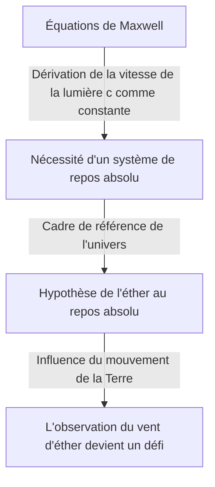

## 1. Introduction : Le "quelque chose" dont on croyait qu'il remplissait l'univers

Dans l'histoire des tentatives humaines pour percer les mystères de la nature, la question de savoir "comment la lumière se propage dans l'espace" a fasciné et profondément troublé de nombreux génies, des philosophes de la Grèce antique aux physiciens modernes.

L'observation des phénomènes physiques quotidiens montre que la transmission du son nécessite une matière telle que l'"air" ou l'"eau", et que la propagation des vagues de l'océan nécessite le milieu de l'"eau de mer". De cette analogie extrêmement intuitive et logique est née l'idée que si la lumière a la nature d'une onde, il doit y avoir un "milieu inconnu" pour transmettre la lumière qui remplit chaque recoin de l'espace. Ce milieu fantôme est ce qu'on appelait l'"éther luminifère" (Luminiferous aether).

Pour de nombreux physiciens du 19e siècle, l'éther constituait un cadre explicatif influent. Les théories et les interprétations n'étaient toutefois pas uniformes, et son mouvement ainsi que ses interactions avec la matière faisaient débat. Les expériences visant à détecter un vent d'éther, ainsi que les développements théoriques ultérieurs, ont conduit à réévaluer le milieu classique de la lumière et font partie de l'histoire qui a mené à la relativité. Cet article retrace l'origine du concept, sa mise à l'épreuve et ses différences avec les idées de la physique moderne.

## 2. Le débat sur la nature de la lumière et la naissance de l'éther

Le débat sur la question de savoir si la nature de la lumière est "particule" ou "onde" a été farouchement disputé lors de la révolution scientifique du 17ème siècle.

Isaac Newton, se basant sur la propagation rectiligne de la lumière et les lois de la réflexion, a proposé la "théorie corpusculaire de la lumière", selon laquelle la lumière est un flux de minuscules particules. En raison de son autorité écrasante, la théorie corpusculaire a dominé la communauté de la physique tout au long du 18ème siècle. Cependant, à la même époque, Christiaan Huygens soutenait que la lumière devait être considérée comme une onde pour expliquer des phénomènes tels que la diffraction et la réfraction de la lumière, prônant la "théorie ondulatoire de la lumière".

Au 19e siècle, les expériences d'interférence de Young et la théorie de Fresnel ont fourni des éléments solides pour expliquer l'interférence et la diffraction comme des comportements ondulatoires de la lumière. Ce comportement ondulatoire ne démontre toutefois pas, à lui seul, l'existence logique d'un milieu mécanique dans le vide. Par analogie avec les ondes connues, de nombreuses théories de l'époque ont proposé l'éther comme milieu de propagation de la lumière.

### Les propriétés étranges exigées de l'éther

Cependant, en postulant le milieu de l'éther, les physiciens ont été confrontés à une contradiction profonde. Il a été révélé par la découverte du phénomène de polarisation que la lumière est une onde transversale (une onde oscillant perpendiculairement à la direction de propagation). Dans le cadre de la physique de l'époque, seul un "solide" pouvait transmettre des ondes transversales. Les gaz et les liquides ne peuvent transmettre que des ondes longitudinales (comme les ondes sonores).

En d'autres termes, l'éther devait être un "solide transparent géant" s'étendant à travers l'univers. Pour transmettre des ondes à la vitesse stupéfiante de la lumière (environ 300 000 kilomètres par seconde), l'éther devait être beaucoup plus dur que l'acier et posséder une élasticité extrêmement forte. D'un autre côté, puisque la Terre et les planètes ne semblent subir aucune résistance de frottement de la part de l'éther lorsqu'elles gravitent autour du soleil, l'éther devait être complètement sans frottement et posséder la propriété extrêmement raréfiée de laisser passer la matière sans résistance.

L'éther s'est retrouvé affublé de cette étrange propriété, logiquement contradictoire en physique : "être un solide plus dur que l'acier, mais sans résistance comme un fluide parfait".

## 3. L'électromagnétisme de Maxwell et le système de repos absolu de l'éther

À la fin du 19ème siècle, James Clerk Maxwell a achevé les "équations de Maxwell", qui constituent le fondement de l'électromagnétisme. Ces équations décrivaient non seulement parfaitement les phénomènes de l'électricité et du magnétisme, mais contenaient également une prédiction surprenante. Lorsqu'il a calculé la vitesse de propagation des ondes électromagnétiques, elle correspondait parfaitement à la "vitesse de la lumière" mesurée dans les expériences de l'époque. Cela a prouvé théoriquement que "la lumière est un type d'onde électromagnétique".

Dans les équations de Maxwell, la vitesse de la lumière $c$ est dérivée comme une constante déterminée par la permittivité et la perméabilité du vide. C'est ici qu'un problème majeur s'est posé. Quand on dit que "la vitesse de la lumière est constante", par rapport à "quoi" est-elle constante ?

Selon le principe de relativité de la mécanique newtonienne, la vitesse devrait toujours changer en fonction de l'état de mouvement de l'observateur. La vitesse d'une balle lancée depuis un train en marche sera la "vitesse du train + la vitesse de la balle" du point de vue d'une personne au sol. Cependant, la vitesse de la lumière dans les équations de Maxwell ne tenait pas compte d'une telle vitesse de l'observateur.

De nombreux théoriciens de l'époque ont étudié des interprétations reliant les champs électromagnétiques à un milieu ou à un référentiel privilégié ; certaines supposaient un éther stationnaire. Les équations de Maxwell, à elles seules, ne démontrent cependant ni l'existence d'un milieu mécanique ni celle d'un référentiel au repos absolu. Dans les formulations relativistes ultérieures, la vitesse de la lumière dans le vide est invariante entre référentiels inertiels, et aucun référentiel privilégié au repos n'est nécessaire.

## 4. L'expérience de Michelson-Morley : Un résultat nul célèbre

Si l'espace est rempli d'un éther au repos absolu, la Terre, en orbite autour du soleil, traverserait constamment la mer d'éther. Du point de vue de la Terre, un "vent d'éther" devrait souffler depuis l'espace.

En 1887, Albert Michelson et Edward Morley ont mené une expérience révolutionnaire pour capturer ce "vent d'éther". Ils ont construit un dispositif optique extrêmement précis appelé "interféromètre de Michelson".

Le principe de l'expérience est le suivant : un faisceau de lumière émis par une source lumineuse est divisé par un miroir semi-réfléchissant en deux directions orthogonales. L'un voyage dans une direction parallèle au vent d'éther, et l'autre dans une direction perpendiculaire, et ils sont réfléchis par des miroirs à chaque extrémité pour revenir. Si le vent d'éther existe, tout comme une personne nageant en faisant des allers-retours dans une rivière est affectée par le courant, il devrait y avoir une infime différence dans le temps d'aller-retour de la lumière. Lorsque les deux faisceaux de lumière renvoyés sont superposés, cette différence de temps devait pouvoir être observée comme un déplacement des "franges d'interférence".

Les mesures n'ont pas détecté de déplacement des franges d'interférence de l'ampleur prévue par un modèle simple d'éther stationnaire. L'article indique un déplacement attendu d'environ 0,4 frange ; le résidu rapporté était bien inférieur. Les auteurs ont conclu que tout mouvement relatif entre la Terre et l'éther se situait très en dessous du niveau de détection attendu. Cela ne signifie pas que le déplacement était littéralement nul : il est plus exact de comprendre le résultat comme un résultat nul pour un modèle classique particulier du vent d'éther.

L'expérience a donné un résultat nul en ce sens qu'elle n'a pas détecté de signal de vent d'éther de l'ampleur prévue. Cela ne signifie pas que l'appareil ou les mesures ont « échoué ». Son importance est d'avoir contraint le signal prédit par un modèle classique particulier de l'éther et d'avoir encouragé d'autres travaux théoriques et expérimentaux.

## 5. Contraction de Lorentz et solutions ad hoc

Les physiciens, prenant au sérieux les résultats de l'expérience, ont lutté pour sauver la théorie de l'éther d'une manière ou d'une autre. George FitzGerald et Hendrik Lorentz ont formulé une hypothèse surprenante.

"Lorsqu'un objet se déplace dans l'éther, l'objet lui-même ne pourrait-il pas se contracter légèrement le long de la direction du mouvement en raison de la pression du vent d'éther ?"

Selon cette "hypothèse de contraction de Lorentz-FitzGerald", le bras de l'interféromètre de Michelson-Morley se contracterait également précisément le long de la direction du mouvement, annulant la différence dans le temps d'aller-retour de la lumière, ce qui expliquerait pourquoi le vent d'éther ne pouvait pas être détecté. De plus, Lorentz a introduit le concept de dilatation du temps (temps local) dans un système en mouvement et a achevé un cadre mathématique appelé "transformation de Lorentz".

L'hypothèse de contraction et la théorie de Lorentz étaient des tentatives visant à concilier l'électrodynamique et les expériences de leur époque. Les réduire rétrospectivement à de simples solutions ad hoc simplifie à l'excès ce contexte théorique et expérimental. Lorentz a conservé l'idée d'un éther au repos absolu, mais le même cadre mathématique est ensuite devenu central en relativité restreinte, qui ne suppose pas de référentiel au repos de l'éther.

## 6. Einstein et le changement de paradigme : la théorie de la relativité restreinte

En 1905, un jeune employé du bureau des brevets, Albert Einstein, a publié un article qui a fondamentalement résolu ce problème complexe en partant de seulement deux principes simples. C'est la "théorie de la relativité restreinte".

Einstein a cessé de s'inquiéter des propriétés de l'éther et est parti de prémisses complètement nouvelles.
1. **Principe de relativité** : Dans tous les référentiels inertiels (observateurs en mouvement rectiligne uniforme), les lois de la physique s'appliquent exactement sous la même forme. Il n'existe pas de système au repos absolu.
2. **Principe de la constance de la vitesse de la lumière** : La vitesse de la lumière dans le vide est toujours constante (constante $c$) pour tous les observateurs, quel que soit l'état de mouvement de la source lumineuse ou de l'observateur.

Accepter ces deux principes conduit à une conclusion surprenante. Pour que la vitesse de la lumière soit toujours constante, l'"espace" doit se contracter et l'écoulement du "temps" doit ralentir en fonction de l'état de mouvement de l'observateur. Il est devenu clair que le phénomène que Lorentz et d'autres pensaient être une "contraction matérielle due à l'éther" était en fait une propriété relative de l'espace et du temps eux-mêmes.

La relativité restreinte, telle qu'Einstein l'a présentée en 1905, a supprimé la nécessité de supposer un milieu mécanique pour la lumière ou un espace absolument stationnaire afin de décrire l'électrodynamique. Cela n'interdit pas logiquement tout emploi du mot « éther ». En 1920, Einstein a utilisé le terme dans un autre sens en évoquant les propriétés physiques de l'espace-temps en relativité générale ; il ne désignait pas un milieu mécanique de la lumière doté d'un état de mouvement.

## 7. Le "vide" dans la physique moderne : le fantôme de l'éther

Bien que l'éther ait été rejeté comme un concept inutile, l'idée que "l'espace vide (le vide)" est véritablement "vide" a également été démentie par la physique moderne.

En théorie quantique des champs, le vide est décrit comme l'état de plus basse énergie des champs, qui présentent des fluctuations quantiques. Dire que des particules et des antiparticules sont constamment créées et annihilées peut donner à tort l'image d'une mer littérale de particules qui apparaissent et disparaissent sans cesse. Les champs, comme le champ électromagnétique et le champ de Higgs, ainsi que la description des particules comme des excitations de ces champs, sont distincts d'un éther mécanique classique.

De plus, dans la théorie de la relativité générale, Einstein a décrit l'espace-temps lui-même comme une entité dynamique courbée par la gravité. Einstein lui-même a déclaré dans ses dernières années que dans le sens où l'espace-temps lui-même possède des propriétés physiques, il "pourrait être appelé un éther dans un sens nouveau" (bien que ce soit complètement différent de l'éther du 19ème siècle en tant que milieu au repos absolu).

Il n'est pas exact de qualifier la matière noire ou l'énergie noire de versions modernes d'un éther qui transporte la lumière. La matière noire est principalement déduite de ses effets gravitationnels et est décrite comme n'émettant, n'absorbant ni ne réfléchissant la lumière. L'énergie noire est le nom donné à ce qui expliquerait l'expansion accélérée de l'Univers. Ni l'une ni l'autre n'a été proposée comme milieu de propagation de la lumière, et leur signification physique est différente.

## 8. Conclusion : Ce que l'histoire des sciences nous apprend

L'histoire de l'éther luminifère est un exemple extrêmement beau de la façon dont la science progresse.

La relativité restreinte moderne n'a pas besoin de l'éther luminifère classique comme milieu de propagation de la lumière. Les recherches motivées par cette hypothèse ont encouragé des expériences précises et des travaux théoriques, et font partie de l'histoire qui a mené à la relativité. À lui seul, l'expérience de Michelson-Morley n'a ni réfuté tous les sens possibles du mot « éther » ni produit la théorie de la relativité.

Les échecs et les prémisses erronées en science ne sont jamais vains. Ils servent de tremplins indispensables pour éclairer des territoires inconnus. Le milieu fantôme de l'éther luminifère a disparu de la physique, mais les connaissances sur "la vraie nature de l'espace-temps" que l'humanité a acquises au cours de son exploration continuent de soutenir notre compréhension de l'univers aujourd'hui.
