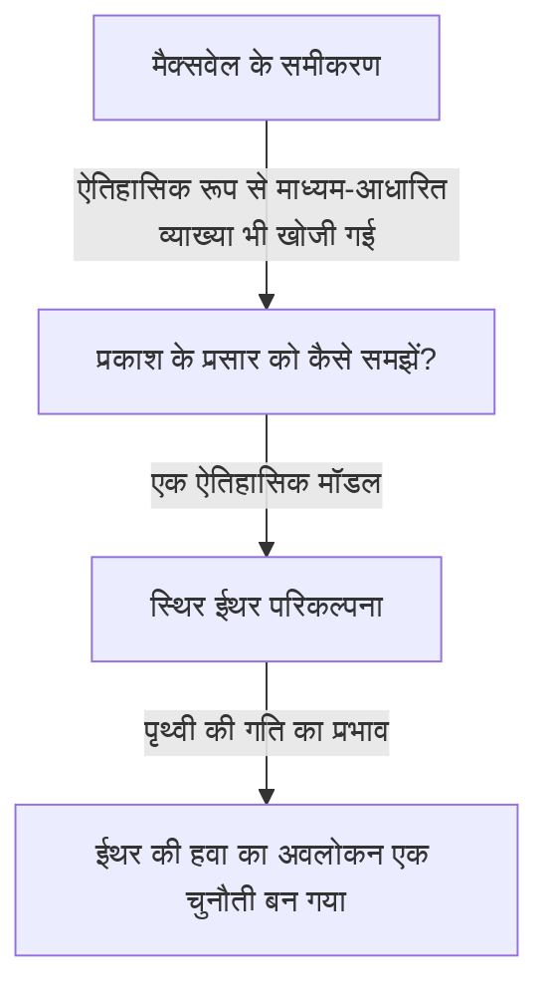

## 1. परिचय: 'वह क्या था' जिसे ब्रह्मांड को भरने वाला माना जाता था

प्रकृति के रहस्यों को उजागर करने के मानव इतिहास में, "प्रकाश अंतरिक्ष में कैसे यात्रा करता है?" इस प्रश्न ने प्राचीन यूनानी दार्शनिकों से लेकर आधुनिक भौतिकविदों तक कई प्रतिभाओं को आकर्षित किया है और उन्हें बहुत परेशान भी किया है।

रोजमर्रा की भौतिक घटनाओं को देखने पर पता चलता है कि ध्वनि के संचरण के लिए "हवा" या "पानी" जैसे पदार्थों की आवश्यकता होती है, और समुद्र की लहरों को आगे बढ़ने के लिए "समुद्री जल" नामक माध्यम आवश्यक है। इस अत्यंत सहज और तार्किक सादृश्य से यह विचार उत्पन्न हुआ कि यदि प्रकाश में तरंगों के गुण हैं, तो ब्रह्मांड के हर कोने में प्रकाश को प्रसारित करने के लिए एक "अज्ञात माध्यम" भरा होना चाहिए। इस भ्रामक माध्यम को "प्रकाशयुक्त ईथर (Luminiferous aether)" कहा गया।

19वीं सदी के अनेक भौतिकविदों के लिए ईथर एक प्रभावशाली व्याख्यात्मक ढाँचा था। फिर भी, सिद्धांत और व्याख्याएँ एक जैसी नहीं थीं; ईथर की गति और पदार्थ के साथ उसकी अंतःक्रिया पर बहस जारी थी। ईथर-वायु खोजने वाले प्रयोगों और बाद के सैद्धांतिक विकासों ने प्रकाश के शास्त्रीय माध्यम पर पुनर्विचार को प्रेरित किया और सापेक्षता तक पहुँचने वाले इतिहास का हिस्सा बने। यह लेख इस अवधारणा की उत्पत्ति, परीक्षण और आधुनिक भौतिकी के विचारों से उसके अंतर का परिचय देता है।

## 2. प्रकाश की प्रकृति पर विवाद और ईथर का जन्म

प्रकाश की वास्तविक प्रकृति "कण" है या "तरंग", इस पर 17वीं शताब्दी की वैज्ञानिक क्रांति के दौरान तीखी बहस हुई थी।

आइजैक न्यूटन ने प्रकाश के सीधी रेखा में चलने और परावर्तन के नियमों के आधार पर "प्रकाश का कण सिद्धांत" प्रस्तावित किया, जिसमें तर्क दिया गया कि प्रकाश सूक्ष्म कणों का प्रवाह है। उनके जबरदस्त प्रभाव के कारण, कण सिद्धांत का 18वीं शताब्दी के दौरान भौतिकी की दुनिया पर दबदबा रहा। हालांकि, उसी समय, क्रिश्चियन हाइगेंस ने तर्क दिया कि विवर्तन और अपवर्तन जैसी घटनाओं को समझाने के लिए प्रकाश को तरंगों के रूप में माना जाना चाहिए, और उन्होंने "प्रकाश का तरंग सिद्धांत" प्रस्तुत किया।

19वीं सदी में यंग के व्यतिकरण प्रयोगों और फ्रेनेल के सिद्धांत ने व्यतिकरण तथा विवर्तन को प्रकाश के तरंग-व्यवहार के रूप में समझाने के लिए मजबूत प्रमाण दिए। लेकिन केवल तरंग-जैसा व्यवहार यह तार्किक रूप से सिद्ध नहीं करता कि निर्वात में कोई यांत्रिक माध्यम मौजूद है। उस समय ज्ञात तरंगों से तुलना के आधार पर कई सिद्धांतों ने ईथर को प्रकाश का वाहक माध्यम माना।

### ईथर के अजीबोगरीब गुण

हालाँकि, ईथर को माध्यम मानने से भौतिकविदों को गंभीर विरोधाभासों का सामना करना पड़ा। ध्रुवीकरण की घटना की खोज से यह स्पष्ट हो गया था कि प्रकाश एक अनुप्रस्थ तरंग (Transverse wave) है (ऐसी तरंग जो यात्रा की दिशा के लंबवत कंपन करती है)। उस समय के भौतिकी के ढांचे में, केवल "ठोस" पदार्थ ही अनुप्रस्थ तरंगों को संचारित कर सकते थे। गैसें और तरल पदार्थ केवल अनुदैर्ध्य तरंगों (Longitudinal waves, जैसे ध्वनि तरंगें) को ही संचारित कर सकते हैं।

दूसरे शब्दों में, ईथर को पूरे ब्रह्मांड में फैला एक "विशाल पारदर्शी ठोस" होना चाहिए। प्रकाश की गति (लगभग 300,000 किलोमीटर प्रति सेकंड) जैसी अत्यधिक गति से तरंगों को प्रसारित करने के लिए, ईथर को स्टील से भी अधिक कठोर होना चाहिए और इसमें अत्यंत मजबूत लोच (elasticity) होनी चाहिए। दूसरी ओर, जब पृथ्वी और ग्रह सूर्य की परिक्रमा करते हैं, तो ऐसा लगता है कि वे ईथर से किसी भी घर्षण प्रतिरोध का अनुभव नहीं करते हैं, इसलिए ईथर को पूरी तरह से घर्षण रहित होना चाहिए और इसमें एक अत्यंत विरल गुण होना चाहिए जो पदार्थों को बिना किसी प्रतिरोध के गुजरने दे।

इस प्रकार ईथर पर भौतिक दृष्टिकोण से एक अजीब और विरोधाभासी प्रकृति थोप दी गई थी: "यह स्टील से भी कठोर ठोस होना चाहिए, लेकिन एक आदर्श तरल पदार्थ की तरह प्रतिरोध-रहित होना चाहिए।"

## 3. मैक्सवेल का विद्युत चुंबकत्व और ईथर का पूर्ण विश्राम संदर्भ

19वीं सदी के उत्तरार्ध में, जेम्स क्लर्क मैक्सवेल ने "मैक्सवेल के समीकरण" पूरे किए जो विद्युत चुंबकत्व की नींव बने। इन समीकरणों ने न केवल विद्युत और चुंबकीय घटनाओं का पूरी तरह से वर्णन किया, बल्कि इनमें एक आश्चर्यजनक भविष्यवाणी भी शामिल थी। जब उन्होंने विद्युत चुम्बकीय तरंगों के प्रसार की गति की गणना की, तो यह उस समय के प्रयोगों में मापी गई "प्रकाश की गति" से पूरी तरह मेल खाती थी। इसने सैद्धांतिक रूप से यह साबित कर दिया कि "प्रकाश एक प्रकार की विद्युत चुम्बकीय तरंग है।"

मैक्सवेल के समीकरणों में, प्रकाश की गति $c$ को एक स्थिरांक के रूप में लिया गया है जो निर्वात की विद्युतशीलता (permittivity) और चुंबकशीलता (permeability) द्वारा निर्धारित होता है। यहां एक बड़ी समस्या उत्पन्न हुई। जब हम कहते हैं कि "प्रकाश की गति स्थिर है," तो यह "किसके सापेक्ष" स्थिर है?

न्यूटोनियन यांत्रिकी के सापेक्षता सिद्धांत के अनुसार, गति हमेशा पर्यवेक्षक की गति की स्थिति के आधार पर बदलनी चाहिए। चलती ट्रेन से फेंकी गई गेंद की गति जमीन पर खड़े व्यक्ति को "ट्रेन की गति + गेंद की गति" प्रतीत होगी। हालाँकि, मैक्सवेल के समीकरणों में प्रकाश की गति ने पर्यवेक्षक की गति पर विचार नहीं किया था।

उस समय के अनेक सिद्धांतकारों ने विद्युतचुंबकीय क्षेत्रों को किसी माध्यम या विशेष संदर्भ-ढाँचे से जोड़ने वाली व्याख्याओं पर विचार किया; इनमें स्थिर ईथर वाले मॉडल भी थे। लेकिन मैक्सवेल के समीकरण अपने-आप किसी यांत्रिक माध्यम या पूर्ण विश्राम-ढाँचे का अस्तित्व सिद्ध नहीं करते। बाद के सापेक्षतावादी सूत्रीकरणों में निर्वात में प्रकाश की गति जड़त्वीय संदर्भ-ढाँचों के बीच अपरिवर्तित रहती है, इसलिए किसी विशेष विश्राम-ढाँचे को मानने की आवश्यकता नहीं है।

## 4. माइकलसन-मोर्ले का प्रयोग: एक प्रसिद्ध नकारात्मक परिणाम

यदि अंतरिक्ष पूरी तरह से स्थिर ईथर से भरा है, तो सूर्य की परिक्रमा करने वाली पृथ्वी लगातार ईथर के समुद्र से होकर गुजर रही है। पृथ्वी के दृष्टिकोण से, ऐसा प्रतीत होना चाहिए कि अंतरिक्ष से "ईथर की हवा" बह रही है।

1887 में, अल्बर्ट माइकलसन और एडवर्ड मोर्ले ने इस "ईथर की हवा" का पता लगाने के लिए एक अभूतपूर्व प्रयोग किया। उन्होंने "माइकलसन इंटरफेरोमीटर" नामक एक अत्यंत सटीक ऑप्टिकल उपकरण का निर्माण किया।

प्रयोग का सिद्धांत इस प्रकार है: एक प्रकाश स्रोत से निकलने वाले प्रकाश की किरण को हाफ-मिरर (अर्ध-पारदर्शी दर्पण) द्वारा दो लंबवत दिशाओं में विभाजित किया जाता है। एक किरण ईथर की हवा के समानांतर चलती है, और दूसरी इसके लंबवत चलती है। वे संबंधित दर्पणों से परावर्तित होकर वापस आती हैं। यदि ईथर की हवा मौजूद है, तो प्रकाश को वापस आने में लगने वाले समय में मामूली अंतर होना चाहिए, ठीक उसी तरह जैसे नदी में आगे-पीछे तैरने वाला व्यक्ति नदी के प्रवाह से प्रभावित होता है। यह उम्मीद की गई थी कि जब वापस आने वाली दो प्रकाश किरणों को जोड़ा जाएगा, तो समय के अंतर को "व्यतिकरण फ्रिंज" (interference fringes) में बदलाव के रूप में देखा जा सकेगा।

मापन में सरल स्थिर-ईथर मॉडल द्वारा अनुमानित आकार का व्यतिकरण-धारी विस्थापन नहीं मिला। मूल लेख में लगभग 0.4 धारी का अपेक्षित विस्थापन दिया गया है; रिपोर्ट किया गया शेष प्रभाव इससे बहुत छोटा था। लेखकों ने निष्कर्ष निकाला कि पृथ्वी और ईथर के बीच कोई भी सापेक्ष गति अपेक्षित पहचान-सीमा से काफी कम थी। इसका अर्थ यह नहीं कि विस्थापन अक्षरशः शून्य था; इसे एक विशिष्ट शास्त्रीय ईथर-वायु मॉडल के लिए नकारात्मक परिणाम समझना अधिक सही है।

यह प्रयोग इस अर्थ में नकारात्मक परिणाम था कि इसमें अनुमानित आकार का ईथर-वायु संकेत नहीं मिला। इसका अर्थ यह नहीं कि उपकरण या मापन "विफल" हुए। इसका महत्व यह था कि इसने एक विशिष्ट शास्त्रीय ईथर मॉडल के अनुमानित संकेत पर सीमा लगाई और आगे के सैद्धांतिक तथा प्रायोगिक कार्य को प्रेरित किया।

## 5. लोरेंत्ज़ संकुचन और तदर्थ (Ad hoc) समाधान

प्रयोग के परिणामों को गंभीरता से लेते हुए, भौतिकविदों ने ईथर सिद्धांत को बचाने के लिए संघर्ष किया। जॉर्ज फिट्ज़गेराल्ड और हेंड्रिक लोरेंत्ज़ ने एक चौंकाने वाली परिकल्पना प्रस्तुत की।

"जब कोई वस्तु ईथर के माध्यम से चलती है, तो क्या वह ईथर की हवा के दबाव के कारण गति की दिशा में थोड़ी सिकुड़ नहीं जाती है?"

इस "लोरेंत्ज़-फिट्ज़गेराल्ड संकुचन परिकल्पना" के अनुसार, माइकलसन-मोर्ले इंटरफेरोमीटर के हाथ भी गति की दिशा में ठीक से सिकुड़ जाते हैं, जिससे प्रकाश के आने-जाने के समय का अंतर रद्द हो जाता है और परिणामस्वरूप ईथर की हवा का पता नहीं लगाया जा सकता। इसके अतिरिक्त, लोरेंत्ज़ ने चलती हुई प्रणालियों में समय के फैलाव (स्थानीय समय) की अवधारणा पेश की और "लोरेंत्ज़ परिवर्तन" नामक गणितीय ढांचा पूरा किया।

संकुचन परिकल्पना और लोरेंत्ज़ का सिद्धांत अपने समय के विद्युतगतिकी तथा प्रयोगों में सामंजस्य बैठाने के प्रयास थे। उन्हें पीछे मुड़कर केवल तदर्थ समाधान कहना उस सैद्धांतिक और प्रायोगिक संदर्भ को जरूरत से ज्यादा सरल बना देता है। लोरेंत्ज़ पूर्ण स्थिर ईथर की धारणा पर कायम रहे, लेकिन यही गणितीय ढाँचा बाद में विशेष सापेक्षता के लिए भी केंद्रीय बना, जिसमें ईथर का विश्राम-ढाँचा आवश्यक नहीं है।

## 6. आइंस्टीन और प्रतिमान विस्थापन (Paradigm Shift): विशेष सापेक्षता का सिद्धांत

1905 में, पेटेंट कार्यालय के एक युवा कर्मचारी अल्बर्ट आइंस्टीन ने एक पेपर प्रकाशित किया जिसने केवल दो सरल सिद्धांतों के आधार पर इस उलझी हुई समस्या को मौलिक रूप से हल कर दिया। यही "विशेष सापेक्षता का सिद्धांत" है।

आइंस्टीन ने ईथर के गुणों के बारे में चिंता करना छोड़ दिया और पूरी तरह से नए आधार से शुरुआत की।
1. **सापेक्षता का सिद्धांत**: भौतिकी के नियम सभी जड़त्वीय संदर्भ प्रणालियों (निरंतर वेग से एक सीधी रेखा में चलने वाले पर्यवेक्षक) में बिल्कुल समान रूप से लागू होते हैं। पूर्ण विश्राम का कोई संदर्भ (absolute rest frame) मौजूद नहीं है।
2. **प्रकाश की गति की स्थिरता का सिद्धांत**: निर्वात में प्रकाश की गति सभी पर्यवेक्षकों के लिए हमेशा स्थिर (स्थिरांक $c$) होती है, भले ही प्रकाश स्रोत की गति की स्थिति या पर्यवेक्षक की गति की स्थिति कुछ भी हो।

इन दोनों सिद्धांतों को स्वीकार करने पर आश्चर्यजनक निष्कर्ष निकलते हैं। प्रकाश की गति हमेशा स्थिर रहने के लिए, पर्यवेक्षक की गति की स्थिति के अनुसार "अंतरिक्ष" को सिकुड़ना चाहिए और "समय" को धीमा होना चाहिए। लोरेंत्ज़ और अन्य लोगों ने जिसे "ईथर के कारण भौतिक संकुचन" माना था, वह वास्तव में समय और स्थान की सापेक्ष प्रकृति के रूप में सामने आया।

1905 में आइंस्टीन द्वारा प्रस्तुत विशेष सापेक्षता ने विद्युतगतिकी का वर्णन करने के लिए प्रकाश के यांत्रिक माध्यम या पूर्णतः स्थिर अंतरिक्ष को मानने की आवश्यकता समाप्त कर दी। इसका अर्थ यह नहीं कि "ईथर" शब्द का हर उपयोग तार्किक रूप से निषिद्ध है। 1920 में आइंस्टीन ने सामान्य सापेक्षता में स्पेसटाइम के भौतिक गुणों की चर्चा करते हुए इस शब्द का एक अलग अर्थ में उपयोग किया था; उनका आशय गति-अवस्था वाले यांत्रिक प्रकाश-माध्यम से नहीं था।

## 7. आधुनिक भौतिकी में 'निर्वात': ईथर का भूत

ईथर को एक अनावश्यक अवधारणा के रूप में त्याग दिया गया था, लेकिन यह विचार भी कि "खाली स्थान (निर्वात)" वास्तव में "खाली" है, आधुनिक भौतिकी द्वारा खारिज कर दिया गया है।

क्वांटम क्षेत्र सिद्धांत में निर्वात को क्षेत्रों की न्यूनतम-ऊर्जा अवस्था के रूप में वर्णित किया जाता है; इन क्षेत्रों में क्वांटम उतार-चढ़ाव होते हैं। यह कहना कि कण और प्रतिकण लगातार बनते और नष्ट होते रहते हैं, निर्वात को सचमुच ऐसे कणों के समुद्र के रूप में दिखा सकता है जो लगातार प्रकट और लुप्त हो रहे हों; यह भ्रामक चित्रण है। विद्युतचुंबकीय और हिग्स क्षेत्र तथा कणों को इन क्षेत्रों की उत्तेजनाओं के रूप में समझना, शास्त्रीय यांत्रिक ईथर से अलग है।

इसके अलावा, सामान्य सापेक्षता के सिद्धांत में, आइंस्टीन ने वर्णित किया कि स्पेसटाइम (Spacetime) स्वयं एक गतिशील इकाई है जो गुरुत्वाकर्षण से मुड़ जाती है। बाद के वर्षों में, आइंस्टीन ने स्वयं भी कहा था कि जिस अर्थ में स्पेसटाइम के भौतिक गुण होते हैं, "इसे एक नए अर्थ में ईथर भी कहा जा सकता है" (हालांकि यह 19वीं सदी के पूर्ण स्थिर माध्यम ईथर से बिल्कुल अलग है)।

डार्क मैटर या डार्क एनर्जी को प्रकाश-वहन करने वाले ईथर का आधुनिक रूप कहना सही नहीं है। डार्क मैटर का अनुमान मुख्यतः उसके गुरुत्वीय प्रभावों से लगाया जाता है और उसका वर्णन ऐसे पदार्थ के रूप में किया जाता है जो प्रकाश उत्सर्जित, अवशोषित या परावर्तित नहीं करता। डार्क एनर्जी उस कारण का नाम है जो ब्रह्मांड के त्वरित विस्तार की व्याख्या करता है। इनमें से किसी को भी प्रकाश के माध्यम के रूप में प्रस्तावित नहीं किया गया; इनके भौतिक अर्थ अलग हैं।

## 8. निष्कर्ष: विज्ञान का इतिहास हमें क्या सिखाता है

प्रकाशयुक्त ईथर की कहानी इस बात का अत्यंत सुंदर उदाहरण है कि विज्ञान कैसे प्रगति करता है।

आधुनिक विशेष सापेक्षता में प्रकाश के माध्यम के रूप में शास्त्रीय प्रकाशयुक्त ईथर की आवश्यकता नहीं है। इस परिकल्पना से प्रेरित शोध ने सटीक प्रयोगों और सैद्धांतिक कार्य को बढ़ावा दिया और सापेक्षता तक पहुँचने वाले इतिहास का हिस्सा बना। माइकलसन-मोर्ले का प्रयोग अकेले "ईथर" शब्द के हर संभावित अर्थ को खारिज नहीं करता था और न ही उसने अकेले सापेक्षता का सिद्धांत उत्पन्न किया।

विज्ञान में असफलताएँ और गलत मान्यताएँ कभी व्यर्थ नहीं जाती हैं। वे अज्ञात क्षेत्रों को रोशन करने के लिए एक अनिवार्य आधार के रूप में काम करते हैं। हालाँकि प्रकाशयुक्त ईथर का भ्रामक माध्यम भौतिकी से गायब हो गया, लेकिन इस खोज की प्रक्रिया के माध्यम से मानवता द्वारा प्राप्त "द रियल नेचर ऑफ स्पेसटाइम (अंतरिक्ष-समय का वास्तविक स्वरूप)" का ज्ञान आज भी ब्रह्मांड की हमारी समझ का समर्थन करता है।
