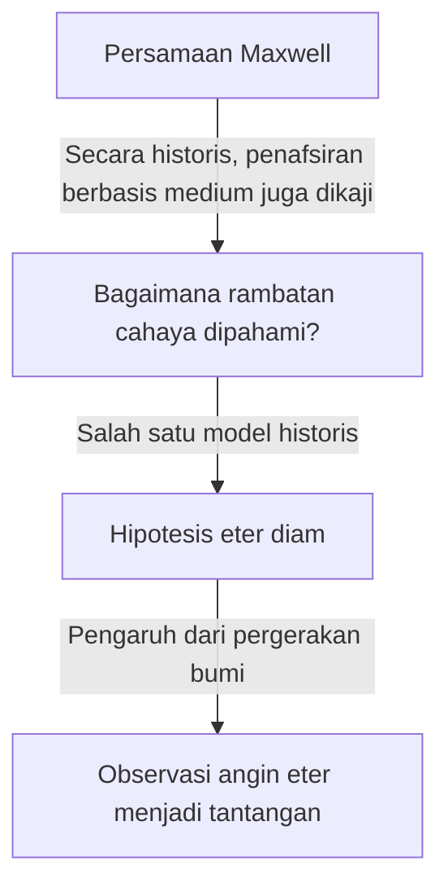

## 1. Pendahuluan: "Sesuatu" yang Diyakini Memenuhi Alam Semesta

Dalam sejarah umat manusia yang berusaha mengungkap misteri alam, pertanyaan tentang "bagaimana cahaya merambat melalui ruang" telah memikat dan juga membingungkan banyak ilmuwan jenius, dari filsuf Yunani kuno hingga fisikawan modern.

Mengamati fenomena fisika sehari-hari, "udara" atau "air" diperlukan agar suara dapat merambat, dan medium seperti "air laut" sangat penting agar gelombang laut dapat merambat. Dari analogi yang sangat intuitif dan logis ini, muncullah gagasan bahwa jika cahaya memiliki sifat gelombang, maka harus ada "medium tak dikenal" untuk merambatkan cahaya yang memenuhi setiap sudut ruang angkasa. Medium ilusi inilah yang disebut "Eter pembawa cahaya (Luminiferous aether)".

Bagi banyak fisikawan abad ke-19, eter merupakan kerangka penjelasan yang berpengaruh. Namun, teori dan penafsirannya tidak seragam; gerak eter dan interaksinya dengan materi masih diperdebatkan. Eksperimen untuk mencari angin eter, bersama perkembangan teori sesudahnya, mendorong peninjauan ulang terhadap medium cahaya klasik dan menjadi bagian dari sejarah yang mengarah pada relativitas. Artikel ini menelusuri asal-usul konsep tersebut, pengujiannya, dan perbedaannya dari gagasan dalam fisika modern.

## 2. Perdebatan Seputar Sifat Asli Cahaya dan Lahirnya Eter

Perdebatan tentang apakah sifat asli cahaya adalah "partikel" atau "gelombang" berlangsung sengit selama era Revolusi Ilmiah di abad ke-17.

Isaac Newton, berdasarkan hukum perambatan lurus dan pemantulan cahaya, mengusulkan "teori partikel cahaya" yang menyatakan bahwa cahaya adalah aliran partikel kecil. Melalui otoritasnya yang luar biasa, teori partikel mendominasi dunia fisika sepanjang abad ke-18. Namun, pada era yang sama, Christiaan Huygens berpendapat bahwa cahaya harus dianggap sebagai gelombang (fluktuasi) untuk menjelaskan fenomena seperti difraksi dan pembiasan cahaya, sehingga ia mengemukakan "teori gelombang cahaya".

Pada abad ke-19, eksperimen interferensi Young dan teori Fresnel memberikan bukti kuat untuk menjelaskan interferensi dan difraksi sebagai perilaku gelombang cahaya. Namun, perilaku seperti gelombang saja tidak secara logis membuktikan adanya medium mekanis di dalam vakum. Berdasarkan analogi dengan gelombang yang telah dikenal, banyak teori pada masa itu mengusulkan eter sebagai medium pembawa cahaya.

### Sifat Aneh yang Diharapkan dari Eter

Namun, dengan mengasumsikan medium eter, para fisikawan menghadapi kontradiksi yang serius. Penemuan fenomena polarisasi mengungkapkan bahwa cahaya adalah gelombang transversal (gelombang yang bergetar tegak lurus terhadap arah rambatannya). Dalam kerangka fisika saat itu, hanya "benda padat" yang dapat merambatkan gelombang transversal. Gas dan cairan hanya dapat merambatkan gelombang longitudinal (seperti gelombang suara).

Dengan kata lain, eter harus berupa "benda padat transparan raksasa" yang menyebar ke seluruh alam semesta. Untuk merambatkan gelombang dengan kecepatan yang sangat luar biasa seperti kecepatan cahaya (sekitar 300.000 kilometer per detik), eter harus jauh lebih keras daripada baja dan memiliki elastisitas yang sangat kuat. Di sisi lain, karena bumi dan planet-planet tampaknya tidak mengalami hambatan gesekan apa pun dari eter saat berevolusi mengelilingi matahari, eter harus sepenuhnya tanpa gesekan dan memiliki sifat yang sangat tipis yang memungkinkan materi melewatinya tanpa hambatan.

Eter pada akhirnya dibebani dengan sifat aneh yang secara fisika sangat kontradiktif, yaitu "benda padat yang lebih keras dari baja, namun tidak memiliki hambatan layaknya fluida yang sempurna".

## 3. Elektromagnetisme Maxwell dan Kerangka Referensi Diam Mutlak Eter

Pada akhir abad ke-19, James Clerk Maxwell menyelesaikan "Persamaan Maxwell" yang menjadi dasar elektromagnetisme. Persamaan ini tidak hanya mendeskripsikan fenomena listrik dan magnetik secara sempurna, tetapi juga memuat prediksi yang mengejutkan. Ketika kecepatan rambat gelombang elektromagnetik dihitung, hasilnya sangat cocok dengan "kecepatan cahaya" yang diukur dalam eksperimen saat itu. Hal ini secara teoritis membuktikan bahwa "cahaya adalah salah satu jenis gelombang elektromagnetik".

Dalam persamaan Maxwell, kecepatan cahaya $c$ diturunkan sebagai konstanta yang ditentukan oleh permitivitas dan permeabilitas ruang hampa. Di sinilah masalah besar muncul. Ketika dikatakan "kecepatan cahaya adalah konstan", terhadap "apa" kecepatan tersebut konstan?

Menurut prinsip relativitas dalam mekanika Newton, kecepatan seharusnya selalu berubah bergantung pada kondisi pergerakan pengamat. Kecepatan bola yang dilemparkan dari kereta yang sedang melaju akan menjadi "kecepatan kereta + kecepatan bola" bila dilihat oleh orang di tanah. Namun, kecepatan cahaya dalam persamaan Maxwell tidak mempertimbangkan kecepatan pengamat seperti itu.

Banyak teoretikus pada masa itu menelaah penafsiran yang menghubungkan medan elektromagnetik dengan suatu medium atau kerangka acuan istimewa; beberapa di antaranya menggunakan model eter yang diam. Namun, persamaan Maxwell sendiri tidak membuktikan adanya medium mekanis ataupun kerangka diam mutlak. Dalam rumusan relativistik yang berkembang kemudian, kecepatan cahaya di vakum bersifat invarian di antara kerangka inersial, sehingga kerangka diam istimewa tidak perlu diasumsikan.

## 4. Eksperimen Michelson-Morley: Hasil nihil yang terkenal

Jika ruang angkasa dipenuhi oleh eter yang diam mutlak, maka bumi yang berevolusi mengelilingi matahari akan selalu bergerak menerjang lautan eter. Jika dilihat dari bumi, seharusnya ada "angin eter" yang berhembus dari luar angkasa.

Pada tahun 1887, Albert Michelson dan Edward Morley melakukan eksperimen terobosan untuk menangkap "angin eter" ini. Mereka membangun perangkat optik yang sangat presisi yang disebut "Interferometer Michelson".

Prinsip eksperimennya adalah sebagai berikut. Seberkas cahaya yang dipancarkan dari sumber cahaya dibagi menjadi dua arah yang saling tegak lurus oleh cermin setengah tembus pandang (half mirror). Satu sinar bergerak sejajar dengan arah angin eter, sementara yang lainnya bergerak tegak lurus, dan keduanya memantul kembali pada cermin di ujung masing-masing. Jika angin eter ada, sama seperti orang yang berenang bolak-balik melintasi sungai yang terpengaruh oleh aliran sungai, seharusnya ada sedikit perbedaan dalam waktu perjalanan bolak-balik cahaya. Ketika dua cahaya yang kembali disatukan, perbedaan waktu tersebut diharapkan dapat diamati sebagai pergeseran pada "pola interferensi".

Pengukuran tidak mendeteksi pergeseran pola interferensi sebesar yang diperkirakan oleh model eter diam yang sederhana. Makalah tersebut menyebut pergeseran yang diharapkan sekitar 0,4 pita; sisa pergeseran yang dilaporkan jauh lebih kecil. Para penulis menyimpulkan bahwa gerak relatif apa pun antara bumi dan eter berada jauh di bawah tingkat deteksi yang diperkirakan. Ini tidak berarti pergeseran itu benar-benar nol; hasil tersebut lebih tepat dipahami sebagai hasil nihil untuk model angin eter klasik tertentu.

Eksperimen ini menghasilkan temuan nihil dalam arti tidak mendeteksi sinyal angin eter sebesar yang diperkirakan. Ini bukan berarti alat atau pengukurannya "gagal". Arti pentingnya adalah membatasi sinyal yang diprediksi oleh model eter klasik tertentu serta mendorong penelitian teoretis dan eksperimental lebih lanjut.

## 5. Kontraksi Lorentz dan Solusi Ad Hoc

Para fisikawan yang menanggapi hasil eksperimen dengan serius berjuang untuk mencoba menyelamatkan teori eter. George FitzGerald dan Hendrik Lorentz membuat hipotesis yang mengejutkan.

"Ketika sebuah benda bergerak melalui eter, bukankah benda itu sendiri akan sedikit menyusut di sepanjang arah pergerakannya akibat tekanan dari angin eter?"

Menurut "hipotesis kontraksi Lorentz-FitzGerald" ini, lengan interferometer Michelson-Morley juga menyusut secara tepat di sepanjang arah pergerakan, sehingga perbedaan waktu bolak-balik cahaya menjadi saling meniadakan, dan sebagai akibatnya dijelaskan bahwa angin eter tidak dapat dideteksi. Lebih jauh lagi, Lorentz juga memperkenalkan konsep dilatasi waktu (waktu lokal) dalam sistem yang bergerak, dan menyelesaikan kerangka matematis yang disebut "Transformasi Lorentz".

Hipotesis kontraksi dan teori Lorentz merupakan upaya untuk menyelaraskan elektrodinamika dengan hasil eksperimen pada masanya. Jika hanya disebut solusi ad hoc dari sudut pandang masa kini, konteks teoretis dan eksperimentalnya menjadi terlalu disederhanakan. Lorentz tetap mempertahankan gagasan eter diam mutlak, tetapi kerangka matematis yang sama kemudian juga menjadi penting bagi relativitas khusus, yang tidak memerlukan kerangka diam eter.

## 6. Einstein dan Pergeseran Paradigma: Teori Relativitas Khusus

Pada tahun 1905, Albert Einstein, seorang pegawai muda di kantor paten, menerbitkan sebuah makalah yang menyelesaikan masalah rumit ini secara mendasar hanya dari dua prinsip sederhana. Inilah "Teori Relativitas Khusus".

Einstein berhenti mengkhawatirkan sifat-sifat eter, dan berangkat dari premis yang sama sekali baru.
1. **Prinsip Relativitas**: Dalam semua kerangka inersia (pengamat yang bergerak lurus beraturan), hukum-hukum fisika berlaku dalam bentuk yang sama persis. Tidak ada sistem diam mutlak.
2. **Prinsip Konstan Kecepatan Cahaya**: Kecepatan cahaya dalam ruang hampa selalu konstan (konstanta $c$) untuk semua pengamat, terlepas dari keadaan gerak sumber cahaya atau keadaan gerak pengamat.

Menerima dua prinsip ini akan mengarah pada kesimpulan yang menakjubkan. Agar kecepatan cahaya selalu konstan, "ruang" harus menyusut dan "waktu" harus berjalan lebih lambat sesuai dengan keadaan gerak pengamat. Fenomena yang dianggap oleh Lorentz dan kawan-kawan sebagai "kontraksi material akibat eter" ternyata merupakan sifat relatif dari ruang dan waktu itu sendiri.

Relativitas khusus sebagaimana dipaparkan Einstein pada 1905 menghilangkan kebutuhan untuk mengasumsikan medium mekanis bagi cahaya atau ruang yang diam mutlak dalam menjelaskan elektrodinamika. Ini tidak secara logis melarang setiap penggunaan kata "eter". Pada 1920, Einstein menggunakan istilah tersebut dengan makna berbeda saat membahas sifat fisik ruang-waktu dalam relativitas umum; yang dimaksud bukan medium mekanis bagi cahaya dengan keadaan gerak tertentu.

## 7. "Ruang Hampa" dalam Fisika Modern: Hantu Eter

Eter dibuang sebagai konsep yang tidak diperlukan, namun gagasan bahwa "ruang yang tidak berisi apa-apa (vakum)" benar-benar "kosong" juga disangkal oleh fisika modern.

Dalam teori medan kuantum, vakum dijelaskan sebagai keadaan berenergi terendah dari medan-medan yang memiliki fluktuasi kuantum. Pernyataan bahwa partikel dan antipartikel terus-menerus tercipta lalu musnah dapat memberi gambaran keliru seolah-olah vakum adalah lautan literal berisi partikel yang selalu muncul dan lenyap. Medan elektromagnetik dan medan Higgs, serta penggambaran partikel sebagai eksitasi medan, berbeda dari eter mekanis klasik.

Selain itu, dalam teori relativitas umum, Einstein mendeskripsikan ruang-waktu itu sendiri sebagai entitas dinamis yang melengkung oleh gravitasi. Di kemudian hari, Einstein sendiri pernah berkata bahwa dalam artian ruang-waktu itu sendiri memiliki sifat fisik, itu "bisa juga disebut eter dalam arti yang baru" (meskipun sangat berbeda dengan eter sebagai medium diam mutlak abad ke-19).

Tidak tepat menyebut materi gelap atau energi gelap sebagai versi modern dari eter pembawa cahaya. Materi gelap terutama disimpulkan dari pengaruh gravitasinya dan digambarkan sebagai sesuatu yang tidak memancarkan, menyerap, ataupun memantulkan cahaya. Energi gelap adalah nama bagi sesuatu yang menjelaskan pemuaian alam semesta yang dipercepat. Keduanya tidak diusulkan sebagai medium bagi cahaya dan makna fisiknya berbeda.

## 8. Kesimpulan: Apa yang Diajarkan oleh Sejarah Sains

Kisah eter cahaya adalah contoh yang sangat indah tentang bagaimana sains maju.

Relativitas khusus modern tidak memerlukan eter pembawa cahaya klasik sebagai medium cahaya. Penelitian yang didorong oleh hipotesis tersebut memacu eksperimen presisi dan kajian teoretis, serta menjadi bagian dari sejarah yang mengarah pada relativitas. Eksperimen Michelson-Morley sendiri tidak membantah semua kemungkinan makna kata "eter" dan tidak sendirian menghasilkan teori relativitas.

Kegagalan atau premis yang salah dalam sains tidak pernah sia-sia. Hal tersebut menjadi batu pijakan yang sangat penting untuk menerangi wilayah yang belum diketahui. Medium ilusi yang disebut eter cahaya telah menghilang dari fisika, namun pengetahuan tentang "wujud asli ruang dan waktu" yang diperoleh umat manusia dalam proses penelusurannya, masih terus menopang pemahaman kita tentang alam semesta hingga saat ini.
