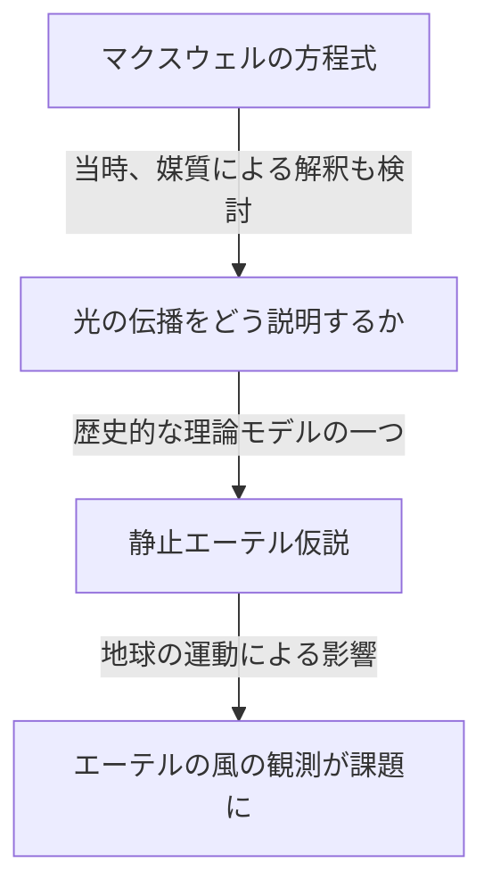

## 1. 序論：宇宙を満たすと信じられた「何か」

人類が自然界の謎を解き明かそうとしてきた歴史の中で、「光がどのようにして空間を伝わるのか」という問いは、古代ギリシャの哲学者から近代の物理学者に至るまで、数多くの天才たちを魅了し、また大いに悩ませてきました。

日常的な物理現象を観察すると、音が伝わるためには「空気」や「水」などの物質が必要であり、海の波が伝わるためには「海水」という媒質が不可欠です。この極めて直感的かつ論理的な類推から、光が波の性質を持つのであれば、光を伝えるための「未知の媒質」が宇宙空間の隅々にまで充満しているはずだという考えが生まれました。この幻の媒質こそが、「光エーテル（Luminiferous aether）」と呼ばれたものです。

エーテルは19世紀の多くの物理学者にとって有力な枠組みでしたが、理論や解釈が一枚岩だったわけではなく、その運動や物質との相互作用をめぐる議論も続いていました。エーテル風を検出しようとした実験と、その後の理論的発展は、古典的な光の媒質という考えを見直す重要な契機となり、相対性理論へつながる科学史の一部をなします。本記事では、この概念の成立、検証、そして現代物理学との違いをたどります。

## 2. 光の本性を巡る論争とエーテルの誕生

光の本質が「粒子」なのか「波」なのかという議論は、17世紀の科学革命の時代に激しく戦わされました。

アイザック・ニュートンは、光の直進性や反射の法則を根拠に、光は微小な粒子の流れであるとする「光の粒子説」を提唱しました。彼の圧倒的な権威により、18世紀を通じて粒子説は物理学界を支配しました。しかし同時代、クリスティアーン・ホイヘンスは、光の回折や屈折などの現象を説明するためには、光を波（波動）とみなすべきだと主張し、「光の波動説」を唱えていました。

19世紀には、ヤングの干渉実験やフレネルの理論などが、光の干渉・回折を波動として説明する強い証拠となりました。ただし、波としての振る舞いが見られることだけから、真空中に機械的な媒質が存在すると論理的に決まるわけではありません。当時は、既知の波には媒質があるという類推から、光を運ぶ媒質としてエーテルを想定する理論が有力になりました。

### エーテルに求められた奇妙な性質

しかし、エーテルという媒質を仮定すると、物理学者たちは深刻な矛盾に直面しました。光は横波（進行方向に対して垂直に振動する波）であることが偏光現象の発見によって判明していました。当時の物理学の枠組みにおいて、横波を伝えることができるのは「固体」のみでした。気体や液体は縦波（音波など）しか伝えられません。

つまり、エーテルは宇宙全体に広がる「巨大な透明の固体」でなければなりません。光の速度（秒速約30万キロメートル）という途方もない速さで波を伝えるためには、エーテルは鋼鉄よりもはるかに硬く、極めて強い弾性を持っている必要があります。その一方で、地球や惑星が太陽の周りを公転する際、エーテルから何の摩擦抵抗も受けていないように見えることから、エーテルは完全に摩擦がなく、物質を抵抗なく通り抜けさせる極めて希薄な性質も持ち合わせていなければなりません。

「鋼鉄よりも硬い固体でありながら、完全な流体のように抵抗がない」という、物理学的にどう考えても矛盾する奇妙な性質を、エーテルは背負わされることになったのです。

## 3. マクスウェル電磁気学とエーテルの絶対静止系

19世紀後半、ジェームズ・クラーク・マクスウェルは電磁気学の基礎となる「マクスウェルの方程式」を完成させました。この方程式は、電気と磁気の現象を完璧に記述するだけでなく、驚くべき予言を含んでいました。電磁波の伝播速度を計算したところ、それが当時の実験で測定されていた「光の速度」と見事に一致したのです。これにより、「光は電磁波の一種である」ことが理論的に証明されました。

マクスウェルの方程式において、光の速度 $c$ は真空の誘電率と透磁率によって決まる定数として導かれます。ここで大きな問題が生じました。「光の速度は定数である」というとき、それは「何に対して」一定なのでしょうか。

ニュートン力学の相対性原理によれば、速度は常に観測者の運動状態に依存して変化するはずです。走る列車から放たれたボールの速度は、地上にいる人から見れば「列車の速度＋ボールの速度」になります。しかし、マクスウェルの方程式における光の速度は、そのような観測者の速度を考慮していませんでした。

当時の多くの理論家は、電磁場を媒質や優先系と結び付ける解釈を検討し、静止エーテルを基準とするモデルも提案しました。一方、マクスウェル方程式そのものが機械的な媒質や絶対静止系の存在を証明しているわけではありません。後の相対論的な定式化では、真空中の光速は慣性系間で不変となり、特権的な静止系を仮定する必要がなくなります。

## 4. マイケルソン・モーリーの実験：有名なヌル結果

もし宇宙空間が絶対静止したエーテルで満たされているなら、太陽の周りを公転する地球は、常にエーテルの海の中を突き進んでいることになります。地球上から見れば、宇宙から「エーテルの風」が吹き付けているはずです。

1887年、アルバート・マイケルソンとエドワード・モーリーは、この「エーテルの風」を捉えるための画期的な実験を行いました。彼らは「マイケルソン干渉計」と呼ばれる極めて精密な光学装置を構築しました。

実験の原理は以下の通りです。光源から放たれた一つの光の束をハーフミラー（半透明の鏡）で直交する二つの方向に分割します。一方はエーテルの風と平行な方向へ、もう一方は垂直な方向へ進み、それぞれの先にある鏡で反射して戻ってきます。もしエーテルの風が存在するなら、川を泳いで往復する人が川の流れの影響を受けるように、光が往復する時間にはごくわずかな差が生じるはずです。戻ってきた二つの光を重ね合わせたとき、その時間の差は「干渉縞」のズレとして観測できると期待されました。

測定では、単純な静止エーテル模型が予測した大きさの干渉縞移動は観測されませんでした。論文が示す期待値は約0.4縞で、報告された残差はその予測より大幅に小さく、著者らは地球とエーテルの相対運動があっても観測限界を大きく下回ると結論しました。「ずれが文字どおり皆無」だったという意味ではなく、特定の古典的エーテル風模型に対するヌル結果として理解するのが正確です。

この実験は、狙った大きさのエーテル風信号を検出できなかったという意味でヌル結果でした。実験装置や測定が「失敗」したという意味ではありません。その重要性は、特定の古典的エーテル模型が予測する信号に強い制約を与え、その後の理論・実験の検討を促した点にあります。

## 5. ローレンツ収縮とアドホックな解決策

実験結果を重く受け止めた物理学者たちは、エーテル理論をどうにか救済しようと苦心しました。ジョージ・フィッツジェラルドやヘンドリック・ローレンツは、驚くべき仮説を立てました。

「物体がエーテルの中を運動すると、エーテルの風の圧力によって、運動の方向に沿って物体そのものがわずかに収縮するのではないか」

この「ローレンツ・フィッツジェラルド収縮仮説」によれば、マイケルソン・モーリーの干渉計の腕も、運動方向に沿って正確に縮むため、光の往復時間の差が相殺され、結果としてエーテルの風が検出できなくなると説明されました。さらにローレンツは、運動する系における時間の遅れ（局所時）の概念も導入し、「ローレンツ変換」と呼ばれる数学的な枠組みを完成させました。

収縮仮説やローレンツの理論は、当時の電磁気学と実験結果を整合させようとする理論的試みでした。後世から「その場しのぎ」とだけ片付けると、当時の理論的・実験的状況を単純化してしまいます。ローレンツは絶対静止エーテルの考えを保ちましたが、同じ数理的枠組みは、後にエーテルの静止系を仮定しない特殊相対論でも中心的な役割を果たしました。

## 6. アインシュタインとパラダイムの転換：特殊相対性理論

1905年、特許局の若き職員であったアルベルト・アインシュタインは、この複雑に絡み合った問題を、たった二つのシンプルな原理から根本的に解決する論文を発表しました。これが「特殊相対性理論」です。

アインシュタインは、エーテルの性質について悩むのをやめ、全く新しい前提から出発しました。
1. **相対性原理**: すべての慣性系（等速直線運動をしている観測者）において、物理法則は全く同じ形で成り立つ。絶対的な静止系など存在しない。
2. **光速度不変の原理**: 真空中の光の速度は、光源の運動状態や観測者の運動状態にかかわらず、すべての観測者にとって常に一定（定数 $c$）である。

この二つの原理を受け入れると、驚くべき結論が導かれます。光速が常に一定であるためには、観測者の運動状態に応じて「空間」が縮み、「時間」の進み方が遅れなければならないのです。ローレンツらが「エーテルによる物質的な収縮」だと考えていた現象は、実は時間と空間そのものの相対的な性質であることが明らかになりました。

1905年の特殊相対論は、電磁気学を記述するために、光を伝える機械的媒質や絶対静止した空間を仮定する必要をなくしました。これは、あらゆる「エーテル」という語の使い方を論理的に禁止したという意味ではありません。アインシュタインは1920年、一般相対論における時空の物理的性質を説明する際に「エーテル」という語を別の意味で論じましたが、それは運動状態を持つ機械的な光媒質ではありません。

## 7. 現代物理学における「真空」：エーテルの亡霊

エーテルは不要な概念として捨て去られましたが、「何もない空間（真空）」が本当に「空っぽ」であるという考えもまた、現代物理学によって否定されています。

量子場の理論では、真空は場の最低エネルギー状態として記述され、場には量子的な揺らぎがあります。「粒子と反粒子が絶えず対生成・対消滅を繰り返す」という表現は、真空を文字どおり粒子が出現・消滅する海のように描くため、正確な説明ではありません。電磁場やヒッグス場などの場と、粒子を場の励起として記述する考え方は、古典的な機械的エーテルとは異なります。

また、一般相対性理論において、アインシュタインは時空そのものが重力によって曲がる動的な実体であると記述しました。アインシュタイン自身も後年、時空そのものが物理的性質を持つという意味において、「新しい意味でのエーテルと呼ぶこともできる」と語ったことがあります（ただし、19世紀の絶対静止媒質としてのエーテルとは全く異なります）。

暗黒物質と暗黒エネルギーを、光を運ぶ媒質という意味でエーテルの現代版と呼ぶのは適切ではありません。暗黒物質は主に重力的影響から推定され、光を放射・吸収・反射しない成分として記述されます。暗黒エネルギーは宇宙の加速膨張を説明するための名称です。いずれも光の伝播媒質として提案されたものではなく、物理的な意味も異なります。

## 8. 結論：科学史が教えてくれること

光エーテルの物語は、科学がどのように進歩するかを示す極めて美しい実例です。

古典的な光エーテルは、現代の特殊相対論で必要とされる光の媒質ではありません。その仮説をめぐる研究は精密な実験と理論的検討を促し、相対論へ至る科学史の一部になりました。ただし、マイケルソン＝モーリー実験だけでエーテルをあらゆる意味で否定したり、単独で相対論を生み出したりしたわけではありません。

科学における失敗や誤った前提は、決して無駄ではありません。それは、未知の領域を照らすための不可欠な足場となります。光エーテルという幻の媒質は、物理学から姿を消しましたが、その探求の過程で人類が得た「時空の真の姿」という知見は、今も私たちの宇宙の理解を支え続けています。
