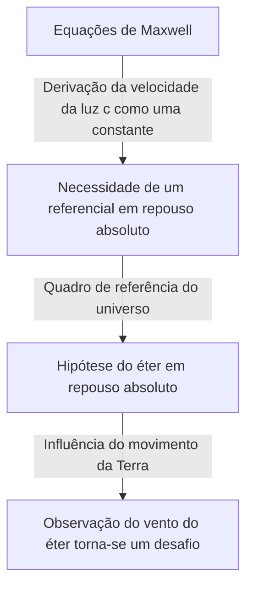

## 1. Introdução: O "Algo" Que Se Acreditava Preencher o Universo

Na história das tentativas da humanidade de desvendar os mistérios da natureza, a pergunta "Como a luz viaja através do espaço?" cativou e também confundiu muitas mentes geniais, desde os antigos filósofos gregos até os físicos modernos.

Observando os fenômenos físicos cotidianos, precisamos de substâncias como "ar" ou "água" para que o som se propague, e o meio "água do mar" é essencial para a propagação das ondas do oceano. A partir dessa analogia extremamente intuitiva e lógica, surgiu a ideia de que, se a luz tem propriedades de onda, deve haver um "meio desconhecido" para transmitir a luz preenchendo cada canto do espaço. Esse meio fantasma era chamado de "éter luminífero" (Luminiferous aether).

Para muitos físicos do século XIX, o éter era um modelo explicativo influente. No entanto, as teorias e interpretações não eram uniformes, e o movimento do éter e a sua interação com a matéria continuavam em debate. As experiências que procuravam detetar o vento do éter, juntamente com desenvolvimentos teóricos posteriores, levaram a reavaliar o meio clássico da luz e fazem parte da história que conduziu à relatividade. Este artigo acompanha a origem e o teste do conceito, distinguindo-o das ideias da física moderna.

## 2. A Disputa Sobre a Natureza da Luz e o Nascimento do Éter

O debate sobre se a essência da luz era uma "partícula" ou uma "onda" foi travado intensamente durante a época da Revolução Científica no século XVII.

Isaac Newton, baseando-se na propagação retilínea da luz e na lei da reflexão, propôs a "teoria corpuscular da luz", que afirmava que a luz é um fluxo de pequenas partículas. Devido à sua esmagadora autoridade, a teoria corpuscular dominou a comunidade física ao longo do século XVIII. No entanto, na mesma época, Christiaan Huygens argumentou que, para explicar fenômenos como a difração e a refração da luz, a luz deveria ser considerada uma onda, defendendo assim a "teoria ondulatória da luz".

No século XIX, as experiências de interferência de Young e a teoria de Fresnel forneceram fortes evidências para explicar a interferência e a difração como comportamento ondulatório da luz. No entanto, esse comportamento, por si só, não demonstra logicamente que exista um meio mecânico no vácuo. Por analogia com as ondas conhecidas, muitas teorias da época propuseram o éter como meio de propagação da luz.

### As Propriedades Bizarras Exigidas do Éter

No entanto, ao assumir o éter como um meio, os físicos enfrentaram uma contradição profunda. Foi descoberto, através dos fenômenos de polarização, que a luz é uma onda transversal (uma onda que vibra perpendicularmente à sua direção de propagação). No arcabouço da física da época, apenas "sólidos" podiam transmitir ondas transversais. Gases e líquidos só podiam transmitir ondas longitudinais (como ondas sonoras).

Em outras palavras, o éter tinha que ser um "gigantesco sólido transparente" que se estendia por todo o universo. Para transmitir ondas na velocidade formidável da luz (cerca de 300.000 quilômetros por segundo), o éter precisava ser muito mais rígido que o aço e ter uma elasticidade extremamente forte. Por outro lado, como a Terra e os planetas não parecem sofrer qualquer resistência de atrito do éter enquanto orbitam o Sol, o éter também deveria ser completamente sem atrito e ter uma propriedade extremamente rarefeita, permitindo que a matéria passasse sem resistência.

O éter foi sobrecarregado com propriedades bizarras e contraditórias em termos de física: "sólido mais rígido que o aço, mas sem resistência, como um fluido perfeito".

## 3. O Eletromagnetismo de Maxwell e o Sistema de Referência Absoluto do Éter

Na segunda metade do século XIX, James Clerk Maxwell completou as "Equações de Maxwell", que formaram a base do eletromagnetismo. Essas equações não apenas descreviam perfeitamente os fenômenos elétricos e magnéticos, mas também continham uma previsão surpreendente. Quando ele calculou a velocidade de propagação das ondas eletromagnéticas, ela correspondeu de forma impressionante à "velocidade da luz" medida em experimentos da época. Isso provou teoricamente que "a luz é um tipo de onda eletromagnética".

Nas equações de Maxwell, a velocidade da luz $c$ é derivada como uma constante determinada pela permissividade e permeabilidade do vácuo. Aqui surgiu um grande problema. Quando dizemos que "a velocidade da luz é uma constante", em relação a "o quê" ela é constante?

De acordo com o princípio da relatividade da mecânica newtoniana, a velocidade deve sempre mudar dependendo do estado de movimento do observador. A velocidade de uma bola lançada de um trem em movimento será "a velocidade do trem + a velocidade da bola" do ponto de vista de uma pessoa no chão. No entanto, a velocidade da luz nas equações de Maxwell não levou em consideração essa velocidade do observador.

Muitos teóricos da época estudaram interpretações que ligavam os campos eletromagnéticos a um meio ou a um referencial privilegiado; algumas incluíam modelos com um éter estacionário. As equações de Maxwell, por si sós, não demonstram a existência de um meio mecânico nem de um referencial em repouso absoluto. Nas formulações relativistas posteriores, a velocidade da luz no vácuo é invariante entre referenciais inerciais, pelo que não é necessário postular um referencial privilegiado em repouso.

## 4. O Experimento de Michelson-Morley: Um Resultado Nulo Famoso

Se o espaço sideral estivesse preenchido com éter em repouso absoluto, a Terra, orbitando o Sol, estaria constantemente avançando através do mar de éter. Visto da Terra, deveria haver um "vento de éter" soprando do espaço.

Em 1887, Albert Michelson e Edward Morley conduziram um experimento revolucionário para capturar este "vento de éter". Eles construíram um dispositivo óptico extremamente preciso chamado "interferômetro de Michelson".

O princípio do experimento era o seguinte. Um feixe de luz emitido por uma fonte de luz é dividido em duas direções ortogonais por um espelho semitransparente (half mirror). Uma viaja paralelamente ao vento do éter e a outra viaja perpendicularmente, e ambas retornam após serem refletidas pelos espelhos em suas respectivas extremidades. Se o vento do éter existisse, deveria haver uma diferença minúscula no tempo de ida e volta da luz, assim como alguém nadando para frente e para trás em um rio seria afetado pela correnteza do rio. Quando os dois feixes de luz retornassem e se sobrepusessem, esperava-se que essa diferença de tempo pudesse ser observada como um deslocamento das "franjas de interferência".

As medições não detectaram um deslocamento das franjas de interferência da magnitude prevista por um modelo simples de éter estacionário. O artigo indica um deslocamento esperado de cerca de 0,4 franja; o desvio residual relatado foi muito menor. Os autores concluíram que qualquer movimento relativo entre a Terra e o éter ficava muito abaixo do nível de detecção esperado. Isso não significa que o deslocamento fosse literalmente zero: é mais rigoroso compreender o resultado como nulo para um modelo clássico específico de vento do éter.

O resultado foi nulo no sentido de que o experimento não detectou um sinal de vento do éter da magnitude prevista. Isso não significa que o aparelho ou as medições tenham "falhado". Sua importância está em limitar o sinal previsto por um modelo clássico específico do éter e em estimular trabalho teórico e experimental posterior.

## 5. Contração de Lorentz e Soluções Ad Hoc

Os físicos, que levaram a sério os resultados experimentais, lutaram de alguma forma para salvar a teoria do éter. George FitzGerald e Hendrik Lorentz criaram uma hipótese surpreendente.

"Quando um objeto se move através do éter, será que o próprio objeto se contrai ligeiramente ao longo da direção do movimento devido à pressão do vento do éter?"

De acordo com esta "hipótese de contração de Lorentz-FitzGerald", o braço do interferômetro de Michelson-Morley também se contrairia com precisão ao longo da direção do movimento, compensando a diferença no tempo de ida e volta da luz, e isso explicava por que o vento do éter não pôde ser detectado. Além disso, Lorentz introduziu o conceito de dilatação do tempo (tempo local) em sistemas em movimento e completou a estrutura matemática chamada "transformação de Lorentz".

A hipótese da contração e a teoria de Lorentz foram tentativas de conciliar a eletrodinâmica e os experimentos da época. Reduzi-las, em retrospectiva, a meras soluções ad hoc simplifica em excesso esse contexto teórico e experimental. Lorentz manteve a ideia de um éter em repouso absoluto; no entanto, o mesmo quadro matemático tornou-se depois central também na relatividade restrita, que não pressupõe um referencial de repouso do éter.

## 6. Einstein e a Mudança de Paradigma: A Teoria da Relatividade Restrita

Em 1905, Albert Einstein, um jovem funcionário do escritório de patentes, publicou um artigo que resolveu fundamentalmente este problema complexo a partir de apenas dois princípios simples. Esta foi a "Teoria da Relatividade Restrita".

Einstein parou de se preocupar com as propriedades do éter e partiu de premissas completamente novas.
1. **Princípio da Relatividade**: As leis da física se mantêm exatamente na mesma forma em todos os sistemas inerciais (observadores em movimento retilíneo uniforme). Não existe um sistema em repouso absoluto.
2. **Princípio da Constância da Velocidade da Luz**: A velocidade da luz no vácuo é sempre constante (constante $c$) para todos os observadores, independentemente do estado de movimento da fonte de luz ou do estado de movimento do observador.

Aceitar esses dois princípios levou a conclusões surpreendentes. Para que a velocidade da luz fosse sempre constante, o "espaço" teria que encolher e o avanço do "tempo" teria que desacelerar dependendo do estado de movimento do observador. Tornou-se claro que o fenômeno que Lorentz e outros consideravam como "contração material devido ao éter" era, na verdade, uma propriedade relativa do próprio tempo e espaço.

A relatividade restrita, tal como Einstein a apresentou em 1905, eliminou a necessidade de pressupor um meio mecânico para a luz ou um espaço absolutamente estacionário ao descrever a eletrodinâmica. Isso não proíbe logicamente todos os usos da palavra "éter". Em 1920, Einstein empregou o termo em outro sentido ao discutir as propriedades físicas do espaço-tempo na relatividade geral; não se referia a um meio mecânico para a luz com um estado de movimento.

## 7. O "Vácuo" na Física Moderna: O Fantasma do Éter

Embora o éter tenha sido descartado como um conceito desnecessário, a ideia de que o "espaço vazio (vácuo)" é verdadeiramente "vazio" também foi rejeitada pela física moderna.

Na teoria quântica de campos, o vácuo é descrito como o estado de menor energia dos campos, que apresentam flutuações quânticas. Dizer que partículas e antipartículas estão constantemente a ser criadas e aniquiladas pode representar erradamente o vácuo como um mar literal de partículas que aparecem e desaparecem sem cessar. Os campos, como o eletromagnético e o de Higgs, e a descrição das partículas como excitações desses campos são distintos de um éter mecânico clássico.

Além disso, na teoria da relatividade geral, Einstein descreveu que o próprio espaço-tempo é uma entidade dinâmica que é curvada pela gravidade. O próprio Einstein disse mais tarde que, no sentido de que o próprio espaço-tempo possui propriedades físicas, "pode ser chamado de éter em um novo sentido" (embora seja completamente diferente do éter como um meio em repouso absoluto do século XIX).

Não é correto chamar a matéria escura ou a energia escura de versões modernas de um éter que transporta a luz. A matéria escura é inferida sobretudo pelos seus efeitos gravitacionais e é descrita como algo que não emite, absorve nem reflete luz. Energia escura é o nome dado ao que explicaria a expansão acelerada do Universo. Nenhuma delas foi proposta como meio para a luz, e os seus significados físicos são diferentes.

## 8. Conclusão: O Que a História da Ciência Nos Ensina

A história do éter luminífero é um exemplo supremamente belo de como a ciência progride.

A relatividade restrita moderna não precisa do éter luminífero clássico como meio para a luz. A investigação motivada por essa hipótese estimulou experiências precisas e trabalho teórico, tornando-se parte da história que conduziu à relatividade. Por si só, a experiência de Michelson-Morley não refutou todos os sentidos possíveis da palavra "éter" nem produziu a teoria da relatividade.

Falhas e premissas errôneas na ciência nunca são em vão. Elas servem como andaimes essenciais para iluminar territórios desconhecidos. O meio fantasma do éter luminífero desapareceu da física, mas o conhecimento da "verdadeira natureza do espaço-tempo" que a humanidade obteve no processo dessa busca continua a sustentar a nossa compreensão do universo até hoje.
